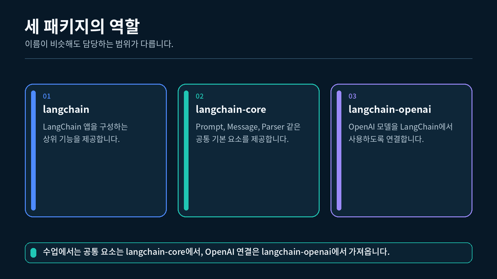
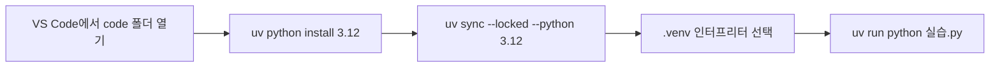
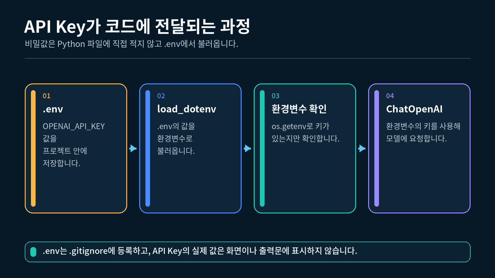

## 1. LangChain 패키지 구조 이해하기

LangChain은 하나의 거대한 패키지에 모든 모델 제공자의 코드를 넣지 않습니다. 공통 기능과 제공자별 연결 코드를 나누어 관리합니다.

휴대전화와 충전기에 비유하면 `langchain-core`는 여러 제품이 함께 따르는 연결 규격이고, `langchain-openai`는 그 규격에 맞춘 OpenAI용 어댑터입니다. `langchain`은 이 구성 요소들을 더 큰 애플리케이션으로 묶을 때 사용하는 상위 기능을 제공합니다.

LangChain 패키지별 역할



### 1.1 수업에서 사용하는 패키지

| 설치 이름 | 역할 | 대표 import |
| --- | --- | --- |
| `langchain` | 상위 수준의 LangChain 기능을 제공합니다. | 후속 장에서 필요한 기능 |
| `langchain-core` | Prompt, Message, Parser 등 공통 구성 요소를 제공합니다. | `from langchain_core...` |
| `langchain-openai` | OpenAI 모델을 LangChain ChatModel로 연결합니다. | `from langchain_openai import ChatOpenAI` |
| `openai` | OpenAI API를 직접 호출하는 공식 Python SDK입니다. | `from openai import OpenAI` |
| `python-dotenv` | 로컬 `.env` 파일을 환경변수로 불러옵니다. | `from dotenv import load_dotenv` |

`python-dotenv`는 LangChain 패키지가 아닙니다. 로컬 개발 환경에서 API Key를 코드 밖에 보관하기 위해 함께 사용하는 도구입니다.

### 1.2 설치 이름과 import 이름

패키지 설치 이름에는 하이픈이 들어가지만 Python import 이름에는 언더스코어가 들어갈 수 있습니다.

```
설치: langchain-core
import: langchain_core

설치: langchain-openai
import: langchain_openai

설치: python-dotenv
import: dotenv
```

이 차이를 모르면 설치는 성공했는데 import가 실패했다고 오해하기 쉽습니다.

---

## 2. 프로젝트 폴더와 VS Code 준비하기

### 2.1 프로젝트 폴더 열기

아래의 수정된 환경 실습 ZIP을 내려받아 압축을 풀고, `pyproject.toml`과 `uv.lock`이 들어 있는 `code` 폴더를 VS Code에서 엽니다.

1. VS Code를 실행합니다.
2. `File → Open Folder`를 선택합니다.
3. 최상위 폴더를 선택합니다.

파일 하나만 여는 것보다 프로젝트 폴더 전체를 여는 것이 중요합니다. 그래야 `.env`, `.venv`, 각 강의 파일을 하나의 프로젝트로 관리할 수 있습니다.

### 2.2 Python 확장 확인

VS Code 왼쪽 Extensions에서 Microsoft의 Python 확장이 설치되어 있는지 확인합니다. 이 확장은 Python 인터프리터 선택, 코드 실행, 오류 표시를 담당합니다.

### 2.3 통합 터미널 열기

VS Code 상단 메뉴에서 `Terminal → New Terminal`을 선택합니다. 터미널의 현재 경로가 프로젝트 최상위 폴더인지 확인하세요.

```powershell
# 현재 터미널이 가리키는 폴더를 출력합니다.
Get-Location
```

출력된 경로의 마지막 폴더가 현재 프로젝트 이름이면 다음 단계로 진행합니다.

---

## 3. uv로 Python 3.12 환경 준비하기

uv는 Python 버전, 프로젝트 의존성, 실행 환경을 함께 관리합니다. 프로젝트마다 만들어지는 `.venv`에 패키지를 설치하므로 수업 간 버전 충돌을 줄일 수 있습니다.

### 3.1 uv 설치 확인

```powershell
uv --version
```

명령을 찾지 못하면 uv 공식 설치 안내의 Windows 방법으로 설치합니다. Windows Package Manager를 사용하는 경우 다음과 같이 실행합니다.

```powershell
winget install --id=astral-sh.uv -e
```

설치 후 VS Code를 다시 열고 새 터미널에서 `uv --version`을 확인합니다.

### 3.2 Python 3.12 준비

```powershell
uv python install 3.12
uv python find 3.12
```

배포 ZIP의 `.python-version`은 `3.12`이며, `pyproject.toml`의 `requires-python = ">=3.12,<3.13"`으로 수업 버전을 제한합니다.

### 3.3 프로젝트 환경 생성

```powershell
# pyproject.toml과 uv.lock이 있는 code 폴더에서 실행합니다.
uv sync --locked --python 3.12
```

uv가 프로젝트의 `.venv`를 만들고 잠금 파일의 패키지를 설치합니다. `Activate.ps1` 실행이나 PowerShell 실행 정책 변경은 수업 필수 단계가 아닙니다.



### 3.4 실행 Python 확인

```powershell
uv run python --version
uv run python -c "import sys; print(sys.executable)"
```

버전은 `Python 3.12.x`, 실행 경로는 현재 프로젝트의 `.venv\Scripts\python.exe`여야 합니다.

---

## 4. 패키지 설치하고 확인하기

### 4.1 수업 기준 버전

| 항목 | 버전 |
| --- | --- |
| Python | `3.12` |
| `langchain` | `1.3.14` |
| `langchain-core` | `1.5.1` |
| `langchain-openai` | `1.4.1` |
| `openai` | `2.48.0` |
| `python-dotenv` | `1.2.2` |
| `pydantic` | `2.13.5` |

버전을 고정하면 강사와 수강생이 같은 API와 import 경로를 사용할 수 있습니다.

### 4.2 패키지 설치와 버전 고정

수강생은 배포된 `pyproject.toml`과 `uv.lock`을 함께 사용합니다. 이미 3.3을 실행했다면 설치가 완료된 상태입니다.

```powershell
uv sync --locked --python 3.12
```

`pyproject.toml`에는 직접 사용하는 패키지와 Python 조건이, `uv.lock`에는 간접 의존성까지 해석된 버전이 기록됩니다. 두 파일과 `.python-version`을 함께 보관합니다.

**직접 새 프로젝트를 만드는 경우에만** `pyproject.toml`이 없는 새 폴더에서 아래 명령을 사용합니다. 배포 ZIP에 다시 `uv init`을 실행하지 않습니다.

```powershell
uv init --bare --python 3.12
uv python pin 3.12
uv add "langchain==1.3.14" "langchain-core==1.5.1" "langchain-openai==1.4.1" "openai==2.48.0" "python-dotenv==1.2.2" "pydantic==2.13.5"
```

새 프로젝트의 `requires-python`도 `">=3.12,<3.13"`으로 맞춘 뒤 `uv lock`을 실행합니다. 패키지를 추가하거나 바꿀 때는 `uv add`로 설정과 잠금 파일을 함께 갱신합니다.

### 4.3 의존성 충돌 확인

```powershell
uv pip check
```

정상이라면 `All installed packages are compatible`이 표시됩니다. 충돌이 있으면 수업 배포 파일을 확인하고 `uv sync --locked`로 다시 맞춥니다.

### 4.4 import 확인

```python
# LangChain의 공통 Prompt 클래스를 가져옵니다.
from langchain_core.prompts import ChatPromptTemplate

# OpenAI 전용 ChatModel 클래스를 가져옵니다.
from langchain_openai import ChatOpenAI

# 두 import가 모두 성공했음을 알립니다.
print("LangChain import 성공")
```

`ModuleNotFoundError`가 나오면 패키지 설치보다 VS Code 인터프리터 선택을 먼저 확인해야 합니다.

---

## 5. API Key를 `.env`로 관리하기

API Key는 계정의 사용 권한과 비용을 발생시킬 수 있는 비밀값입니다. Python 파일에 직접 적으면 화면 공유, Git 업로드, 파일 전달 과정에서 노출될 수 있습니다.

API Key가 코드 밖에서 모델로 전달되는 흐름



### 5.1 프로젝트 루트에 `.env` 만들기

VS Code Explorer에서 최상위 프로젝트 폴더를 선택한 뒤 새 파일 `.env`를 만듭니다.

```
# 발급받은 실제 OpenAI API Key를 등호 오른쪽에 입력합니다.
OPENAI_API_KEY=여기에_실제_API_Key_입력

# 수업에서 사용할 기본 모델명을 지정합니다.
OPENAI_MODEL=gpt-5.6-luna
```

따옴표는 없어도 됩니다. 등호 앞뒤에 불필요한 공백을 넣지 마세요. 기존 `.env`를 재사용하면 `OPENAI_MODEL`도 직접 수정하세요. 이미 터미널에 설정된 환경변수는 `load_dotenv()`의 기본 동작에서 `.env`보다 우선합니다.

기본 권장 모델의 정확한 API ID는 `gpt-5.6-luna`입니다. 계정의 사용 권한과 비용은 공식 모델 안내에서 확인합니다. 교안의 실습은 `reasoning_effort="none"`과 Chat Completions를 기준으로 하며 `temperature`는 지정하지 않습니다.

> API Key 값을 교안, 채팅, 캡처 화면, 과제 제출물에 넣지 마세요. 이미 노출된 키는 문자열 일부를 가리는 것으로 해결되지 않으므로 폐기하고 새 키를 발급해야 합니다.
> 

### 5.2 `.gitignore` 만들기

같은 최상위 폴더에 `.gitignore` 파일을 만들고 다음 내용을 입력합니다.

```
# API Key가 들어 있는 로컬 환경 파일을 Git 추적에서 제외합니다.
.env

# 프로젝트 전용 가상환경을 Git 추적에서 제외합니다.
.venv/

# Python이 자동으로 만드는 캐시 폴더를 제외합니다.
__pycache__/
```

`.gitignore`는 앞으로의 Git 추적을 막는 파일입니다. 이미 Git에 올라간 API Key를 자동으로 지우거나 무효화하지는 않습니다.

### 5.3 Python에서 `.env` 읽기

```python
# 운영체제 환경변수를 읽기 위해 os를 가져옵니다.
import os

# .env 값을 현재 Python 프로세스의 환경변수로 불러옵니다.
from dotenv import load_dotenv

# 현재 파일 위치에서 상위 폴더를 탐색해 가장 가까운 .env를 읽습니다.
load_dotenv()

# API Key 값을 화면에 출력하지 않고 존재 여부만 확인합니다.
api_key_is_ready = bool(os.getenv("OPENAI_API_KEY"))

# 키가 준비되었는지 True 또는 False로만 출력합니다.
print(api_key_is_ready)
```

정상적으로 설정했다면 `True`가 출력됩니다.

---

## 6. VS Code 인터프리터 선택하기

`uv run`이 사용하는 Python과 VS Code 편집기·실행 버튼이 사용하는 Python을 일치시키기 위해 다음 순서로 프로젝트의 `.venv`를 선택합니다.

1. `Ctrl + Shift + P`를 누릅니다.
2. `Python: Select Interpreter`를 검색합니다.
3. 경로에 `.venv\Scripts\python.exe`가 들어 있는 항목을 선택합니다.
4. VS Code 오른쪽 아래 또는 상태 표시줄의 Python 버전을 확인합니다.
5. 기존 터미널을 닫고 새 터미널을 엽니다.

선택한 인터프리터는 다음 코드로 다시 확인할 수 있습니다.

```python
# 현재 파일을 실행하는 Python의 전체 경로를 확인하기 위해 sys를 가져옵니다.
import sys

# 출력 경로에 .venv가 포함되어 있는지 확인합니다.
print(sys.executable)
```

---

## 7. 기본 ChatModel 호출하기

환경 설정이 끝났으면 가장 작은 실제 모델 호출을 실행합니다.

```python
# 환경변수를 사용하기 위해 os와 load_dotenv를 가져옵니다.
import os
from dotenv import load_dotenv

# OpenAI 모델을 LangChain ChatModel로 사용하는 클래스를 가져옵니다.
from langchain_openai import ChatOpenAI

# 프로젝트의 .env 값을 현재 Python 프로세스로 불러옵니다.
load_dotenv()

# 모델명은 .env에서 읽고, 없으면 수업 기본값을 사용합니다.
model_name = os.getenv("OPENAI_MODEL", "gpt-5.6-luna")

# ChatOpenAI는 OPENAI_API_KEY 환경변수를 사용해 인증합니다.
model = ChatOpenAI(
    model=model_name,
    reasoning_effort="none",
    use_responses_api=False,
    max_completion_tokens=600,
    timeout=30,
    max_retries=0,
)

# 짧은 질문을 한 번 보내 AIMessage 응답을 받습니다.
response = model.invoke("LangChain을 한 문장으로 소개해 주세요.")

# AIMessage의 텍스트 본문을 출력합니다.
print(response.content)
```

모델이 생성한 문장은 매번 조금 달라질 수 있습니다. 중요한 것은 인증 오류 없이 문자열 답변이 나온다는 점입니다.

### AIMessage란

`model.invoke()`는 단순 문자열이 아니라 `AIMessage`를 반환합니다. 지금은 `response.content`에서 본문만 확인합니다. 2-2강에서는 Parser를 붙여 이 응답을 문자열, 리스트, 딕셔너리로 바꿉니다.

---

## 8. 완성 실습 실행하기

이 강의의 `실습.py`는 다음 순서로 환경을 확인합니다.

```
현재 Python 경로 확인
→ 핵심 패키지 버전 확인
→ API Key 설정 여부 확인
→ ChatOpenAI 실제 호출 1회
```

### 8.1 실행

```powershell
# VS Code에서 연 code 폴더의 터미널에서 먼저 오프라인 검사합니다.
uv run python 실습.py --offline

# .env에 API 키를 설정한 뒤 실제 API를 한 번 호출합니다.
uv run python 실습.py
```

### 8.2 정상 출력 구조

"""VS Code + uv + Python 3.12 환경 검사. --offline은 API를 호출하지 않습니다."""
import argparse
import os
import sys
from importlib.metadata import version
from pathlib import Path

from dotenv import load_dotenv
from langchain_core.prompts import ChatPromptTemplate
from langchain_openai import ChatOpenAI

EXPECTED = {
    "langchain": "1.3.14",
    "langchain-core": "1.5.1",
    "langchain-openai": "1.4.1",
    "openai": "2.48.0",
    "python-dotenv": "1.2.2",
    "pydantic": "2.13.5",
}


def main():
    parser = argparse.ArgumentParser(description=__doc__)
    parser.add_argument("--offline", action="store_true")
    args = parser.parse_args()
    load_dotenv(Path(__file__).resolve().parent / ".env")
    print("[Python 환경]")
    print("- 실행 파일:", sys.executable)
    print("- 버전:", sys.version.split()[0])
    if sys.version_info[:2] != (3, 12):
        raise SystemExit("Python 3.12가 필요합니다. uv sync --locked --python 3.12를 실행하세요.")
    print("\n[패키지 확인]")
    mismatch = False
    for package, expected in EXPECTED.items():
        actual = version(package)
        ok = actual == expected
        mismatch |= not ok
        print(f"- {package}: {actual} (기준 {expected}) [{'OK' if ok else '불일치'}]")
    if mismatch:
        raise SystemExit("배포된 uv.lock을 이용해 uv sync --locked를 실행하세요.")
    prompt = ChatPromptTemplate.from_messages([("human", "{question}")])
    assert prompt.invoke({"question": "환경 검사"}).to_messages()[0].content == "환경 검사"
    model_name = os.getenv("OPENAI_MODEL", "gpt-5.6-luna").strip()
    key_ready = bool(os.getenv("OPENAI_API_KEY", "").strip())
    print("\n[환경변수 확인]")
    print("- OPENAI_API_KEY:", "설정됨" if key_ready else "설정되지 않음")
    print("- OPENAI_MODEL:", model_name)
    if args.offline:
        print("\n오프라인 환경 검사를 통과했습니다. 실제 API 호출은 생략했습니다.")
        return
    if not key_ready:
        print("\n.env에 수업용 API 키를 설정한 뒤 다시 실행하세요. 실제 API는 호출하지 않았습니다.")
        return
    if not model_name:
        raise SystemExit(".env의 OPENAI_MODEL을 입력하세요.")
    model = ChatOpenAI(
        model=model_name, reasoning_effort="none", use_responses_api=False,
        max_completion_tokens=600, timeout=30, max_retries=0,
    )
    response = model.invoke("LangChain을 한 문장으로 소개해 주세요.")
    if not isinstance(response.content, str) or not response.content.strip():
        raise RuntimeError("텍스트 답변이 비어 있습니다. 모델 설정과 응답을 확인하세요.")
    print("\n[실제 모델 호출]")
    print(response.content)
    print("\n환경 설정과 기본 ChatModel 호출이 완료되었습니다.")


if __name__ == "__main__":
    main()


```
[Python 환경]
- 실행 파일: ...\.venv\Scripts\python.exe
- 버전: 3.12.x

[패키지 확인]
- langchain: 1.3.14 (기준 1.3.14) [OK]
...

[환경변수 확인]
- OPENAI_API_KEY: 설정됨
- OPENAI_MODEL: gpt-5.6-luna

[실제 모델 호출]
모델이 생성한 한 문장

환경 설정과 기본 ChatModel 호출이 완료되었습니다.
```

API Key가 없으면 실제 호출 전에 안내 문구를 출력하고 종료합니다. `--offline`은 키가 있어도 API를 호출하지 않습니다. Python 3.12 의존성 설치와 오프라인 검사는 확인했으며, 실제 API 응답은 수강생의 유효한 API 키로 확인해야 합니다.