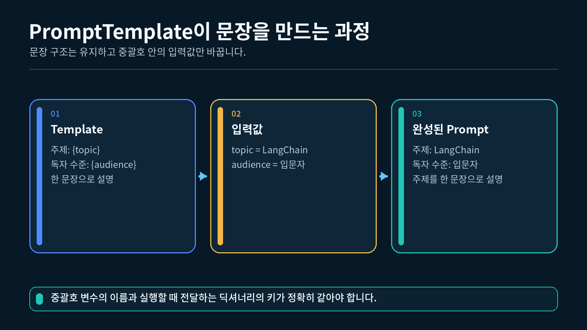
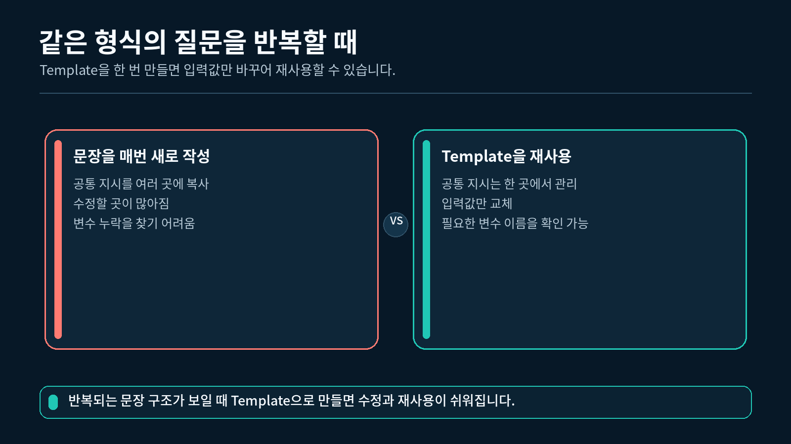
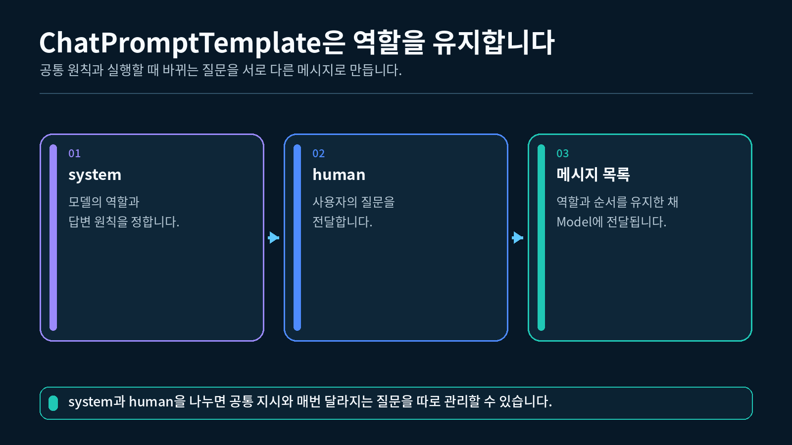

## 1. Prompt와 Template 이해하기

Prompt는 모델에게 전달하는 지시와 입력을 뜻합니다. 매번 Prompt 전체를 새로 작성할 수도 있지만, 반복되는 문장이 많아지면 오타가 생기고 답변 원칙을 한꺼번에 바꾸기 어려워집니다.

Template은 편지 양식과 비슷합니다. 인사말과 문장 구조는 그대로 두고 받는 사람의 이름이나 날짜만 바꾸어 여러 편지를 만들 수 있습니다.

```
고정 문장: 독자 수준에 맞춰 다음 글을 요약하세요.
바뀌는 값: audience = "파이썬 입문자"
```

중괄호로 표시한 `{audience}`가 **입력 변수**입니다. 실행할 때 실제 값을 넣으면 완성된 Prompt가 만들어집니다.

### Template을 사용하는 이유

- 공통 지시문을 한 곳에서 관리할 수 있습니다.
- 질문이나 문서만 바꾸어 같은 형식을 재사용할 수 있습니다.
- 어떤 입력값이 필요한지 변수 이름으로 확인할 수 있습니다.
- 역할 기반 메시지의 순서를 일정하게 유지할 수 있습니다.

---

## 2. PromptTemplate으로 문자열 만들기

`PromptTemplate`은 하나의 문자열 Prompt를 만드는 데 사용합니다.



PromptTemplate에 입력 변수가 들어가는 흐름

### 2.1 가장 작은 PromptTemplate

```python
# 일반 문자열 Prompt를 만드는 PromptTemplate을 가져옵니다.
from langchain_core.prompts import PromptTemplate

# topic과 audience가 실행할 때 바뀌는 입력 변수입니다.
template = PromptTemplate.from_template(
    "주제:{topic}\n"
    "독자 수준:{audience}\n"
    "주제를 한 문장으로 설명하세요."
)

# 두 입력 변수에 실제 값을 넣어 완성된 문자열을 만듭니다.
formatted_prompt = template.format(
    topic="LangChain",
    audience="파이썬 입문자",
)

# 변수 치환이 끝난 문자열을 출력합니다.
print(formatted_prompt)
```

실행 결과는 다음과 같습니다.

```
주제: LangChain
독자 수준: 파이썬 입문자
주제를 한 문장으로 설명하세요.
```

`from_template()`은 문자열 안의 `{topic}`, `{audience}`를 입력 변수로 찾습니다. `format()`은 각 변수에 값을 넣어 일반 문자열을 반환합니다.

### 2.2 여러 줄 Prompt 만들기

요약할 문서처럼 입력이 길어질 때는 문자열을 여러 줄로 나누면 읽기 쉽습니다.

```python
# audience와 text를 입력으로 받는 여러 줄 템플릿을 만듭니다.
summary_template = PromptTemplate.from_template(
    "독자 수준:{audience}\n"
    "다음 글을 독자 수준에 맞춰 세 문장으로 요약하세요.\n"
    "글:{text}"
)

# 요약 대상과 독자 수준을 실행 시점에 전달합니다.
summary_prompt = summary_template.format(
    audience="파이썬 입문자",
    text="LangChain은 프롬프트, 모델, 파서를 연결해 LLM 앱을 구성합니다.",
)

# 모델에 보내기 전 완성된 Prompt를 확인합니다.
print(summary_prompt)
```

```
독자 수준: 파이썬 입문자
다음 글을 독자 수준에 맞춰 세 문장으로 요약하세요.
글: LangChain은 프롬프트, 모델, 파서를 연결해 LLM 앱을 구성합니다.
```

입력값 앞에 `독자 수준:`이라는 이름을 붙이면 값이 바뀌어도 한국어 조사가 어색해지지 않습니다. Template은 값을 정확히 치환하지만 문장의 자연스러움이나 내용의 사실성까지 자동으로 확인하지는 않습니다. 완성된 Prompt를 모델 호출 전에 직접 읽어 보는 습관이 중요합니다.

---

## 3. 입력 변수 바꾸어 재사용하기

Template의 장점은 입력값만 바꾸어 같은 구조를 여러 번 사용할 수 있다는 점입니다.

```python
# 한 번 만든 템플릿을 여러 topic에 재사용합니다.
explain_template = PromptTemplate.from_template(
    "{topic}의 핵심 역할을 초보자도 이해할 수 있게 설명하세요."
)

# 같은 형식으로 질문할 주제를 목록에 담습니다.
topics = ["Prompt", "Model", "Parser"]

# Template은 유지하고 topic 값만 하나씩 바꿉니다.
for topic in topics:
    # 현재 topic을 넣어 완성된 Prompt 문자열을 만듭니다.
    prompt_text = explain_template.format(topic=topic)

    # 각 실행에서 달라진 결과를 확인합니다.
    print(prompt_text)
```

```
Prompt의 핵심 역할을 초보자도 이해할 수 있게 설명하세요.
Model의 핵심 역할을 초보자도 이해할 수 있게 설명하세요.
Parser의 핵심 역할을 초보자도 이해할 수 있게 설명하세요.
```

한 번 만든 Template을 여러 입력에 재사용



### 입력 변수 이름 확인하기

어떤 값을 전달해야 하는지 기억나지 않을 때는 `input_variables`를 확인할 수 있습니다.

```python
# Template이 요구하는 입력 변수 이름을 확인합니다.
required_variables = explain_template.input_variables

# 현재 템플릿에서는 topic 하나가 출력됩니다.
print(required_variables)
```

```
['topic']
```

변수 이름은 대소문자까지 정확히 일치해야 합니다.

---

## 4. ChatPromptTemplate으로 역할 나누기

`PromptTemplate`은 최종 결과가 하나의 문자열입니다. 반면 `ChatPromptTemplate`은 system, human 같은 **메시지 역할을 유지**합니다.



ChatPromptTemplate의 system과 human 역할

### 4.1 system과 human

- `system`: 모델이 모든 질문에 공통으로 따를 역할과 답변 원칙
- `human`: 사용자가 현재 실행에서 전달하는 질문이나 요청

역할을 구분하면 고정 지시와 사용자 입력을 한 문자열에 섞지 않고 관리할 수 있습니다.

OpenAI SDK의 `user` 역할과 LangChain의 `human` 역할은 모두 사용자의 질문을 나타냅니다. 이 강의에서는 LangChain의 이름인 `human`을 사용합니다.

### 4.2 ChatPromptTemplate 만들기

```python
# 역할 기반 Prompt를 만드는 ChatPromptTemplate을 가져옵니다.
from langchain_core.prompts import ChatPromptTemplate

# system과 human 메시지를 전달 순서대로 정의합니다.
chat_template = ChatPromptTemplate.from_messages(
    [
        (
            "system",
            "당신은{subject} 입문 수업의 튜터입니다. "
            "전문 용어를 먼저 풀어 쓰고 간단한 예시를 덧붙이세요.",
        ),
        (
            "human",
            "{question}",
        ),
    ]
)
```

`subject`와 `question`은 실행할 때 값을 넣는 입력 변수입니다.

### 4.3 역할별 메시지 확인하기

```python
# 두 변수에 실제 값을 넣어 역할별 메시지 목록을 만듭니다.
messages = chat_template.format_messages(
    subject="LangChain",
    question="PromptTemplate을 사용하는 이유가 무엇인가요?",
)

# 모델에 전달될 순서대로 역할과 본문을 출력합니다.
for message in messages:
    print(f"역할:{message.type}")
    print(f"내용:{message.content}")
```

```
역할: system
내용: 당신은 LangChain 입문 수업의 튜터입니다. 전문 용어를 먼저 풀어 쓰고 간단한 예시를 덧붙이세요.
역할: human
내용: PromptTemplate을 사용하는 이유가 무엇인가요?
```

`format_messages()`의 결과는 메시지 객체 목록입니다. 첫 번째 메시지는 system 역할이고 두 번째 메시지는 human 역할입니다.

### 4.4 질문만 바꾸어 재사용하기

```python
# 같은 답변 원칙을 적용할 두 질문을 준비합니다.
questions = [
    "Model은 어떤 일을 하나요?",
    "Output Parser는 왜 필요한가요?",
]

# ChatPromptTemplate은 한 번만 만들고 질문만 바꿉니다.
for question in questions:
    # subject는 유지하고 현재 question만 전달합니다.
    messages = chat_template.format_messages(
        subject="LangChain",
        question=question,
    )

    # 마지막 human 메시지가 현재 질문으로 바뀌었는지 확인합니다.
    print(messages[-1].content)
```

공통 역할과 답변 원칙을 바꾸고 싶다면 system 메시지 한 곳만 수정하면 됩니다.

---

## 5. 두 Template 비교하기

| 비교 항목 | `PromptTemplate` | `ChatPromptTemplate` |
| --- | --- | --- |
| 결과 형태 | 하나의 문자열 | 역할별 메시지 목록 |
| 역할 구분 | 문자열 안에서 직접 표현 | system, human 역할로 보존 |
| 적합한 상황 | 단순 텍스트 생성, 문자열 가공 | 채팅 모델에 역할별 메시지 전달 |
| 이번 강의 메서드 | `format()` | `format_messages()` |

### 어떤 Template을 선택할까

OpenAI의 ChatModel처럼 역할별 메시지를 입력으로 받는 모델에는 `ChatPromptTemplate`이 자연스럽습니다. 단순히 하나의 문자열을 만들거나 파일에 저장할 문장을 조립할 때는 `PromptTemplate`이 간단합니다.

둘 중 하나가 항상 더 좋은 것은 아닙니다. 다음 단계가 어떤 입력을 받는지 보고 선택하세요.

### Template이 하지 않는 일

Template은 다음 작업을 자동으로 처리하지 않습니다.

- 모델 API 호출
- 모델 답변의 사실성 확인
- 사용자 입력의 개인정보 제거
- 결과를 리스트나 JSON으로 변환

이번 강의에서는 **모델 호출 전 메시지를 만드는 역할**에만 집중합니다.

---

## 6. 완성 실습 실행하기

`실습.py`는 API Key 없이 실행할 수 있습니다. 다음 세 단계를 순서대로 확인합니다.

```
PromptTemplate으로 문자열 만들기
→ ChatPromptTemplate으로 역할별 메시지 만들기
→ 같은 ChatPromptTemplate에 질문만 바꾸어 재사용하기
```

### 6.1 실행

1-2강에서 만든 `pyproject.toml`과 `uv.lock`이 있는 프로젝트의 하위 폴더에 `실습.py`를 두고, 해당 폴더에서 실행합니다. VS Code 인터프리터는 이 프로젝트의 `.venv` (Python 3.12)를 선택합니다.

```powershell
# 2-1강 폴더에서 uv가 관리하는 Python 3.12으로 실습을 실행합니다.
uv run python 실습.py
```
"""2-1강: PromptTemplate과 ChatPromptTemplate의 결과를 비교합니다."""

from langchain_core.prompts import ChatPromptTemplate, PromptTemplate


def build_summary_template() -> PromptTemplate:
    """문서 요약 지시문을 재사용할 수 있는 문자열 템플릿으로 만듭니다."""

    # audience와 text가 실행할 때마다 바뀌는 입력 변수입니다.
    template_text = (
        "독자 수준: {audience}\n"
        "다음 글을 독자 수준에 맞춰 세 문장으로 요약하세요.\n"
        "글: {text}"
    )

    # 문자열 안의 중괄호 변수를 LangChain이 관리하도록 템플릿 객체를 만듭니다.
    return PromptTemplate.from_template(template_text)


def build_tutor_chat_template() -> ChatPromptTemplate:
    """튜터 역할과 수강생 질문을 분리한 채팅 템플릿을 만듭니다."""

    # system에는 모든 질문에 공통으로 적용할 역할과 답변 원칙을 넣습니다.
    system_message = (
        "당신은 {subject} 입문 수업의 튜터입니다. "
        "전문 용어를 먼저 풀어 쓰고 간단한 예시를 덧붙이세요."
    )

    # human에는 실행할 때마다 달라지는 수강생 질문을 넣습니다.
    human_message = "{question}"

    # 메시지 역할과 순서를 유지하는 ChatPromptTemplate을 반환합니다.
    return ChatPromptTemplate.from_messages(
        [
            ("system", system_message),
            ("human", human_message),
        ]
    )


def show_prompt_template() -> None:
    """PromptTemplate에 값을 넣어 완성된 문자열을 출력합니다."""

    # 재사용할 요약 템플릿을 한 번 만듭니다.
    summary_template = build_summary_template()

    # 템플릿의 audience와 text 변수에 실제 값을 넣습니다.
    formatted_prompt = summary_template.format(
        audience="파이썬 입문자",
        text="LangChain은 프롬프트, 모델, 파서를 연결해 LLM 앱을 구성합니다.",
    )

    # PromptTemplate의 결과가 하나의 문자열이라는 점을 확인합니다.
    print("[PromptTemplate 결과]")
    print(formatted_prompt)


def show_chat_prompt_template() -> None:
    """ChatPromptTemplate에 값을 넣어 역할별 메시지를 출력합니다."""

    # 재사용할 채팅 템플릿을 한 번 만듭니다.
    chat_template = build_tutor_chat_template()

    # subject와 question 변수를 채워 system, human 메시지를 만듭니다.
    messages = chat_template.format_messages(
        subject="LangChain",
        question="PromptTemplate을 사용하는 이유가 무엇인가요?",
    )

    # 각 메시지의 역할과 본문을 순서대로 확인합니다.
    print("\n[ChatPromptTemplate 결과]")
    for message in messages:
        print(f"- 역할: {message.type}")
        print(f"  내용: {message.content}")


def show_reuse_example() -> None:
    """같은 템플릿에 질문만 바꾸어 재사용하는 모습을 보여 줍니다."""

    # 반복문 밖에서 템플릿을 한 번만 만듭니다.
    chat_template = build_tutor_chat_template()

    # 같은 답변 원칙을 적용할 두 질문을 목록으로 준비합니다.
    questions = [
        "Model은 어떤 일을 하나요?",
        "Output Parser는 왜 필요한가요?",
    ]

    # 질문만 바꾸어 같은 템플릿을 여러 번 사용합니다.
    print("\n[같은 템플릿 재사용]")
    for number, question in enumerate(questions, start=1):
        # subject는 유지하고 question에 현재 질문을 넣습니다.
        messages = chat_template.format_messages(
            subject="LangChain",
            question=question,
        )

        # 마지막 human 메시지에서 실제 질문이 바뀌었는지 확인합니다.
        print(f"{number}. {messages[-1].content}")


def main() -> None:
    """두 템플릿의 결과와 재사용 방식을 순서대로 실행합니다."""

    # 일반 문자열을 만드는 PromptTemplate 예제를 실행합니다.
    show_prompt_template()

    # 역할별 메시지를 만드는 ChatPromptTemplate 예제를 실행합니다.
    show_chat_prompt_template()

    # 하나의 템플릿을 여러 입력에 재사용하는 예제를 실행합니다.
    show_reuse_example()


if __name__ == "__main__":
    # 파일을 직접 실행했을 때만 세 예제를 차례대로 실행합니다.
    main()

### 6.2 실행 결과

```
[PromptTemplate 결과]
독자 수준: 파이썬 입문자
다음 글을 독자 수준에 맞춰 세 문장으로 요약하세요.
글: LangChain은 프롬프트, 모델, 파서를 연결해 LLM 앱을 구성합니다.

[ChatPromptTemplate 결과]
- 역할: system
  내용: 당신은 LangChain 입문 수업의 튜터입니다. 전문 용어를 먼저 풀어 쓰고 간단한 예시를 덧붙이세요.
- 역할: human
  내용: PromptTemplate을 사용하는 이유가 무엇인가요?

[같은 템플릿 재사용]
1. Model은 어떤 일을 하나요?
2. Output Parser는 왜 필요한가요?
```

첫 번째 결과에서 입력 변수 두 개가 각각 알맞은 위치에 들어갔는지 확인하세요. 코드가 실행되더라도 완성된 Prompt가 자연스러운지는 직접 읽어 보아야 합니다.

