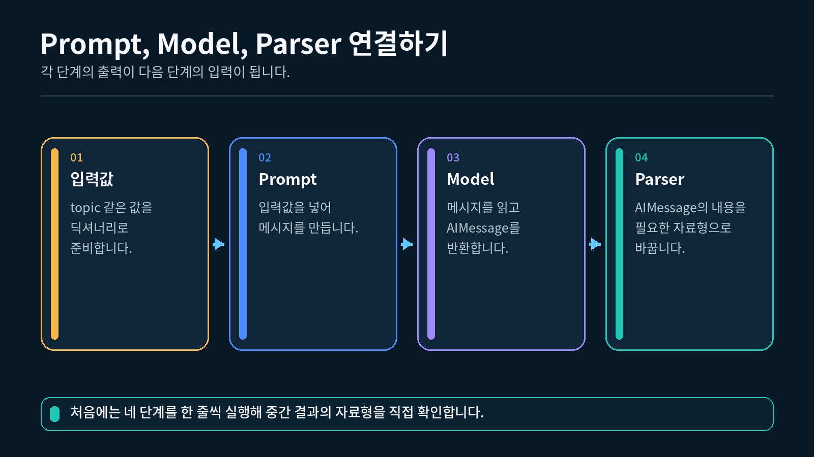
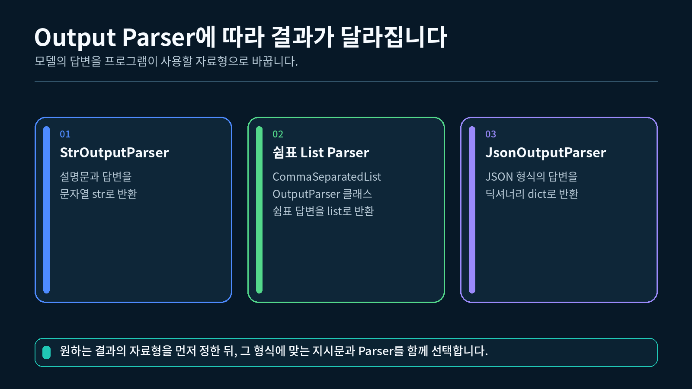
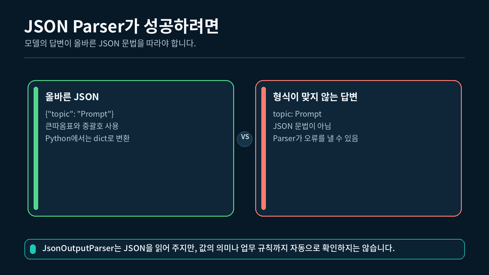

## 1. 기본 체인의 전체 흐름

2-1강에서 Prompt는 모델에 전달할 메시지를 만들었습니다. 이제 그 뒤에 ChatModel과 Output Parser를 차례대로 연결합니다.

Prompt, Model, Parser의 입출력 흐름



각 단계는 앞 단계의 출력을 입력으로 받습니다.

```
입력 딕셔너리
→ Prompt가 역할별 메시지를 만듭니다.
→ ChatModel이 AIMessage를 만듭니다.
→ Parser가 앱에서 사용할 자료형으로 바꿉니다.
```

### 단계별 자료형

| 단계 | 받는 값 | 내보내는 값 |
| --- | --- | --- |
| `ChatPromptTemplate` | 입력 변수의 값 | 역할별 메시지 목록 |
| `ChatOpenAI` | 역할별 메시지 목록 | `AIMessage` |
| `StrOutputParser` | `AIMessage` | `str` |
| List Parser | `AIMessage` | `list[str]` |
| JSON Parser | `AIMessage` | `dict` 또는 `list` |

파이프라인에서 오류가 발생하면 앞 단계가 어떤 자료형을 내보냈고 다음 단계가 무엇을 기대했는지 확인해야 합니다.

---

## 2. Prompt와 ChatModel 연결하기

### 2.1 Prompt 만들기

```python
# 역할 기반 Prompt를 만들기 위해 ChatPromptTemplate을 가져옵니다.
from langchain_core.prompts import ChatPromptTemplate

# 고정 답변 원칙과 실행할 때 바뀌는 질문을 분리합니다.
prompt = ChatPromptTemplate.from_messages(
    [
        ("system", "당신은 AI 입문 수업의 튜터입니다."),
        ("human", "{question}"),
    ]
)

# question 변수에 실제 질문을 넣어 메시지 목록을 만듭니다.
messages = prompt.format_messages(
    question="LangChain의 세 가지 기본 구성 요소를 설명해 주세요."
)
```

### 2.2 ChatModel 호출하기

```python
# .env에서 지정한 권장 모델을 읽습니다.
import os

# .env의 환경변수를 현재 Python 프로세스로 불러옵니다.
from dotenv import load_dotenv

# OpenAI ChatModel을 LangChain 방식으로 사용하는 클래스를 가져옵니다.
from langchain_openai import ChatOpenAI

# 프로젝트 루트의 .env를 읽습니다.
load_dotenv()

# ChatOpenAI는 OPENAI_API_KEY 환경변수를 사용해 인증합니다.
model = ChatOpenAI(model=os.getenv("OPENAI_MODEL", "gpt-5.6-luna"))

# Prompt가 만든 메시지를 모델에 전달합니다.
ai_message = model.invoke(messages)

# 모델 응답 객체의 종류와 본문을 확인합니다.
print(type(ai_message).__name__)
print(ai_message.content)
```

출력 구조는 다음과 같습니다. 실제 답변 문장은 달라질 수 있습니다.

```
AIMessage
모델이 생성한 답변
```

### AIMessage를 그대로 사용하는 경우

`AIMessage`에는 답변 본문 외에도 모델이 제공한 부가 정보가 들어갈 수 있습니다. 그런 정보가 필요하다면 Parser를 붙이기 전에 `AIMessage`를 유지해야 합니다.

이번 실습처럼 화면에 답변 글만 보여 주거나 다른 문자열 함수에 전달하려면 Parser로 문자열을 꺼내는 편이 간단합니다.

---

## 3. StrOutputParser로 문자열 만들기

`StrOutputParser`는 `AIMessage`의 텍스트 본문을 일반 문자열로 바꿉니다.

### 3.1 Parser 연결

```python
# AIMessage의 본문을 문자열로 바꾸는 Parser를 가져옵니다.
from langchain_core.output_parsers import StrOutputParser

# 문자열 변환을 담당할 Parser 객체를 만듭니다.
parser = StrOutputParser()

# 모델이 반환한 AIMessage를 Parser에 전달합니다.
text_result = parser.invoke(ai_message)

# 변환된 값과 문자열 여부를 함께 확인합니다.
print(text_result)
print(isinstance(text_result, str))
```

```
모델이 생성한 답변
True
```

### 3.2 API 호출 없이 Parser만 확인하기

Parser의 동작만 확인할 때는 `AIMessage`를 직접 만들 수 있습니다.

```python
# 테스트용 AIMessage를 만들기 위해 메시지 클래스를 가져옵니다.
from langchain_core.messages import AIMessage

# 실제 API 호출 대신 고정된 본문을 가진 메시지를 만듭니다.
sample_message = AIMessage(content="Prompt는 모델에 전달할 메시지를 만듭니다.")

# StrOutputParser로 AIMessage의 본문을 꺼냅니다.
sample_result = StrOutputParser().invoke(sample_message)

# 결과와 문자열 여부를 출력합니다.
print(sample_result)
print(isinstance(sample_result, str))
```

이 코드는 실제 모델을 호출하지 않으므로 비용이 발생하지 않고 결과가 항상 같습니다.

---

## 4. List Parser로 리스트 만들기

여러 키워드를 반복문이나 화면의 태그로 사용하려면 문자열보다 리스트가 편리합니다. `CommaSeparatedListOutputParser`는 쉼표로 구분된 문자열을 `list[str]`로 바꿉니다.

Output Parser에 따른 결과 자료형 비교



### 4.1 Parser의 형식 안내 확인

```python
# 쉼표 구분 문자열을 리스트로 바꾸는 Parser를 가져옵니다.
from langchain_core.output_parsers import CommaSeparatedListOutputParser

# List Parser 객체를 만듭니다.
list_parser = CommaSeparatedListOutputParser()

# 모델에게 어떤 형식으로 답해야 하는지 알려 줄 문장을 확인합니다.
format_instructions = list_parser.get_format_instructions()

# Prompt에 넣을 형식 안내를 출력합니다.
print(format_instructions)
```

Parser는 모델이 자동으로 형식을 지키게 만드는 장치가 아닙니다. `get_format_instructions()`로 원하는 형식을 Prompt에 알려 주고, 실제 응답을 Parser로 변환하는 두 단계가 필요합니다.

### 4.2 List Parser를 포함한 단계별 실행

```python
# 형식 안내와 사용자 질문이 들어갈 역할 기반 Prompt를 만듭니다.
list_prompt = ChatPromptTemplate.from_messages(
    [
        (
            "system",
            "질문에 맞는 핵심 키워드만 반환하세요.\n"
            "출력 형식:{format_instructions}",
        ),
        ("human", "{question}"),
    ]
)

# Parser의 형식 안내와 실제 질문을 Prompt에 전달합니다.
list_messages = list_prompt.format_messages(
    format_instructions=list_parser.get_format_instructions(),
    question="LangChain 기본 체인의 구성 요소 세 개를 알려 주세요.",
)

# 모델이 쉼표로 구분된 답변을 생성하도록 메시지를 전달합니다.
list_ai_message = model.invoke(list_messages)

# 모델 응답을 Python 리스트로 변환합니다.
list_result = list_parser.invoke(list_ai_message)

# 변환된 리스트와 자료형을 확인합니다.
print(list_result)
print(type(list_result).__name__)
```

출력 예시는 다음과 같습니다.

```
['Prompt', 'Model', 'Parser']
list
```

> 항목 자체에 쉼표가 자주 들어가는 복잡한 데이터에는 단순 쉼표 Parser가 적합하지 않습니다. 이 Parser는 짧은 키워드 목록처럼 구조가 단순한 경우에 사용하세요.
> 

---

## 5. JSON Parser로 딕셔너리 만들기

JSON은 키와 값을 가진 데이터를 표현할 수 있습니다. `JsonOutputParser`는 모델이 만든 JSON 형식의 문자열을 Python 딕셔너리나 리스트로 변환합니다.

### 5.1 JSON 형식 안내와 Prompt

```python
# JSON 문자열을 Python 값으로 바꾸는 Parser를 가져옵니다.
from langchain_core.output_parsers import JsonOutputParser

# JSON Parser 객체를 만듭니다.
json_parser = JsonOutputParser()

# 필요한 키와 출력 형식 안내가 들어간 Prompt를 만듭니다.
json_prompt = ChatPromptTemplate.from_messages(
    [
        (
            "system",
            "질문을 분류하고 category와 reason 키를 가진 JSON 객체로 답하세요.\n"
            "출력 형식:{format_instructions}",
        ),
        ("human", "{question}"),
    ]
)

# 형식 안내와 분류할 질문을 메시지에 넣습니다.
json_messages = json_prompt.format_messages(
    format_instructions=json_parser.get_format_instructions(),
    question="PromptTemplate은 어떤 역할을 하나요?",
)
```

### 5.2 모델 호출과 JSON 변환

```python
# 모델에 JSON 형식의 답변을 요청합니다.
json_ai_message = model.invoke(json_messages)

# 모델 응답을 Python 값으로 변환합니다.
json_result = json_parser.invoke(json_ai_message)

# 이번 Prompt는 JSON 객체를 요구했으므로 dict인지 확인합니다.
if not isinstance(json_result, dict):
    raise TypeError("JSON 객체를 기대했지만 다른 자료형이 반환되었습니다.")

# category와 reason 키가 모두 있는지 확인합니다.
if "category" not in json_result or "reason" not in json_result:
    raise ValueError("JSON 결과에 category 또는 reason 키가 없습니다.")

# 후속 코드가 사용할 category 값을 키로 읽습니다.
print(json_result["category"])

# 전체 결과의 Python 자료형을 확인합니다.
print(type(json_result).__name__)
```

출력 예시는 다음과 같습니다.

```
교육
dict
```

### 5.3 JSON 변환 결과 확인하기

이 강의의 `JsonOutputParser`는 JSON 형식의 값을 Python 객체로 바꾸는 역할에 집중합니다. 그래서 5.2 코드에서는 `dict`인지 먼저 확인하고, `category`와 `reason` 키가 모두 있는지 확인한 뒤 값을 읽었습니다. 이 순서를 지키면 키가 없는 상태에서 값을 먼저 읽어 `KeyError`가 발생하는 일을 피할 수 있습니다.

현재 검사는 필요한 키의 존재만 확인합니다. `category`에 어떤 값까지 허용할지처럼 더 세밀한 규칙은 지금 단계에서 다루지 않습니다.

JSON 응답이 변환되는 성공 경로와 오류 경로



### 5.4 Parser 오류 처리

```python
# LangChain Parser가 발생시키는 공통 오류 타입을 가져옵니다.
from langchain_core.exceptions import OutputParserException

# JSON 변환에 실패해도 프로그램 전체가 바로 종료되지 않도록 처리합니다.
try:
    # 모델 응답을 JSON 값으로 변환합니다.
    json_result = json_parser.invoke(json_ai_message)
except OutputParserException as error:
    # 실제 응답 전체 대신 오류 종류와 안내 문구를 출력합니다.
    print("모델 응답을 JSON으로 변환하지 못했습니다.")
    print(type(error).__name__)
```

오류를 무시하고 빈 딕셔너리로 바꾸면 데이터 문제를 놓칠 수 있습니다. 실패 사실을 사용자나 로그에 분명히 남기는 편이 좋습니다.

---

## 6. Parser별 결과 비교하기

| Parser | 모델이 만들도록 요청할 형식 | Python 결과 | 적합한 예 |
| --- | --- | --- | --- |
| `StrOutputParser` | 일반 문장 | `str` | 설명, 요약, 답변 |
| `CommaSeparatedListOutputParser` | 쉼표로 구분한 항목 | `list[str]` | 짧은 키워드, 태그 |
| `JsonOutputParser` | JSON 객체 또는 배열 | `dict` 또는 `list` | 분류 결과, 여러 필드 |

Parser는 모델의 지식이나 답변의 사실성을 검사하지 않습니다. **응답 형식을 해석하고 Python 자료형으로 바꾸는 역할**을 담당합니다.

### Parser 선택 순서

1. 애플리케이션에서 최종적으로 필요한 Python 자료형을 정합니다.
2. 그 자료형에 맞는 Parser를 선택합니다.
3. Parser의 형식 안내를 Prompt에 포함합니다.
4. 모델 응답을 Parser로 변환합니다.
5. 변환 결과에 필요한 키와 값이 있는지 확인합니다.

---

## 7. 완성 실습 실행하기

`실습.py`의 상단에는 다음 설정이 있습니다.

```python
# 한 번 실행할 예제를 text, list, json 중에서 선택합니다.
EXAMPLE = "text"
```

API 호출 횟수를 줄이기 위해 한 번에 예제 하나만 실행합니다.

| `EXAMPLE` 값 | 실행하는 Parser | 예상 자료형 |
| --- | --- | --- |
| `"text"` | `StrOutputParser` | `str` |
| `"list"` | `CommaSeparatedListOutputParser` | `list` |
| `"json"` | `JsonOutputParser` | `dict` |

### 7.1 실행

1-2강에서 만든 `pyproject.toml`과 `uv.lock`이 있는 프로젝트의 하위 폴더에 `실습.py`를 두고, 해당 폴더에서 실행합니다. VS Code 인터프리터는 이 프로젝트의 `.venv` (Python 3.12)를 선택합니다.

```powershell
# 2-2강 폴더에서 uv가 관리하는 Python 3.12으로 실습을 실행합니다.
uv run python 실습.py
```

"""2-2강: Prompt, ChatModel, Output Parser를 단계별로 연결합니다."""

import json
import os

from dotenv import load_dotenv
from langchain_core.exceptions import OutputParserException
from langchain_core.output_parsers import (
    CommaSeparatedListOutputParser,
    JsonOutputParser,
    StrOutputParser,
)
from langchain_core.prompts import ChatPromptTemplate
from langchain_openai import ChatOpenAI


# 한 번 실행할 예제를 text, list, json 중에서 선택합니다.
EXAMPLE = "text"

# .env에 모델명이 없을 때 사용할 저비용 기본 모델을 지정합니다.
DEFAULT_MODEL = "gpt-5-nano"


def build_model(api_key: str, model_name: str) -> ChatOpenAI:
    """환경 설정을 사용해 OpenAI ChatModel 객체를 만듭니다."""

    # API Key와 모델명을 코드에 직접 적지 않고 함수 인자로 전달합니다.
    return ChatOpenAI(
        api_key=api_key,
        model=model_name,
    )


def run_text_example(model) -> str:
    """모델 답변을 일반 문자열로 변환합니다."""

    # system 지시와 human 질문을 역할별 메시지로 정의합니다.
    prompt = ChatPromptTemplate.from_messages(
        [
            ("system", "당신은 AI 입문 수업의 튜터입니다."),
            ("human", "{question}"),
        ]
    )

    # 실행할 질문을 템플릿에 넣어 실제 메시지 목록을 만듭니다.
    messages = prompt.format_messages(
        question="LangChain의 세 가지 기본 구성 요소를 두 문장으로 설명해 주세요."
    )

    # ChatModel에 메시지를 전달하고 AIMessage 응답을 받습니다.
    ai_message = model.invoke(messages)

    # AIMessage의 본문을 문자열로 꺼내는 Parser를 만듭니다.
    parser = StrOutputParser()

    # Parser가 AIMessage를 문자열로 변환합니다.
    parsed_result = parser.invoke(ai_message)

    # 문자열이 아닌 결과가 오면 잘못된 출력 계약을 바로 알립니다.
    if not isinstance(parsed_result, str):
        raise TypeError("StrOutputParser 결과가 문자열이 아닙니다.")

    # 확인한 문자열을 호출한 쪽에 반환합니다.
    return parsed_result


def run_list_example(model) -> list[str]:
    """쉼표로 구분된 모델 답변을 Python 리스트로 변환합니다."""

    # 쉼표 구분 형식을 이해하는 List Parser를 먼저 만듭니다.
    parser = CommaSeparatedListOutputParser()

    # Parser가 요구하는 출력 형식을 Prompt에 함께 전달합니다.
    prompt = ChatPromptTemplate.from_messages(
        [
            (
                "system",
                "질문에 맞는 핵심 키워드만 반환하세요.\n"
                "출력 형식: {format_instructions}",
            ),
            ("human", "{question}"),
        ]
    )

    # 질문과 형식 안내를 템플릿 변수에 넣어 메시지 목록을 만듭니다.
    messages = prompt.format_messages(
        format_instructions=parser.get_format_instructions(),
        question="LangChain 기본 체인의 핵심 구성 요소 세 개를 알려 주세요.",
    )

    # 모델이 만든 쉼표 구분 응답을 AIMessage로 받습니다.
    ai_message = model.invoke(messages)

    # 쉼표 문자열을 list[str] 형태로 변환합니다.
    parsed_result = parser.invoke(ai_message)

    # Parser 결과가 리스트인지 확인해 잘못된 출력 계약을 바로 알립니다.
    if not isinstance(parsed_result, list):
        raise TypeError("List Parser 결과가 리스트가 아닙니다.")

    # 확인한 리스트를 별도의 강제 변환 없이 반환합니다.
    return parsed_result


def run_json_example(model) -> dict:
    """JSON 형식의 모델 답변을 Python 딕셔너리로 변환합니다."""

    # 올바른 JSON 문자열을 Python 값으로 바꾸는 Parser를 만듭니다.
    parser = JsonOutputParser()

    # 필요한 키와 Parser의 형식 안내를 system 메시지에 넣습니다.
    prompt = ChatPromptTemplate.from_messages(
        [
            (
                "system",
                "질문을 분류하고 category와 reason 키를 가진 JSON 객체로 답하세요.\n"
                "출력 형식: {format_instructions}",
            ),
            ("human", "{question}"),
        ]
    )

    # 질문과 JSON 형식 안내를 템플릿 변수에 넣습니다.
    messages = prompt.format_messages(
        format_instructions=parser.get_format_instructions(),
        question="PromptTemplate은 어떤 역할을 하나요?",
    )

    # 모델에 메시지를 보내 JSON 형태의 응답을 받습니다.
    ai_message = model.invoke(messages)

    # JSON 문자열을 Python 값으로 변환합니다.
    parsed_result = parser.invoke(ai_message)

    # 이번 실습은 JSON 객체를 요구하므로 dict인지 확인합니다.
    if not isinstance(parsed_result, dict):
        raise TypeError("JSON 객체를 기대했지만 다른 자료형이 반환되었습니다.")

    # 이번 예제에서 요청한 category와 reason 키가 모두 있는지 확인합니다.
    if "category" not in parsed_result or "reason" not in parsed_result:
        raise ValueError("JSON 결과에 category 또는 reason 키가 없습니다.")

    # 후속 코드가 바로 사용할 수 있는 딕셔너리를 반환합니다.
    return parsed_result


def run_selected_example(model, example: str):
    """선택한 예제 하나만 실행해 API 호출 횟수를 줄입니다."""

    # text를 선택하면 StrOutputParser 예제를 실행합니다.
    if example == "text":
        return run_text_example(model)

    # list를 선택하면 CommaSeparatedListOutputParser 예제를 실행합니다.
    if example == "list":
        return run_list_example(model)

    # json을 선택하면 JsonOutputParser 예제를 실행합니다.
    if example == "json":
        return run_json_example(model)

    # 허용하지 않은 값은 조용히 넘어가지 않고 올바른 선택지를 안내합니다.
    raise ValueError("EXAMPLE은 'text', 'list', 'json' 중 하나여야 합니다.")


def print_result(example: str, result) -> None:
    """선택한 Parser의 결과와 Python 자료형을 읽기 좋게 출력합니다."""

    # 어떤 예제를 실행했는지 먼저 보여 줍니다.
    print(f"[선택한 예제] {example}")

    # dict는 한글과 들여쓰기를 유지한 JSON 문자열로 출력합니다.
    if isinstance(result, dict):
        print(json.dumps(result, ensure_ascii=False, indent=2))
    else:
        # 문자열과 리스트는 Python이 제공하는 기본 표시 형식을 사용합니다.
        print(result)

    # 기본 자료형 이름을 실제 결과 객체에서 읽습니다.
    result_type = type(result).__name__

    # str의 하위 구현도 수강생이 아는 문자열 자료형으로 표시합니다.
    if isinstance(result, str):
        result_type = "str"

    # Parser에 따라 최종 자료형이 달라졌는지 확인합니다.
    print(f"[최종 자료형] {result_type}")


def main() -> None:
    """환경변수를 읽고 선택한 기본 체인을 실제 API로 한 번 실행합니다."""

    # 실습 폴더 또는 상위 폴더의 .env 파일을 환경변수로 불러옵니다.
    load_dotenv()

    # API Key는 환경변수에서 읽고 화면에는 출력하지 않습니다.
    api_key = os.getenv("OPENAI_API_KEY")

    # 모델명은 환경변수로 바꿀 수 있으며 기본값은 저비용 모델입니다.
    model_name = os.getenv("OPENAI_MODEL", DEFAULT_MODEL)

    # API Key가 없으면 무엇을 설정해야 하는지 알려 주고 종료합니다.
    if not api_key:
        print("OPENAI_API_KEY가 없습니다.")
        print("1-2강에서 만든 .env 파일을 확인해 주세요.")
        return

    # 실제 OpenAI ChatModel 객체를 한 번 만듭니다.
    model = build_model(api_key, model_name)

    try:
        # text, list, json 중 선택한 체인 하나만 실행합니다.
        result = run_selected_example(model, EXAMPLE)
    except OutputParserException:
        # Parser의 긴 내부 오류 대신 수강생이 확인할 항목만 안내합니다.
        print("모델 응답을 선택한 형식으로 변환하지 못했습니다.")
        print("Prompt의 출력 형식 안내와 모델 응답을 확인해 주세요.")
        return
    except (TypeError, ValueError) as error:
        # 자료형, 필수 키, EXAMPLE 설정 오류는 작성한 한국어 원인을 보여 줍니다.
        print("선택한 예제를 실행하지 못했습니다.")
        print(f"원인: {error}")
        return

    # 변환된 값과 Python 자료형을 함께 출력합니다.
    print_result(EXAMPLE, result)


if __name__ == "__main__":
    # 터미널에서 python 실습.py로 실행했을 때만 실제 API를 호출합니다.
    main()


### 7.2 text 실행 결과 구조

```
[선택한 예제] text
모델이 생성한 설명
[최종 자료형] str
```

### 7.3 list와 json도 확인하기

1. `실습.py` 상단의 `EXAMPLE` 값을 `"list"`로 바꿉니다.
2. 파일을 저장하고 다시 실행합니다.
3. 결과 자료형이 `list`인지 확인합니다.
4. `EXAMPLE`을 `"json"`으로 바꾸어 같은 과정을 반복합니다.
5. 각 실행은 실제 API를 한 번씩 호출하므로 필요한 예제만 실행하세요.

모델 답변의 문구를 정답과 글자 단위로 비교하지 마세요. 최종 자료형과 필요한 값이 들어 있는지 확인합니다.