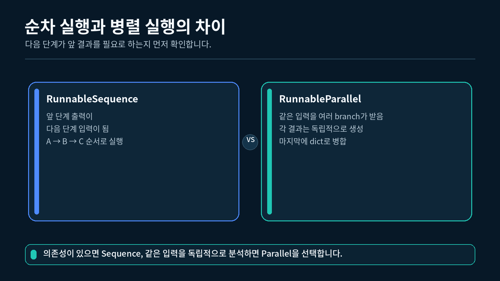
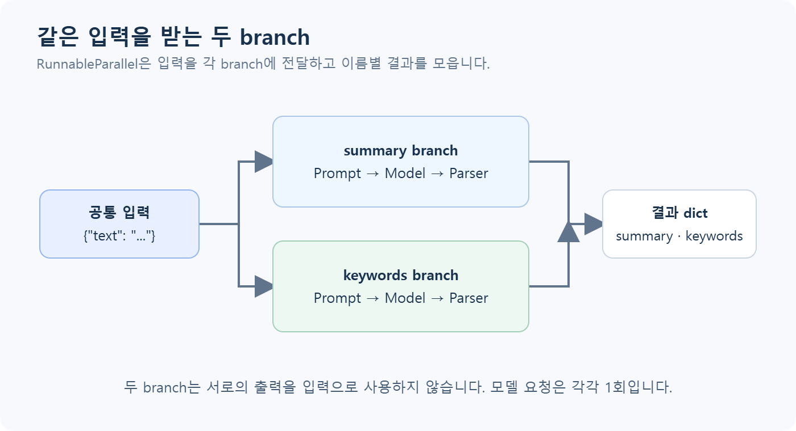
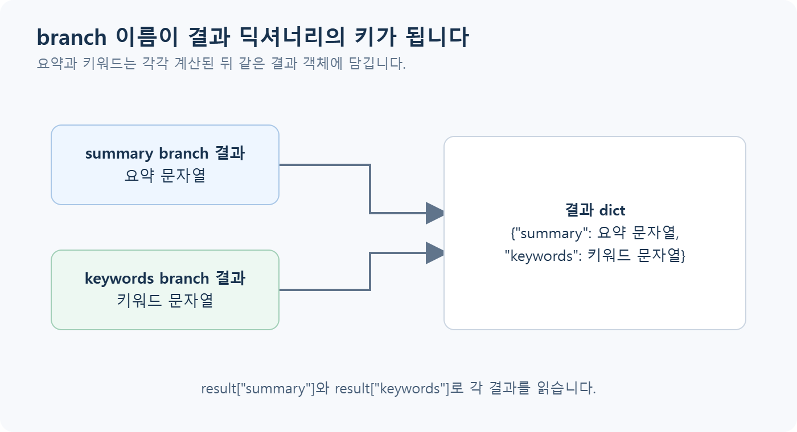

## 1. 순차 실행과 병렬 실행 구분하기

지금까지 만든 기본 체인은 Prompt, Model, Parser를 왼쪽에서 오른쪽으로 실행했습니다. 앞 단계의 결과가 다음 단계의 입력이 되므로 **순차 실행**입니다.

```
입력 → Prompt → Model → Parser → 문자열 결과
```

하나의 글에서 요약과 키워드를 모두 얻고 싶다면 분석 흐름을 두 갈래로 나눌 수 있습니다. 두 분석은 같은 원문을 사용하지만 서로의 결과를 기다려서 입력으로 사용하지는 않습니다.

```
                    ┌→ 요약 branch ─────┐
같은 입력 딕셔너리 ─┤                    ├→ 결과 딕셔너리
                    └→ 키워드 branch ───┘
```

순차 실행과 병렬 실행의 차이



### 순차와 병렬을 판단하는 질문

| 질문 | 실행 구조 |
| --- | --- |
| 두 번째 단계가 첫 번째 단계의 결과를 사용합니까? | 순차 실행 |
| 두 작업이 같은 입력을 각각 사용합니까? | 병렬 실행 |
| 앞에서 입력을 정리한 뒤 두 분석으로 나눕니까? | 순차 실행 뒤 병렬 실행 |

이번 실습은 마지막 경우에 해당합니다.

```
원문 문자열
→ 공백을 정리하고 {"text": "..."}로 변환
→ 요약과 키워드 추출에 같은 딕셔너리 전달
→ {"summary": "...", "keywords": "..."} 반환
```

`RunnableParallel`이라는 이름의 병렬은 결과를 두 갈래로 나누어 구성한다는 뜻으로 먼저 이해하면 됩니다. 이번 강의에서는 실행 속도를 측정하거나 세부 실행 방식을 조정하지 않습니다.

---

## 2. RunnableSequence로 단계 연결하기

`RunnableSequence`는 여러 Runnable을 **정해진 순서대로 실행**하는 객체입니다. 3장에서 사용한 `first | second`도 순차 체인을 만들며, 이번에는 클래스 이름과 단계 구성을 더 분명하게 보기 위해 `RunnableSequence`를 직접 사용합니다.

### 2.1 작은 문자열 예제로 순서 확인하기

```python
# 일반 Python 함수를 Runnable로 감싸는 클래스를 가져옵니다.
from langchain_core.runnables import RunnableLambda, RunnableSequence

# 입력 문자열의 앞뒤 공백을 제거하는 함수를 정의합니다.
def clean_text(text: str) -> str:
    # 정리된 문자열을 다음 단계로 반환합니다.
    return text.strip()

# 정리된 문자열 앞에 이름표를 붙이는 함수를 정의합니다.
def add_label(text: str) -> str:
    # 앞 단계에서 받은 문자열을 사용해 새 문자열을 만듭니다.
    return f"학습 주제: {text}"

# 첫 번째 Python 함수를 실행 가능한 Runnable 단계로 만듭니다.
clean_step = RunnableLambda(clean_text)

# 두 번째 Python 함수도 Runnable 단계로 만듭니다.
label_step = RunnableLambda(add_label)

# 공백 정리 뒤 이름표 추가가 실행되도록 순서를 지정합니다.
sequence = RunnableSequence(
    clean_step,
    label_step,
)

# 공백이 포함된 문자열 한 건을 순차 체인에 전달합니다.
result = sequence.invoke("  LangChain  ")

# 두 단계가 차례대로 적용된 최종 결과를 출력합니다.
print(result)
```

```
학습 주제: LangChain
```

### 2.2 이 결과가 나온 이유

1. `clean_step`이 `" LangChain "`을 받아 `"LangChain"`을 반환합니다.
2. `label_step`이 `"LangChain"`을 받아 `"학습 주제: LangChain"`을 반환합니다.
3. `RunnableSequence`는 마지막 단계의 출력을 전체 결과로 반환합니다.

순차 체인에서는 단계의 순서가 중요합니다. 뒤 단계는 바로 앞 단계의 출력을 입력으로 받기 때문입니다.

### 2.3 pipe 문법과 비교하기

다음 두 코드는 같은 순서의 체인을 표현합니다.

```python
# 클래스를 직접 사용해 두 단계를 순서대로 지정합니다.
sequence_by_class = RunnableSequence(
    clean_step,
    label_step,
)

# pipe 연산자를 사용해 같은 두 단계를 왼쪽에서 오른쪽으로 연결합니다.
sequence_by_pipe = clean_step | label_step

# 두 체인의 클래스 이름을 각각 확인합니다.
print(type(sequence_by_class).__name__)
print(type(sequence_by_pipe).__name__)
```

```
RunnableSequence
RunnableSequence
```

처음 구조를 읽을 때는 `|`가 간결하고, 단계 목록을 분명하게 펼쳐 보고 싶을 때는 `RunnableSequence(...)`가 이해하기 쉽습니다.

---

## 3. RunnableParallel로 같은 입력 나누기

`RunnableParallel`은 같은 입력을 여러 branch에 전달하고, 각 branch의 결과를 하나의 딕셔너리로 모읍니다.

### 3.1 API 없이 두 branch 확인하기

```python
# 일반 함수를 Runnable로 만들 클래스와 병렬 구성을 만들 클래스를 가져옵니다.
from langchain_core.runnables import RunnableLambda, RunnableParallel

# 입력 문자열을 대문자로 바꾸는 첫 번째 branch 함수를 정의합니다.
def make_upper(text: str) -> str:
    # 변환된 문자열을 첫 번째 branch 결과로 반환합니다.
    return text.upper()

# 입력 문자열의 글자 수를 세는 두 번째 branch 함수를 정의합니다.
def count_length(text: str) -> int:
    # 계산한 글자 수를 두 번째 branch 결과로 반환합니다.
    return len(text)

# 같은 문자열을 두 branch에 전달하도록 병렬 구성을 만듭니다.
parallel = RunnableParallel(
    upper=RunnableLambda(make_upper),
    length=RunnableLambda(count_length),
)

# 문자열 한 건을 병렬 Runnable에 전달합니다.
result = parallel.invoke("LangChain")

# 각 branch 이름으로 결과를 읽습니다.
print(result["upper"])
print(result["length"])
print(type(result).__name__)
```

```
LANGCHAIN
9
dict
```

### 3.2 이 결과가 나온 이유

- `upper` branch는 원본 `"LangChain"`을 받아 `"LANGCHAIN"`을 반환합니다.
- `length` branch도 같은 원본 `"LangChain"`을 받아 `9`를 반환합니다.
- `RunnableParallel`은 branch 이름을 키로 사용해 두 값을 딕셔너리에 담습니다.

```python
# 결과 딕셔너리는 branch를 만들 때 지정한 이름을 키로 가집니다.
expected_shape = {
    "upper": "첫 번째 branch 결과",
    "length": "두 번째 branch 결과",
}
```

`upper`와 `length`는 LangChain이 정한 이름이 아닙니다. 코드를 작성한 사람이 결과를 알아보기 쉽게 정한 이름입니다.

---

## 4. 요약 branch와 키워드 branch 만들기

이번 완성 실습에서는 같은 글을 두 가지 관점으로 분석합니다.

- `summary` branch: 글을 입문자가 이해하기 쉬운 한 문장으로 요약합니다.
- `keywords` branch: 글에서 핵심 키워드 세 개를 추출합니다.

같은 입력을 받는 두 개의 분석 branch

### 순차와 병렬을 판단하는 질문

| 질문 | 실행 구조 |
| --- | --- |
| 두 번째 단계가 첫 번째 단계의 결과를 사용합니까? | 순차 실행 |
| 두 작업이 같은 입력을 각각 사용합니까? | 병렬 실행 |
| 앞에서 입력을 정리한 뒤 두 분석으로 나눕니까? | 순차 실행 뒤 병렬 실행 |

이번 실습은 마지막 경우에 해당합니다.

```
원문 문자열
→ 공백을 정리하고 {"text": "..."}로 변환
→ 요약과 키워드 추출에 같은 딕셔너리 전달
→ {"summary": "...", "keywords": "..."} 반환
```

`RunnableParallel`이라는 이름의 병렬은 결과를 두 갈래로 나누어 구성한다는 뜻으로 먼저 이해하면 됩니다. 이번 강의에서는 실행 속도를 측정하거나 세부 실행 방식을 조정하지 않습니다.

---

## 2. RunnableSequence로 단계 연결하기

`RunnableSequence`는 여러 Runnable을 **정해진 순서대로 실행**하는 객체입니다. 3장에서 사용한 `first | second`도 순차 체인을 만들며, 이번에는 클래스 이름과 단계 구성을 더 분명하게 보기 위해 `RunnableSequence`를 직접 사용합니다.

### 2.1 작은 문자열 예제로 순서 확인하기

```python
# 일반 Python 함수를 Runnable로 감싸는 클래스를 가져옵니다.
from langchain_core.runnables import RunnableLambda, RunnableSequence

# 입력 문자열의 앞뒤 공백을 제거하는 함수를 정의합니다.
def clean_text(text: str) -> str:
    # 정리된 문자열을 다음 단계로 반환합니다.
    return text.strip()

# 정리된 문자열 앞에 이름표를 붙이는 함수를 정의합니다.
def add_label(text: str) -> str:
    # 앞 단계에서 받은 문자열을 사용해 새 문자열을 만듭니다.
    return f"학습 주제: {text}"

# 첫 번째 Python 함수를 실행 가능한 Runnable 단계로 만듭니다.
clean_step = RunnableLambda(clean_text)

# 두 번째 Python 함수도 Runnable 단계로 만듭니다.
label_step = RunnableLambda(add_label)

# 공백 정리 뒤 이름표 추가가 실행되도록 순서를 지정합니다.
sequence = RunnableSequence(
    clean_step,
    label_step,
)

# 공백이 포함된 문자열 한 건을 순차 체인에 전달합니다.
result = sequence.invoke("  LangChain  ")

# 두 단계가 차례대로 적용된 최종 결과를 출력합니다.
print(result)
```

```
학습 주제: LangChain
```

### 2.2 이 결과가 나온 이유

1. `clean_step`이 `" LangChain "`을 받아 `"LangChain"`을 반환합니다.
2. `label_step`이 `"LangChain"`을 받아 `"학습 주제: LangChain"`을 반환합니다.
3. `RunnableSequence`는 마지막 단계의 출력을 전체 결과로 반환합니다.

순차 체인에서는 단계의 순서가 중요합니다. 뒤 단계는 바로 앞 단계의 출력을 입력으로 받기 때문입니다.

### 2.3 pipe 문법과 비교하기

다음 두 코드는 같은 순서의 체인을 표현합니다.

```python
# 클래스를 직접 사용해 두 단계를 순서대로 지정합니다.
sequence_by_class = RunnableSequence(
    clean_step,
    label_step,
)

# pipe 연산자를 사용해 같은 두 단계를 왼쪽에서 오른쪽으로 연결합니다.
sequence_by_pipe = clean_step | label_step

# 두 체인의 클래스 이름을 각각 확인합니다.
print(type(sequence_by_class).__name__)
print(type(sequence_by_pipe).__name__)
```

```
RunnableSequence
RunnableSequence
```

처음 구조를 읽을 때는 `|`가 간결하고, 단계 목록을 분명하게 펼쳐 보고 싶을 때는 `RunnableSequence(...)`가 이해하기 쉽습니다.

---

## 3. RunnableParallel로 같은 입력 나누기

`RunnableParallel`은 같은 입력을 여러 branch에 전달하고, 각 branch의 결과를 하나의 딕셔너리로 모읍니다.

### 3.1 API 없이 두 branch 확인하기

```python
# 일반 함수를 Runnable로 만들 클래스와 병렬 구성을 만들 클래스를 가져옵니다.
from langchain_core.runnables import RunnableLambda, RunnableParallel

# 입력 문자열을 대문자로 바꾸는 첫 번째 branch 함수를 정의합니다.
def make_upper(text: str) -> str:
    # 변환된 문자열을 첫 번째 branch 결과로 반환합니다.
    return text.upper()

# 입력 문자열의 글자 수를 세는 두 번째 branch 함수를 정의합니다.
def count_length(text: str) -> int:
    # 계산한 글자 수를 두 번째 branch 결과로 반환합니다.
    return len(text)

# 같은 문자열을 두 branch에 전달하도록 병렬 구성을 만듭니다.
parallel = RunnableParallel(
    upper=RunnableLambda(make_upper),
    length=RunnableLambda(count_length),
)

# 문자열 한 건을 병렬 Runnable에 전달합니다.
result = parallel.invoke("LangChain")

# 각 branch 이름으로 결과를 읽습니다.
print(result["upper"])
print(result["length"])
print(type(result).__name__)
```

```
LANGCHAIN
9
dict
```

### 3.2 이 결과가 나온 이유

- `upper` branch는 원본 `"LangChain"`을 받아 `"LANGCHAIN"`을 반환합니다.
- `length` branch도 같은 원본 `"LangChain"`을 받아 `9`를 반환합니다.
- `RunnableParallel`은 branch 이름을 키로 사용해 두 값을 딕셔너리에 담습니다.

```python
# 결과 딕셔너리는 branch를 만들 때 지정한 이름을 키로 가집니다.
expected_shape = {
    "upper": "첫 번째 branch 결과",
    "length": "두 번째 branch 결과",
}
```

`upper`와 `length`는 LangChain이 정한 이름이 아닙니다. 코드를 작성한 사람이 결과를 알아보기 쉽게 정한 이름입니다.

---

## 4. 요약 branch와 키워드 branch 만들기

이번 완성 실습에서는 같은 글을 두 가지 관점으로 분석합니다.

- `summary` branch: 글을 입문자가 이해하기 쉬운 한 문장으로 요약합니다.
- `keywords` branch: 글에서 핵심 키워드 세 개를 추출합니다.

같은 입력을 받는 두 개의 분석 branch



### 4.1 공통 입력 형태

두 Prompt는 모두 `{text}` 변수를 사용합니다. 따라서 두 branch에는 다음 형태의 딕셔너리가 들어가야 합니다.

```python
# 두 Prompt가 함께 읽을 text 키를 가진 입력을 준비합니다.
input_data = {
    "text": "LCEL은 여러 단계를 연결하는 표현 방식입니다."
}
```

### 4.2 요약 branch 만들기

```python
# 모델 응답을 일반 문자열로 바꾸는 Parser를 가져옵니다.
from langchain_core.output_parsers import StrOutputParser

# 역할 기반 Prompt를 만들 클래스를 가져옵니다.
from langchain_core.prompts import ChatPromptTemplate

# 요약 기준과 원문 위치를 가진 Prompt를 만듭니다.
summary_prompt = ChatPromptTemplate.from_messages(
    [
        (
            "system",
            "주어진 글을 입문자가 이해하기 쉬운 한 문장으로 요약하세요.",
        ),
        (
            "human",
            "{text}",
        ),
    ]
)

# 요약 Prompt, 이미 준비한 Model, 문자열 Parser를 순서대로 연결합니다.
summary_chain = summary_prompt | model | StrOutputParser()
```

이 branch는 입력 딕셔너리에서 `text`를 읽고 최종 요약 문자열을 반환합니다.

### 4.3 키워드 branch 만들기

```python
# 키워드 개수와 출력 방법을 알려 주는 Prompt를 만듭니다.
keyword_prompt = ChatPromptTemplate.from_messages(
    [
        (
            "system",
            "주어진 글에서 핵심 키워드 세 개를 쉼표로 구분해 답하세요.",
        ),
        (
            "human",
            "{text}",
        ),
    ]
)

# 키워드 Prompt, 같은 Model, 문자열 Parser를 순서대로 연결합니다.
keyword_chain = keyword_prompt | model | StrOutputParser()
```

두 branch가 같은 `model` 객체를 사용해도 각 branch는 별도의 모델 요청을 실행합니다.

### 4.4 두 branch를 하나로 묶기

```python
# 같은 입력 딕셔너리를 요약과 키워드 체인에 각각 전달하도록 구성합니다.
parallel_analysis = RunnableParallel(
    summary=summary_chain,
    keywords=keyword_chain,
)
```

아직 `invoke()`를 호출하지 않았으므로 이 코드는 구조만 만듭니다.

---

## 5. 순차 전처리와 병렬 분석 연결하기

완성 실습은 원문 문자열을 바로 Prompt에 전달하지 않습니다. 먼저 문자열을 확인하고 Prompt가 요구하는 딕셔너리로 바꿉니다.

### 5.1 입력 전처리 함수

```python
# 원문 문자열을 확인하고 두 Prompt가 읽을 딕셔너리로 바꾸는 함수를 정의합니다.
def prepare_input(text: str) -> dict[str, str]:
    # 문자열이 아닌 값은 strip을 호출하기 전에 분명한 오류로 알립니다.
    if not isinstance(text, str):
        raise TypeError("text는 문자열이어야 합니다.")

    # 문장 앞뒤의 불필요한 공백을 제거합니다.
    clean_text = text.strip()

    # 공백을 제거한 뒤 내용이 없으면 모델에 전달하지 않습니다.
    if not clean_text:
        raise ValueError("text는 비어 있을 수 없습니다.")

    # 두 Prompt가 함께 읽을 text 키를 가진 딕셔너리를 반환합니다.
    return {"text": clean_text}
```

### 5.2 전처리 함수만 확인하기

```python
# 앞뒤에 공백이 있는 짧은 문장을 전처리 함수에 전달합니다.
prepared = prepare_input("  LCEL은 단계를 연결합니다.  ")

# Prompt에 전달될 딕셔너리를 출력합니다.
print(prepared)
```

```
{'text': 'LCEL은 단계를 연결합니다.'}
```

문자열 앞뒤 공백이 제거되고 `text` 키가 있는 딕셔너리로 바뀌었기 때문에 두 Prompt가 같은 값을 읽을 수 있습니다.

### 5.3 전처리 뒤 병렬 분석 연결하기

```python
# 일반 Python 전처리 함수를 Runnable 단계로 감쌉니다.
prepare_step = RunnableLambda(prepare_input)

# 전처리를 먼저 실행하고 그 결과를 두 분석 branch에 전달합니다.
analysis_chain = RunnableSequence(
    prepare_step,
    parallel_analysis,
)
```

이 전체 체인의 자료 흐름은 다음과 같습니다.

| 순서 | 단계 | 입력 | 출력 |
| --- | --- | --- | --- |
| 1 | `prepare_step` | `str` | `{"text": str}` |
| 2-A | `summary_chain` | `{"text": str}` | 요약 `str` |
| 2-B | `keyword_chain` | `{"text": str}` | 키워드 `str` |
| 3 | `RunnableParallel` 결과 | 두 문자열 | 결과 `dict` |

전처리는 한 번 실행되고, 그 결과 딕셔너리가 두 branch의 공통 입력이 됩니다.

---

## 6. 병렬 실행 결과 딕셔너리 읽기

`RunnableParallel`의 최종 결과는 branch 이름을 키로 가진 딕셔너리입니다.

두 branch 결과가 하나의 딕셔너리로 모이는 과정

### 4.1 공통 입력 형태

두 Prompt는 모두 `{text}` 변수를 사용합니다. 따라서 두 branch에는 다음 형태의 딕셔너리가 들어가야 합니다.

```python
# 두 Prompt가 함께 읽을 text 키를 가진 입력을 준비합니다.
input_data = {
    "text": "LCEL은 여러 단계를 연결하는 표현 방식입니다."
}
```

### 4.2 요약 branch 만들기

```python
# 모델 응답을 일반 문자열로 바꾸는 Parser를 가져옵니다.
from langchain_core.output_parsers import StrOutputParser

# 역할 기반 Prompt를 만들 클래스를 가져옵니다.
from langchain_core.prompts import ChatPromptTemplate

# 요약 기준과 원문 위치를 가진 Prompt를 만듭니다.
summary_prompt = ChatPromptTemplate.from_messages(
    [
        (
            "system",
            "주어진 글을 입문자가 이해하기 쉬운 한 문장으로 요약하세요.",
        ),
        (
            "human",
            "{text}",
        ),
    ]
)

# 요약 Prompt, 이미 준비한 Model, 문자열 Parser를 순서대로 연결합니다.
summary_chain = summary_prompt | model | StrOutputParser()
```

이 branch는 입력 딕셔너리에서 `text`를 읽고 최종 요약 문자열을 반환합니다.

### 4.3 키워드 branch 만들기

```python
# 키워드 개수와 출력 방법을 알려 주는 Prompt를 만듭니다.
keyword_prompt = ChatPromptTemplate.from_messages(
    [
        (
            "system",
            "주어진 글에서 핵심 키워드 세 개를 쉼표로 구분해 답하세요.",
        ),
        (
            "human",
            "{text}",
        ),
    ]
)

# 키워드 Prompt, 같은 Model, 문자열 Parser를 순서대로 연결합니다.
keyword_chain = keyword_prompt | model | StrOutputParser()
```

두 branch가 같은 `model` 객체를 사용해도 각 branch는 별도의 모델 요청을 실행합니다.

### 4.4 두 branch를 하나로 묶기

```python
# 같은 입력 딕셔너리를 요약과 키워드 체인에 각각 전달하도록 구성합니다.
parallel_analysis = RunnableParallel(
    summary=summary_chain,
    keywords=keyword_chain,
)
```

아직 `invoke()`를 호출하지 않았으므로 이 코드는 구조만 만듭니다.

---

## 5. 순차 전처리와 병렬 분석 연결하기

완성 실습은 원문 문자열을 바로 Prompt에 전달하지 않습니다. 먼저 문자열을 확인하고 Prompt가 요구하는 딕셔너리로 바꿉니다.

### 5.1 입력 전처리 함수

```python
# 원문 문자열을 확인하고 두 Prompt가 읽을 딕셔너리로 바꾸는 함수를 정의합니다.
def prepare_input(text: str) -> dict[str, str]:
    # 문자열이 아닌 값은 strip을 호출하기 전에 분명한 오류로 알립니다.
    if not isinstance(text, str):
        raise TypeError("text는 문자열이어야 합니다.")

    # 문장 앞뒤의 불필요한 공백을 제거합니다.
    clean_text = text.strip()

    # 공백을 제거한 뒤 내용이 없으면 모델에 전달하지 않습니다.
    if not clean_text:
        raise ValueError("text는 비어 있을 수 없습니다.")

    # 두 Prompt가 함께 읽을 text 키를 가진 딕셔너리를 반환합니다.
    return {"text": clean_text}
```

### 5.2 전처리 함수만 확인하기

```python
# 앞뒤에 공백이 있는 짧은 문장을 전처리 함수에 전달합니다.
prepared = prepare_input("  LCEL은 단계를 연결합니다.  ")

# Prompt에 전달될 딕셔너리를 출력합니다.
print(prepared)
```

```
{'text': 'LCEL은 단계를 연결합니다.'}
```

문자열 앞뒤 공백이 제거되고 `text` 키가 있는 딕셔너리로 바뀌었기 때문에 두 Prompt가 같은 값을 읽을 수 있습니다.

### 5.3 전처리 뒤 병렬 분석 연결하기

```python
# 일반 Python 전처리 함수를 Runnable 단계로 감쌉니다.
prepare_step = RunnableLambda(prepare_input)

# 전처리를 먼저 실행하고 그 결과를 두 분석 branch에 전달합니다.
analysis_chain = RunnableSequence(
    prepare_step,
    parallel_analysis,
)
```

이 전체 체인의 자료 흐름은 다음과 같습니다.

| 순서 | 단계 | 입력 | 출력 |
| --- | --- | --- | --- |
| 1 | `prepare_step` | `str` | `{"text": str}` |
| 2-A | `summary_chain` | `{"text": str}` | 요약 `str` |
| 2-B | `keyword_chain` | `{"text": str}` | 키워드 `str` |
| 3 | `RunnableParallel` 결과 | 두 문자열 | 결과 `dict` |

전처리는 한 번 실행되고, 그 결과 딕셔너리가 두 branch의 공통 입력이 됩니다.

---

## 6. 병렬 실행 결과 딕셔너리 읽기

`RunnableParallel`의 최종 결과는 branch 이름을 키로 가진 딕셔너리입니다.

두 branch 결과가 하나의 딕셔너리로 모이는 과정



### 6.1 결과 구조

```python
# 두 branch가 반환할 최종 결과의 형태를 예시로 나타냅니다.
result_shape = {
    "summary": "요약 branch가 만든 문자열",
    "keywords": "키워드 branch가 만든 문자열",
}
```

실제 실행 뒤에는 다음처럼 각 값을 읽습니다.

```python
# 전처리와 두 분석 branch를 실행해 결과 딕셔너리를 받습니다.
result = analysis_chain.invoke("LCEL은 Prompt, Model, Parser를 연결합니다.")

# summary 키로 요약 branch의 결과를 읽습니다.
summary_text = result["summary"]

# keywords 키로 키워드 branch의 결과를 읽습니다.
keyword_text = result["keywords"]

# 두 문자열을 구분해 출력합니다.
print(f"[요약]\n{summary_text}")
print(f"[키워드]\n{keyword_text}")
```

### 6.2 branch 이름과 결과 키의 관계

```python
# 왼쪽의 summary와 keywords가 최종 딕셔너리의 키가 됩니다.
parallel_analysis = RunnableParallel(
    summary=summary_chain,
    keywords=keyword_chain,
)
```

| branch 이름 | 실행하는 체인 | 최종 딕셔너리 키 |
| --- | --- | --- |
| `summary` | `summary_chain` | `result["summary"]` |
| `keywords` | `keyword_chain` | `result["keywords"]` |

키를 `"summary_text"`로 바꾸면 결과도 `result["summary_text"]`로 읽어야 합니다.

### 6.3 API 호출 횟수

이번 구조에는 모델을 사용하는 branch가 두 개 있습니다.

```
summary branch  → 모델 API 1회
keywords branch → 모델 API 1회
합계            → 모델 API 2회
```

`RunnableParallel`을 한 번 `invoke()`하더라도 **모델 API 호출은 두 번** 발생합니다. 한 모델 객체를 함께 사용한다는 사실이 호출 한 번을 뜻하지는 않습니다. 실습을 반복 실행할 때는 두 branch가 각각 새 응답을 만든다는 점을 기억하세요.

## 7. 완성 실습 실행하기

`실습.py`는 다음 순서로 동작합니다.

```
.env 읽기
→ OPENAI_API_KEY와 OPENAI_MODEL 확인
→ ChatOpenAI 만들기
→ 원문 문자열 전처리
→ 요약 branch와 키워드 branch 실행
→ 결과 딕셔너리의 두 값을 출력
```

### 7.1 실습에서 사용하는 입력

```python
# 두 branch가 함께 분석할 짧은 수업 예시 문장입니다.
SAMPLE_TEXT = (
    "LCEL은 Prompt, Model, Parser 같은 단계를 연결해 "
    "재사용 가능한 LangChain 파이프라인을 구성하는 표현 방식입니다."
)
```

### 7.2 VS Code에서 실행하기

1-2강에서 만든 `pyproject.toml`과 `uv.lock`이 있는 프로젝트의 하위 폴더에 `실습.py`를 두고, 해당 폴더에서 실행합니다. VS Code 인터프리터는 이 프로젝트의 `.venv` (Python 3.12)를 선택합니다.

```powershell
# 4-1강 폴더로 이동한 상태에서 uv가 관리하는 Python 3.12으로 실행합니다.
uv run python 실습.py
```

"""4-1강: 순차 단계와 두 개의 병렬 분석 단계를 하나의 체인으로 연결합니다."""

import os

from dotenv import load_dotenv
from langchain_core.output_parsers import StrOutputParser
from langchain_core.prompts import ChatPromptTemplate
from langchain_core.runnables import RunnableLambda, RunnableParallel, RunnableSequence
from langchain_openai import ChatOpenAI


# .env에 모델명이 없을 때 사용할 수업 기본 모델을 지정합니다.
DEFAULT_MODEL = "gpt-5-nano"

# 두 병렬 branch가 함께 분석할 짧은 예시 문장을 준비합니다.
SAMPLE_TEXT = (
    "LCEL은 Prompt, Model, Parser 같은 단계를 연결해 "
    "재사용 가능한 LangChain 파이프라인을 구성하는 표현 방식입니다."
)


def prepare_input(text: str) -> dict[str, str]:
    """문자열의 불필요한 공백을 정리하고 Prompt가 요구하는 딕셔너리로 바꿉니다."""

    # 호출한 쪽에서 문자열이 아닌 값을 전달하면 잘못된 입력을 즉시 알립니다.
    if not isinstance(text, str):
        raise TypeError("text는 문자열이어야 합니다.")

    # 문장 앞뒤의 불필요한 공백을 제거합니다.
    clean_text = text.strip()

    # 공백만 있는 문장은 모델에 보내지 않고 원인을 안내합니다.
    if not clean_text:
        raise ValueError("text는 비어 있을 수 없습니다.")

    # 두 Prompt가 공통으로 읽을 text 키를 가진 딕셔너리를 반환합니다.
    return {"text": clean_text}


def build_model(api_key: str, model_name: str) -> ChatOpenAI:
    """환경변수에서 읽은 설정으로 OpenAI ChatModel을 만듭니다."""

    # API Key와 모델명을 코드에 직접 적지 않고 함수 인자로 전달합니다.
    return ChatOpenAI(
        api_key=api_key,
        model=model_name,
    )


def build_analysis_chain(model) -> RunnableSequence:
    """전처리 뒤에 요약과 키워드 추출을 병렬로 실행하는 체인을 만듭니다."""

    # 요약 branch에서 사용할 역할 기반 Prompt를 만듭니다.
    summary_prompt = ChatPromptTemplate.from_messages(
        [
            ("system", "주어진 글을 입문자가 이해하기 쉬운 한 문장으로 요약하세요."),
            ("human", "{text}"),
        ]
    )

    # 키워드 branch에서 사용할 별도의 Prompt를 만듭니다.
    keyword_prompt = ChatPromptTemplate.from_messages(
        [
            ("system", "주어진 글에서 핵심 키워드 세 개를 쉼표로 구분해 답하세요."),
            ("human", "{text}"),
        ]
    )

    # 두 모델 응답을 모두 일반 문자열로 바꿀 Parser를 만듭니다.
    parser = StrOutputParser()

    # 요약 Prompt, Model, Parser를 순서대로 연결합니다.
    summary_chain = summary_prompt | model | parser

    # 키워드 Prompt, Model, Parser를 순서대로 연결합니다.
    keyword_chain = keyword_prompt | model | parser

    # 같은 입력을 두 독립 branch에 전달하고 결과를 키가 있는 딕셔너리로 모읍니다.
    parallel_analysis = RunnableParallel(
        summary=summary_chain,
        keywords=keyword_chain,
    )

    # 일반 Python 전처리 함수를 Runnable 단계로 감쌉니다.
    prepare_step = RunnableLambda(prepare_input)

    # 전처리를 먼저 실행한 뒤 병렬 분석을 실행하는 순차 체인을 반환합니다.
    return RunnableSequence(
        prepare_step,
        parallel_analysis,
    )


def main() -> None:
    """환경 설정을 읽고 두 모델 branch가 있는 전체 체인을 한 번 실행합니다."""

    # 실습 폴더 또는 상위 폴더의 .env 값을 현재 Python 프로세스로 불러옵니다.
    load_dotenv()

    # API Key는 환경변수에서 읽고 실제 값은 화면에 출력하지 않습니다.
    api_key = os.getenv("OPENAI_API_KEY")

    # 모델명은 환경변수로 바꿀 수 있고, 없으면 수업 기본값을 사용합니다.
    model_name = os.getenv("OPENAI_MODEL", DEFAULT_MODEL)

    # API Key가 없으면 설정 위치를 알려 주고 모델 호출 전에 종료합니다.
    if not api_key:
        print("OPENAI_API_KEY가 없습니다.")
        print("1-2강에서 만든 .env 파일을 확인해 주세요.")
        return

    # 동일한 모델 설정을 두 분석 branch가 함께 사용하도록 모델을 한 번 만듭니다.
    model = build_model(api_key, model_name)

    # 전처리와 병렬 분석이 포함된 전체 체인을 만듭니다.
    chain = build_analysis_chain(model)

    # 하나의 글을 체인에 전달해 요약과 키워드 결과를 함께 받습니다.
    result = chain.invoke(SAMPLE_TEXT)

    # RunnableParallel의 최종 결과가 딕셔너리인지 확인합니다.
    if not isinstance(result, dict):
        raise TypeError("병렬 체인의 결과가 딕셔너리가 아닙니다.")

    # 두 branch의 이름이 최종 결과에 모두 들어 있는지 확인합니다.
    if "summary" not in result or "keywords" not in result:
        raise ValueError("summary 또는 keywords 결과가 없습니다.")

    # pipe로 연결한 전체 객체가 RunnableSequence임을 확인합니다.
    print(f"[전체 체인 타입] {type(chain).__name__}")

    # 요약 branch의 최종 문자열을 출력합니다.
    print(f"[요약]\n{result['summary']}")

    # 키워드 branch의 최종 문자열을 출력합니다.
    print(f"[키워드]\n{result['keywords']}")


if __name__ == "__main__":
    # 터미널에서 python 실습.py로 실행했을 때만 실제 API를 호출합니다.
    main()


### 7.3 실행 결과 구조

```
[전체 체인 타입] RunnableSequence
[요약]
모델이 생성한 한 문장 요약
[키워드]
모델이 생성한 쉼표 구분 키워드 세 개
```

예를 들어 다음과 비슷한 형태로 출력될 수 있습니다.

```
[전체 체인 타입] RunnableSequence
[요약]
LCEL은 LangChain의 여러 단계를 연결해 재사용 가능한 흐름을 만드는 방식입니다.
[키워드]
LCEL, LangChain, 파이프라인
```

모델이 생성하는 문장은 실행할 때마다 달라질 수 있습니다. 글자 단위로 같은지 비교하지 말고 다음 네 가지를 확인하세요.

1. 전체 체인 타입이 `RunnableSequence`로 출력되는가?
2. 요약과 키워드 제목이 모두 출력되는가?
3. 요약이 한 문장 형태인가?
4. 키워드가 쉼표로 구분된 세 항목 형태인가?

이번 `실습.py`를 한 번 실행하면 요약 branch와 키워드 branch가 각각 모델을 호출하므로 API 호출은 총 두 번 발생합니다.

### 7.4 API Key가 없을 때

`OPENAI_API_KEY`가 없으면 모델을 만들기 전에 다음 안내를 출력하고 종료합니다.

```
OPENAI_API_KEY가 없습니다.
1-2강에서 만든 .env 파일을 확인해 주세요.
```

이 경우 요약과 키워드 분석은 실행되지 않습니다.