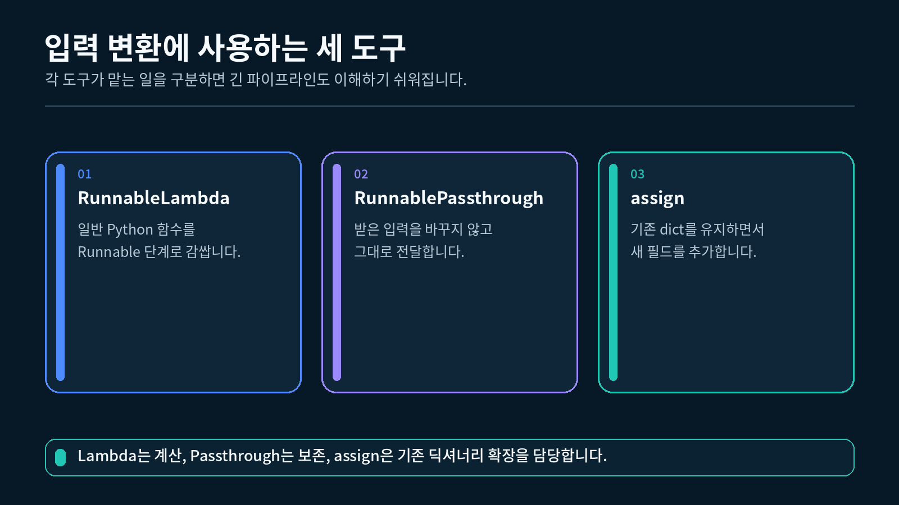
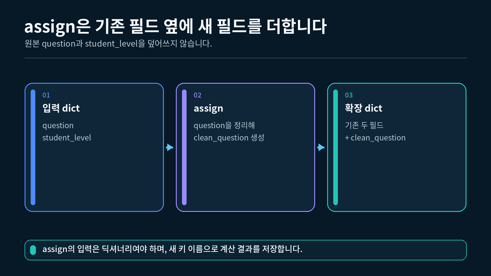
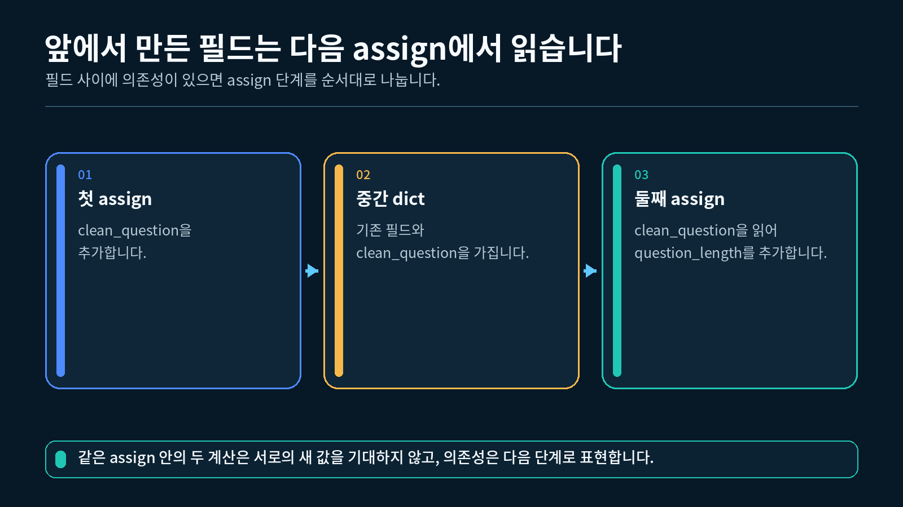

## 1. 세 가지 도구의 역할 구분하기

4-1강에서는 하나의 입력을 요약과 키워드 추출에 나누어 전달했습니다. 이번에는 딕셔너리의 기존 값을 보존하면서 계산한 값을 새 필드로 더합니다.

RunnablePassthrough, RunnableLambda, assign의 역할



세 도구의 역할을 먼저 구분해 보겠습니다.

| 도구 | 받는 값 | 하는 일 | 내보내는 값 |
| --- | --- | --- | --- |
| `RunnablePassthrough()` | 어떤 입력 | 입력의 내용을 바꾸지 않고 전달 | 받은 입력의 내용 |
| `RunnableLambda(function)` | 함수가 받을 입력 | 일반 Python 함수 실행 | 함수의 반환값 |
| `RunnablePassthrough.assign(...)` | 딕셔너리 | 기존 필드를 유지하고 새 필드 추가 | 필드가 늘어난 딕셔너리 |

이번 실습의 입력은 다음과 같습니다.

```python
# 원본 질문과 수강생 수준을 가진 입력 딕셔너리를 준비합니다.
input_data = {
    "question": "  RunnablePassthrough는 어떤 역할을 하나요?  ",
    "student_level": "입문",
}
```

최종 결과는 다음 형태가 됩니다.

```python
# 두 개의 새 필드가 추가된 최종 결과 형태입니다.
result_shape = {
    "question": "  RunnablePassthrough는 어떤 역할을 하나요?  ",
    "student_level": "입문",
    "clean_question": "RunnablePassthrough는 어떤 역할을 하나요?",
    "question_length": 32,
}
```

중요한 점은 원본 `question`을 덮어쓰지 않는다는 것입니다. 정리한 문자열은 `clean_question`이라는 새 필드에 넣고, 그 길이는 `question_length`에 넣습니다.

---

## 2. RunnablePassthrough로 입력 유지하기

`RunnablePassthrough`는 받은 입력의 내용을 그대로 다음으로 전달합니다. 이름의 `Passthrough`는 값을 통과시킨다는 뜻입니다.

### 2.1 가장 작은 실행

```python
# 받은 입력의 내용을 유지하는 Runnable을 가져옵니다.
from langchain_core.runnables import RunnablePassthrough

# 두 필드가 있는 작은 입력 딕셔너리를 준비합니다.
input_data = {
    "question": "LCEL은 무엇인가요?",
    "student_level": "입문",
}

# 입력을 바꾸지 않고 통과시키는 Runnable을 실행합니다.
result = RunnablePassthrough().invoke(input_data)

# 통과한 딕셔너리 전체를 출력합니다.
print(result)

# 입력과 결과의 내용이 같은지 확인합니다.
print(result == input_data)
```

```
{'question': 'LCEL은 무엇인가요?', 'student_level': '입문'}
True
```

### 2.2 이 결과가 나온 이유

`RunnablePassthrough()`는 질문을 정리하거나 새로운 값을 계산하지 않았습니다. 입력 딕셔너리의 내용을 그대로 결과로 전달했기 때문에 두 딕셔너리의 내용 비교도 `True`가 됩니다.

### 2.3 언제 필요한가

체인을 만들다 보면 어떤 단계에서는 값을 바꾸지 않고 유지해야 합니다.

```
원본 question ------------> 그대로 유지
student_level ------------> 그대로 유지
새로 계산한 clean_question --> 추가
```

이번 강의에서는 `assign()`이 기존 딕셔너리를 보존하는 바탕으로 `RunnablePassthrough`를 사용합니다.

---

## 3. RunnableLambda로 Python 함수 실행하기

`RunnableLambda`는 일반 Python 함수를 Runnable로 감쌉니다. 감싼 뒤에는 다른 LangChain 구성 요소처럼 `invoke()`로 실행하고 `|`로 연결할 수 있습니다.

### 3.1 일반 함수와 RunnableLambda 비교하기

```python
# 일반 Python 함수를 Runnable로 감싸는 클래스를 가져옵니다.
from langchain_core.runnables import RunnableLambda

# 숫자를 두 배로 만드는 일반 Python 함수를 정의합니다.
def double_number(number: int) -> int:
    # 계산한 정수를 함수의 결과로 반환합니다.
    return number * 2

# 일반 Python 방식으로 함수를 직접 호출합니다.
direct_result = double_number(5)

# 같은 함수를 Runnable 단계로 감쌉니다.
double_step = RunnableLambda(double_number)

# Runnable의 공통 실행 메서드로 입력 한 건을 전달합니다.
runnable_result = double_step.invoke(5)

# 두 실행 결과를 각각 출력합니다.
print(direct_result)
print(runnable_result)
```

```
10
10
```

함수의 계산 내용은 바뀌지 않았습니다. `RunnableLambda`가 일반 함수를 LangChain 체인에 연결할 수 있는 실행 단계로 바꾸었습니다.

### 3.2 딕셔너리에서 질문 꺼내 정리하기

완성 실습에서는 다음 함수를 `RunnableLambda`로 감쌉니다.

```python
# 입력 딕셔너리에서 질문을 꺼내 앞뒤 공백을 제거하는 함수를 정의합니다.
def extract_clean_question(data: dict) -> str:
    # question 값에 strip을 적용해 불필요한 공백을 제거합니다.
    clean_question = data["question"].strip()

    # 정리된 질문 문자열을 반환합니다.
    return clean_question

# 질문 정리 함수를 Runnable 단계로 만듭니다.
clean_question_step = RunnableLambda(extract_clean_question)

# 앞뒤 공백이 있는 question을 Runnable에 전달합니다.
clean_question = clean_question_step.invoke(
    {
        "question": "  assign은 무엇을 하나요?  ",
        "student_level": "입문",
    }
)

# 함수가 반환한 정리된 문자열을 출력합니다.
print(clean_question)
```

```
assign은 무엇을 하나요?
```

`RunnableLambda`의 출력은 감싼 함수의 반환값입니다. 이 함수가 문자열을 반환했으므로 실행 결과도 문자열입니다.

---

## 4. assign으로 새 필드 추가하기

`RunnablePassthrough.assign()`은 입력 딕셔너리의 기존 필드를 유지하면서 계산한 값을 새 필드에 넣습니다.

assign이 기존 딕셔너리에 새 필드를 추가하는 과정



### 4.1 clean_question 필드 하나 추가하기

```python
# RunnableLambda와 RunnablePassthrough를 가져옵니다.
from langchain_core.runnables import RunnableLambda, RunnablePassthrough

# 입력 딕셔너리의 question을 정리하는 함수를 정의합니다.
def extract_clean_question(data: dict) -> str:
    # 원본 문자열의 앞뒤 공백을 제거해 반환합니다.
    return data["question"].strip()

# 기존 입력을 유지하면서 clean_question 필드를 추가하는 단계를 만듭니다.
add_clean_question = RunnablePassthrough.assign(
    clean_question=RunnableLambda(extract_clean_question)
)

# 원본 질문과 수준이 있는 딕셔너리를 준비합니다.
input_data = {
    "question": "  Runnable이란 무엇인가요?  ",
    "student_level": "입문",
}

# assign 단계를 실행해 필드가 추가된 새 결과를 받습니다.
result = add_clean_question.invoke(input_data)

# 앞뒤 공백이 보이도록 기존 question을 세로선 사이에 출력합니다.
print(f"|{result['question']}|")

# 기존 student_level이 유지되었는지 확인합니다.
print(result["student_level"])

# 새 clean_question이 추가되었는지 확인합니다.
print(result["clean_question"])
```

```
|  Runnable이란 무엇인가요?  |
입문
Runnable이란 무엇인가요?
```

### 4.2 assign 문법 읽기

```python
# clean_question은 새로 만들 결과 딕셔너리의 키입니다.
add_clean_question = RunnablePassthrough.assign(
    # 오른쪽 Runnable의 결과가 clean_question 키의 값이 됩니다.
    clean_question=RunnableLambda(extract_clean_question)
)
```

| 코드 부분 | 의미 |
| --- | --- |
| `RunnablePassthrough` | 기존 입력 딕셔너리의 필드를 유지 |
| `assign(...)` | 새 필드를 추가 |
| `clean_question=` | 새 필드의 이름 |
| `RunnableLambda(...)` | 새 필드 값을 계산할 단계 |

`assign()`의 입력은 딕셔너리여야 합니다. 문자열 하나만 바로 전달하면 기존 필드와 새 필드를 합칠 기준이 없으므로 오류가 발생합니다.

---

## 5. 두 번의 assign을 순서대로 연결하기

이번 실습은 새 필드를 한 번에 모두 만들지 않습니다.

1. 첫 번째 `assign()`이 `clean_question`을 추가합니다.
2. 두 번째 `assign()`이 앞 단계의 `clean_question`을 읽습니다.
3. 두 번째 `assign()`이 `question_length`를 추가합니다.

두 번의 assign으로 필드를 차례대로 추가하는 흐름



### 5.1 질문 길이 함수

```python
# 앞 단계가 만든 clean_question의 글자 수를 세는 함수를 정의합니다.
def count_clean_question(data: dict) -> int:
    # 딕셔너리에서 정리된 질문 문자열을 읽습니다.
    clean_question = data["clean_question"]

    # Python의 len으로 전체 글자 수를 계산해 반환합니다.
    return len(clean_question)
```

이 함수는 `clean_question` 키가 이미 있는 딕셔너리를 기대합니다.

### 5.2 두 번째 assign 만들기

```python
# 기존 필드를 유지하면서 question_length 필드를 추가하는 단계를 만듭니다.
add_question_length = RunnablePassthrough.assign(
    question_length=RunnableLambda(count_clean_question)
)
```

### 5.3 두 assign 연결하기

```python
# clean_question을 먼저 만들고 그 길이를 나중에 계산하도록 연결합니다.
transform_chain = add_clean_question | add_question_length

# 앞뒤 공백이 있는 질문을 포함한 딕셔너리를 준비합니다.
input_data = {
    "question": "  LCEL  ",
    "student_level": "입문",
}

# 두 번의 필드 추가 단계를 순서대로 실행합니다.
result = transform_chain.invoke(input_data)

# 최종 딕셔너리 전체를 출력합니다.
print(result)
```

```
{'question': '  LCEL  ', 'student_level': '입문', 'clean_question': 'LCEL', 'question_length': 4}
```

### 5.4 순서가 중요한 이유

두 번째 단계의 `count_clean_question()`은 다음 코드를 실행합니다.

```python
# 첫 번째 assign이 만든 키를 두 번째 단계에서 읽습니다.
clean_question = data["clean_question"]
```

따라서 `add_clean_question`이 먼저 실행되어야 합니다.

```
입력 딕셔너리
→ clean_question 추가
→ clean_question을 읽어 question_length 추가
→ 최종 딕셔너리
```

단계를 반대로 연결하면 `clean_question`이 아직 없는 상태에서 값을 읽으려 하므로 `KeyError`가 발생합니다.

---

## 6. 입력 확인부터 최종 결과까지 구성하기

완성 실습은 `assign()`을 실행하기 전에 입력 딕셔너리와 `question` 값을 확인합니다.

### 6.1 입력 확인 함수

```python
# 여러 종류의 값을 타입 힌트에 사용할 수 있도록 Any를 가져옵니다.
from typing import Any

# 체인이 요구하는 입력 딕셔너리와 question 값을 확인하는 함수를 정의합니다.
def require_input_dict(data: Any) -> dict[str, Any]:
    # 딕셔너리가 아니면 assign 단계로 전달하지 않습니다.
    if not isinstance(data, dict):
        raise TypeError("입력은 딕셔너리여야 합니다.")

    # 이후 함수가 사용할 question 키가 있는지 확인합니다.
    if "question" not in data:
        raise ValueError("입력에 question 키가 필요합니다.")

    # strip을 사용할 수 있도록 question 값이 문자열인지 확인합니다.
    if not isinstance(data["question"], str):
        raise TypeError("question 값은 문자열이어야 합니다.")

    # 확인을 통과한 딕셔너리를 다음 단계에 그대로 전달합니다.
    return data
```

### 6.2 빈 질문 확인하기

`extract_clean_question()`은 공백을 제거한 뒤 실제 내용이 남는지도 확인합니다.

```python
# 입력 딕셔너리에서 question을 꺼내 정리하는 함수를 정의합니다.
def extract_clean_question(data: dict[str, Any]) -> str:
    # question 문자열의 앞뒤 공백을 제거합니다.
    clean_question = data["question"].strip()

    # 공백을 제거한 뒤 내용이 없으면 이유를 알립니다.
    if not clean_question:
        raise ValueError("question은 비어 있을 수 없습니다.")

    # 새 필드에 넣을 정리된 질문을 반환합니다.
    return clean_question
```

### 6.3 전체 체인 만들기

```python
# 입력 확인 함수를 첫 번째 Runnable 단계로 만듭니다.
validate_step = RunnableLambda(require_input_dict)

# 기존 필드를 유지하면서 clean_question을 추가합니다.
add_clean_question = RunnablePassthrough.assign(
    clean_question=RunnableLambda(extract_clean_question)
)

# 앞 단계의 clean_question을 읽어 question_length를 추가합니다.
add_question_length = RunnablePassthrough.assign(
    question_length=RunnableLambda(count_clean_question)
)

# 입력 확인, 질문 정리, 길이 추가를 순서대로 연결합니다.
chain = validate_step | add_clean_question | add_question_length
```

### 6.4 단계별 자료형 흐름

| 순서 | 단계 | 주요 확인 또는 변화 |
| --- | --- | --- |
| 1 | `validate_step` | 딕셔너리, `question` 키, 문자열 값 확인 |
| 2 | `add_clean_question` | 기존 필드 유지, 정리된 질문 추가 |
| 3 | `add_question_length` | 기존 필드 유지, 정리된 질문 길이 추가 |

각 단계의 출력은 다음 단계의 입력 딕셔너리가 됩니다.

---

## 7. 완성 실습 실행하기

`실습.py`는 작은 단독 실행부터 전체 체인까지 다음 순서로 확인합니다.

```
입력 딕셔너리 준비
→ RunnablePassthrough 단독 실행
→ RunnableLambda 단독 실행
→ 입력 확인과 두 assign이 포함된 전체 체인 실행
→ 원본 필드와 새 필드 출력
```

### 7.1 VS Code에서 실행하기

1-2강에서 만든 `pyproject.toml`과 `uv.lock`이 있는 프로젝트의 하위 폴더에 `실습.py`를 두고, 해당 폴더에서 실행합니다. VS Code 인터프리터는 이 프로젝트의 `.venv` (Python 3.12)를 선택합니다.

```powershell
# 4-2강 폴더로 이동한 상태에서 uv가 관리하는 Python 3.12으로 실행합니다.
uv run python 실습.py
```

이 실습은 모델을 사용하지 않으므로 API Key가 필요하지 않고 API 호출도 발생하지 않습니다.


"""4-2강: 기존 입력을 유지하면서 정리된 질문과 길이 정보를 추가합니다."""

from typing import Any

from langchain_core.runnables import RunnableLambda, RunnablePassthrough, RunnableSequence

# 입력 확인 함수
def require_input_dict(data: Any) -> dict[str, Any]:
    """실습 체인이 요구하는 입력 딕셔너리와 question 값을 확인합니다."""

    # RunnablePassthrough.assign은 딕셔너리 입력을 기대하므로 컨테이너 타입을 확인합니다.
    if not isinstance(data, dict):
        raise TypeError("입력은 딕셔너리여야 합니다.")

    # 이후 단계가 사용할 question 키가 있는지 확인합니다.
    if "question" not in data:
        raise ValueError("입력에 question 키가 필요합니다.")

    # question 값이 문자열인지 확인해 strip 호출 오류를 예방합니다.
    if not isinstance(data["question"], str):
        raise TypeError("question 값은 문자열이어야 합니다.")

    # 검증을 통과한 딕셔너리를 다음 단계에 그대로 전달합니다.
    return data

# 빈 질문 확인하기
def extract_clean_question(data: dict[str, Any]) -> str:
    """입력 딕셔너리에서 질문을 꺼내 앞뒤 공백을 제거합니다."""

    # 원본 question 문자열의 앞뒤 공백을 제거합니다.
    clean_question = data["question"].strip()

    # 공백을 제거한 뒤 내용이 없으면 빈 질문임을 알립니다.
    if not clean_question:
        raise ValueError("question은 비어 있을 수 없습니다.")

    # 기존 question은 유지하고 새 필드에 넣을 정리된 문자열을 반환합니다.
    return clean_question

# 질문 길이 함수
def count_clean_question(data: dict[str, Any]) -> int:
    """앞 단계가 추가한 clean_question의 글자 수를 계산합니다."""

    # 앞 단계에서 만든 clean_question 값을 읽습니다.
    clean_question = data["clean_question"]

    # 예상하지 못한 타입이 들어오면 길이를 계산하기 전에 원인을 알립니다.
    if not isinstance(clean_question, str):
        raise TypeError("clean_question 값은 문자열이어야 합니다.")

    # 정리된 질문의 글자 수를 정수로 반환합니다.
    return len(clean_question)

# 전체 체인 만들기
def build_transform_chain() -> RunnableSequence:
    """검증, 질문 정리, 길이 추가를 순서대로 실행하는 체인을 만듭니다."""

    # 일반 Python 입력 검증 함수를 Runnable 단계로 감쌉니다.
    validate_step = RunnableLambda(require_input_dict)

    # 기존 딕셔너리를 유지하면서 clean_question 필드를 새로 추가합니다.
    add_clean_question = RunnablePassthrough.assign(
        clean_question=RunnableLambda(extract_clean_question)
    )

    # 직전 단계의 clean_question을 읽어 question_length 필드를 추가합니다.
    add_question_length = RunnablePassthrough.assign(
        question_length=RunnableLambda(count_clean_question)
    )

    # 세 단계를 왼쪽에서 오른쪽 순서로 연결해 반환합니다.
    return validate_step | add_clean_question | add_question_length


def main() -> None:
    """작은 입력 변환부터 assign이 포함된 전체 체인까지 순서대로 확인합니다."""

    # 원본 질문과 수강생 수준을 가진 입력 딕셔너리를 준비합니다.
    input_data = {
        "question": "  RunnablePassthrough는 어떤 역할을 하나요?  ",
        "student_level": "입문",
    }

    # RunnablePassthrough가 입력을 바꾸지 않고 전달하는지 먼저 확인합니다.
    passed_data = RunnablePassthrough().invoke(input_data)

    # 기존 두 필드가 그대로 유지되었는지 출력합니다.
    print(f"[Passthrough 키] {list(passed_data.keys())}")

    # 일반 Python 함수를 RunnableLambda로 감싸 단독 실행합니다.
    clean_question_step = RunnableLambda(extract_clean_question)

    # 딕셔너리에서 정리된 질문 문자열만 만들어 봅니다.
    clean_question = clean_question_step.invoke(input_data)

    # RunnableLambda가 만든 중간 문자열을 출력합니다.
    print(f"[Lambda 결과] {clean_question}")

    # 기존 필드를 보존하면서 두 새 필드를 추가하는 전체 체인을 만듭니다.
    chain = build_transform_chain()

    # 준비한 입력을 전체 변환 체인에 전달합니다.
    result = chain.invoke(input_data)

    # 원본 question의 앞뒤 공백이 보이도록 세로선 사이에 출력합니다.
    print(f"[원본 질문] |{result['question']}|")

    # 첫 번째 assign 단계가 추가한 값을 출력합니다.
    print(f"[정리된 질문] {result['clean_question']}")

    # 두 번째 assign 단계가 추가한 글자 수를 출력합니다.
    print(f"[질문 길이] {result['question_length']}")

    # 원래 있던 student_level도 보존되었는지 출력합니다.
    print(f"[수강생 수준] {result['student_level']}")


if __name__ == "__main__":
    # 터미널에서 python 실습.py로 실행했을 때만 예제를 실행합니다.
    main()


### 7.2 실행 결과

```
[Passthrough 키] ['question', 'student_level']
[Lambda 결과] RunnablePassthrough는 어떤 역할을 하나요?
[원본 질문] |  RunnablePassthrough는 어떤 역할을 하나요?  |
[정리된 질문] RunnablePassthrough는 어떤 역할을 하나요?
[질문 길이] 32
[수강생 수준] 입문
```

`[원본 질문]` 줄의 두 세로선 사이에는 원래 문자열의 앞뒤 공백이 그대로 남아 있습니다. `[정리된 질문]` 줄에는 `strip()`을 적용한 결과가 출력됩니다.

### 7.3 결과가 나온 이유

1. `RunnablePassthrough()`는 입력 딕셔너리의 `question`, `student_level` 키를 그대로 유지합니다.
2. `RunnableLambda(extract_clean_question)`은 질문 앞뒤 공백을 제거한 문자열을 만듭니다.
3. 첫 번째 `assign()`은 그 문자열을 `clean_question`에 넣습니다.
4. 두 번째 `assign()`은 `clean_question`의 길이를 세어 `question_length`에 넣습니다.
5. 원래 있던 `question`과 `student_level`도 최종 딕셔너리에 남습니다.

`"RunnablePassthrough는 어떤 역할을 하나요?"`의 길이는 Python의 `len()` 기준으로 `32`이므로 `[질문 길이] 32`가 출력됩니다.

### 7.4 확인할 항목

- `Passthrough` 결과에 원래 두 키가 모두 있는가?
- `Lambda` 결과에 앞뒤 공백이 제거되었는가?
- 최종 결과에서 원본 질문과 정리된 질문을 모두 읽을 수 있는가?
- 질문 길이가 `32`인가?
- `student_level` 값 `"입문"`이 유지되었는가?