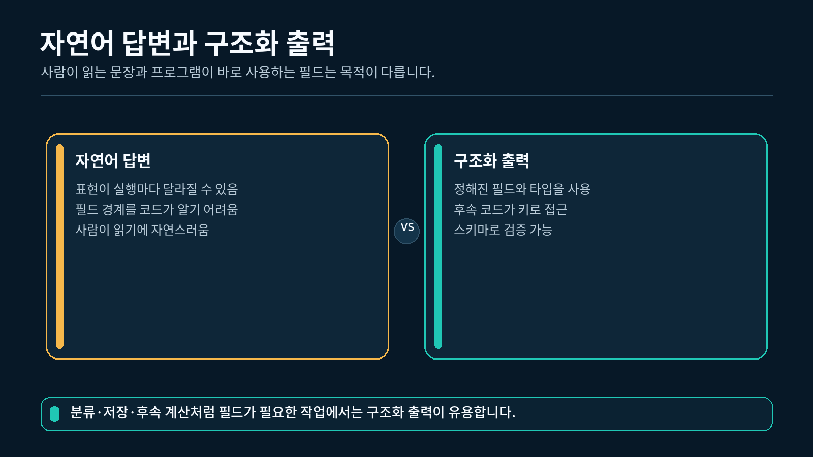
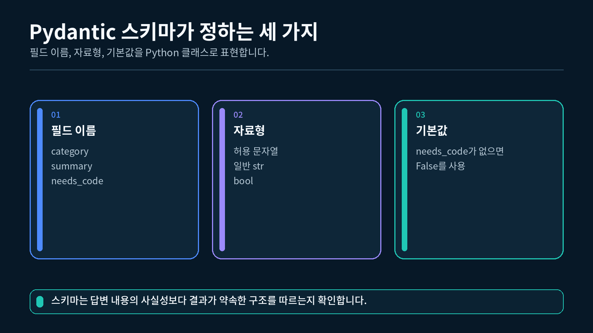
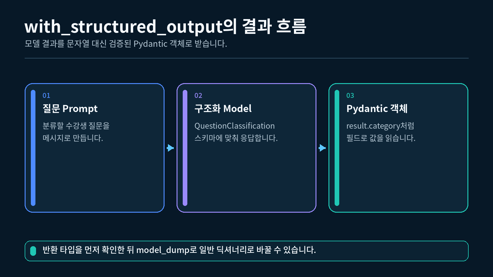

## 1. 자연어 출력과 구조화 출력 비교하기

지금까지 모델의 답변은 주로 일반 문자열로 받았습니다. 사람이 읽을 설명문에는 문자열이 편하지만, 프로그램이 답변의 일부를 꺼내 사용하려면 문제가 생길 수 있습니다.

예를 들어 수강생 질문을 분류하는 모델이 다음과 같이 답했다고 가정해 보겠습니다.

```
이 질문은 코드 실행 중 발생한 오류에 관한 질문이며 코드 예시가 필요합니다.
```

사람은 이 문장을 읽고 질문의 종류와 코드 필요 여부를 이해할 수 있습니다. 그러나 프로그램은 `"오류"`라는 분류와 `True`라는 값을 문장 안에서 다시 찾아야 합니다.

구조화 출력은 필요한 값을 필드별로 나눕니다.

```
category = "오류"
summary = "체인 실행 중 발생한 KeyError를 해결하려는 질문입니다."
needs_code = True
```

자연어 응답과 구조화 출력의 차이



### 두 출력 방식의 차이

| 구분 | 자연어 문자열 | 구조화 출력 |
| --- | --- | --- |
| 대표 자료형 | `str` | Pydantic 객체 |
| 값을 읽는 방법 | 문장을 다시 해석 | 정해진 필드에 접근 |
| 필드 누락 확인 | 직접 확인해야 함 | 스키마가 검증 |
| 허용값 제한 | 별도 코드 필요 | `Literal`로 표현 가능 |
| 적합한 상황 | 설명문을 그대로 보여 줄 때 | 분류, 저장, 조건 분기에 사용할 때 |

구조화 출력은 답변을 더 정확한 사실로 만들어 주는 기능이 아닙니다. 정해진 필드와 타입을 지켰는지를 확인하는 기능입니다.

예를 들어 `category="오류"`가 스키마를 통과했더라도 실제 질문을 잘못 분류했을 수 있습니다. **형식이 올바른지**와 **내용이 올바른지**는 구분해야 합니다.

---

## 2. Pydantic 스키마 만들기

스키마는 프로그램이 받을 데이터의 모양을 미리 적은 규칙입니다. 이번 강의에서는 다음 세 필드를 사용합니다.

| 필드 | 타입 | 규칙 |
| --- | --- | --- |
| `category` | 문자열 | `"개념"`, `"코드"`, `"오류"` 중 하나 |
| `summary` | 문자열 | 질문의 핵심을 정리한 한 문장 |
| `needs_code` | 불리언 | 코드 예시가 필요하면 `True` |

Pydantic에서는 `BaseModel`을 상속한 클래스로 이 규칙을 표현합니다.

BaseModel, Field, Literal로 만든 평면 스키마



### 2.1 가장 작은 스키마 정의

```python
# category에 허용할 문자열을 제한하기 위해 Literal을 가져옵니다.
from typing import Literal

# 데이터 모델과 필드 설명을 작성하기 위해 BaseModel과 Field를 가져옵니다.
from pydantic import BaseModel, Field

# 하나의 객체 안에 세 개의 단순 필드만 두는 평면 구조를 사용합니다.
# 질문 분류 결과가 가져야 할 필드와 타입을 클래스로 정의합니다.
class QuestionClassification(BaseModel):
    # category는 세 문자열 중 하나만 받을 수 있습니다.
    category: Literal["개념", "코드", "오류"] = Field(
        description="질문의 가장 알맞은 분류"
    )

    # summary는 질문의 핵심을 담는 필수 문자열입니다.
    summary: str = Field(
        description="질문의 핵심을 정리한 한 문장"
    )

    # Pydantic 객체를 직접 만들 때 needs_code를 생략하면 False를 사용합니다.
    needs_code: bool = Field(
        default=False,
        description="코드 예시가 필요한지 여부",
    )
```

이 코드는 모델을 호출하지 않습니다. Python 안에서 데이터의 모양만 정의하므로 API Key 없이도 실행할 수 있습니다.

### 2.2 각 도구의 역할

| 도구 | 이번 코드에서 하는 일 |
| --- | --- |
| `BaseModel` | 필드를 읽고 규칙에 맞는 객체를 만듦 |
| `Field` | 필드의 설명이나 기본값을 기록함 |
| `Literal` | 받을 수 있는 문자열을 정해진 목록으로 제한함 |

처음에는 스키마를 복잡하게 만들 필요가 없습니다. 후속 코드가 실제로 사용할 필드만 먼저 정의하는 것이 좋습니다.

---

## 3. 필수 필드와 기본값 확인하기

Pydantic 객체를 Python 코드에서 직접 만들 때 기본값이 없는 필드는 반드시 전달해야 합니다. 기본값이 있는 필드는 생략할 수 있습니다.

이번 스키마에서 `category`와 `summary`는 필수 필드입니다. `needs_code`에는 `False`라는 기본값이 있습니다.

### 3.1 기본값 동작 확인

```python
# 허용할 분류 문자열을 제한하기 위해 Literal을 가져옵니다.
from typing import Literal

# Pydantic 스키마를 만들기 위한 클래스를 가져옵니다.
from pydantic import BaseModel, Field

# 이 예제도 이전과 같은 세 필드만 사용합니다.
# 질문 분류 결과의 세 필드를 정의합니다.
class QuestionClassification(BaseModel):
    # 분류는 개념, 코드, 오류 중 하나여야 합니다.
    category: Literal["개념", "코드", "오류"] = Field(
        description="질문의 분류"
    )

    # 요약은 반드시 전달해야 하는 문자열입니다.
    summary: str = Field(
        description="질문의 한 문장 요약"
    )

    # 코드 필요 여부를 생략하면 False를 사용합니다.
    needs_code: bool = Field(
        default=False,
        description="코드 예시가 필요한지 여부",
    )

# 필수 필드 두 개만 전달해 Pydantic 객체를 만듭니다.
result = QuestionClassification(
    # category는 Literal의 허용 목록에 있는 값을 사용합니다.
    category="개념",
    # summary는 기본값이 없으므로 반드시 전달합니다.
    summary="LCEL의 의미를 묻는 질문입니다.",
)

# 생략한 needs_code가 어떤 값을 사용하는지 확인합니다.
print(result.needs_code)
```

```
False
```

Python 코드에서 `needs_code`를 전달하지 않았지만 `Field(default=False)`가 있으므로 Pydantic 객체가 정상적으로 만들어집니다.

### 3.2 허용하지 않은 분류 값

```python
# 잘못된 category가 거부되는지 확인하기 위해 ValidationError를 가져옵니다.
from pydantic import ValidationError

try:
    # "기타"는 Literal에 포함되지 않으므로 객체 생성이 실패합니다.
    wrong_result = QuestionClassification(
        category="기타",
        summary="분류할 수 없는 질문입니다.",
    )
except ValidationError:
    # ValidationError를 잡았으므로 프로그램이 Traceback으로 끝나지 않습니다.
    # 긴 오류 전문 대신 현재 학습에 필요한 사실만 출력합니다.
    print("category는 개념, 코드, 오류 중 하나여야 합니다.")
```

```
category는 개념, 코드, 오류 중 하나여야 합니다.
```

Pydantic은 클래스에 적은 규칙을 기준으로 객체를 만들기 전에 값을 검사합니다. 이 단계에서는 모델 응답이 아니라 직접 만든 Python 값을 검사하고 있습니다.

---

## 4. Pydantic 객체 사용하기

검증을 통과한 결과는 일반 딕셔너리가 아니라 `QuestionClassification` 객체입니다. 점 표기법으로 필드에 접근할 수 있습니다.

### 4.1 필드 읽기

```python
# 세 필드가 모두 올바른 Pydantic 객체를 만듭니다.
result = QuestionClassification(
    # category에는 허용된 "코드"를 전달합니다.
    category="코드",
    # summary에는 질문의 핵심 문장을 전달합니다.
    summary="RunnableParallel 예제 코드를 요청한 질문입니다.",
    # 코드 예시가 필요하므로 True를 명시합니다.
    needs_code=True,
)

# 점 표기법으로 각 필드 값을 읽습니다.
print(result.category)
print(result.summary)
print(result.needs_code)
```

```
코드
RunnableParallel 예제 코드를 요청한 질문입니다.
True
```

`result["category"]`가 아니라 `result.category`로 접근한다는 점을 기억하세요.

### 4.2 딕셔너리로 변환하기

JSON으로 출력하거나 기존 딕셔너리 코드에 전달해야 한다면 `model_dump()`를 사용합니다.

```python
# Pydantic 객체를 일반 Python 딕셔너리로 변환합니다.
result_dict = result.model_dump()

# 변환된 자료형과 category 값을 확인합니다.
print(type(result_dict).__name__)
print(result_dict["category"])
```

```
dict
코드
```

스키마 검증을 받을 때는 Pydantic 객체가 편하고, JSON 저장이나 딕셔너리 기반 함수에 전달할 때는 `model_dump()` 결과가 편합니다.

---

## 5. `with_structured_output()` 이해하기

`ChatOpenAI`의 기본 `invoke()` 결과는 `AIMessage`입니다. `with_structured_output(스키마)`를 적용하면 지정한 스키마에 맞는 객체를 받도록 모델을 설정할 수 있습니다.

여기서 로컬 Pydantic 객체 생성과 모델의 구조화 출력을 구분해야 합니다. Python 코드에서 객체를 직접 만들 때는 기본값이 있는 `needs_code`를 생략할 수 있습니다. 

반면 현재 `ChatOpenAI.with_structured_output()`이 모델에 전달하는 출력 형식은 `category`, `summary`, `needs_code` 세 필드를 모두 응답에 포함하도록 요청합니다.

Prompt부터 Pydantic 객체까지 이어지는 structured output 흐름



흐름은 다음과 같습니다.

```
질문 딕셔너리
→ Prompt가 역할별 메시지를 만듭니다.
→ 구조화 모델이 스키마에 맞는 답변을 생성합니다.
→ QuestionClassification 객체를 반환합니다.
```

### 5.1 구조화 모델 만들기

```python
# .env에서 지정한 권장 모델을 읽습니다.
import os
from dotenv import load_dotenv

# OpenAI ChatModel을 LangChain 방식으로 사용하기 위해 가져옵니다.
from langchain_openai import ChatOpenAI

# .env의 OPENAI_API_KEY를 사용하는 ChatModel을 만듭니다.
load_dotenv()

model = ChatOpenAI(model=os.getenv("OPENAI_MODEL", "gpt-5.6-luna"))

# 원래 model은 그대로 두고 구조화 출력을 위한 새 실행 객체를 만듭니다.
# 모델이 QuestionClassification 스키마에 맞는 객체를 반환하도록 설정합니다.
structured_model = model.with_structured_output(
    QuestionClassification
)
```

`structured_model`은 원래 모델과 별도의 API가 아닙니다. 같은 ChatModel에 원하는 출력 스키마를 알려 준 실행 객체입니다.

### 5.2 구조화 모델 호출 결과

```python
# 분류할 질문을 자연어 메시지로 전달합니다.
result = structured_model.invoke(
    # 질문 앞에 수행할 분류 작업과 허용값을 함께 적습니다.
    "다음 질문을 개념, 코드, 오류 중 하나로 분류하세요: "
    # 실제로 분류할 수강생 질문을 뒤에 이어 붙입니다.
    "체인을 실행했는데 KeyError가 발생합니다."
)

# 먼저 반환된 값이 어떤 Pydantic 클래스인지 확인합니다.
# 반환된 객체의 클래스와 필드 값을 확인합니다.
print(type(result).__name__)
print(result.category)
print(result.needs_code)
```

출력 예시는 다음과 같습니다.

```
QuestionClassification
오류
True
```

모델이 만드는 `summary` 문장이나 분류 결과는 실행할 때 달라질 수 있습니다. 문장을 글자 단위로 비교하지 말고, 반환 자료형과 세 필드가 스키마를 따르는지 확인하세요.

---

## 6. Prompt와 구조화 모델 연결하기

분류 기준과 실제 질문을 분리하려면 `ChatPromptTemplate`을 사용합니다. 3장에서 배운 `|` 연산자로 Prompt와 구조화 모델을 순서대로 연결할 수 있습니다.

### 6.1 Prompt 만들기

```python
# 역할별 메시지 Prompt를 만들기 위해 클래스를 가져옵니다.
from langchain_core.prompts import ChatPromptTemplate

# system 메시지는 매 실행에서 유지할 고정 규칙을 담습니다.
# 고정 분류 기준과 실행할 때 바뀌는 질문을 분리합니다.
prompt = ChatPromptTemplate.from_messages(
    [
        # 첫 메시지에는 분류 기준과 summary 작성 규칙을 넣습니다.
        (
            "system",
            "수강생 질문을 개념, 코드, 오류 중 하나로 분류하세요. "
            "summary는 한 문장으로 작성하세요.",
        ),
        # 두 번째 메시지의 question 변수는 실행할 때 값을 받습니다.
        ("human", "{question}"),
    ]
)
```

### 6.2 체인 만들고 실행하기

```python
# Prompt의 메시지를 구조화 모델에 전달하는 체인을 만듭니다.
chain = prompt | structured_model

# invoke에는 Prompt 변수와 같은 이름의 키를 전달합니다.
# question 변수에 실제 수강생 질문을 넣어 체인을 실행합니다.
result = chain.invoke(
    {
        "question": (
            "체인을 실행했는데 KeyError가 발생합니다. "
            "코드로 확인해 주세요."
        )
    }
)

# 검증된 객체에서 필요한 필드를 읽습니다.
print(result.category)
print(result.summary)
print(result.needs_code)
```

출력 예시는 다음과 같습니다.

```
오류
체인 실행 중 발생한 KeyError를 해결하려는 질문입니다.
True
```

Prompt는 무엇을 분류할지 알려 주고, 스키마는 어떤 필드와 타입으로 받을지 정합니다. 두 역할은 서로 다릅니다.

---

## 7. 완성 실습 실행하기

이번 강의 폴더의 `실습.py`는 로컬 스키마 확인과 실제 구조화 출력을 한 파일에서 차례대로 실행합니다.

### 7.1 완성 실습의 실행 순서

1. `QuestionClassification` 스키마를 정의합니다.
2. API 호출 없이 로컬 Pydantic 객체를 만듭니다.
3. `.env`에서 `OPENAI_API_KEY`와 선택적인 `OPENAI_MODEL`을 읽습니다.
4. API Key가 있으면 `ChatOpenAI`를 만듭니다.
5. Prompt와 `with_structured_output()`이 적용된 모델을 연결합니다.
6. 질문을 전달하고 `QuestionClassification` 객체인지 확인합니다.
7. `model_dump()`로 딕셔너리를 만든 뒤 JSON 형태로 출력합니다.

### 7.2 실행하기

VS Code에서 `5-1_Pydantic_schema와_structured_output` 폴더의 터미널을 열고 실행합니다.

1-2강에서 만든 `pyproject.toml`과 `uv.lock`이 있는 프로젝트의 하위 폴더에 `실습.py`를 두고, 해당 폴더에서 실행합니다. VS Code 인터프리터는 이 프로젝트의 `.venv` (Python 3.12)를 선택합니다.

```bash
uv run python 실습.py
```
"""5-1강: Pydantic 스키마를 정의하고 모델 응답을 검증된 객체로 받습니다."""

import json
import os
from typing import Literal

from dotenv import load_dotenv
from langchain_core.prompts import ChatPromptTemplate
from langchain_openai import ChatOpenAI
from pydantic import BaseModel, Field


# .env에 모델명이 없을 때 사용할 수업 기본 모델을 지정합니다.
DEFAULT_MODEL = "gpt-5-nano"

# 기본값 동작 확인
class QuestionClassification(BaseModel):
    """수강생 질문을 분류한 결과의 필드와 타입을 정의합니다."""

    # category는 세 개의 허용값 중 하나만 받을 수 있습니다.
    category: Literal["개념", "코드", "오류"] = Field(
        description="질문의 가장 알맞은 분류"
    )

    # summary는 질문의 핵심을 한 문장으로 정리한 문자열입니다.
    summary: str = Field(
        description="질문의 핵심을 정리한 한 문장"
    )

    # Pydantic 객체를 직접 만들 때 needs_code를 생략하면 False를 사용합니다.
    needs_code: bool = Field(
        default=False,
        description="코드 예시가 필요한지 여부",
    )


def build_model(api_key: str, model_name: str) -> ChatOpenAI:
    """환경변수에서 읽은 설정으로 OpenAI ChatModel을 만듭니다."""

    # API Key와 모델명을 코드에 직접 적지 않고 함수 인자로 전달합니다.
    return ChatOpenAI(
        api_key=api_key,
        model=model_name,
    )

# Prompt a만들기
def build_structured_chain(model):
    """질문 Prompt와 Pydantic 구조화 모델을 연결합니다."""

    # 질문 분류 기준과 실제 질문을 역할별 메시지로 만듭니다.
    prompt = ChatPromptTemplate.from_messages(
        [
            (
                "system",
                "수강생 질문을 개념, 코드, 오류 중 하나로 분류하세요. "
                "summary는 한 문장으로 작성하세요.",
            ),
            ("human", "{question}"),
        ]
    )

    # 모델 응답이 QuestionClassification 스키마를 따르도록 설정합니다.
    structured_model = model.with_structured_output(QuestionClassification)

    # Prompt의 출력을 구조화 모델에 전달하는 체인을 반환합니다.
    return prompt | structured_model


def show_local_schema_example() -> None:
    """API 호출 없이 Pydantic 객체 생성과 기본값 동작을 먼저 확인합니다."""

    # 필수 필드 두 개만 전달해 Pydantic 객체를 만듭니다.
    local_result = QuestionClassification(
        category="개념",
        summary="LCEL의 의미를 묻는 질문입니다.",
    )

    # 생략한 needs_code가 기본값 False를 사용했는지 확인합니다.
    print(f"[로컬 객체] {local_result}")
    print(f"[로컬 기본값] {local_result.needs_code}")


def main() -> None:
    """로컬 스키마를 확인한 뒤 실제 모델의 구조화 출력을 한 번 받습니다."""

    # 먼저 API 비용 없이 Pydantic 스키마의 기본 동작을 확인합니다.
    show_local_schema_example()

    # 실습 폴더 또는 상위 폴더의 .env 값을 현재 Python 프로세스로 불러옵니다.
    load_dotenv()

    # API Key는 환경변수에서 읽고 실제 값은 화면에 출력하지 않습니다.
    api_key = os.getenv("OPENAI_API_KEY")

    # 모델명은 환경변수로 바꿀 수 있고, 없으면 수업 기본값을 사용합니다.
    model_name = os.getenv("OPENAI_MODEL", DEFAULT_MODEL)

    # API Key가 없으면 로컬 예제까지만 실행했음을 알려 주고 종료합니다.
    if not api_key:
        print("OPENAI_API_KEY가 없어 실제 구조화 출력 호출은 건너뜁니다.")
        print("1-2강에서 만든 .env 파일을 확인해 주세요.")
        return

    # 환경 설정으로 실제 OpenAI ChatModel을 만듭니다.
    model = build_model(api_key, model_name)

    # Prompt와 Pydantic 구조화 모델을 연결한 체인을 만듭니다.
    chain = build_structured_chain(model)

    # 수강생 질문을 한 번 전달해 검증된 Pydantic 객체를 받습니다.
    result = chain.invoke(
        {"question": "체인을 실행했는데 KeyError가 발생합니다. 코드로 확인해 주세요."}
    )

    # 예상한 Pydantic 클래스가 반환되었는지 확인합니다.
    if not isinstance(result, QuestionClassification):
        raise TypeError("QuestionClassification 객체가 반환되지 않았습니다.")

    # Pydantic 객체를 일반 딕셔너리로 바꿉니다.
    result_dict = result.model_dump()

    # 필드와 한글을 읽기 쉬운 JSON 형태로 출력합니다.
    print("[실제 구조화 출력]")
    print(json.dumps(result_dict, ensure_ascii=False, indent=2))


if __name__ == "__main__":
    # 터미널에서 python 실습.py로 실행했을 때만 실제 모델 호출까지 진행합니다.
    main()

### 7.3 API Key가 없을 때의 결과

```
[로컬 객체] category='개념' summary='LCEL의 의미를 묻는 질문입니다.' needs_code=False
[로컬 기본값] False
OPENAI_API_KEY가 없어 실제 구조화 출력 호출은 건너뜁니다.
1-2강에서 만든 .env 파일을 확인해 주세요.
```

앞의 두 줄은 API 호출 없이 실행됩니다. 따라서 API Key가 없어도 Pydantic 객체와 기본값 동작을 먼저 확인할 수 있습니다.

### 7.4 API Key가 있을 때의 결과

```
[로컬 객체] category='개념' summary='LCEL의 의미를 묻는 질문입니다.' needs_code=False
[로컬 기본값] False
[실제 구조화 출력]
{
  "category": "오류",
  "summary": "체인 실행 중 발생한 KeyError를 해결하려는 질문입니다.",
  "needs_code": true
}
```

`summary`의 문구는 달라질 수 있습니다. 다음 항목을 확인하면 됩니다.

- `[실제 구조화 출력]` 아래에 세 필드가 모두 있는가?
- `category`가 `"개념"`, `"코드"`, `"오류"` 중 하나인가?
- `needs_code`가 따옴표 없는 `true` 또는 `false`로 표시되는가?
- 실행 중 `QuestionClassification 객체가 반환되지 않았습니다.` 오류가 발생하지 않았는가?

### 7.5 완성 실습의 핵심 연결

```python
# ChatModel에 반환할 Pydantic 스키마를 지정합니다.
structured_model = model.with_structured_output(
    QuestionClassification
)

# Prompt와 구조화 모델의 실행 순서를 LCEL로 표현합니다.
# Prompt가 만든 메시지를 구조화 모델에 전달합니다.
chain = prompt | structured_model

# 입력 딕셔너리의 question 키가 Prompt의 변수를 채웁니다.
# 질문을 전달하고 검증된 Pydantic 객체를 받습니다.
result = chain.invoke(
    {"question": "체인을 실행했는데 KeyError가 발생합니다."}
)
```

이 세 단계가 이번 강의의 핵심입니다. 처음부터 모든 코드를 외우기보다 `스키마 지정 → 체인 연결 → 객체 반환`의 흐름을 이해하세요.