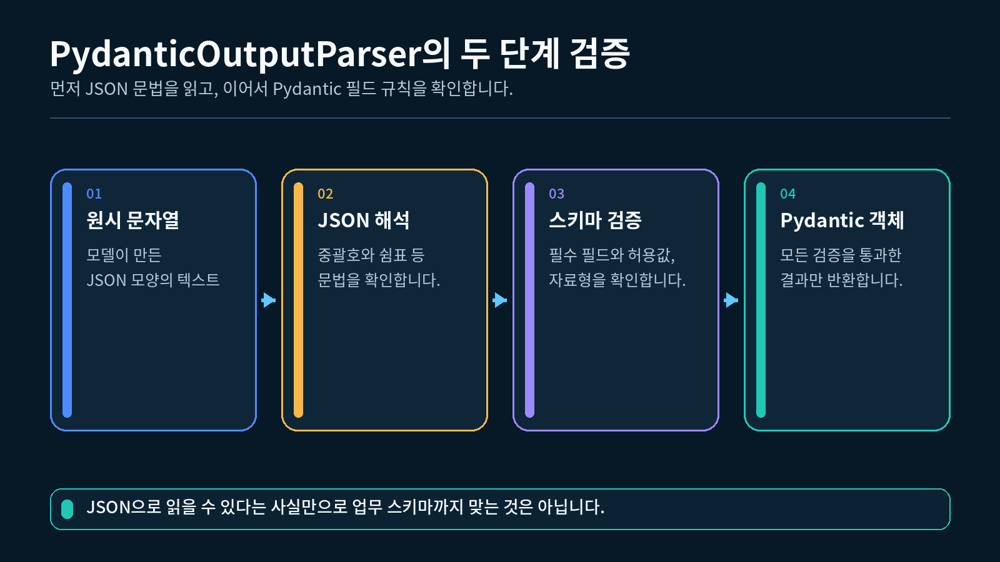
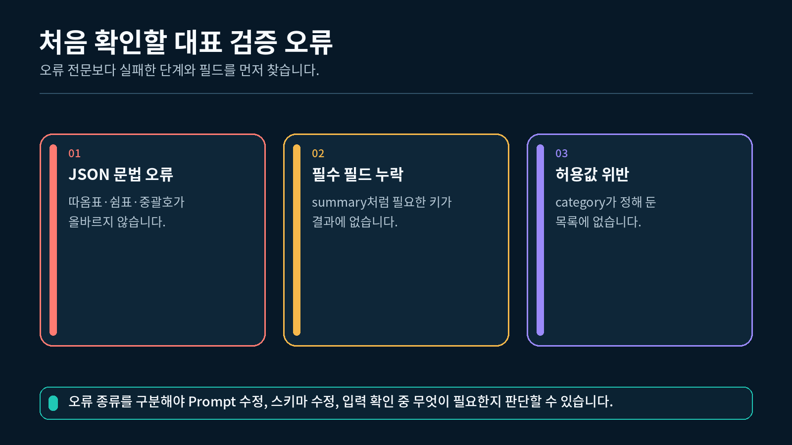

## 1. Parser 검증이 필요한 이유

5-1강에서는 `with_structured_output()`을 사용해 모델에서 Pydantic 객체를 직접 받았습니다. 이번 강의에서는 이미 만들어진 문자열을 Pydantic 스키마에 맞게 변환하고 검증합니다.

다음 문자열은 겉으로 보기에 JSON입니다.

```
{"category":"개념","summary":"LCEL의 의미를 묻는 질문입니다."}
```

그러나 JSON 문법이 맞다는 사실만으로 애플리케이션이 원하는 규칙을 모두 만족한다고 볼 수는 없습니다.

- 필수 `summary`가 들어 있는가?
- `category`가 허용된 값인가?
- `needs_code`가 불리언인가?

`PydanticOutputParser`는 JSON 문자열을 읽은 뒤 Pydantic 스키마로 필드와 값을 확인합니다.

문자열이 Parser와 Pydantic 검증을 거치는 흐름



### Parser 검증의 세 단계

```
JSON 문자열
→ JSON 문법을 읽습니다.
→ Pydantic 스키마로 필드와 값을 검사합니다.
→ 검증된 Pydantic 객체를 반환합니다.
```

이 강의에서 사용하는 쉼표 누락처럼 Parser가 JSON을 읽지 못하거나, 두 번째 단계에서 스키마를 만족하지 못하면 객체가 만들어지지 않습니다.

---

## 2. `PydanticOutputParser` 준비하기

Parser를 만들기 전에 어떤 Pydantic 객체로 변환할지 스키마를 정의해야 합니다.

### 2.1 스키마 정의하기

```python
# category에 허용할 문자열을 제한하기 위해 Literal을 가져옵니다.
from typing import Literal

# Pydantic 스키마와 필드 설명을 만들기 위한 클래스를 가져옵니다.
from pydantic import BaseModel, Field

# 질문 분류 결과의 필드와 타입을 정의합니다.
class QuestionClassification(BaseModel):
    # category는 개념, 코드, 오류 중 하나만 허용합니다.
    category: Literal["개념", "코드", "오류"] = Field(
        description="질문의 가장 알맞은 분류"
    )

    # summary는 반드시 포함되어야 하는 문자열입니다.
    summary: str = Field(
        description="질문의 핵심을 정리한 한 문장"
    )

    # needs_code는 생략하면 False를 사용하는 필드입니다.
    needs_code: bool = Field(
        default=False,
        description="코드 예시가 필요한지 여부",
    )
```

5-1강과 같은 평면 스키마입니다. 이번에는 이 클래스를 Parser에 전달합니다.

### 2.2 Parser 만들기

```python
# JSON 문자열을 Pydantic 객체로 바꾸는 Parser를 가져옵니다.
from langchain_core.output_parsers import PydanticOutputParser

# QuestionClassification 스키마를 사용하는 Parser를 만듭니다.
parser = PydanticOutputParser(
    pydantic_object=QuestionClassification
)
```

`pydantic_object`에는 이미 만든 Pydantic **클래스**를 전달합니다. `QuestionClassification()`처럼 객체를 먼저 만들 필요가 없습니다.

### 2.3 형식 안내 확인하기

Parser는 모델에게 전달할 수 있는 형식 안내도 만들 수 있습니다.

```python
# 현재 Parser가 요구하는 출력 형식 안내를 만듭니다.
format_instructions = parser.get_format_instructions()

# 안내가 문자열인지 확인합니다.
print(type(format_instructions).__name__)
```

```
str
```

`get_format_instructions()`는 형식 안내 문자열을 만들 뿐, 모델을 호출하지 않습니다. 실제 모델 Prompt에 이 안내를 넣는 방법은 이후 완성 앱에서 사용할 수 있습니다.

---

## 3. 정상 JSON 문자열 검증하기

`parse()`에 올바른 JSON 문자열을 전달하면 Parser가 `QuestionClassification` 객체를 반환합니다.

### 3.1 정상 문자열 준비하기

```python
# 세 필드가 모두 올바른 JSON 문자열을 준비합니다.
valid_output = (
    '{"category":"개념",'
    '"summary":"LCEL의 의미를 묻는 질문입니다.",'
    '"needs_code":false}'
)
```

Python 코드 안의 전체 값은 문자열입니다. JSON 안의 `false`는 따옴표가 없는 JSON 불리언입니다.

### 3.2 Parser로 변환하기

```python
# JSON 문자열을 검증된 Pydantic 객체로 변환합니다.
result = parser.parse(valid_output)

# 반환된 클래스 이름과 필요한 필드를 확인합니다.
print(type(result).__name__)
print(result.category)
print(result.needs_code)
```

```
QuestionClassification
개념
False
```

Parser가 JSON을 읽고 스키마까지 확인했으므로 결과는 단순 딕셔너리가 아니라 `QuestionClassification` 객체입니다.

### 3.3 기본값이 적용되는 경우

`needs_code`는 기본값이 있으므로 JSON에서 생략할 수 있습니다.

```python
# 선택 필드 needs_code를 생략한 JSON 문자열을 준비합니다.
output_without_optional_field = (
    '{"category":"개념",'
    '"summary":"Prompt의 역할을 묻는 질문입니다."}'
)

# Parser로 문자열을 Pydantic 객체로 변환합니다.
result = parser.parse(output_without_optional_field)

# 생략한 필드가 기본값을 사용했는지 확인합니다.
print(result.needs_code)
```

```
False
```

반대로 기본값이 없는 `summary`는 생략할 수 없습니다.

---

## 4. 대표적인 검증 실패 비교하기

Parser 검증은 크게 JSON 문법 오류와 스키마 오류에서 실패할 수 있습니다.

JSON 문법 오류, 필드 누락, 허용값 위반 비교



### 4.1 JSON 문법 오류

다음 문자열은 `category` 값 뒤의 쉼표가 빠졌습니다.

```python
# 쉼표가 빠져 JSON 문법이 깨진 문자열을 준비합니다.
broken_json = (
    '{"category":"개념" '
    '"summary":"쉼표가 빠진 출력입니다."}'
)
```

Parser는 JSON을 먼저 읽을 수 없으므로 검증된 객체를 만들지 못합니다.

### 4.2 필수 필드 누락

다음 문자열은 JSON 문법은 맞지만 필수 `summary`가 없습니다.

```python
# 필수 summary 필드가 없는 JSON 문자열을 준비합니다.
missing_field_output = (
    '{"category":"개념","needs_code":false}'
)
```

JSON 객체로는 읽을 수 있지만 `QuestionClassification` 객체를 만들 수는 없습니다.

### 4.3 `Literal` 허용값 위반

다음 문자열의 `category`는 스키마에 없는 `"기타"`입니다.

```python
# category의 허용 목록에 없는 값을 사용한 문자열을 준비합니다.
wrong_value_output = (
    '{"category":"기타",'
    '"summary":"허용되지 않은 분류 값을 사용했습니다.",'
    '"needs_code":false}'
)
```

필드 이름과 JSON 문법은 맞지만 `Literal` 규칙을 만족하지 못합니다.

### 4.4 Parser 실패 잡기

`PydanticOutputParser.parse()`가 변환하지 못하면 호출한 쪽에서는 `OutputParserException`을 잡습니다.

```python
# Parser 변환 실패를 처리하기 위한 예외를 가져옵니다.
from langchain_core.exceptions import OutputParserException

try:
    # 필수 필드가 빠진 문자열을 Parser에 전달합니다.
    result = parser.parse(missing_field_output)
except OutputParserException:
    # 실패한 문자열을 정상 객체처럼 사용하지 않고 안내합니다.
    print("Parser 검증에 실패했습니다.")
```

```
Parser 검증에 실패했습니다.
```

실패를 빈 객체나 임의의 기본값으로 바꾸지 않았기 때문에 후속 코드가 잘못된 결과를 정상으로 오해하지 않습니다.

---

## 5. 두 예외의 발생 위치 구분하기

이번 강의에서 이름이 비슷하게 느껴질 수 있는 두 예외를 구분해야 합니다.

| 호출한 코드 | 실패할 때 잡는 대표 예외 | 의미 |
| --- | --- | --- |
| `parser.parse(JSON_문자열)` | `OutputParserException` | Parser가 문자열을 목표 객체로 만들지 못함 |
| `QuestionClassification.model_validate(딕셔너리)` | `ValidationError` | Pydantic이 딕셔너리를 스키마에 맞는 객체로 만들지 못함 |

`PydanticOutputParser` 내부에서도 Pydantic 검증을 사용하지만, Parser를 호출한 코드에는 LangChain의 Parser 예외로 전달됩니다. 직접 Pydantic을 호출하면 Pydantic의 `ValidationError`를 만납니다.

### 5.1 Parser를 직접 호출하는 경우

```python
# Parser 계층의 실패를 처리하기 위한 예외를 가져옵니다.
from langchain_core.exceptions import OutputParserException

try:
    # 문자열을 Parser로 변환하고 검증합니다.
    parser.parse(missing_field_output)
except OutputParserException:
    # Parser를 호출했으므로 Parser 예외를 처리합니다.
    print("OutputParserException")
```

```
OutputParserException
```

### 5.2 Pydantic을 직접 호출하는 경우

```python
# JSON 문자열을 Python 딕셔너리로 읽기 위해 json을 가져옵니다.
import json

# Pydantic 직접 검증 실패를 처리하기 위해 ValidationError를 가져옵니다.
from pydantic import ValidationError

# JSON 문법이 올바른 문자열을 Python 딕셔너리로 바꿉니다.
parsed_data = json.loads(missing_field_output)

try:
    # 딕셔너리를 Pydantic 스키마로 직접 검증합니다.
    QuestionClassification.model_validate(parsed_data)
except ValidationError:
    # Pydantic을 직접 호출했으므로 ValidationError를 처리합니다.
    print("ValidationError")
```

```
ValidationError
```

두 예외 중 무엇이 더 좋은지를 고르는 문제가 아닙니다. **어떤 함수를 호출했는지**에 따라 알맞은 예외를 처리해야 합니다.

---

## 6. 짧고 읽기 쉬운 오류 정보 만들기

초보 단계에서 긴 예외 전문을 한꺼번에 읽으면 핵심 필드를 찾기 어렵습니다. Pydantic의 오류 목록에서 첫 오류의 필드 위치와 유형을 확인해 보겠습니다.

예외 정보에서 필드 위치와 오류 유형을 읽는 순서

!5-2_03_오류읽기.png

### 6.1 첫 오류의 위치와 유형 읽기

```python
# JSON 문자열을 Python 값으로 바꾸기 위해 json을 가져옵니다.
import json

# Pydantic 검증 오류를 처리하기 위해 ValidationError를 가져옵니다.
from pydantic import ValidationError

# 필수 summary가 빠진 JSON 문자열을 딕셔너리로 바꿉니다.
parsed_data = json.loads(
    '{"category":"개념","needs_code":false}'
)

try:
    # 딕셔너리를 질문 분류 스키마로 직접 검증합니다.
    QuestionClassification.model_validate(parsed_data)
except ValidationError as error:
    # 오류 목록에서 처음 확인할 한 건을 가져옵니다.
    first_error = error.errors(
        include_input=False
    )[0]

    # 문제가 발생한 필드 경로를 문자열로 연결합니다.
    field_path = ".".join(
        str(part) for part in first_error["loc"]
    )

    # 필드 이름과 표준 오류 유형을 짧게 출력합니다.
    print(f"필드={field_path}")
    print(f"유형={first_error['type']}")
```

```
필드=summary
유형=missing
```

### 6.2 대표 오류 유형 읽기

| 상황 | 필드 경로 예시 | 오류 유형 예시 |
| --- | --- | --- |
| 필수 필드 누락 | `summary` | `missing` |
| `Literal` 허용값 위반 | `category` | `literal_error` |
| 불리언 타입 문제 | `needs_code` | 타입 관련 오류 |

오류 유형은 현재 환경의 Pydantic 버전과 입력 값에 따라 세부 표현이 달라질 수 있습니다. 가장 먼저 필드 위치를 확인하고, 그다음 유형을 읽으세요.

완성 실습에서는 Parser 실패를 `OutputParserException`으로 잡은 뒤, 학습용 설명 함수에서 JSON 문법과 Pydantic 스키마를 차례로 확인합니다.

---

## 7. 완성 실습 실행하기

이번 강의의 `실습.py`는 실제 모델을 호출하지 않습니다. 세 개의 고정 문자열을 같은 Parser로 검증하므로 실행할 때마다 결과가 같습니다.

### 7.1 완성 실습의 세 입력

| 사례 | 입력 특징 | 예상 결과 |
| --- | --- | --- |
| 정상 출력 | 모든 필드와 값이 올바름 | `QuestionClassification` 객체 |
| 필수 필드 누락 | `summary`가 없음 | `summary`의 `missing` |
| 허용값 위반 | `category="기타"` | `category`의 `literal_error` |

### 7.2 실행하기

VS Code에서 `5-2_Parser_기반_검증과_validation_error` 폴더의 터미널을 열고 실행합니다.

1-2강에서 만든 `pyproject.toml`과 `uv.lock`이 있는 프로젝트의 하위 폴더에 `실습.py`를 두고, 해당 폴더에서 실행합니다. VS Code 인터프리터는 이 프로젝트의 `.venv` (Python 3.12)를 선택합니다.

```bash
uv run python 실습.py
```

"""5-2강: PydanticOutputParser로 정상 출력과 대표 검증 실패를 비교합니다."""

import json
from typing import Literal

from langchain_core.exceptions import OutputParserException
from langchain_core.output_parsers import PydanticOutputParser
from pydantic import BaseModel, Field, ValidationError


class QuestionClassification(BaseModel):
    """수강생 질문 분류 결과의 허용 필드와 타입을 정의합니다."""

    # category는 정해진 세 문자열 중 하나만 허용합니다.
    category: Literal["개념", "코드", "오류"] = Field(
        description="질문의 가장 알맞은 분류"
    )

    # summary는 반드시 포함되어야 하는 문자열 필드입니다.
    summary: str = Field(
        description="질문의 핵심을 정리한 한 문장"
    )

    # needs_code는 생략할 수 있고 생략하면 False를 사용합니다.
    needs_code: bool = Field(
        default=False,
        description="코드 예시가 필요한지 여부",
    )


def explain_validation_failure(raw_output: str) -> str:
    """원문을 출력하지 않고 JSON 또는 스키마 실패 위치만 짧게 설명합니다."""

    try:
        # 먼저 표준 json 모듈로 JSON 문법이 올바른지 확인합니다.
        parsed_data = json.loads(raw_output)
    except json.JSONDecodeError:
        # JSON 문법 자체가 깨졌다면 필드 검증 전에 문법 오류로 분류합니다.
        return "JSON 문법 오류"

    try:
        # JSON 문법이 맞으면 Pydantic으로 필드와 타입을 다시 검증합니다.
        QuestionClassification.model_validate(parsed_data)
    except ValidationError as error:
        # 여러 오류 중 처음 확인할 한 건만 가져옵니다.
        first_error = error.errors(include_input=False)[0]

        # 중첩 위치도 읽을 수 있도록 필드 경로를 점으로 연결합니다.
        field_path = ".".join(str(part) for part in first_error["loc"])

        # 원본 입력 대신 필드명과 표준 오류 유형만 반환합니다.
        return f"스키마 오류 · 필드={field_path} · 유형={first_error['type']}"

    # 직접 검증은 통과했는데 Parser가 실패했다면 Parser 설정을 확인하도록 안내합니다.
    return "Parser 설정 확인 필요"


def parse_case(
    parser: PydanticOutputParser,
    case_name: str,
    raw_output: str,
) -> None:
    """하나의 문자열을 Parser로 검증하고 성공 또는 짧은 실패 이유를 출력합니다."""

    # 여러 검증 사례의 출력이 섞이지 않도록 현재 사례 이름을 먼저 표시합니다.
    print(f"\n[{case_name}]")

    try:
        # JSON 문자열을 QuestionClassification 객체로 변환합니다.
        result = parser.parse(raw_output)
    except OutputParserException:
        # 긴 Parser 예외 전문 대신 학습에 필요한 실패 유형만 출력합니다.
        print(f"검증 실패: {explain_validation_failure(raw_output)}")
        return

    # 검증을 통과한 결과의 클래스 이름을 확인합니다.
    print(f"검증 성공: {type(result).__name__}")

    # 후속 코드가 바로 사용할 category 값을 출력합니다.
    print(f"category={result.category}")


def main() -> None:
    """정상, 필수 필드 누락, 허용값 위반 사례를 같은 Parser로 실행합니다."""

    # QuestionClassification 스키마를 사용하는 Pydantic Parser를 만듭니다.
    parser = PydanticOutputParser(
        pydantic_object=QuestionClassification
    )

    # 모든 필드가 올바른 정상 JSON 문자열을 준비합니다.
    valid_output = (
        '{"category":"개념",'
        '"summary":"LCEL의 의미를 묻는 질문입니다.",'
        '"needs_code":false}'
    )

    # 필수 summary 필드가 빠진 JSON 문자열을 준비합니다.
    missing_field_output = (
        '{"category":"개념","needs_code":false}'
    )

    # category가 허용 목록에 없는 JSON 문자열을 준비합니다.
    wrong_value_output = (
        '{"category":"기타",'
        '"summary":"분류할 수 없는 값을 사용했습니다.",'
        '"needs_code":false}'
    )

    # 정상 문자열이 Pydantic 객체로 변환되는지 확인합니다.
    parse_case(parser, "정상 출력", valid_output)

    # 필수 필드 누락이 검증 실패로 처리되는지 확인합니다.
    parse_case(parser, "필수 필드 누락", missing_field_output)

    # Literal 허용값 위반이 검증 실패로 처리되는지 확인합니다.
    parse_case(parser, "허용값 위반", wrong_value_output)


if __name__ == "__main__":
    # 터미널에서 python 실습.py로 실행했을 때만 세 사례를 실행합니다.
    main()

### 7.3 전체 예상 결과

```
[정상 출력]
검증 성공: QuestionClassification
category=개념

[필수 필드 누락]
검증 실패: 스키마 오류 · 필드=summary · 유형=missing

[허용값 위반]
검증 실패: 스키마 오류 · 필드=category · 유형=literal_error
```

이 실습에서 주의할 부분은 다음과 같습니다.

- 정상 사례만 `category` 값을 출력합니다.
- 실패 사례를 빈 객체나 기본 분류로 바꾸지 않습니다.
- 긴 예외 전문 대신 처음 확인할 필드와 오류 유형을 출력합니다.
- 실패한 원문 전체를 출력하지 않고 검증 위치만 확인합니다.

### 7.4 `parse_case()`의 실행 흐름

아래는 제공된 `실습.py`의 `parse_case()` 함수 내부입니다. `return`을 포함하므로 함수 밖에 따로 붙여 실행하지 않습니다.

```python
try:
    # JSON 문자열을 QuestionClassification 객체로 변환합니다.
    result = parser.parse(raw_output)
except OutputParserException:
    # Parser 실패 원인을 짧게 분류해 출력합니다.
    print(
        f"검증 실패:{explain_validation_failure(raw_output)}"
    )
    return

# 검증을 통과한 객체의 클래스와 category를 출력합니다.
print(f"검증 성공:{type(result).__name__}")
print(f"category={result.category}")
```

`return`이 있으므로 검증 실패 뒤의 성공 출력 코드는 실행되지 않습니다. 성공과 실패 경로가 섞이지 않는지 확인하세요.

### 7.5 실행 결과가 의미하는 것

정상 사례가 성공했다는 것은 Parser가 JSON 문자열을 읽고 세 필드의 규칙을 만족하는 객체를 만들었다는 뜻입니다.

필수 필드 누락과 허용값 위반이 실패했다는 것은 스키마가 불완전한 값을 정상 객체로 통과시키지 않았다는 뜻입니다. 실패를 확인하는 것 또한 실습의 정상 결과입니다.