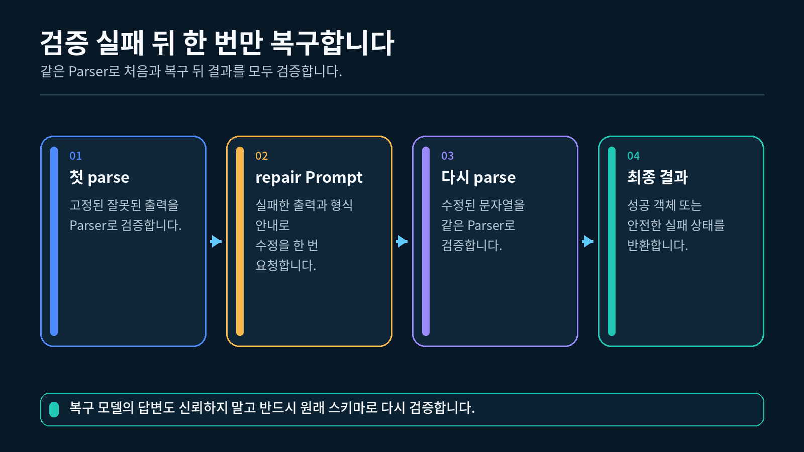
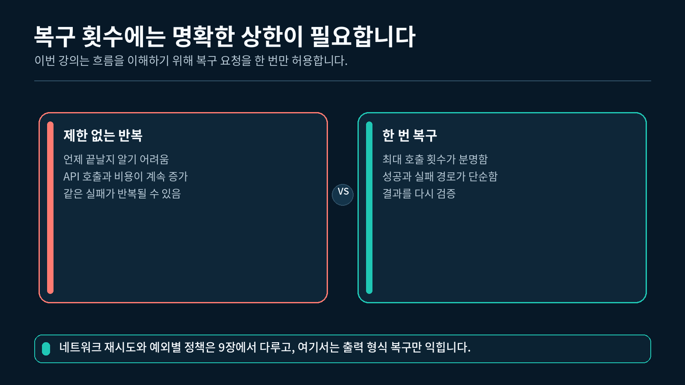
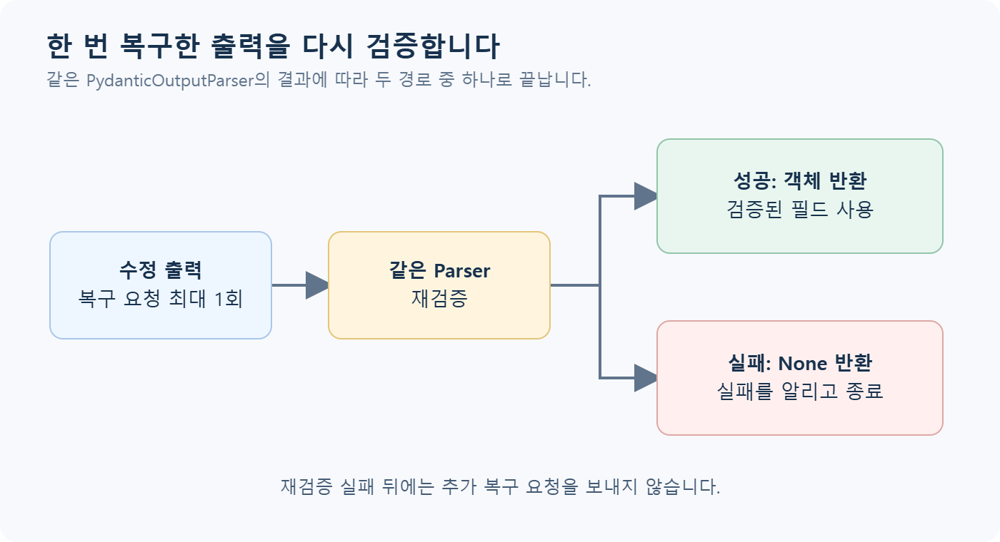

## 1. 검증 실패 뒤에 필요한 처리

5-2강에서는 `PydanticOutputParser`가 잘못된 문자열을 정상 객체로 만들지 않는다는 점을 확인했습니다. 실제 앱에서는 검증 실패 뒤에 무엇을 할지도 정해야 합니다.

이번 강의에서 사용하는 첫 출력은 다음과 같습니다.

```
{"category":"기타","needs_code":false}
```

이 문자열에는 두 가지 문제가 있습니다.

- `category="기타"`는 허용된 `"개념"`, `"코드"`, `"오류"` 중 하나가 아닙니다.
- 필수 필드인 `summary`가 없습니다.

이 값을 그대로 사용하면 `category`를 기준으로 한 조건 분기가 예상과 다르게 동작할 수 있습니다. 임의로 `category="개념"`을 넣는 것도 모델의 의도를 확인하지 않은 채 값을 추측하는 행동입니다.

이번 강의에서는 다음 원칙을 사용합니다.

1. 첫 검증에 실패한 문자열은 정상 결과로 사용하지 않습니다.
2. 원래 질문과 실패한 출력을 수정 Prompt에 함께 넣습니다.
3. Parser의 형식 안내를 모델에 제공합니다.
4. 수정 요청은 한 번만 보냅니다.
5. 수정 결과도 같은 Parser로 다시 검증합니다.
6. 재검증에 실패하면 최종 실패로 종료합니다.

---

## 2. 한 번만 복구하는 전체 흐름

출력 복구는 잘못된 값을 억지로 통과시키는 과정이 아닙니다. 모델에 올바른 형식으로 다시 작성하도록 요청하고, 새 결과를 처음과 같은 규칙으로 다시 검사하는 과정입니다.

첫 검증 실패 뒤 한 번만 수정하고 재검증하는 흐름



```
실패한 출력
→ 첫 Parser 검증
→ 실패하면 수정 Prompt를 한 번 실행
→ 수정 문자열을 같은 Parser로 재검증
→ 성공 객체 또는 최종 실패
```

### 왜 같은 Parser를 다시 사용하는가?

첫 검증과 재검증에 다른 규칙을 사용하면 수정된 결과가 원래 스키마를 만족하는지 알기 어렵습니다.

이번 실습에서는 두 번 모두 다음 Parser를 사용합니다.

```python
# 처음과 수정 뒤에 공통으로 사용할 스키마 클래스를 지정합니다.
# QuestionClassification 스키마를 검증할 Parser를 만듭니다.
parser = PydanticOutputParser(
    pydantic_object=QuestionClassification
)
```

첫 결과와 수정 결과가 모두 같은 `QuestionClassification` 계약을 통과해야 합니다.

---

## 3. 첫 출력을 안전하게 검증하기

먼저 문자열을 Parser로 검증하고, 성공하면 객체를, 실패하면 `None`을 반환하는 작은 함수를 만듭니다.

### 3.1 `try_parse()` 함수

```python
# Parser 실패를 처리하기 위한 예외를 가져옵니다.
from langchain_core.exceptions import OutputParserException

# Pydantic 구조화 문자열을 검증하기 위한 Parser를 가져옵니다.
from langchain_core.output_parsers import PydanticOutputParser

# 반환 타입의 None은 검증된 객체가 없다는 상태를 나타냅니다.
def try_parse(
    parser: PydanticOutputParser,
    raw_output: str,
) -> QuestionClassification | None:
    """문자열 검증에 성공하면 객체를, 실패하면 None을 반환합니다."""

    # 성공과 실패를 하나의 함수 안에서 분리해 처리합니다.
    try:
        # JSON 문자열을 Pydantic 객체로 변환하고 검증합니다.
        return parser.parse(raw_output)
    except OutputParserException:
        # 잘못된 category나 필드 누락 모두 Parser 실패로 처리합니다.
        # 실패한 값을 정상 객체로 바꾸지 않고 None으로 표시합니다.
        return None
```

`None`은 검증된 객체가 없다는 뜻입니다. 이 함수는 오류 내용을 고치지 않으며, 성공 여부만 호출한 쪽에 알려 줍니다.

### 3.2 실패 출력 확인하기

```python
# 필수 필드가 없고 category도 잘못된 문자열을 준비합니다.
broken_output = (
    '{"category":"기타","needs_code":false}'
)

# 첫 검증에는 수정 전 원문을 그대로 전달합니다.
# 첫 출력을 같은 Parser로 검증합니다.
first_result = try_parse(
    # parser는 QuestionClassification 규칙을 가지고 있습니다.
    parser,
    # broken_output은 문자열 상태의 첫 결과입니다.
    broken_output,
)

# None 여부만으로 검증 성공과 실패를 나눕니다.
# 검증 결과가 없으면 실패 상태를 출력합니다.
if first_result is None:
    print("[첫 검증] 실패")
else:
    print("[첫 검증] 성공")
```

```
[첫 검증] 실패
```

이 결과는 코드가 잘못 실행되었다는 뜻이 아닙니다. 준비한 `broken_output`이 스키마를 통과하지 못한다는 예상된 결과입니다.

### 3.3 첫 검증이 성공한 경우

첫 출력이 이미 정상이라면 수정 요청을 보낼 필요가 없습니다.

```python
# 스키마를 만족하는 정상 JSON 문자열을 준비합니다.
valid_output = (
    '{"category":"개념",'
    '"summary":"LCEL의 역할을 묻는 질문입니다.",'
    '"needs_code":false}'
)

# 정상 문자열도 실패 문자열과 같은 함수에 전달합니다.
# 정상 문자열을 Parser로 검증합니다.
first_result = try_parse(
    parser,
    valid_output,
)

# 객체가 반환되면 첫 검증이 통과한 상태입니다.
# 객체가 있으면 수정 없이 바로 사용할 수 있습니다.
if first_result is not None:
    # 이 분기에서는 모델에 수정 요청을 보내지 않습니다.
    print("[첫 검증] 성공 · 복구 요청 없음")
```

```
[첫 검증] 성공 · 복구 요청 없음
```

불필요한 모델 호출을 보내지 않는 것도 한 번 복구 흐름의 중요한 조건입니다.

---

## 4. 수정 Prompt 만들기

첫 검증이 실패하면 모델이 어떤 형식으로 다시 작성해야 하는지 알려 줘야 합니다. `PydanticOutputParser.get_format_instructions()`가 만든 안내를 Prompt에 넣습니다.

### 4.1 수정 Prompt의 입력

수정 Prompt에는 세 값을 전달합니다.

| 입력 변수 | 역할 |
| --- | --- |
| `format_instructions` | Parser가 요구하는 필드와 형식 |
| `question` | 구조화하려던 원래 질문 |
| `broken_output` | 첫 검증에 실패한 문자열 |

### 4.2 역할별 메시지 만들기

```python
# 역할별 수정 Prompt를 만들기 위해 클래스를 가져옵니다.
from langchain_core.prompts import ChatPromptTemplate

# Prompt에는 시스템 지시와 실제 수정 대상을 각각 넣습니다.
# 설명을 덧붙이지 않고 올바른 JSON으로 다시 작성하도록 요청합니다.
repair_prompt = ChatPromptTemplate.from_messages(
    [
        # system 메시지는 올바른 형식으로 다시 쓰라는 규칙을 전달합니다.
        (
            "system",
            "다음 출력을 설명 없이 올바른 JSON 객체로 다시 작성하세요.\n"
            "요구 형식:\n{format_instructions}",
        ),
        # human 메시지는 원래 질문과 실패한 출력을 전달합니다.
        (
            "human",
            "질문:{question}\n"
            "검증에 실패한 출력:{broken_output}",
        ),
    ]
)
```

수정 Prompt는 모델이 자유롭게 새로운 설명을 길게 쓰도록 요청하지 않습니다. 원래 질문의 의미를 유지하면서 요구 형식에 맞는 JSON 객체로 다시 작성하도록 범위를 좁힙니다.

### 4.3 형식 안내 넣어 보기

```python
# Parser가 현재 스키마에 맞춰 만든 형식 안내를 가져옵니다.
format_instructions = parser.get_format_instructions()

# API 호출 없이 Prompt 변수 세 개를 먼저 채워 봅니다.
# 수정 Prompt에 들어갈 세 입력을 메시지로 변환합니다.
messages = repair_prompt.format_messages(
    # 형식 안내는 system 메시지의 변수를 채웁니다.
    format_instructions=format_instructions,
    # 원래 질문은 수정 과정에서도 의미를 유지하게 돕습니다.
    question="LCEL에서 pipe 연산자는 어떤 역할을 하나요?",
    # 실패 문자열은 모델이 고쳐야 할 대상을 알려 줍니다.
    broken_output='{"category":"기타"}',
)

# system과 human 두 메시지가 만들어졌는지 확인합니다.
print(len(messages))
print(messages[0].type)
print(messages[1].type)
```

```
2
system
human
```

이 단계는 Prompt를 만들기만 하므로 실제 API를 호출하지 않습니다.

---

## 5. 수정 문자열을 한 번만 요청하기

수정 Prompt, ChatModel, `StrOutputParser`를 연결하면 수정된 JSON **문자열**을 받을 수 있습니다.

### 5.1 수정 체인 만들기

```python
# AIMessage의 본문만 문자열로 받기 위해 Parser를 가져옵니다.
from langchain_core.output_parsers import StrOutputParser

# 모델 응답을 일반 문자열로 바꿀 Parser를 만듭니다.
text_parser = StrOutputParser()

# 수정 Prompt, 모델, 문자열 Parser를 순서대로 연결합니다.
repair_chain = repair_prompt | model | text_parser
```

이 시점의 `repair_chain` 결과는 아직 `QuestionClassification` 객체가 아닙니다. 모델이 다시 작성한 문자열이므로 다음 단계에서 Pydantic Parser로 재검증해야 합니다.

### 5.2 복구 횟수 제한

이번 실습은 첫 검증 뒤 수정 요청을 최대 한 번만 허용합니다.

```python
# 첫 검증 뒤 허용할 수정 요청 횟수를 한 번으로 정합니다.
MAX_REPAIR_ATTEMPTS = 1
```

수정 요청 횟수를 한 번으로 제한하는 이유



한 번의 수정 요청에도 올바른 결과를 만들지 못하면 다음과 같이 종료합니다.

```
첫 검증 실패
→ 수정 요청 1회
→ 재검증 실패
→ 최종 실패
```

끝없이 다시 요청하면 실행 시간과 API 사용량이 계속 늘어나고, 언제 끝나는지 예측하기 어려워집니다. 입문 실습에서는 한 번으로 제한해 성공과 실패 경로를 분명하게 확인합니다.

### 5.3 한 번 호출하기

```python
# 실패한 출력과 원래 질문을 수정 체인에 한 번 전달합니다.
repaired_output = repair_chain.invoke(
    {
        # Parser의 형식 안내를 수정 Prompt에 전달합니다.
        "format_instructions": (
            parser.get_format_instructions()
        ),
        # 처음 구조화하려던 질문을 그대로 전달합니다.
        "question": (
            "LCEL에서 pipe 연산자는 어떤 역할을 하나요?"
        ),
        # 첫 검증에 실패한 문자열을 수정 대상으로 전달합니다.
        "broken_output": broken_output,
    }
)
```

모델이 올바르게 수정했다면 다음과 비슷한 문자열이 반환될 수 있습니다.

```
{"category":"개념","summary":"LCEL의 pipe 연산자 역할을 묻는 질문입니다.","needs_code":false}
```

문구는 달라질 수 있으므로 문자열 자체를 정답으로 확정하지 않습니다. 다음 단계의 Parser 검증을 통과하는지 확인합니다.

---

## 6. 같은 Parser로 재검증하기

모델이 수정한 문자열도 반드시 `try_parse()`에 전달합니다.

### 6.1 수정 결과 검증

```python
# 모델이 다시 작성한 문자열을 처음과 같은 Parser로 검증합니다.
repaired_result = try_parse(
    # 첫 검증과 같은 스키마 규칙을 적용합니다.
    parser,
    # 모델이 돌려준 수정 문자열을 검사합니다.
    repaired_output,
)

# None이 아니면 검증된 QuestionClassification 객체가 만들어졌습니다.
# Pydantic 객체가 만들어졌는지 확인합니다.
if repaired_result is not None:
    print("[복구 1회] 성공")
else:
    print("[복구 1회] 실패")
```

성공한 경우:

```
[복구 1회] 성공
```

실패한 경우:

```
[복구 1회] 실패
```

수정 요청을 보냈다는 사실만으로 성공한 것이 아닙니다. `QuestionClassification` 객체가 실제로 만들어져야 복구 성공입니다.

### 6.2 왜 문자열 Parser와 Pydantic Parser를 나누는가?

수정 체인의 마지막 `StrOutputParser`는 `AIMessage`에서 텍스트를 꺼냅니다. 그다음 `PydanticOutputParser`는 그 텍스트의 JSON 문법과 스키마를 검증합니다.

| Parser | 입력 | 출력 | 역할 |
| --- | --- | --- | --- |
| `StrOutputParser` | `AIMessage` | `str` | 모델 답변 본문 꺼내기 |
| `PydanticOutputParser` | JSON 문자열 | Pydantic 객체 | 필드와 값 검증하기 |

두 Parser는 이름은 비슷하지만 담당하는 작업이 다릅니다.

---

## 7. 최종 결과를 성공과 실패로 나누기

`repair_once()` 함수는 성공하면 `QuestionClassification` 객체를 반환하고, 끝까지 실패하면 `None`을 반환합니다.

한 번의 재검증 뒤 최종 성공과 실패로 나뉘는 흐름



### 7.1 최종 분기 코드

아래 호출은 `repair_once()`가 정의된 제공 파일 안에서 실행합니다. 앞 절의 설명용 조각만 붙이는 대신, `실습.py`에서 함수 정의와 호출 위치를 함께 확인하세요.

```python
# 한 번의 수정과 재검증을 실행해 최종 결과를 받습니다.
final_result = repair_once(
    # model은 수정 Prompt를 한 번 실행합니다.
    model=model,
    # parser는 첫 출력과 수정 출력에 같은 규칙을 적용합니다.
    parser=parser,
    # question은 처음 분류하려던 수강생 질문입니다.
    question="LCEL에서 pipe 연산자는 어떤 역할을 하나요?",
    # broken_output은 첫 검증이 실패할 고정 문자열입니다.
    broken_output=broken_output,
)

# None 여부를 먼저 확인한 뒤에만 객체 필드에 접근합니다.
# 최종 객체가 없으면 실패 문구를 출력하고 종료합니다.
if final_result is None:
    print("[최종 결과] 구조화 출력을 만들지 못했습니다.")
else:
    # 검증된 객체가 있을 때만 필드 값을 사용합니다.
    print(f"[최종 category]{final_result.category}")
    print(f"[최종 summary]{final_result.summary}")
    print(f"[최종 needs_code]{final_result.needs_code}")
```

### 7.2 성공 결과 예시

```
[최종 category] 개념
[최종 summary] LCEL의 pipe 연산자 역할을 묻는 질문입니다.
[최종 needs_code] False
```

### 7.3 최종 실패 결과

```
[최종 결과] 구조화 출력을 만들지 못했습니다.
```

최종 실패는 프로그램이 무조건 중단되어야 한다는 뜻은 아닙니다. 이번 실습에서는 검증되지 않은 값을 사용하지 않고 분명한 실패 상태로 종료한다는 뜻입니다.

---

## 8. 완성 실습 실행하기

이번 강의의 `실습.py`는 일부러 잘못 만든 고정 문자열에서 시작합니다. 실제 모델 호출은 복구 요청 한 번에만 사용됩니다.

### 8.1 완성 실습의 실행 순서

1. `.env`에서 `OPENAI_API_KEY`와 선택적인 `OPENAI_MODEL`을 읽습니다.
2. `QuestionClassification` 스키마와 `PydanticOutputParser`를 준비합니다.
3. `BROKEN_OUTPUT`을 첫 번째로 검증합니다.
4. 첫 검증이 실패하면 형식 안내가 있는 수정 Prompt를 만듭니다.
5. 모델에 수정 요청을 한 번 보냅니다.
6. 수정 문자열을 같은 Parser로 재검증합니다.
7. 성공하면 필드를 출력하고, 실패하면 최종 실패 문구를 출력합니다.

### 8.2 실행하기

VS Code에서 `5-3_출력_복구와_retry_연결` 폴더의 터미널을 열고 실행합니다.

1-2강에서 만든 `pyproject.toml`과 `uv.lock`이 있는 프로젝트의 하위 폴더에 `실습.py`를 두고, 해당 폴더에서 실행합니다. VS Code 인터프리터는 이 프로젝트의 `.venv` (Python 3.12)를 선택합니다.

```bash
uv run python 실습.py
```

"""5-3강: 검증에 실패한 고정 출력을 한 번만 다시 요청하고 재검증합니다."""

import os
from typing import Literal

from dotenv import load_dotenv
from langchain_core.exceptions import OutputParserException
from langchain_core.output_parsers import PydanticOutputParser, StrOutputParser
from langchain_core.prompts import ChatPromptTemplate
from langchain_openai import ChatOpenAI
from pydantic import BaseModel, Field


# .env에 모델명이 없을 때 사용할 수업 기본 모델을 지정합니다.
DEFAULT_MODEL = "gpt-5-nano"

# 첫 검증이 반드시 실패하도록 필수 필드가 없고 허용값도 잘못된 예시를 사용합니다.
BROKEN_OUTPUT = '{"category":"기타","needs_code":false}'

# 최초 검증 뒤 허용할 복구 요청 횟수를 한 번으로 제한합니다.
MAX_REPAIR_ATTEMPTS = 1


class QuestionClassification(BaseModel):
    """수강생 질문 분류 결과의 허용 필드와 타입을 정의합니다."""

    # category는 세 개의 허용 문자열 중 하나여야 합니다.
    category: Literal["개념", "코드", "오류"] = Field(
        description="질문의 가장 알맞은 분류"
    )

    # summary는 질문의 핵심을 담은 필수 문자열입니다.
    summary: str = Field(
        description="질문의 핵심을 정리한 한 문장"
    )

    # needs_code는 생략되면 False를 사용하는 선택 필드입니다.
    needs_code: bool = Field(
        default=False,
        description="코드 예시가 필요한지 여부",
    )


def build_model(api_key: str, model_name: str) -> ChatOpenAI:
    """환경변수에서 읽은 설정으로 OpenAI ChatModel을 만듭니다."""

    # API Key와 모델명을 코드에 직접 적지 않고 함수 인자로 전달합니다.
    return ChatOpenAI(
        api_key=api_key,
        model=model_name,
    )


def try_parse(
    parser: PydanticOutputParser,
    raw_output: str,
) -> QuestionClassification | None:
    """문자열을 검증하고 실패하면 예외 대신 None을 반환합니다."""

    try:
        # JSON 문자열을 Pydantic 객체로 변환하고 필드까지 검증합니다.
        return parser.parse(raw_output)
    except OutputParserException:
        # 이 함수에서는 실패 여부만 전달하고 긴 원문과 예외 전문은 출력하지 않습니다.
        return None


def build_repair_chain(model, parser: PydanticOutputParser):
    """잘못된 출력을 스키마 형식으로 다시 작성하도록 요청하는 체인을 만듭니다."""

    # Parser가 요구하는 JSON 형식을 repair Prompt에 포함합니다.
    repair_prompt = ChatPromptTemplate.from_messages(
        [
            (
                "system",
                "다음 출력을 설명 없이 올바른 JSON 객체로 다시 작성하세요.\n"
                "요구 형식:\n{format_instructions}",
            ),
            (
                "human",
                "질문: {question}\n"
                "검증에 실패한 출력: {broken_output}",
            ),
        ]
    )

    # 모델의 AIMessage를 재검증할 문자열로 바꿀 Parser를 만듭니다.
    text_parser = StrOutputParser()

    # repair Prompt, Model, 문자열 Parser를 순서대로 연결합니다.
    return repair_prompt | model | text_parser


def repair_once(
    model,
    parser: PydanticOutputParser,
    question: str,
    broken_output: str,
) -> QuestionClassification | None:
    """검증 실패 뒤 모델에 한 번만 수정을 요청하고 결과를 다시 검증합니다."""

    # 먼저 전달받은 원래 출력을 그대로 검증합니다.
    first_result = try_parse(parser, broken_output)

    # 첫 검증이 성공했다면 불필요한 모델 호출 없이 바로 반환합니다.
    if first_result is not None:
        print("[첫 검증] 성공 · 복구 요청 없음")
        return first_result

    # 첫 검증 실패 사실과 제한된 복구 횟수를 화면에 알립니다.
    print("[첫 검증] 실패")

    # 현재 실습은 한 번의 복구만 허용하므로 정해진 횟수만 반복합니다.
    for attempt in range(1, MAX_REPAIR_ATTEMPTS + 1):
        # 스키마 형식을 포함한 repair 체인을 만듭니다.
        repair_chain = build_repair_chain(model, parser)

        # 잘못된 출력과 원래 질문을 모델에 보내 수정된 문자열을 받습니다.
        repaired_output = repair_chain.invoke(
            {
                "format_instructions": parser.get_format_instructions(),
                "question": question,
                "broken_output": broken_output,
            }
        )

        # 모델이 고친 문자열도 같은 Parser로 다시 검증합니다.
        repaired_result = try_parse(parser, repaired_output)

        # 재검증에 성공하면 시도 번호를 알리고 검증된 객체를 반환합니다.
        if repaired_result is not None:
            print(f"[복구 {attempt}회] 성공")
            return repaired_result

        # 재검증에 실패하면 이번 시도가 실패했음을 알립니다.
        print(f"[복구 {attempt}회] 실패")

    # 허용한 복구 횟수를 모두 사용했으면 실패 상태를 None으로 반환합니다.
    return None


def main() -> None:
    """고정된 실패 출력을 한 번만 복구하고 최종 검증 결과를 확인합니다."""

    # 실습 폴더 또는 상위 폴더의 .env 값을 현재 Python 프로세스로 불러옵니다.
    load_dotenv()

    # API Key는 환경변수에서 읽고 실제 값은 화면에 출력하지 않습니다.
    api_key = os.getenv("OPENAI_API_KEY")

    # 모델명은 환경변수로 바꿀 수 있고, 없으면 수업 기본값을 사용합니다.
    model_name = os.getenv("OPENAI_MODEL", DEFAULT_MODEL)

    # API Key가 없으면 복구 요청을 보낼 수 없음을 안내하고 종료합니다.
    if not api_key:
        print("OPENAI_API_KEY가 없습니다.")
        print("1-2강에서 만든 .env 파일을 확인해 주세요.")
        return

    # QuestionClassification 스키마를 검증할 Parser를 만듭니다.
    parser = PydanticOutputParser(
        pydantic_object=QuestionClassification
    )

    # 한 번의 repair 요청에 사용할 실제 OpenAI ChatModel을 만듭니다.
    model = build_model(api_key, model_name)

    # 분류 대상이었던 원래 질문을 준비합니다.
    question = "LCEL에서 pipe 연산자는 어떤 역할을 하나요?"

    # 고정된 실패 출력을 최대 한 번만 복구하고 재검증합니다.
    final_result = repair_once(
        model=model,
        parser=parser,
        question=question,
        broken_output=BROKEN_OUTPUT,
    )

    # 복구 뒤에도 검증을 통과하지 못하면 안전한 종료 문구만 보여 줍니다.
    if final_result is None:
        print("[최종 결과] 구조화 출력을 만들지 못했습니다.")
        return

    # 검증된 Pydantic 객체의 필드를 후속 코드처럼 안전하게 사용합니다.
    print(f"[최종 category] {final_result.category}")
    print(f"[최종 summary] {final_result.summary}")
    print(f"[최종 needs_code] {final_result.needs_code}")


if __name__ == "__main__":
    # 터미널에서 python 실습.py로 실행했을 때만 실제 복구 요청을 보냅니다.
    main()

### 8.3 API Key가 없을 때의 결과

```
OPENAI_API_KEY가 없습니다.
1-2강에서 만든 .env 파일을 확인해 주세요.
```

수정 요청은 실제 모델 호출이 필요하므로 API Key가 없으면 호출 전에 종료합니다.

### 8.4 한 번의 복구에 성공한 결과

```
[첫 검증] 실패
[복구 1회] 성공
[최종 category] 개념
[최종 summary] LCEL에서 pipe 연산자의 역할을 묻는 질문입니다.
[최종 needs_code] False
```

`summary` 문구와 모델의 분류는 달라질 수 있습니다. 다음 흐름을 확인하세요.

- 첫 검증이 계획대로 실패했는가?
- 복구 요청이 `1회`로 표시되는가?
- 성공 뒤 세 필드가 출력되는가?
- 최종 필드는 검증된 Pydantic 객체에서 읽었는가?

### 8.5 수정 결과도 실패한 경우

```
[첫 검증] 실패
[복구 1회] 실패
[최종 결과] 구조화 출력을 만들지 못했습니다.
```

이 경우 두 번째 수정 요청은 보내지 않습니다. `MAX_REPAIR_ATTEMPTS = 1`이므로 한 번의 재검증 뒤 최종 실패로 종료합니다.

### 8.6 첫 출력이 이미 정상인 경우

완성 파일의 `BROKEN_OUTPUT`은 학습을 위해 반드시 실패하도록 만들어져 있습니다. 나중에 정상 문자열을 전달하면 함수는 다음과 같이 불필요한 복구 요청을 생략합니다.

```
[첫 검증] 성공 · 복구 요청 없음
```

이때 반환된 첫 Pydantic 객체를 바로 최종 결과로 사용합니다.