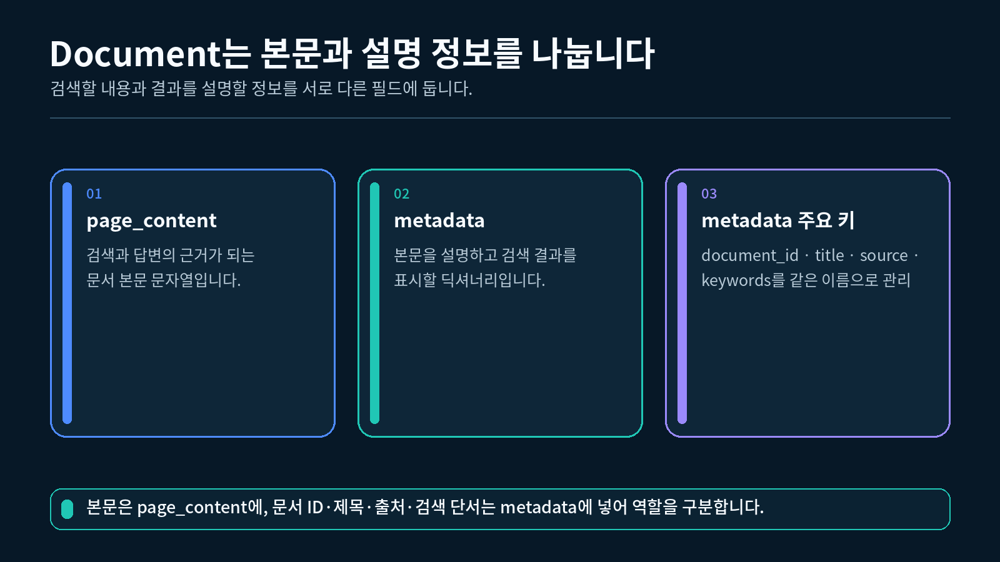
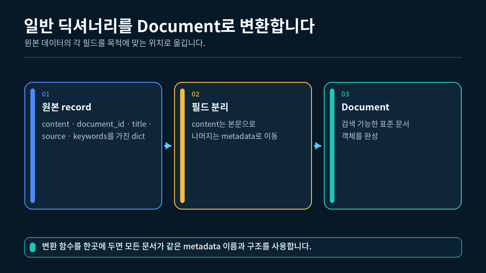

## 1. 외부 문서를 같은 형태로 다루는 이유

LLM 애플리케이션이 참고할 정보는 Markdown 파일, 사내 규정, FAQ, 데이터베이스 행처럼 여러 형태로 존재할 수 있습니다. 검색 단계에서 이 자료를 그대로 제각각 처리하면 본문이 어디에 있고 출처가 어디에 있는지 매번 다시 확인해야 합니다.

LangChain의 `Document`는 문서 본문과 부가 정보를 일정한 구조로 묶습니다.

```
원본 문장
→ Document로 변환
→ 본문은 page_content에 저장
→ 식별자와 출처는 metadata에 저장
```

이번 강의에서는 다음 세 문서를 사용합니다.

| 문서 ID | 제목 | 설명 |
| --- | --- | --- |
| `doc-001` | LCEL 기초 | LCEL과 pipe 연산자 설명 |
| `doc-002` | API Key 관리 | `.env`와 환경변수 설명 |
| `doc-003` | Retriever 역할 | Retriever의 기본 역할 설명 |

세 문서의 주제는 다르지만 모두 `Document` 객체이므로 다음 강의의 Retriever가 같은 방식으로 받을 수 있습니다.

---

## 2. Document의 두 가지 핵심 영역

`Document`에서 먼저 구분할 항목은 `page_content`와 `metadata`입니다.

Document에서 본문과 metadata를 구분하는 구조



| 영역 | 저장하는 값 | 이번 실습 예시 |
| --- | --- | --- |
| `page_content` | 문서의 실제 본문 | `"Retriever는 ... 검색 인터페이스입니다."` |
| `metadata` | 본문을 설명하는 부가 정보 | ID, 제목, 출처, 검색 키워드 |

### page_content

`page_content`는 검색 뒤 Prompt의 참고 문맥으로 전달할 수 있는 문자열입니다.

```python
# Document 클래스를 가져옵니다.
from langchain_core.documents import Document

# 실제 설명 문장을 page_content에 저장한 문서를 만듭니다.
document = Document(
    page_content=(
        "Retriever는 사용자 질의와 관련된 Document를 찾아 "
        "다음 단계에 전달하는 검색 인터페이스입니다."
    )
)

# LLM이 참고할 수 있는 문서 본문을 출력합니다.
print(document.page_content)
```

```
Retriever는 사용자 질의와 관련된 Document를 찾아 다음 단계에 전달하는 검색 인터페이스입니다.
```

### metadata

`metadata`는 Python 딕셔너리입니다. 문서 식별자나 출처처럼 본문을 설명하는 값을 키와 값으로 저장합니다.

```python
# Document에 저장된 metadata의 자료형 이름을 확인합니다.
print(type(document.metadata).__name__)
```

```
dict
```

본문과 metadata는 함께 이동하지만 역할은 다릅니다. 답변 근거가 되는 설명은 `page_content`에 두고, 검색 결과를 구분하거나 화면에 표시할 정보는 `metadata`에 둡니다.

---

## 3. Document 한 개 만들기

이제 본문과 metadata를 모두 가진 문서를 만듭니다.

```python
# 문서 본문과 부가 정보를 함께 가진 Document를 만듭니다.
document = Document(
    # page_content에는 검색 뒤 참고할 실제 설명을 저장합니다.
    page_content=(
        "LCEL은 Prompt, Model, Parser 같은 Runnable 단계를 "
        "pipe 연산자로 연결하는 표현식입니다."
    ),

    # metadata에는 본문을 식별하고 표시할 부가 정보를 저장합니다.
    metadata={
        # document_id는 문서를 중복되지 않게 구분합니다.
        "document_id": "doc-001",

        # title은 검색 결과 화면에 표시할 이름입니다.
        "title": "LCEL 기초",

        # source는 문서가 온 원본 파일을 기록합니다.
        "source": "langchain_intro.md",

        # keywords는 다음 강의의 단순 검색에서 사용할 단서입니다.
        "keywords": ["lcel", "pipe", "runnable"],
    },
)

# 점 표기법으로 실제 본문을 읽습니다.
print(document.page_content)

# metadata 딕셔너리에서 문서 식별자를 읽습니다.
print(document.metadata["document_id"])

# metadata 딕셔너리에서 제목을 읽습니다.
print(document.metadata["title"])
```

```
LCEL은 Prompt, Model, Parser 같은 Runnable 단계를 pipe 연산자로 연결하는 표현식입니다.
doc-001
LCEL 기초
```

### 생성자의 입력과 결과

```
Document(
    page_content=문서 본문 문자열,
    metadata=부가 정보 딕셔너리,
)
```

`Document(...)`를 호출하면 딕셔너리가 아니라 `Document` 객체가 만들어집니다. 본문은 `document.page_content`, metadata는 `document.metadata`로 읽습니다.

---

## 4. metadata 필드 설계하기

metadata의 키 이름은 애플리케이션이 정합니다. 중요한 점은 같은 의미의 값을 문서마다 같은 키에 넣는 것입니다.

이번 실습에서는 네 개의 필드를 사용합니다.

| 키 | 역할 | 예시 |
| --- | --- | --- |
| `document_id` | 문서를 구분하는 고유 식별자 | `doc-001` |
| `title` | 사람이 읽는 문서 제목 | `LCEL 기초` |
| `source` | 문서가 온 파일이나 시스템 | `langchain_intro.md` |
| `keywords` | 6-2강의 단순 검색에 사용할 단서 | `["lcel", "pipe"]` |

### 같은 키를 사용하는 이유

첫 번째 문서는 `source`, 두 번째 문서는 `file`, 세 번째 문서는 `origin`이라는 키를 사용하면 formatter가 문서마다 다른 코드를 실행해야 합니다. 모든 문서가 `source`를 사용하면 하나의 코드로 출처를 읽을 수 있습니다.

```python
# source 키가 있는 문서에서 출처를 읽습니다.
source = document.metadata["source"]

# 읽은 출처 문자열을 출력합니다.
print(source)
```

```
langchain_intro.md
```

### 대괄호 접근과 get 비교

키가 반드시 있다고 확신하면 대괄호를 사용할 수 있습니다.

```python
# 반드시 존재한다고 약속한 title 키의 값을 읽습니다.
title = document.metadata["title"]
```

키가 없을 가능성이 있다면 `get()`으로 대체값을 정할 수 있습니다.

```python
# author 키가 없으면 작성자 없음이라는 대체 문구를 사용합니다.
author = document.metadata.get(
    "author",
    "작성자 없음",
)

# 존재하지 않는 키 대신 선택된 대체 문구를 출력합니다.
print(author)
```

```
작성자 없음
```

metadata는 검색 정확도를 자동으로 높이는 마법의 정보가 아닙니다. 다음 단계가 실제로 읽고 사용하는 필드를 일관되게 저장하는 것이 핵심입니다.

---

## 5. 여러 Document를 목록으로 구성하기

Retriever는 일반적으로 문서 한 개가 아니라 검색 대상 문서 목록을 사용합니다. 이번에는 세 개의 `Document`를 Python 리스트에 넣습니다.

일반 딕셔너리 레코드의 필드를 Document 구조로 옮기는 흐름



원본 데이터가 딕셔너리라면 실제 본문 필드는 `page_content`로 옮기고 제목·출처처럼 본문을 설명하는 나머지 필드는 `metadata`로 옮길 수 있습니다. 이번 완성 실습은 변환 결과를 쉽게 확인할 수 있도록 같은 구조의 `Document`를 직접 만듭니다.

```python
# 세 개의 Document를 저장할 문서 목록을 만듭니다.
documents = [
    # 첫 번째 항목은 LCEL 개념을 설명하는 문서입니다.
    Document(
        # 검색 뒤 LLM이 참고할 실제 LCEL 설명입니다.
        page_content=(
            "LCEL은 Runnable 단계를 pipe 연산자로 연결합니다."
        ),
        metadata={
            "document_id": "doc-001",
            "title": "LCEL 기초",
            "source": "langchain_intro.md",
        },
    ),

    # 두 번째 항목은 API Key 관리 방법을 설명하는 문서입니다.
    Document(
        # 환경변수 관리 원칙을 문서 본문으로 저장합니다.
        page_content=(
            "API Key는 .env 파일의 환경변수로 관리합니다."
        ),
        metadata={
            "document_id": "doc-002",
            "title": "API Key 관리",
            "source": "environment_setup.md",
        },
    ),

    # 세 번째 항목은 Retriever 역할을 설명하는 문서입니다.
    Document(
        # 관련 문서를 찾는 Retriever의 핵심 설명을 저장합니다.
        page_content=(
            "Retriever는 질의와 관련된 Document를 찾습니다."
        ),
        metadata={
            "document_id": "doc-003",
            "title": "Retriever 역할",
            "source": "retriever_note.md",
        },
    ),
]

# 목록에 저장된 전체 문서 수를 출력합니다.
print(len(documents))

# 첫 번째 Document의 제목을 출력합니다.
print(documents[0].metadata["title"])

# 세 번째 Document의 본문을 출력합니다.
print(documents[2].page_content)
```

```
3
LCEL 기초
Retriever는 질의와 관련된 Document를 찾습니다.
```

`documents[0]`은 첫 번째 `Document` 객체입니다. 그 뒤에 `.metadata`나 `.page_content`를 이어 필요한 영역을 읽습니다.

---

## 6. 검색 결과 표시용 formatter 만들기

검색된 `Document`를 그대로 출력하면 객체의 내부 표현이 함께 보여 초보자가 읽기 어렵습니다. formatter는 필요한 metadata와 본문만 정해진 형식으로 바꿉니다.

Document 목록에서 필요한 정보만 검색 결과로 표시하는 흐름


### Document 한 개 변환하기

```python
def format_document(document: Document) -> str:
    """Document 한 개를 제목과 출처가 보이는 문자열로 바꿉니다."""

    # metadata에서 문서 식별자를 읽고 없으면 대체 문구를 사용합니다.
    document_id = str(
        document.metadata.get("document_id", "ID 없음")
    )

    # metadata에서 화면에 표시할 제목을 읽습니다.
    title = str(
        document.metadata.get("title", "제목 없음")
    )

    # metadata에서 원본 위치를 나타내는 출처를 읽습니다.
    source = str(
        document.metadata.get("source", "출처 없음")
    )

    # 첫 줄에는 metadata를, 다음 줄에는 본문을 배치합니다.
    return (
        # 대괄호 안에는 문서 식별과 출처 정보를 배치합니다.
        f"[{document_id} |{title} |{source}]\n"

        # 다음 줄에는 Document의 실제 본문을 그대로 배치합니다.
        f"{document.page_content}"
    )
```

### 여러 Document 합치기

```python
def format_documents(documents: list[Document]) -> str:
    """여러 Document를 빈 줄로 구분된 하나의 문자열로 합칩니다."""

    # 각 문서를 같은 출력 형식으로 변환합니다.
    formatted_documents = [
        format_document(document)
        for document in documents
    ]

    # 문서 경계가 보이도록 빈 줄 하나로 연결합니다.
    return "\n\n".join(formatted_documents)
```

### formatter 실행 결과

```python
# 문서 목록 전체를 formatter에 전달합니다.
formatted_text = format_documents(documents)

# 화면에 표시하거나 Prompt에 전달할 문자열을 출력합니다.
print(formatted_text)
```

```
[doc-001 | LCEL 기초 | langchain_intro.md]
LCEL은 Runnable 단계를 pipe 연산자로 연결합니다.

[doc-002 | API Key 관리 | environment_setup.md]
API Key는 .env 파일의 환경변수로 관리합니다.

[doc-003 | Retriever 역할 | retriever_note.md]
Retriever는 질의와 관련된 Document를 찾습니다.
```

formatter는 `Document` 자체를 변경하지 않습니다. 검색 결과를 사람이 읽거나 Prompt가 받을 수 있는 문자열로 새로 만드는 함수입니다.

---

## 7. 완성 실습 실행하기

강 폴더의 `실습.py`에는 세 문서 생성, 필드 확인, formatter 실행 흐름이 모두 들어 있습니다.

```
Document 세 개 생성
→ page_content와 metadata 확인
→ formatter로 표시 문자열 생성
→ 최종 결과 출력
```

### VS Code 터미널에서 실행하기

1-2강에서 만든 `pyproject.toml`과 `uv.lock`이 있는 프로젝트의 하위 폴더에 `실습.py`를 두고, 해당 폴더에서 실행합니다. VS Code 인터프리터는 이 프로젝트의 `.venv` (Python 3.12)를 선택합니다.

```bash
# 6-1강 폴더에서 uv가 관리하는 Python 3.12으로 실습을 실행합니다.
uv run python 실습.py
```

6-1강은 모델이나 외부 서버를 호출하지 않으므로 `OPENAI_API_KEY` 없이 실행할 수 있습니다.

"""6-1강: 문장을 Document 객체로 만들고 본문과 metadata를 구분해 출력합니다."""

from langchain_core.documents import Document


def build_documents() -> list[Document]:
    """수업에서 반복해서 사용할 세 개의 Document 객체를 만듭니다."""

    # LCEL 개념 문서의 본문과 출처 정보를 하나의 Document로 만듭니다.
    lcel_document = Document(
        page_content=(
            "LCEL은 Prompt, Model, Parser 같은 Runnable 단계를 "
            "pipe 연산자로 연결하는 표현식입니다."
        ),
        metadata={
            # document_id는 검색 결과에서 문서를 구분하는 고유 값입니다.
            "document_id": "doc-001",

            # title은 사용자 화면에 표시할 문서 이름입니다.
            "title": "LCEL 기초",

            # source는 이 문서의 원본 파일을 나타냅니다.
            "source": "langchain_intro.md",

            # keywords는 다음 강의의 단순 검색에서 사용할 단서입니다.
            "keywords": ["lcel", "pipe", "runnable"],
        },
    )

    # API Key 관리 문서도 본문과 metadata를 분리해 만듭니다.
    api_key_document = Document(
        page_content=(
            "API Key는 코드에 직접 적지 않고 .env 파일의 "
            "OPENAI_API_KEY 환경변수로 관리합니다."
        ),
        metadata={
            "document_id": "doc-002",
            "title": "API Key 관리",
            "source": "environment_setup.md",
            "keywords": ["api", "key", "환경변수", ".env"],
        },
    )

    # Retriever 역할을 설명하는 세 번째 문서를 만듭니다.
    retriever_document = Document(
        page_content=(
            "Retriever는 사용자 질의와 관련된 Document를 찾아 "
            "다음 단계에 전달하는 검색 인터페이스입니다."
        ),
        metadata={
            "document_id": "doc-003",
            "title": "Retriever 역할",
            "source": "retriever_note.md",
            "keywords": ["retriever", "검색", "질의", "문서"],
        },
    )

    # 만든 세 문서를 검색 가능한 문서 목록으로 반환합니다.
    return [
        lcel_document,
        api_key_document,
        retriever_document,
    ]


def format_document(document: Document) -> str:
    """Document 한 개를 제목과 출처가 보이는 문자열로 바꿉니다."""

    # metadata에서 문서 식별자를 읽고 없으면 대체 문구를 사용합니다.
    document_id = str(
        document.metadata.get("document_id", "ID 없음")
    )

    # metadata에서 화면에 표시할 제목을 읽습니다.
    title = str(
        document.metadata.get("title", "제목 없음")
    )

    # metadata에서 원본 파일이나 시스템을 나타내는 출처를 읽습니다.
    source = str(
        document.metadata.get("source", "출처 없음")
    )

    # 첫 줄에는 metadata를, 다음 줄에는 실제 본문을 배치합니다.
    return (
        f"[{document_id} | {title} | {source}]\n"
        f"{document.page_content}"
    )


def format_documents(documents: list[Document]) -> str:
    """여러 Document를 빈 줄로 구분된 하나의 문자열로 합칩니다."""

    # 각 문서를 같은 출력 형식으로 바꿉니다.
    formatted_documents = [
        format_document(document)
        for document in documents
    ]

    # 문서 사이를 빈 줄 하나로 구분해 사람이 읽기 쉽게 만듭니다.
    return "\n\n".join(formatted_documents)


def main() -> None:
    """Document의 본문, metadata, formatter 결과를 차례대로 확인합니다."""

    # 실습용 Document 세 개를 준비합니다.
    documents = build_documents()

    # 문서 목록의 전체 개수를 먼저 출력합니다.
    print(f"[문서 개수] {len(documents)}")

    # 각 Document의 본문과 핵심 metadata를 하나씩 확인합니다.
    for number, document in enumerate(documents, start=1):
        # 현재 확인하는 문서의 순서를 표시합니다.
        print(f"\n[문서 {number}]")

        # 검색과 결과 표시에서 사용할 고유 식별자를 출력합니다.
        print(
            "document_id:",
            document.metadata["document_id"],
        )

        # 사람이 읽을 수 있는 문서 제목을 출력합니다.
        print(
            "title:",
            document.metadata["title"],
        )

        # 문서가 어디에서 왔는지 나타내는 출처를 출력합니다.
        print(
            "source:",
            document.metadata["source"],
        )

        # LLM에 전달할 수 있는 실제 문서 본문을 출력합니다.
        print(
            "page_content:",
            document.page_content,
        )

    # 여러 문서를 한 번에 표시하는 formatter 결과의 시작을 알립니다.
    print("\n[formatter 결과]")

    # metadata와 본문이 함께 보이도록 정리한 최종 문자열을 출력합니다.
    print(format_documents(documents))


if __name__ == "__main__":
    # VS Code 터미널에서 python 실습.py로 실행했을 때만 main을 호출합니다.
    main()

### 예상 출력

```
[문서 개수] 3

[문서 1]
document_id: doc-001
title: LCEL 기초
source: langchain_intro.md
page_content: LCEL은 Prompt, Model, Parser 같은 Runnable 단계를 pipe 연산자로 연결하는 표현식입니다.

[문서 2]
document_id: doc-002
title: API Key 관리
source: environment_setup.md
page_content: API Key는 코드에 직접 적지 않고 .env 파일의 OPENAI_API_KEY 환경변수로 관리합니다.

[문서 3]
document_id: doc-003
title: Retriever 역할
source: retriever_note.md
page_content: Retriever는 사용자 질의와 관련된 Document를 찾아 다음 단계에 전달하는 검색 인터페이스입니다.

[formatter 결과]
[doc-001 | LCEL 기초 | langchain_intro.md]
LCEL은 Prompt, Model, Parser 같은 Runnable 단계를 pipe 연산자로 연결하는 표현식입니다.

[doc-002 | API Key 관리 | environment_setup.md]
API Key는 코드에 직접 적지 않고 .env 파일의 OPENAI_API_KEY 환경변수로 관리합니다.

[doc-003 | Retriever 역할 | retriever_note.md]
Retriever는 사용자 질의와 관련된 Document를 찾아 다음 단계에 전달하는 검색 인터페이스입니다.
```

문서 개수와 metadata 값은 코드에서 고정했으므로 같은 환경에서는 같은 결과가 나옵니다.