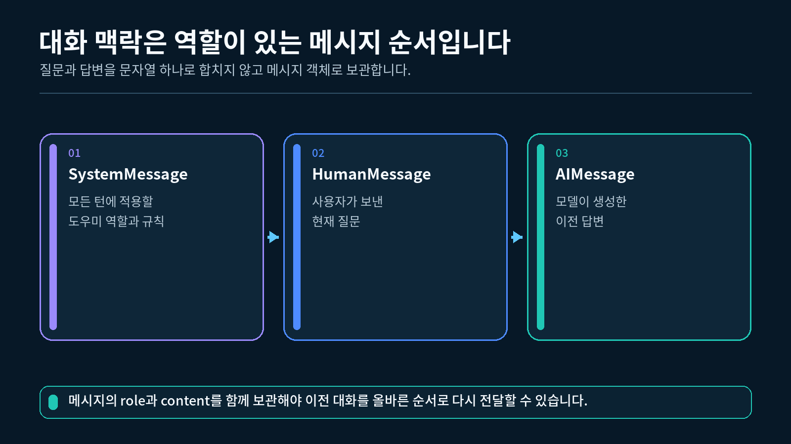
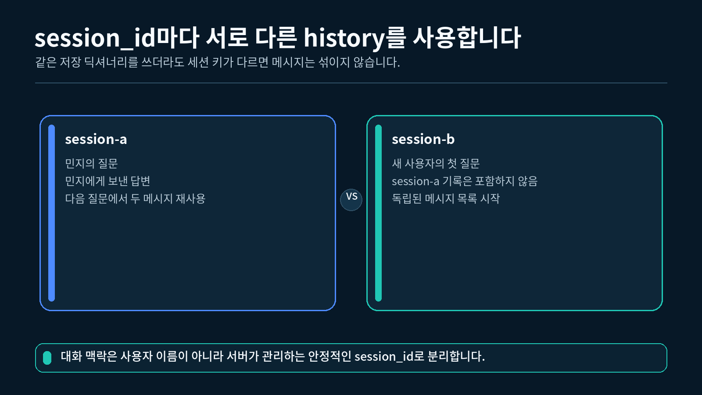
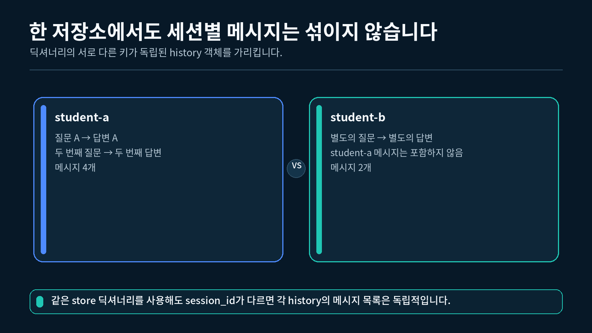

## 1. 대화 메시지와 history 이해하기

6장까지 만든 체인은 한 번의 입력을 받아 한 번의 결과를 반환했습니다. 다음 호출에서는 이전 질문과 답변이 자동으로 전달되지 않았습니다.

```
첫 번째 호출: "제 이름은 민지입니다."
두 번째 호출: "제 이름이 뭐였나요?"
```

두 번째 질문만 모델에 보내면 첫 번째 문장을 알 수 없습니다. 이전 대화를 참고하려면 애플리케이션이 메시지를 저장하고 다음 호출에 다시 전달해야 합니다.

LangChain에서는 대화를 역할이 있는 메시지 객체로 표현합니다.

| 클래스 | 역할 | 이번 강의에서의 사용 |
| --- | --- | --- |
| `HumanMessage` | 사용자가 보낸 질문이나 요청 | 질문 저장 |
| `AIMessage` | 모델이 생성한 답변 | 답변 저장 |
| `SystemMessage` | 모델의 역할과 답변 원칙 | 개념만 확인 |
| `BaseMessage` | 여러 메시지 클래스의 공통 부모 | 함수 타입 표시 |

한 번의 대화는 보통 다음 순서로 저장합니다.

```
HumanMessage("질문")
→ AIMessage("답변")
```

HumanMessage와 AIMessage가 한 번의 대화를 이루는 구조



### history가 하는 일

이번 강의에서 `history`는 한 세션에서 주고받은 메시지 목록입니다.

```
history
├─ HumanMessage("첫 질문")
├─ AIMessage("첫 답변")
├─ HumanMessage("두 번째 질문")
└─ AIMessage("두 번째 답변")
```

중요한 점은 history가 답변을 스스로 만들지 않는다는 것입니다. history는 이미 발생한 대화를 순서대로 보관합니다.

### 지금 다루는 범위

- Python 프로세스가 실행되는 동안만 기록을 보관합니다.
- `session_id` 문자열로 대화를 구분합니다.
- 질문과 답변을 그대로 저장합니다.
- 기록 요약, 삭제 정책, 데이터베이스 연결은 다루지 않습니다.

---

## 2. HumanMessage와 AIMessage 만들기

먼저 두 메시지 클래스로 질문과 답변을 직접 만듭니다.

### 2.1 메시지 클래스 가져오기

```python
# 사용자 질문을 나타내는 HumanMessage를 가져옵니다.
from langchain_core.messages import HumanMessage

# AI 답변을 나타내는 AIMessage를 가져옵니다.
from langchain_core.messages import AIMessage
```

두 클래스를 한 줄에서 함께 가져올 수도 있습니다.

```python
# 사용자 질문과 AI 답변을 만들 두 메시지 클래스를 함께 가져옵니다.
from langchain_core.messages import AIMessage, HumanMessage
```

### 2.2 질문과 답변 만들기

```python
# 사용자가 보낸 질문을 HumanMessage 객체로 만듭니다.
user_message = HumanMessage(
    content="LCEL은 무엇인가요?"
)

# AI가 보낸 답변을 AIMessage 객체로 만듭니다.
ai_message = AIMessage(
    content="LangChain 구성 요소를 연결하는 표현 방식입니다."
)
```

`content`에는 메시지 본문이 들어갑니다. 이번 강의에서는 문자열 본문만 사용합니다.

### 2.3 클래스와 본문 확인하기

```python
# 사용자 메시지의 실제 클래스 이름을 출력합니다.
print(type(user_message).__name__)

# 사용자 메시지의 문자열 본문을 출력합니다.
print(user_message.content)

# AI 메시지의 실제 클래스 이름을 출력합니다.
print(type(ai_message).__name__)

# AI 메시지의 문자열 본문을 출력합니다.
print(ai_message.content)
```

```
HumanMessage
LCEL은 무엇인가요?
AIMessage
LangChain 구성 요소를 연결하는 표현 방식입니다.
```

### 객체와 문자열을 구분하기

다음 두 값은 역할이 다릅니다.

```python
# 일반 문자열은 본문만 가지고 있으며 메시지 역할은 포함하지 않습니다.
plain_text = "LCEL은 무엇인가요?"

# HumanMessage는 본문과 함께 사용자 역할을 표현합니다.
message = HumanMessage(
    content="LCEL은 무엇인가요?"
)

# 두 값의 클래스 이름을 비교해 출력합니다.
print(type(plain_text).__name__)
print(type(message).__name__)
```

```
str
HumanMessage
```

대화 기록에는 역할 정보가 필요하므로 질문과 답변을 메시지 객체로 저장합니다.

---

## 3. InMemoryChatMessageHistory 사용하기

메시지 객체를 만들었다면 저장할 대화 기록이 필요합니다. 이번 강의에서는 `InMemoryChatMessageHistory`를 사용합니다.

### 3.1 비어 있는 history 만들기

```python
# 메모리에 대화 메시지를 보관하는 클래스를 가져옵니다.
from langchain_core.chat_history import InMemoryChatMessageHistory

# 아직 메시지가 없는 비어 있는 대화 기록을 만듭니다.
history = InMemoryChatMessageHistory()

# 처음에는 저장된 메시지가 없으므로 길이가 0인지 확인합니다.
print(len(history.messages))
```

```
0
```

### 3.2 한 번의 대화 추가하기

```python
# 한 번의 사용자 질문과 AI 답변을 메시지 목록으로 추가합니다.
history.add_messages(
    [
        HumanMessage(content="Parser는 무엇인가요?"),
        AIMessage(content="모델 출력을 사용할 형태로 바꾸는 구성 요소입니다."),
    ]
)

# 질문과 답변 두 개가 저장되었는지 확인합니다.
print(len(history.messages))
```

```
2
```

### 3.3 저장된 순서대로 읽기

```python
# 메시지를 저장된 순서대로 하나씩 꺼냅니다.
for message in history.messages:
    # 각 메시지의 LangChain 역할 이름과 본문을 출력합니다.
    print(f"{message.type}:{message.content}")
```

```
human: Parser는 무엇인가요?
ai: 모델 출력을 사용할 형태로 바꾸는 구성 요소입니다.
```

### 메모리에 저장된다는 뜻

`InMemoryChatMessageHistory`의 기록은 현재 Python 프로그램의 메모리에 있습니다.

- 프로그램을 종료하고 다시 실행하면 이전 기록은 사라집니다.
- 다른 컴퓨터나 다른 Python 프로세스와 자동으로 공유되지 않습니다.
- 입문 실습과 동작 확인에는 간단하지만 영구 저장소는 아닙니다.

---

## 4. session_id와 세션 저장소 구분하기

history 객체 하나만 사용하면 모든 대화가 같은 목록에 들어갑니다. 여러 사용자의 대화를 나누려면 각 대화를 구분할 키가 필요합니다.

이번 강의에서는 `session_id`라는 문자열을 사용합니다.

```
student-a → student-a의 history
student-b → student-b의 history
```

session_id가 서로 다른 대화 기록을 가리키는 구조



### 4.1 세션 저장소 만들기

Python 딕셔너리의 키에는 `session_id`, 값에는 history 객체를 넣습니다.

```python
# session_id별 대화 기록을 보관할 빈 딕셔너리를 만듭니다.
store: dict[str, InMemoryChatMessageHistory] = {}

# student-a의 비어 있는 대화 기록을 딕셔너리에 저장합니다.
store["student-a"] = InMemoryChatMessageHistory()

# 현재 저장소에 들어 있는 session_id 목록을 출력합니다.
print(list(store.keys()))
```

```
['student-a']
```

### 4.2 같은 세션과 다른 세션

```python
# student-a가 가리키는 대화 기록을 두 번 가져옵니다.
first_a = store["student-a"]
second_a = store["student-a"]

# 두 변수가 같은 history 객체를 가리키는지 확인합니다.
print(first_a is second_a)

# student-b를 위한 새로운 대화 기록을 별도로 저장합니다.
store["student-b"] = InMemoryChatMessageHistory()

# 두 session_id가 서로 다른 history 객체를 가리키는지 확인합니다.
print(store["student-a"] is not store["student-b"])
```

```
True
True
```

`session_id` 자체가 대화를 저장하는 것은 아닙니다. 딕셔너리에서 알맞은 history를 찾기 위한 키 역할을 합니다.

---

## 5. get_session_history 함수 만들기

새로운 `session_id`가 들어올 때마다 직접 history를 만드는 코드를 반복하지 않도록 함수를 작성합니다.

### 5.1 필요한 동작

함수는 다음 두 경우를 처리합니다.

1. 이미 있는 `session_id`이면 저장된 history를 반환합니다.
2. 처음 보는 `session_id`이면 새 history를 만든 뒤 반환합니다.

```python
# session_id와 대화 기록을 연결할 저장소 타입을 정의합니다.
HistoryStore = dict[str, InMemoryChatMessageHistory]

# session_id에 해당하는 대화 기록을 가져오는 함수를 정의합니다.
def get_session_history(
    store: HistoryStore,
    session_id: str,
) -> InMemoryChatMessageHistory:
    """session_id에 해당하는 기록을 가져오고, 없으면 새로 만듭니다."""

    # 처음 들어온 session_id에는 비어 있는 대화 기록을 만들어 저장합니다.
    if session_id not in store:
        store[session_id] = InMemoryChatMessageHistory()

    # 같은 session_id에는 항상 같은 대화 기록을 반환합니다.
    return store[session_id]
```

### 5.2 새 세션 만들기

```python
# session_id별 대화 기록을 보관할 빈 저장소를 만듭니다.
store: HistoryStore = {}

# 처음 보는 student-a이므로 새 history가 만들어집니다.
history_a = get_session_history(
    store,
    "student-a",
)

# 저장소에 student-a 키가 생겼는지 확인합니다.
print(list(store.keys()))

# 새 history에는 아직 메시지가 없는지 확인합니다.
print(len(history_a.messages))
```

```
['student-a']
0
```

### 5.3 기존 세션 다시 가져오기

```python
# 같은 student-a의 대화 기록을 다시 가져옵니다.
history_a_again = get_session_history(
    store,
    "student-a",
)

# 새 객체가 아니라 앞에서 만든 같은 객체인지 확인합니다.
print(history_a is history_a_again)
```

```
True
```

### 빈 session_id 막기

완성 실습에서는 공백뿐인 `session_id`를 거부합니다.

```python
# session_id가 비어 있으면 명확한 오류를 발생시키는 함수를 정의합니다.
def validate_session_id(session_id: str) -> None:
    """비어 있는 session_id를 거부합니다."""

    # 앞뒤 공백을 제거한 결과가 비어 있는지 확인합니다.
    if not session_id.strip():
        raise ValueError("session_id는 비어 있을 수 없습니다.")
```

빈 키 하나에 여러 대화가 섞이는 실수를 일찍 발견하기 위한 작은 확인입니다.

---

## 6. 한 번의 질문과 답변 저장하기

한 번의 대화가 끝날 때 질문과 답변을 같은 세션에 순서대로 추가하는 함수를 만듭니다.

### 6.1 add_turn 함수

```python
# 한 번의 질문과 답변을 지정한 세션에 저장하는 함수를 정의합니다.
def add_turn(
    store: HistoryStore,
    session_id: str,
    user_text: str,
    ai_text: str,
) -> None:
    """한 번의 사용자 질문과 AI 답변을 지정한 세션에 저장합니다."""

    # 질문과 답변을 저장할 세션의 대화 기록을 가져옵니다.
    history = get_session_history(
        store,
        session_id,
    )

    # 사용자 질문과 AI 답변을 실제 대화 순서대로 추가합니다.
    history.add_messages(
        [
            HumanMessage(content=user_text),
            AIMessage(content=ai_text),
        ]
    )
```

### 6.2 같은 세션에 두 번 저장하기

```python
# session_id별 기록을 보관할 빈 저장소를 만듭니다.
store: HistoryStore = {}

# student-a의 첫 번째 질문과 답변을 저장합니다.
add_turn(
    store=store,
    session_id="student-a",
    user_text="LCEL은 무엇인가요?",
    ai_text="LangChain 구성 요소를 연결하는 표현 방식입니다.",
)

# 같은 student-a의 두 번째 질문과 답변을 이어서 저장합니다.
add_turn(
    store=store,
    session_id="student-a",
    user_text="기본 예시를 알려 주세요.",
    ai_text="prompt | model | parser처럼 연결합니다.",
)

# 두 번의 대화가 질문과 답변 네 메시지로 저장되었는지 확인합니다.
print(len(store["student-a"].messages))
```

```
4
```

### 저장 순서가 중요한 이유

다음 순서를 유지해야 다음 호출에서 대화 흐름을 읽을 수 있습니다.

```
첫 질문 → 첫 답변 → 두 번째 질문 → 두 번째 답변
```

답변을 질문보다 먼저 저장하거나 한쪽만 저장하면 실제 대화와 history의 순서가 달라집니다.

---

## 7. 두 세션의 기록 분리하기

이제 같은 저장소 안에서 `student-a`와 `student-b`를 분리합니다.

같은 저장소 안에서 두 session_id의 메시지가 섞이지 않는 구조



### 7.1 서로 다른 대화 저장하기

```python
# 두 세션의 기록을 함께 보관할 빈 저장소를 만듭니다.
store: HistoryStore = {}

# student-a 세션에 LCEL 질문과 답변을 저장합니다.
add_turn(
    store=store,
    session_id="student-a",
    user_text="LCEL은 무엇인가요?",
    ai_text="구성 요소를 연결하는 표현 방식입니다.",
)

# student-b 세션에는 Parser 질문과 답변을 별도로 저장합니다.
add_turn(
    store=store,
    session_id="student-b",
    user_text="Parser는 무엇인가요?",
    ai_text="모델 출력을 사용할 형태로 바꿉니다.",
)
```

### 7.2 각 세션의 첫 질문 확인하기

```python
# student-a의 첫 메시지 본문을 출력합니다.
print(store["student-a"].messages[0].content)

# student-b의 첫 메시지 본문을 출력합니다.
print(store["student-b"].messages[0].content)
```

```
LCEL은 무엇인가요?
Parser는 무엇인가요?
```

### 7.3 객체도 분리되었는지 확인하기

```python
# 서로 다른 session_id가 별도의 history 객체를 사용하는지 확인합니다.
print(
    store["student-a"] is not store["student-b"]
)
```

```
True
```

한 세션의 메시지를 추가해도 다른 세션의 메시지 수는 바뀌지 않아야 합니다.

---

## 8. 완성 실습 실행하기

완성 실습은 다음 순서로 동작합니다.

1. 비어 있는 세션 저장소를 만듭니다.
2. `student-a`에 두 번의 대화를 저장합니다.
3. `student-b`에 한 번의 대화를 저장합니다.
4. 두 세션의 메시지를 각각 출력합니다.
5. 같은 세션은 같은 history를 재사용하는지 확인합니다.
6. 다른 세션은 별도의 history를 사용하는지 확인합니다.

### 8.1 VS Code에서 실행하기

7-1강 폴더를 VS Code로 연 뒤 터미널에서 실행합니다.

1-2강에서 만든 `pyproject.toml`과 `uv.lock`이 있는 프로젝트의 하위 폴더에 `실습.py`를 두고, 해당 폴더에서 실행합니다. VS Code 인터프리터는 이 프로젝트의 `.venv` (Python 3.12)를 선택합니다.

```powershell
# uv가 관리하는 Python 3.12으로 7-1강 완성 실습을 실행합니다.
uv run python 실습.py
```

"""7-1강: session_id별로 분리된 인메모리 대화 기록을 구성합니다."""

from langchain_core.chat_history import InMemoryChatMessageHistory
from langchain_core.messages import AIMessage, BaseMessage, HumanMessage


# session_id와 해당 세션의 대화 기록을 연결하는 딕셔너리 타입을 정의합니다.
HistoryStore = dict[str, InMemoryChatMessageHistory]


def get_session_history(
    store: HistoryStore,
    session_id: str,
) -> InMemoryChatMessageHistory:
    """session_id에 해당하는 기록을 가져오고, 없으면 새로 만듭니다."""

    # 빈 session_id는 서로 다른 사용자의 기록을 구분할 수 없으므로 거부합니다.
    if not session_id.strip():
        raise ValueError("session_id는 비어 있을 수 없습니다.")

    # 처음 들어온 session_id라면 비어 있는 대화 기록을 만들어 저장합니다.
    if session_id not in store:
        store[session_id] = InMemoryChatMessageHistory()

    # 같은 session_id에는 항상 같은 대화 기록 객체를 반환합니다.
    return store[session_id]


def add_turn(
    store: HistoryStore,
    session_id: str,
    user_text: str,
    ai_text: str,
) -> None:
    """한 번의 사용자 질문과 AI 답변을 지정한 세션에 저장합니다."""

    # 질문과 답변을 저장할 세션의 대화 기록을 가져옵니다.
    history = get_session_history(store, session_id)

    # 한 번의 대화를 HumanMessage와 AIMessage 순서로 추가합니다.
    history.add_messages(
        [
            HumanMessage(content=user_text),
            AIMessage(content=ai_text),
        ]
    )


def role_name(message: BaseMessage) -> str:
    """메시지 객체의 클래스를 화면에 표시할 역할 이름으로 바꿉니다."""

    # 사용자 메시지는 읽기 쉬운 human 역할 이름으로 표시합니다.
    if isinstance(message, HumanMessage):
        return "human"

    # AI 답변은 읽기 쉬운 ai 역할 이름으로 표시합니다.
    if isinstance(message, AIMessage):
        return "ai"

    # 이번 실습에서 다루지 않은 메시지는 LangChain의 type 값을 사용합니다.
    return message.type


def print_history(
    store: HistoryStore,
    session_id: str,
) -> None:
    """한 세션의 메시지 수와 저장 순서를 화면에 출력합니다."""

    # 출력할 session_id에 해당하는 대화 기록을 가져옵니다.
    history = get_session_history(store, session_id)

    # 세션 이름과 현재 저장된 전체 메시지 수를 먼저 출력합니다.
    print(f"[{session_id}] 메시지 {len(history.messages)}개")

    # 메시지를 저장된 순서대로 하나씩 꺼냅니다.
    for index, message in enumerate(history.messages, start=1):
        # 메시지의 역할과 문자열 본문을 한 줄로 출력합니다.
        print(f"{index}. {role_name(message)}: {message.content}")


def main() -> None:
    """두 세션의 기록을 만들고 같은 세션만 기록을 공유하는지 확인합니다."""

    # 여러 세션의 대화 기록을 보관할 빈 딕셔너리를 만듭니다.
    store: HistoryStore = {}

    # student-a 세션에 첫 번째 질문과 답변을 저장합니다.
    add_turn(
        store=store,
        session_id="student-a",
        user_text="LCEL은 무엇인가요?",
        ai_text="LangChain 구성 요소를 연결하는 표현 방식입니다.",
    )

    # 같은 student-a 세션에 두 번째 질문과 답변을 이어서 저장합니다.
    add_turn(
        store=store,
        session_id="student-a",
        user_text="가장 기본적인 연결 예시를 알려 주세요.",
        ai_text="prompt | model | parser처럼 연결할 수 있습니다.",
    )

    # student-b 세션에는 student-a와 무관한 별도의 대화를 저장합니다.
    add_turn(
        store=store,
        session_id="student-b",
        user_text="Output Parser는 무엇인가요?",
        ai_text="모델 출력을 애플리케이션이 사용할 형태로 바꿉니다.",
    )

    # student-a 세션에 저장된 두 번의 대화를 확인합니다.
    print_history(store, "student-a")

    # 두 세션의 출력 사이를 구분하기 위해 빈 줄을 출력합니다.
    print()

    # student-b 세션에는 한 번의 대화만 있는지 확인합니다.
    print_history(store, "student-b")

    # 같은 session_id를 두 번 조회한 결과를 각각 저장합니다.
    first_a = get_session_history(store, "student-a")
    second_a = get_session_history(store, "student-a")

    # 다른 session_id의 기록도 별도로 가져옵니다.
    history_b = get_session_history(store, "student-b")

    # 같은 session_id가 같은 기록 객체를 반환하는지 확인합니다.
    print(f"\n[같은 세션 재사용] {first_a is second_a}")

    # 서로 다른 session_id가 별도의 기록 객체를 사용하는지 확인합니다.
    print(f"[다른 세션 분리] {first_a is not history_b}")


if __name__ == "__main__":
    # 터미널에서 python 실습.py로 실행했을 때만 세션 기록 예제를 실행합니다.
    main()

### 8.2 예상 출력

```
[student-a] 메시지 4개
1. human: LCEL은 무엇인가요?
2. ai: LangChain 구성 요소를 연결하는 표현 방식입니다.
3. human: 가장 기본적인 연결 예시를 알려 주세요.
4. ai: prompt | model | parser처럼 연결할 수 있습니다.

[student-b] 메시지 2개
1. human: Output Parser는 무엇인가요?
2. ai: 모델 출력을 애플리케이션이 사용할 형태로 바꿉니다.

[같은 세션 재사용] True
[다른 세션 분리] True
```

### 8.3 출력에서 확인할 내용

- `student-a`에는 두 번의 대화가 있으므로 메시지가 4개입니다.
- `student-b`에는 한 번의 대화가 있으므로 메시지가 2개입니다.
- 같은 `session_id`를 다시 조회하면 기존 history 객체를 반환합니다.
- 다른 `session_id`는 별도의 history 객체를 사용합니다.
- 이번 실습은 외부 API를 호출하지 않습니다.