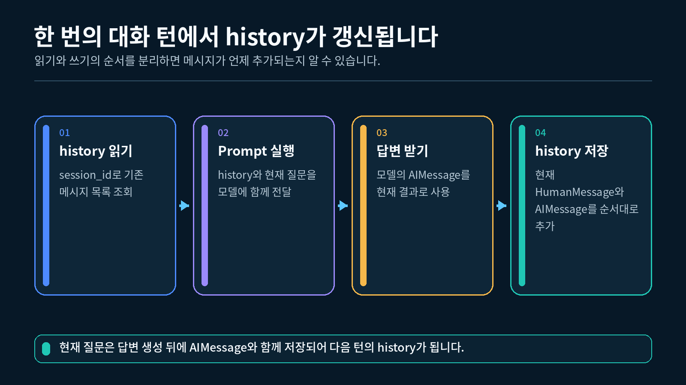
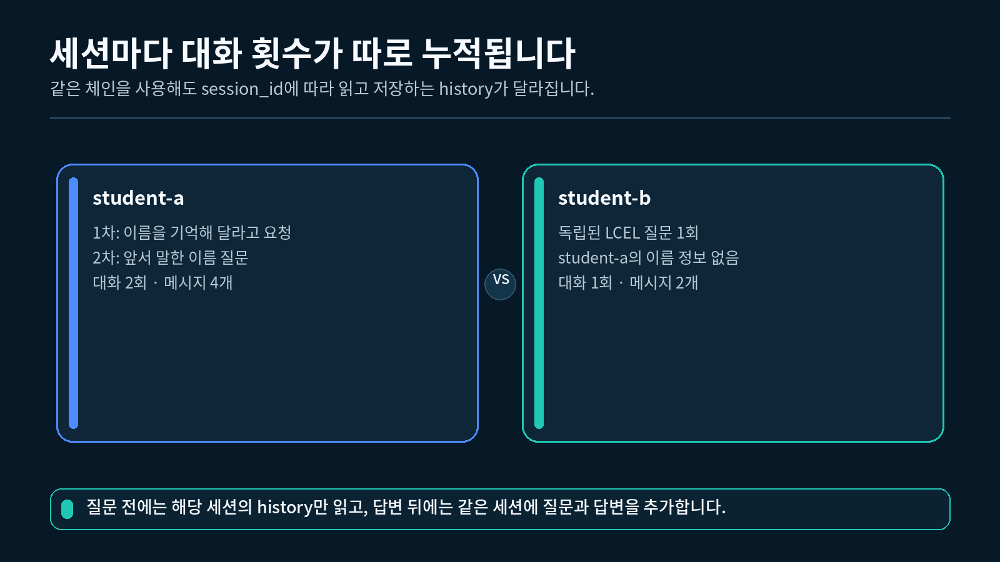
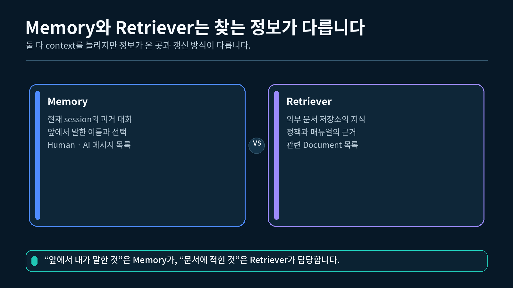

## 1. 저장한 history를 Prompt에 넣는 이유

7-1강에서는 `session_id`별로 질문과 답변을 저장했습니다. 기록을 저장했다는 사실만으로 모델이 이전 대화를 알게 되는 것은 아닙니다.

다음 호출에서 history를 Prompt 입력에 포함해야 모델이 과거 메시지를 읽을 수 있습니다.

```
session_id로 history 조회
→ 이전 메시지 목록을 Prompt에 전달
→ 현재 질문을 Prompt에 추가
→ 모델 호출
→ 새 질문과 답변을 history에 저장
```

### 저장과 주입을 구분하기

| 동작 | 목적 | 실행 시점 |
| --- | --- | --- |
| history 조회 | 현재 세션의 이전 메시지 찾기 | 모델 호출 전 |
| history 주입 | 이전 메시지를 Prompt에 포함하기 | 모델 호출 전 |
| 현재 질문 전달 | 이번에 답할 질문 추가하기 | 모델 호출 시 |
| 새 대화 저장 | 다음 호출에서 사용할 기록 갱신 | 모델 호출 후 |

세션 history를 조회해 Prompt에 넣고 새 대화를 다시 저장하는 흐름



### 현재 질문을 언제 저장할까?

이번 실습에서는 모델을 호출한 뒤 현재 질문과 답변을 함께 저장합니다.

모델 호출 전에 현재 질문을 history에 추가하고, Prompt의 `{question}`에도 같은 질문을 넣으면 질문이 두 번 전달될 수 있습니다.

```
올바른 입력
이전 history + 현재 question

피해야 할 입력
현재 question까지 넣은 history + 같은 현재 question
```

먼저 이전 history로 답변을 만든 뒤 질문과 답변을 한 쌍으로 저장하면 순서를 분명하게 유지할 수 있습니다.

---

## 2. MessagesPlaceholder 이해하기

`MessagesPlaceholder`는 이미 만들어진 메시지 목록을 Chat Prompt의 지정한 위치에 넣습니다.

### 2.1 Prompt 구조

```python
# 역할 기반 Prompt와 메시지 목록 위치를 표현할 클래스를 가져옵니다.
from langchain_core.prompts import ChatPromptTemplate, MessagesPlaceholder

# system, 이전 history, 현재 질문 순서의 대화형 Prompt를 만듭니다.
prompt = ChatPromptTemplate.from_messages(
    [
        # 첫 메시지는 모든 대화 턴에 공통으로 적용할 역할을 지정합니다.
        (
            "system",
            "당신은 LangChain 입문 수강생을 돕는 튜터입니다.",
        ),
        # 이 위치에는 실행할 때 전달한 이전 메시지 목록이 펼쳐집니다.
        MessagesPlaceholder(variable_name="history"),
        # 마지막 메시지는 이번 실행에서 새로 받은 질문을 담습니다.
        ("human", "{question}"),
    ]
)
```

`history`에는 문자열 하나가 아니라 `HumanMessage`와 `AIMessage`가 들어 있는 목록을 전달합니다.

### 2.2 이전 메시지 준비하기

```python
# Prompt에 넣을 사용자와 AI 메시지 클래스를 가져옵니다.
from langchain_core.messages import AIMessage, HumanMessage

# 앞선 한 번의 질문과 답변을 메시지 목록으로 준비합니다.
previous_messages = [
    # 이전 사용자의 발화를 HumanMessage로 보관합니다.
    HumanMessage(content="제 이름은 민지입니다."),
    # 이전 모델의 답변을 AIMessage로 보관합니다.
    AIMessage(content="민지님, 반갑습니다."),
]
```

### 2.3 Prompt 메시지 완성하기

```python
# 이전 history와 현재 질문을 넣어 실제 메시지 목록을 만듭니다.
messages = prompt.format_messages(
    # Placeholder에는 문자열이 아니라 역할이 있는 메시지 목록을 전달합니다.
    history=previous_messages,
    # 현재 질문은 human 템플릿의 question 변수를 채웁니다.
    question="제 이름이 뭐였나요?",
)

# 모델에 전달될 메시지를 역할과 본문 순서로 출력합니다.
for message in messages:
    # type은 system, human, ai처럼 각 메시지의 역할을 나타냅니다.
    print(f"{message.type}:{message.content}")
```

```
system: 당신은 LangChain 입문 수강생을 돕는 튜터입니다.
human: 제 이름은 민지입니다.
ai: 민지님, 반갑습니다.
human: 제 이름이 뭐였나요?
```

### Placeholder의 위치가 중요한 이유

이번 Prompt는 다음 순서로 모델에 전달됩니다.

```
system 지시
→ 이전 대화
→ 현재 질문
```

현재 질문 뒤에 이전 대화를 넣으면 대화의 시간 순서를 읽기 어려워집니다. 이번 강의에서는 `system → history → human` 순서를 고정합니다.

---

## 3. 현재 입문용 세션 대화 흐름 만들기

완성 실습은 폐기 예정인 래퍼에 의존하지 않고 다음 동작을 코드에 직접 드러냅니다.

1. `session_id`로 history를 가져옵니다.
2. history의 메시지 목록과 현재 질문을 체인에 전달합니다.
3. 모델의 문자열 답변을 받습니다.
4. 현재 질문과 답변을 같은 history에 저장합니다.

이 구조는 대화 이력이 언제 읽히고 갱신되는지 처음 배우는 수강생이 한 줄씩 확인하기 쉽습니다.

### 3.1 세션 저장소와 조회 함수

```python
# 메모리에 대화 기록을 보관하는 클래스를 가져옵니다.
from langchain_core.chat_history import InMemoryChatMessageHistory

# session_id와 대화 기록을 연결하는 딕셔너리 타입을 정의합니다.
HistoryStore = dict[str, InMemoryChatMessageHistory]

# session_id의 기존 history를 가져오거나 새로 만드는 함수를 정의합니다.
def get_session_history(
    store: HistoryStore,
    session_id: str,
) -> InMemoryChatMessageHistory:
    """session_id에 해당하는 기록을 가져오고, 없으면 새로 만듭니다."""

    # 처음 사용하는 session_id에는 비어 있는 history를 만듭니다.
    if session_id not in store:
        store[session_id] = InMemoryChatMessageHistory()

    # 같은 session_id에는 항상 같은 history를 반환합니다.
    return store[session_id]
```

### 3.2 Prompt, Model, Parser 연결하기

```python
# 모델의 AIMessage를 문자열로 바꿀 Parser를 가져옵니다.
from langchain_core.output_parsers import StrOutputParser

# OpenAI ChatModel을 LangChain 방식으로 사용할 클래스를 가져옵니다.
from langchain_openai import ChatOpenAI

# 대화 이력을 받을 역할 기반 Prompt를 만듭니다.
prompt = ChatPromptTemplate.from_messages(
    [
        # system 메시지는 대화 전체에서 유지할 답변 원칙을 전달합니다.
        (
            "system",
            "이전 대화에 근거해 두 문장 이내로 답하세요.",
        ),
        # history 변수에 들어온 과거 메시지를 현재 질문 앞에 배치합니다.
        MessagesPlaceholder(variable_name="history"),
        # question 변수는 이번 턴의 새 HumanMessage가 됩니다.
        ("human", "{question}"),
    ]
)

# 환경변수에서 읽은 API Key와 모델명을 사용해 ChatModel을 만듭니다.
model = ChatOpenAI(
    api_key=api_key,
    model=model_name,
)

# 모델 답변 객체를 문자열로 바꿀 Parser를 만듭니다.
parser = StrOutputParser()

# Prompt, Model, Parser를 실행 순서대로 연결합니다.
chain = prompt | model | parser
```

`api_key`와 `model_name`은 완성 실습에서 `.env`를 읽은 뒤 전달합니다.

### 3.3 한 번의 세션 질문 실행하기

```python
# 새 질문과 답변을 history에 저장할 메시지 클래스를 가져옵니다.
from langchain_core.messages import AIMessage, HumanMessage

# 한 세션의 history를 주입하고 새 대화를 저장하는 함수를 정의합니다.
def ask_session(
    chain,
    store: HistoryStore,
    session_id: str,
    question: str,
) -> str:
    """한 세션의 과거 메시지를 주입하고 새 질문과 답변을 기록합니다."""

    # 현재 질문이 속한 세션의 history를 가져옵니다.
    history = get_session_history(
        store,
        session_id,
    )

    # 이전 메시지 목록과 현재 질문을 체인에 전달합니다.
    raw_answer = chain.invoke(
        {
            "history": list(history.messages),
            "question": question,
        }
    )

    # 애플리케이션에서 사용할 일반 문자열로 명시적으로 변환합니다.
    answer = str(raw_answer)

    # 현재 질문과 모델 답변을 다음 호출에서 사용할 history에 추가합니다.
    history.add_messages(
        [
            HumanMessage(content=question),
            AIMessage(content=answer),
        ]
    )

    # 화면 출력과 후속 처리에 사용할 답변 문자열을 반환합니다.
    return answer
```

### 왜 `list(history.messages)`를 전달할까?

이번 호출에 사용할 이전 메시지 목록을 실행 시점에 명확히 전달하기 위해 새 목록으로 복사합니다. 모델 호출이 끝난 뒤 원래 history 객체에는 새 질문과 답변을 추가합니다.

---

## 4. 같은 세션과 다른 세션 실행하기

같은 `session_id`는 앞선 대화를 이어서 사용하고, 다른 `session_id`는 별도의 history를 사용해야 합니다.

student-a와 student-b의 대화 기록이 각각 갱신되는 흐름



### 4.1 같은 세션에서 두 번 질문하기

```python
# 여러 세션의 history를 보관할 빈 저장소를 만듭니다.
store: HistoryStore = {}

# student-a 세션에 이름을 기억해 달라는 첫 질문을 보냅니다.
first_answer = ask_session(
    # 앞에서 만든 대화 체인을 첫 번째 인자로 전달합니다.
    chain=chain,
    # 두 대화가 같은 세션 저장소를 함께 사용하게 합니다.
    store=store,
    # 첫 번째 사용자의 세션을 student-a로 구분합니다.
    session_id="student-a",
    question="제 이름은 민지입니다. 다음 질문에서 기억해 주세요.",
)

# 같은 student-a 세션에서 앞서 말한 이름을 다시 질문합니다.
second_answer = ask_session(
    # 첫 호출과 같은 체인과 저장소를 다시 사용합니다.
    chain=chain,
    store=store,
    # 같은 session_id를 사용해야 첫 대화가 history에 포함됩니다.
    session_id="student-a",
    question="제가 앞에서 말한 이름은 무엇인가요?",
)
```

두 번째 호출에는 첫 질문과 첫 답변이 history로 전달됩니다.

```
student-a 두 번째 호출 입력
├─ 첫 HumanMessage
├─ 첫 AIMessage
└─ 현재 질문
```

### 4.2 다른 세션에서 질문하기

```python
# student-b에는 student-a와 무관한 별도의 질문을 보냅니다.
other_answer = ask_session(
    # 대화 체인은 같아도 history 저장소의 세션 키는 다르게 지정합니다.
    chain=chain,
    store=store,
    # student-b 키는 비어 있는 새 history를 선택합니다.
    session_id="student-b",
    question="LCEL은 무엇인가요?",
)
```

`student-b`의 history에는 `student-a`가 말한 이름이 들어 있지 않습니다.

### 4.3 세션별 메시지 수 확인하기

```python
# student-a에는 두 번의 대화가 있어 메시지가 네 개인지 확인합니다.
print(len(store["student-a"].messages))

# student-b에는 한 번의 대화가 있어 메시지가 두 개인지 확인합니다.
print(len(store["student-b"].messages))
```

```
4
2
```

같은 저장소를 사용하더라도 `session_id`가 다르면 서로 다른 history 객체가 갱신됩니다.

---

## 5. RunnableWithMessageHistory 기존 계약 살펴보기

커리큘럼 제목에 포함된 `RunnableWithMessageHistory`는 체인을 감싸고 history 조회와 갱신을 대신 수행하던 래퍼입니다.

`langchain-core 1.5.1`에서는 이 클래스가 `1.3.3`부터 폐기 예정으로 표시되며 `2.0.0`에서 제거될 예정입니다. 현재 안내되는 대체 방향은 LangGraph의 내장 persistence이지만, LangGraph 구현은 이번 LangChain 입문 강의 범위가 아닙니다.

따라서 이번 강의에서는 다음처럼 구분합니다.

| 항목 | 이번 강의의 처리 |
| --- | --- |
| 기존 래퍼의 목적 | 개념으로 이해 |
| `session_id` 설정 위치 | 계약 형태 확인 |
| 래퍼를 사용한 완성 실습 | 사용하지 않음 |
| 현재 입문 실습 | history를 명시적으로 조회·주입·갱신 |
| LangGraph persistence | 후속 과정에서 학습 |

### 5.1 기존 래퍼가 요구한 네 요소

기존 계약은 다음 네 요소를 연결했습니다.

1. 감쌀 기본 Runnable
2. `session_id`로 history를 반환하는 함수
3. 현재 질문이 들어 있는 입력 키
4. 과거 메시지가 들어갈 history 키

### 5.2 참고용 계약 코드

다음 코드는 기존 구조를 읽기 위한 참고 예시입니다. 완성 실습에서는 호출하지 않습니다.

```python
# 기존 history 래퍼의 계약을 확인하기 위해 클래스를 가져옵니다.
from langchain_core.runnables.history import RunnableWithMessageHistory

# 폐기 예정인 기존 래퍼를 구성하는 참고 함수를 정의합니다.
def build_legacy_history_wrapper(
    base_chain,
    store: HistoryStore,
):
    """기존 RunnableWithMessageHistory 계약을 읽기 위한 참고 함수입니다."""

    # 래퍼가 session_id로 history를 찾을 수 있게 중간 함수를 정의합니다.
    def history_factory(
        session_id: str,
    ) -> InMemoryChatMessageHistory:
        # 앞에서 만든 세션 저장소에서 알맞은 history를 반환합니다.
        return get_session_history(
            store,
            session_id,
        )

    # 현재 질문 키와 과거 메시지 키를 기존 래퍼에 알려 줍니다.
    return RunnableWithMessageHistory(
        # base_chain은 실제 Prompt, Model, Parser가 연결된 Runnable입니다.
        base_chain,
        # history_factory는 session_id에 맞는 기록 객체를 반환합니다.
        history_factory,
        # question 키에는 이번 턴의 새 사용자 입력이 들어 있습니다.
        input_messages_key="question",
        # history 키에는 이전 HumanMessage와 AIMessage가 주입됩니다.
        history_messages_key="history",
    )
```

### 5.3 기존 실행 설정 형태

기존 래퍼는 입력 딕셔너리와 별도로 `configurable.session_id`를 받았습니다.

```python
# 기존 래퍼의 호출 계약을 설명하는 함수를 정의합니다.
def invoke_legacy_contract(
    legacy_chain,
    question: str,
    session_id: str,
):
    """기존 래퍼가 요구했던 입력과 config 모양을 보여 줍니다."""

    # 현재 질문은 입력 딕셔너리의 question 키에 넣습니다.
    inputs = {
        "question": question,
    }

    # history를 찾을 session_id는 configurable 설정에 넣습니다.
    config = {
        "configurable": {
            "session_id": session_id,
        }
    }

    # 기존 래퍼 계약에 맞춰 입력과 설정을 함께 전달합니다.
    return legacy_chain.invoke(
        inputs,
        config=config,
    )
```

클래스 이름과 기존 계약은 읽을 수 있어야 하지만, 새 입문 실습의 기본 선택으로 사용하지는 않습니다.

---

## 6. Retriever와 Memory 역할 비교하기

Retriever와 대화 history는 모두 모델에 추가 문맥을 제공하지만 가져오는 정보가 다릅니다.

외부 문서를 찾는 Retriever와 현재 세션 대화를 보관하는 Memory 비교



| 비교 항목 | Retriever | 대화 history |
| --- | --- | --- |
| 가져오는 정보 | 외부 문서 | 현재 세션의 이전 메시지 |
| 대표 입력 | 검색 질의 | `session_id` |
| 대표 결과 | `Document` 목록 | `BaseMessage` 목록 |
| 주요 목적 | 질문과 관련된 근거 찾기 | 대화 흐름 이어가기 |
| 이번 과정의 예 | 6장의 문서 검색 | 7장의 세션 대화 |

### Retriever가 필요한 질문

```
"교육 운영 문서에서 환불 기준을 찾아 주세요."
```

외부 문서에 있는 정보를 찾아야 하므로 Retriever의 역할에 가깝습니다.

### 대화 history가 필요한 질문

```
"제가 앞에서 말한 이름이 뭐였나요?"
```

현재 세션의 앞선 발화를 읽어야 하므로 대화 history의 역할에 가깝습니다.

### 서로 대신할 수 있을까?

- Retriever는 사용자가 앞에서 말한 내용을 자동으로 기억하지 않습니다.
- 대화 history는 외부 문서 전체를 검색하는 도구가 아닙니다.
- 실제 앱에서는 두 기능을 함께 사용할 수 있지만 이번 강의에서는 결합 구현을 하지 않습니다.

이번 단계에서는 **외부 지식은 Retriever, 현재 대화는 history**라고 구분하면 충분합니다.

---

## 7. 완성 실습 실행하기

완성 실습은 `RunnableWithMessageHistory` 없이 대화 이력의 이동을 직접 보여 줍니다.

### 7.1 실행 순서

1. `.env`에서 `OPENAI_API_KEY`와 선택적인 `OPENAI_MODEL`을 읽습니다.
2. API Key가 없으면 모델 객체를 만들지 않고 정상 종료합니다.
3. `MessagesPlaceholder("history")`가 있는 Prompt를 만듭니다.
4. Prompt, ChatModel, Parser를 연결합니다.
5. `student-a`에서 이름을 말하고 같은 세션에서 다시 질문합니다.
6. `student-b`에는 별도의 질문을 한 번 보냅니다.
7. 두 세션의 대화 횟수와 메시지 수를 확인합니다.

### 7.2 API 호출 횟수

API Key가 있을 때 완성 실습은 모델을 총 세 번 호출합니다.

| 호출 | session_id | 목적 |
| --- | --- | --- |
| 1 | `student-a` | 기억할 이름 전달 |
| 2 | `student-a` | 같은 세션의 이전 이름 참조 |
| 3 | `student-b` | 별도 세션 질문 |

### 7.3 VS Code에서 실행하기

7-2강 폴더를 VS Code로 연 뒤 터미널에서 실행합니다.

1-2강에서 만든 `pyproject.toml`과 `uv.lock`이 있는 프로젝트의 하위 폴더에 `실습.py`를 두고, 해당 폴더에서 실행합니다. VS Code 인터프리터는 이 프로젝트의 `.venv` (Python 3.12)를 선택합니다.

```powershell
# uv가 관리하는 Python 3.12으로 7-2강 완성 실습을 실행합니다.
uv run python 실습.py
```

"""7-2강: MessagesPlaceholder와 세션 딕셔너리로 대화 이력을 직접 주입합니다."""

import os

from dotenv import load_dotenv
from langchain_core.chat_history import InMemoryChatMessageHistory
from langchain_core.messages import AIMessage, HumanMessage
from langchain_core.output_parsers import StrOutputParser
from langchain_core.prompts import ChatPromptTemplate, MessagesPlaceholder
from langchain_openai import ChatOpenAI


# .env에 모델명이 없을 때 사용할 수업 기본 모델을 지정합니다.
DEFAULT_MODEL = "gpt-5-nano"

# session_id와 해당 세션의 대화 기록을 연결하는 딕셔너리 타입을 정의합니다.
HistoryStore = dict[str, InMemoryChatMessageHistory]


def get_session_history(
    store: HistoryStore,
    session_id: str,
) -> InMemoryChatMessageHistory:
    """session_id에 해당하는 기록을 가져오고, 없으면 새로 만듭니다."""

    # 빈 session_id는 서로 다른 대화를 구분할 수 없으므로 거부합니다.
    if not session_id.strip():
        raise ValueError("session_id는 비어 있을 수 없습니다.")

    # 처음 사용하는 session_id에는 비어 있는 대화 기록을 만듭니다.
    if session_id not in store:
        store[session_id] = InMemoryChatMessageHistory()

    # 같은 session_id에는 항상 같은 대화 기록을 반환합니다.
    return store[session_id]


def build_chain(api_key: str, model_name: str):
    """대화 이력을 받을 Prompt와 OpenAI ChatModel, Parser를 연결합니다."""

    # history 위치에 이전 메시지 목록을 넣을 수 있는 대화형 Prompt를 만듭니다.
    prompt = ChatPromptTemplate.from_messages(
        [
            (
                "system",
                "당신은 LangChain 입문 수강생을 돕는 튜터입니다. "
                "이전 대화에 근거해 두 문장 이내로 답하세요.",
            ),
            MessagesPlaceholder(variable_name="history"),
            ("human", "{question}"),
        ]
    )

    # 환경변수에서 받은 API Key와 모델명으로 ChatModel을 만듭니다.
    model = ChatOpenAI(
        api_key=api_key,
        model=model_name,
    )

    # 모델의 AIMessage 본문을 문자열로 바꿀 Parser를 만듭니다.
    parser = StrOutputParser()

    # Prompt, Model, Parser를 데이터가 이동하는 순서대로 연결합니다.
    return prompt | model | parser


def ask_session(
    chain,
    store: HistoryStore,
    session_id: str,
    question: str,
) -> str:
    """한 세션의 과거 메시지를 주입하고 새 질문과 답변을 기록합니다."""

    # 현재 질문이 속한 세션의 대화 기록을 가져옵니다.
    history = get_session_history(store, session_id)

    # 실행 직전까지 저장된 메시지 목록과 새 질문을 체인에 전달합니다.
    raw_answer = chain.invoke(
        {
            "history": list(history.messages),
            "question": question,
        }
    )

    # 애플리케이션 경계에서 최종 결과를 일반 문자열로 명시적으로 바꿉니다.
    answer = str(raw_answer)

    # 방금 실행한 질문과 답변을 다음 요청에서 사용할 기록에 추가합니다.
    history.add_messages(
        [
            HumanMessage(content=question),
            AIMessage(content=answer),
        ]
    )

    # 화면 출력과 후속 처리에 사용할 답변 문자열을 반환합니다.
    return answer


def print_session_size(
    store: HistoryStore,
    session_id: str,
) -> None:
    """지정한 세션에 저장된 대화 횟수와 메시지 수를 출력합니다."""

    # 크기를 확인할 세션의 대화 기록을 가져옵니다.
    history = get_session_history(store, session_id)

    # 질문과 답변 두 메시지가 한 번의 대화를 이루므로 2로 나눕니다.
    turn_count = len(history.messages) // 2

    # 세션별 대화 횟수와 전체 메시지 수를 함께 출력합니다.
    print(
        f"[{session_id}] 대화 {turn_count}회 · "
        f"메시지 {len(history.messages)}개"
    )


def main() -> None:
    """두 세션을 분리해 실행하고 한 세션에서만 이전 이름을 참조합니다."""

    # 현재 프로젝트의 .env 값을 Python 환경변수로 불러옵니다.
    load_dotenv()

    # 실제 값은 출력하지 않고 OPENAI_API_KEY 존재 여부만 확인합니다.
    api_key = os.getenv("OPENAI_API_KEY")

    # OPENAI_MODEL이 없으면 수업 기본 모델을 사용합니다.
    model_name = os.getenv("OPENAI_MODEL", DEFAULT_MODEL)

    # API Key가 없으면 모델 객체를 만들지 않고 설정 방법을 안내합니다.
    if not api_key:
        print("OPENAI_API_KEY가 없습니다.")
        print("1-2강에서 만든 .env 파일을 확인해 주세요.")
        return

    # 세션 이력을 받을 Prompt와 실제 OpenAI 모델을 연결합니다.
    chain = build_chain(api_key, model_name)

    # 여러 session_id의 대화 기록을 보관할 빈 딕셔너리를 만듭니다.
    store: HistoryStore = {}

    # student-a 세션에 기억할 이름을 첫 번째 대화로 전달합니다.
    first_answer = ask_session(
        chain=chain,
        store=store,
        session_id="student-a",
        question="제 이름은 민지입니다. 다음 질문에서 기억해 주세요.",
    )

    # 첫 번째 모델 답변을 세션 이름과 함께 출력합니다.
    print(f"[student-a · 1차 답변] {first_answer}")

    # 같은 student-a 세션에서 앞서 말한 이름을 다시 질문합니다.
    second_answer = ask_session(
        chain=chain,
        store=store,
        session_id="student-a",
        question="제가 앞에서 말한 이름은 무엇인가요?",
    )

    # history가 주입된 두 번째 모델 답변을 출력합니다.
    print(f"[student-a · 2차 답변] {second_answer}")

    # student-b에는 별도의 질문을 보내 student-a와 기록이 섞이지 않게 합니다.
    other_answer = ask_session(
        chain=chain,
        store=store,
        session_id="student-b",
        question="LCEL은 무엇인가요?",
    )

    # student-b가 받은 독립적인 답변을 출력합니다.
    print(f"[student-b · 1차 답변] {other_answer}")

    # student-a에는 두 번의 대화가 저장되었는지 확인합니다.
    print_session_size(store, "student-a")

    # student-b에는 한 번의 대화만 저장되었는지 확인합니다.
    print_session_size(store, "student-b")


if __name__ == "__main__":
    # 터미널에서 python 실습.py로 실행했을 때만 실제 모델을 호출합니다.
    main()

### 7.4 API Key가 없을 때

```
OPENAI_API_KEY가 없습니다.
1-2강에서 만든 .env 파일을 확인해 주세요.
```

설정 오류를 확인한 뒤 종료하므로 네트워크 요청을 보내지 않습니다.

### 7.5 API Key가 있을 때의 출력 구조

모델 답변의 문장은 실행할 때마다 달라질 수 있지만 출력의 구조는 다음과 같습니다.

```
[student-a · 1차 답변] ...
[student-a · 2차 답변] ...민지...
[student-b · 1차 답변] ...
[student-a] 대화 2회 · 메시지 4개
[student-b] 대화 1회 · 메시지 2개
```

두 번째 `student-a` 답변이 앞선 이름을 참고하는지 확인합니다. 세션별 메시지 수는 모델의 문장과 관계없이 각각 4개와 2개여야 합니다.