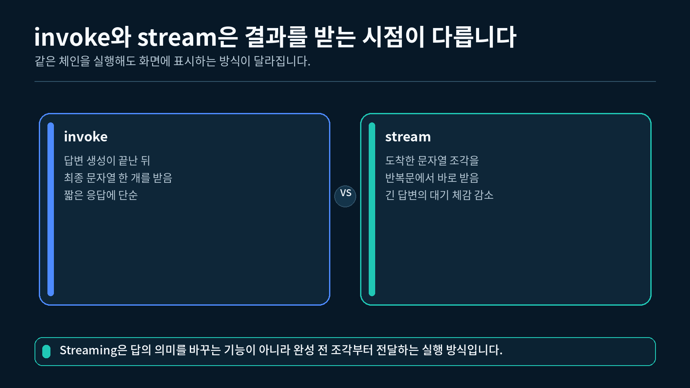
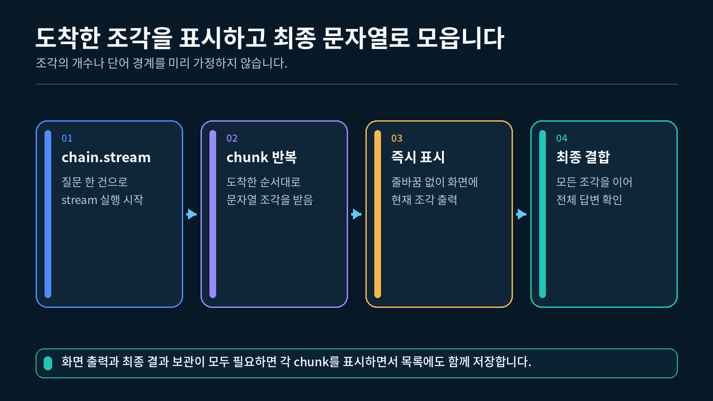
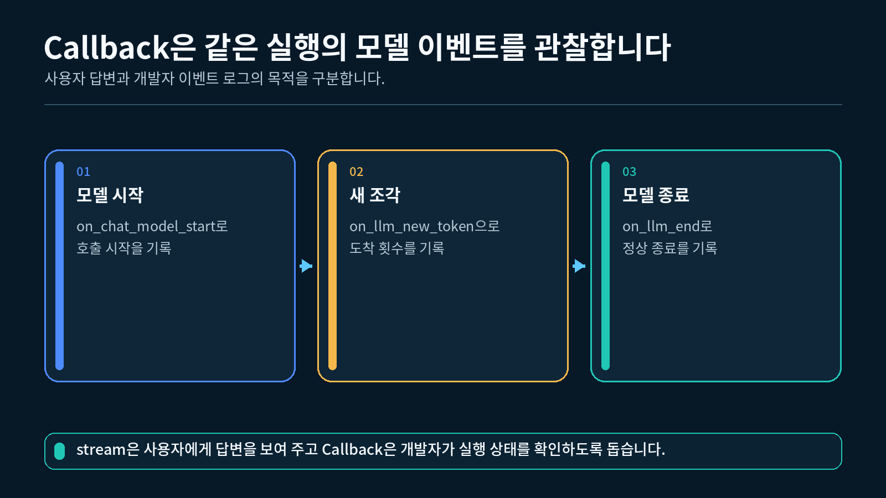

## 1. 스트리밍 출력과 실행 관찰 구분하기

3-2강에서는 `stream()`이 반환하는 문자열 조각을 반복문으로 받아 화면에 이어서 출력했습니다. 이번 강의에서는 같은 실행에 **Callback Handler**를 연결해 모델이 언제 시작하고 끝나는지도 함께 관찰합니다.

```
사용자에게 보여 줄 내용  → chain.stream()이 내보내는 답변 조각
개발자가 확인할 상태     → Callback Handler가 받는 실행 이벤트
```

invoke와 stream의 결과 표시 시점 비교



### 1.1 두 흐름을 나누는 이유

스트리밍 답변과 실행 이벤트는 목적이 다릅니다.

| 구분 | 확인하는 내용 | 이번 실습의 출력 |
| --- | --- | --- |
| 답변 흐름 | 모델이 생성한 실제 문장 | `[스트리밍 답변]` 아래의 본문 |
| 실행 흐름 | 모델 호출의 시작·진행·완료·오류 | `[Callback]`으로 시작하는 상태 |

Callback이 답변을 대신 생성하는 것은 아닙니다. Callback은 체인이 실행되는 동안 발생한 사건을 전달받아 기록하거나 화면에 표시합니다.

### 1.2 한 번의 모델 요청

이번 완성 실습은 다음 순서로 한 번만 실행됩니다.

```
질문 딕셔너리
→ Prompt
→ Model
→ StrOutputParser
→ 문자열 조각을 화면에 출력
→ 모든 조각을 합친 전체 문자열 반환
```

Callback Handler는 이 흐름 옆에서 모델 이벤트를 관찰합니다. Handler를 추가했다고 모델 요청이 한 번 더 발생하지는 않습니다.

---

## 2. 문자열을 내보내는 스트리밍 체인 만들기

이번 체인의 마지막에는 `StrOutputParser`를 둡니다. 따라서 `chain.stream()`의 반복문에서 받는 값을 문자열로 다룰 수 있습니다.

### 2.1 Prompt 만들기

```python
# 역할 기반 Prompt를 만들 클래스를 가져옵니다.
from langchain_core.prompts import ChatPromptTemplate

# 답변 역할과 길이를 모든 질문에 공통으로 적용할 Prompt를 만듭니다.
prompt = ChatPromptTemplate.from_messages(
    [
        (
            "system",
            "당신은 LangChain 입문 수업의 튜터입니다. "
            "핵심만 쉬운 한국어 두 문장으로 설명하세요.",
        ),
        (
            "human",
            "{question}",
        ),
    ]
)
```

실행할 때는 `question` 키가 있는 딕셔너리를 전달해야 합니다.

```python
# Prompt의 question 변수에 들어갈 질문 한 건을 준비합니다.
input_data = {
    "question": "스트리밍 응답의 장점은 무엇인가요?"
}
```

### 2.2 Model과 Parser 연결하기

```python
# .env에서 지정한 권장 모델을 읽습니다.
import os

# .env 파일의 값을 현재 Python 환경변수로 불러올 함수를 가져옵니다.
from dotenv import load_dotenv

# 모델 응답을 일반 문자열로 바꿀 Parser를 가져옵니다.
from langchain_core.output_parsers import StrOutputParser

# OpenAI ChatModel을 LangChain 방식으로 사용할 클래스를 가져옵니다.
from langchain_openai import ChatOpenAI

# 현재 프로젝트의 .env 값을 환경변수로 불러옵니다.
load_dotenv()

# load_dotenv()로 불러온 환경변수에서 API Key를 읽는 ChatModel을 만듭니다.
model = ChatOpenAI(
    model=os.getenv("OPENAI_MODEL", "gpt-5.6-luna"),
)

# 모델의 출력 조각을 문자열 조각으로 바꿀 Parser를 만듭니다.
parser = StrOutputParser()

# Prompt, Model, Parser를 데이터가 흐르는 순서대로 연결합니다.
chain = prompt | model | parser
```

### 2.3 문자열 조각 받기

```python
# 이어서 출력될 모델 답변의 시작 위치를 표시합니다.
print("[스트리밍 답변]")

# 체인이 내보내는 문자열 조각을 도착하는 순서대로 받습니다.
for raw_chunk in chain.stream(input_data):
    # 애플리케이션에서 사용할 일반 문자열로 명시적으로 바꿉니다.
    chunk = str(raw_chunk)

    # 답변 조각을 줄바꿈 없이 즉시 이어서 출력합니다.
    print(chunk, end="", flush=True)

# 스트리밍이 끝난 뒤 다음 출력이 새 줄에서 시작되게 합니다.
print()
```

조각의 개수와 경계는 실행할 때마다 달라질 수 있습니다. 한 조각이 한 단어나 한 글자와 항상 일치한다고 가정하지 않습니다.

---

## 3. Callback Handler의 역할 이해하기

LangChain의 Callback Handler는 체인과 모델이 실행되는 동안 발생하는 이벤트를 받는 객체입니다. 이번 강의에서는 모델에 관한 네 가지 이벤트만 사용합니다.

| 메서드 | 실행 시점 | 이번 실습에서 하는 일 |
| --- | --- | --- |
| `on_chat_model_start()` | 채팅 모델 호출 시작 | 조각 개수를 0으로 초기화 |
| `on_llm_new_token()` | 새 출력 조각 도착 | 내용이 있는 문자열 이벤트 개수 증가 |
| `on_llm_end()` | 모델 호출 정상 완료 | 완료 상태와 개수 출력 |
| `on_llm_error()` | 모델 호출 실패 | 예외 종류 출력 |

stream 조각을 출력하고 전체 문자열로 모으는 흐름



### 3.1 Handler는 결과를 바꾸지 않음

Callback 메서드는 실행 상태를 관찰하지만 Prompt, 모델 답변, Parser 결과를 바꾸지 않습니다.

```
체인의 데이터 흐름: Prompt → Model → Parser → 문자열 조각
Callback의 관찰 흐름: 시작 → 새 조각 여러 번 → 완료 또는 오류
```

따라서 Handler를 연결하기 전과 후에 체인이 만드는 답변의 의미는 같습니다.

### 3.2 `on_llm_new_token()` 이름 읽기

메서드 이름에는 `token`이 들어 있지만, 이번 강의에서는 **출력 이벤트 조각**으로 이해합니다. 모델의 tokenizer가 세는 정확한 토큰 한 개와 Callback 호출 한 번이 항상 일치한다고 가정하지 않습니다.

현재 Callback 값은 문자열 외의 구조가 될 수도 있습니다. 문자열 조각만 세려면 자료형과 빈 문자열을 함께 확인합니다.

```python
# 현재 이벤트 값이 내용이 있는 문자열일 때만 개수를 셉니다.
if isinstance(token, str) and token:
    # 문자열 이벤트 한 건을 관찰 결과에 추가합니다.
    self.text_event_count += 1
```

### 3.3 Handler의 출력과 답변 출력

이번 실습에서는 답변 본문을 `for` 반복문이 출력합니다. Callback은 같은 답변을 다시 출력하지 않고 시작·완료·오류 상태만 보여 줍니다. 이렇게 하면 답변이 두 번 보이는 혼동을 막을 수 있습니다.

---

## 4. 최소 Streaming Handler 구현하기

사용자 정의 Handler는 `BaseCallbackHandler`를 상속해 만듭니다. 4.2~4.4절의 메서드는 4.1절 클래스 안에서 `__init__`와 같은 깊이로 들여쓰기합니다. 전체 클래스는 제공된 `실습.py`에서 확인할 수 있습니다.

### 4.1 클래스와 초기값

```python
# 여러 형태의 Callback 인자를 표시할 Any를 가져옵니다.
from typing import Any

# 사용자 정의 Callback의 기반 클래스를 가져옵니다.
from langchain_core.callbacks import BaseCallbackHandler

# 모델 완료 결과의 자료형을 가져옵니다.
from langchain_core.outputs import LLMResult

# 모델의 최소 스트리밍 이벤트를 관찰할 Handler를 정의합니다.
class SimpleStreamingHandler(BaseCallbackHandler):
    """모델의 시작, 문자열 조각, 완료, 오류 이벤트만 기록합니다."""

    def __init__(self) -> None:
        """한 번의 실행에서 관찰할 문자열 조각 개수를 준비합니다."""

        # 아직 모델이 문자열 조각을 보내지 않았으므로 0에서 시작합니다.
        self.text_event_count = 0
```

### 4.2 시작 이벤트

`on_chat_model_start()`는 채팅 모델 호출이 시작될 때 실행됩니다. `serialized`와 `messages`는 Handler가 받을 수 있도록 메서드 위치에 그대로 둡니다.

```python
# SimpleStreamingHandler 클래스 안에 작성하는 메서드입니다.
def on_chat_model_start(
    self,
    serialized: dict[str, Any],
    messages: list[list[Any]],
    **kwargs: Any,
) -> None:
    """채팅 모델 호출이 시작될 때 실행 상태를 초기화합니다."""

    # 같은 Handler를 다시 사용해도 현재 실행만 세도록 초기화합니다.
    self.text_event_count = 0

    # 답변 본문과 구분되는 시작 상태를 표시합니다.
    print("[Callback] 채팅 모델 호출 시작")
```

### 4.3 출력 조각 이벤트

```python
# SimpleStreamingHandler 클래스 안에 작성하는 메서드입니다.
def on_llm_new_token(
    self,
    token: str | list[str | dict[str, Any]],
    **kwargs: Any,
) -> None:
    """모델이 새 출력 조각을 보낼 때 문자열 조각의 개수를 셉니다."""

    # 현재 이벤트가 내용이 있는 문자열인지 확인합니다.
    if isinstance(token, str) and token:
        # 조건을 만족하는 문자열 이벤트만 한 개로 계산합니다.
        self.text_event_count += 1
```

이 메서드는 조각을 직접 출력하지 않습니다. 답변 출력은 `chain.stream()`의 반복문 한 곳에서만 담당합니다.

### 4.4 완료와 오류 이벤트

```python
# SimpleStreamingHandler 클래스 안에 작성하는 정상 완료 메서드입니다.
def on_llm_end(
    self,
    response: LLMResult,
    **kwargs: Any,
) -> None:
    """모델 호출이 정상적으로 끝났을 때 관찰 결과를 표시합니다."""

    # 스트리밍 본문 뒤에서 완료 상태가 새 줄로 시작되게 합니다.
    print()

    # 이번 실행에서 관찰한 문자열 이벤트 개수를 표시합니다.
    print(
        "[Callback] 채팅 모델 호출 완료 "
        f"· 문자열 이벤트{self.text_event_count}개"
    )

# SimpleStreamingHandler 클래스 안에 작성하는 오류 메서드입니다.
def on_llm_error(
    self,
    error: BaseException,
    **kwargs: Any,
) -> None:
    """모델 호출 중 오류가 발생하면 예외 종류를 짧게 표시합니다."""

    # 스트리밍 본문과 오류 안내가 붙지 않도록 줄을 바꿉니다.
    print()

    # 예외 메시지 전체 대신 예외 클래스 이름만 표시합니다.
    print(f"[Callback] 채팅 모델 호출 실패 ·{type(error).__name__}")
```

정상 실행에서는 `on_llm_end()`가 호출됩니다. 모델 호출이 실패하면 `on_llm_error()`가 호출되며, 오류 자체는 체인 호출 쪽으로도 전달됩니다.

정상 실행에서 Callback Handler가 받는 세 단계



도식은 정상 실행의 시작, 새 조각, 완료 순서를 보여 줍니다. 오류가 발생한 실행은 완료 대신 `on_llm_error()` 경로로 이동합니다.

---

## 5. 한 번의 stream 실행에 Handler 연결하기

Handler 객체는 체인을 새로 만들 때 넣지 않고, 실행 설정인 `config`의 `callbacks` 목록에 넣을 수 있습니다.

### 5.1 Handler 객체 만들기

```python
# 현재 모델 실행의 이벤트를 기록할 Handler 객체를 만듭니다.
handler = SimpleStreamingHandler()
```

### 5.2 실행 설정에 연결하기

```python
# 현재 실행 한 번에만 Handler를 연결하고 문자열 조각을 받습니다.
for raw_chunk in chain.stream(
    input_data,
    config={"callbacks": [handler]},
):
    # Parser 결과를 일반 문자열로 바꿉니다.
    chunk = str(raw_chunk)

    # 도착한 문자열을 즉시 화면에 이어서 출력합니다.
    print(chunk, end="", flush=True)
```

`callbacks`는 목록이므로 필요할 때 Handler를 여러 개 연결할 수 있습니다. 이번 강의에서는 실행 흐름을 단순하게 유지하기 위해 하나만 사용합니다.

### 5.3 이벤트와 결과 조각의 관계

모델이 만든 이벤트 조각과 전체 LCEL 체인이 Parser 뒤에서 내보내는 문자열 조각은 서로 다른 경계에서 관찰됩니다. 따라서 다음 두 개수가 항상 같다고 기대하지 않습니다.

```
handler.text_event_count     → 모델 Callback이 관찰한 문자열 이벤트 수
len(collected_chunks)        → 최종 체인의 반복문이 받은 문자열 조각 수
```

이번 실습에서는 특정 개수를 예상하지 않습니다. 답변 조각을 모두 합친 문자열이 비어 있지 않은지만 확인합니다.

---

## 6. 조각을 출력하면서 전체 답변 모으기

스트리밍은 화면 표시뿐 아니라 전체 결과를 나중에 저장하거나 다른 함수에 전달할 때도 사용할 수 있습니다.

### 6.1 빈 리스트 준비하기

```python
# 도착한 문자열 조각을 순서대로 보관할 빈 리스트를 만듭니다.
collected_chunks: list[str] = []
```

### 6.2 출력과 저장을 함께 수행하기

```python
# 현재 실행에 Handler를 연결하고 결과 조각을 하나씩 받습니다.
for raw_chunk in chain.stream(
    input_data,
    config={"callbacks": [handler]},
):
    # Parser가 내보낸 값을 일반 문자열로 변환합니다.
    chunk = str(raw_chunk)

    # 전체 답변을 만들 수 있도록 현재 조각을 저장합니다.
    collected_chunks.append(chunk)

    # 사용자는 기다리지 않도록 현재 조각을 즉시 보여 줍니다.
    print(chunk, end="", flush=True)
```

### 6.3 전체 문자열 만들기

```python
# 저장한 모든 문자열 조각을 도착한 순서대로 이어 붙입니다.
full_text = "".join(collected_chunks)

# 공백을 제외한 내용이 없으면 정상 답변으로 사용하지 않습니다.
if not full_text.strip():
    raise ValueError("스트리밍 답변이 비어 있습니다.")

# 합친 최종 결과가 일반 문자열인지 확인합니다.
print(f"[전체 답변 자료형]{type(full_text).__name__}")
```

스트리밍 출력과 전체 문자열 저장은 서로 대체 관계가 아닙니다. 같은 반복문 안에서 조각을 출력하고 리스트에도 넣으면 두 목적을 함께 달성할 수 있습니다.

---

## 7. 완성 실습 실행하기

`실습.py`는 실제 OpenAI 모델을 한 번 호출해 스트리밍 답변과 최소 Callback 이벤트를 보여 줍니다.

### 7.1 실행 전 확인

프로젝트의 `.env` 파일에 다음 설정이 있어야 합니다.

```
OPENAI_API_KEY=발급받은_API_Key
OPENAI_MODEL=gpt-5.6-luna
```

`OPENAI_MODEL`은 생략할 수 있지만 `OPENAI_API_KEY`는 실제 모델 호출에 필요합니다.

### 7.2 VS Code에서 실행하기

1-2강에서 만든 `pyproject.toml`과 `uv.lock`이 있는 프로젝트의 하위 폴더에 `실습.py`를 두고, 해당 폴더에서 실행합니다. VS Code 인터프리터는 이 프로젝트의 `.venv` (Python 3.12)를 선택합니다.

```powershell
# 8-1강 폴더로 이동한 상태에서 uv가 관리하는 Python 3.12으로 실행합니다.
uv run python 실습.py
```

"""8-1강: 스트리밍 답변을 출력하고 최소 Callback 이벤트를 관찰합니다."""

import os
from typing import Any

from dotenv import load_dotenv
from langchain_core.callbacks import BaseCallbackHandler
from langchain_core.output_parsers import StrOutputParser
from langchain_core.outputs import LLMResult
from langchain_core.prompts import ChatPromptTemplate
from langchain_openai import ChatOpenAI


# .env에 모델명이 없을 때 사용할 수업 기본 모델을 지정합니다.
DEFAULT_MODEL = "gpt-5-nano"

# 한 번의 모델 호출로 확인할 짧은 실습 질문을 준비합니다.
SAMPLE_QUESTION = "스트리밍 응답이 사용자 경험에 주는 장점을 두 문장으로 설명해 주세요."


class SimpleStreamingHandler(BaseCallbackHandler):
    """모델의 시작, 문자열 조각, 완료, 오류 이벤트만 기록합니다."""

    def __init__(self) -> None:
        """한 번의 실행에서 관찰할 문자열 조각 개수를 준비합니다."""

        # 아직 모델이 문자열 조각을 보내지 않았으므로 0에서 시작합니다.
        self.text_event_count = 0

    def on_chat_model_start(
        self,
        serialized: dict[str, Any],
        messages: list[list[Any]],
        **kwargs: Any,
    ) -> None:
        """채팅 모델 호출이 시작될 때 실행 상태를 초기화합니다."""

        # 같은 Handler를 다시 사용해도 현재 실행의 개수만 세도록 초기화합니다.
        self.text_event_count = 0

        # 답변 본문과 구분되는 짧은 시작 이벤트를 화면에 표시합니다.
        print("[Callback] 채팅 모델 호출 시작")

    def on_llm_new_token(
        self,
        token: str | list[str | dict[str, Any]],
        **kwargs: Any,
    ) -> None:
        """모델이 새 출력 조각을 보낼 때 문자열 조각의 개수를 셉니다."""

        # 현재 LangChain에서는 token 값이 문자열이 아닐 수도 있으므로 먼저 확인합니다.
        if isinstance(token, str) and token:
            # 내용이 있는 문자열 이벤트만 한 개로 계산합니다.
            self.text_event_count += 1

    def on_llm_end(
        self,
        response: LLMResult,
        **kwargs: Any,
    ) -> None:
        """모델 호출이 정상적으로 끝났을 때 관찰 결과를 표시합니다."""

        # 스트리밍 본문 뒤에서 완료 이벤트가 새 줄로 시작되게 합니다.
        print()

        # 이번 실행에서 받은 문자열 이벤트 개수를 완료 메시지와 함께 표시합니다.
        print(
            "[Callback] 채팅 모델 호출 완료 "
            f"· 문자열 이벤트 {self.text_event_count}개"
        )

    def on_llm_error(
        self,
        error: BaseException,
        **kwargs: Any,
    ) -> None:
        """모델 호출 중 오류가 발생하면 예외 종류를 짧게 표시합니다."""

        # 스트리밍 본문과 오류 안내가 같은 줄에 붙지 않도록 먼저 줄을 바꿉니다.
        print()

        # API Key 같은 민감한 값은 출력하지 않고 예외 클래스 이름만 보여 줍니다.
        print(f"[Callback] 채팅 모델 호출 실패 · {type(error).__name__}")


def build_streaming_chain(model: ChatOpenAI):
    """Prompt, Model, 문자열 Parser를 연결한 스트리밍 체인을 만듭니다."""

    # 답변 역할과 길이를 모든 질문에 공통으로 적용할 Prompt를 만듭니다.
    prompt = ChatPromptTemplate.from_messages(
        [
            (
                "system",
                "당신은 LangChain 입문 수업의 튜터입니다. "
                "핵심만 쉬운 한국어 두 문장으로 설명하세요.",
            ),
            (
                "human",
                "{question}",
            ),
        ]
    )

    # 모델의 출력 조각을 화면에서 다루기 쉬운 문자열 조각으로 바꿉니다.
    parser = StrOutputParser()

    # Prompt, Model, Parser가 차례대로 실행되는 LCEL 체인을 반환합니다.
    return prompt | model | parser


def stream_answer(chain, handler: SimpleStreamingHandler, question: str) -> str:
    """질문 한 건의 답변을 즉시 출력하면서 전체 문자열도 반환합니다."""

    # Prompt의 question 변수에 전달할 입력 딕셔너리를 준비합니다.
    input_data = {
        "question": question,
    }

    # 도착한 문자열 조각을 순서대로 보관할 빈 리스트를 만듭니다.
    collected_chunks: list[str] = []

    # 이어서 출력될 모델 답변의 시작 위치를 표시합니다.
    print("[스트리밍 답변]")

    # 현재 실행에만 사용자 정의 Handler를 연결하고 결과 조각을 하나씩 받습니다.
    for raw_chunk in chain.stream(
        input_data,
        config={"callbacks": [handler]},
    ):
        # Parser가 내보낸 값을 애플리케이션에서 사용할 일반 문자열로 바꿉니다.
        chunk = str(raw_chunk)

        # 마지막에 전체 답변을 다시 만들 수 있도록 현재 조각을 저장합니다.
        collected_chunks.append(chunk)

        # 답변이 완성될 때까지 기다리지 않고 현재 조각을 바로 이어서 출력합니다.
        print(chunk, end="", flush=True)

    # 저장한 문자열 조각을 도착한 순서 그대로 이어 전체 답변을 만듭니다.
    full_text = "".join(collected_chunks)

    # 비어 있는 응답을 정상 결과로 사용하지 않도록 명확한 오류를 발생시킵니다.
    if not full_text.strip():
        raise ValueError("스트리밍 답변이 비어 있습니다.")

    # 화면 표시 외의 후속 작업에도 사용할 수 있도록 전체 문자열을 반환합니다.
    return full_text


def main() -> None:
    """환경변수를 확인하고 Callback이 연결된 스트리밍 체인을 실행합니다."""

    # 실습 폴더 또는 상위 폴더에 있는 .env 파일의 값을 불러옵니다.
    load_dotenv()

    # 실제 API Key는 환경변수에서 읽고 화면에는 출력하지 않습니다.
    api_key = os.getenv("OPENAI_API_KEY")

    # 환경변수로 모델을 바꾸지 않으면 수업 기본 모델을 사용합니다.
    model_name = os.getenv("OPENAI_MODEL", DEFAULT_MODEL)

    # API Key가 없으면 모델 객체를 만들기 전에 설정 위치를 안내하고 종료합니다.
    if not api_key:
        print("OPENAI_API_KEY가 없습니다.")
        print("1-2강에서 만든 .env 파일을 확인해 주세요.")
        return

    # 짧은 스트리밍 답변을 생성할 OpenAI ChatModel을 만듭니다.
    model = ChatOpenAI(
        api_key=api_key,
        model=model_name,
    )

    # Prompt, Model, Parser가 연결된 체인을 한 번 만듭니다.
    chain = build_streaming_chain(model)

    # 현재 모델 실행의 최소 이벤트를 기록할 Handler를 만듭니다.
    handler = SimpleStreamingHandler()

    # 답변을 화면에 즉시 출력하면서 전체 문자열도 변수로 받습니다.
    full_answer = stream_answer(
        chain=chain,
        handler=handler,
        question=SAMPLE_QUESTION,
    )

    # 조각을 합친 최종 값이 문자열인지 확인합니다.
    print(f"[전체 답변 자료형] {type(full_answer).__name__}")


if __name__ == "__main__":
    # VS Code 터미널에서 python 실습.py로 실행할 때만 main을 호출합니다.
    main()

### 7.3 실행 결과 구조

모델이 생성한 문장과 조각 개수는 달라질 수 있습니다. 출력 구조는 다음과 같습니다.

```
[스트리밍 답변]
[Callback] 채팅 모델 호출 시작
모델이 생성한 두 문장 답변
[Callback] 채팅 모델 호출 완료 · 문자열 이벤트 N개
[전체 답변 자료형] str
```

`N`은 실행마다 달라질 수 있습니다. 이 숫자가 크거나 작다고 답변 품질이 결정되는 것은 아닙니다.

### 7.4 API Key가 없을 때

API Key가 없으면 모델 요청 전에 다음 안내를 출력하고 정상 종료합니다.

```
OPENAI_API_KEY가 없습니다.
1-2강에서 만든 .env 파일을 확인해 주세요.
```