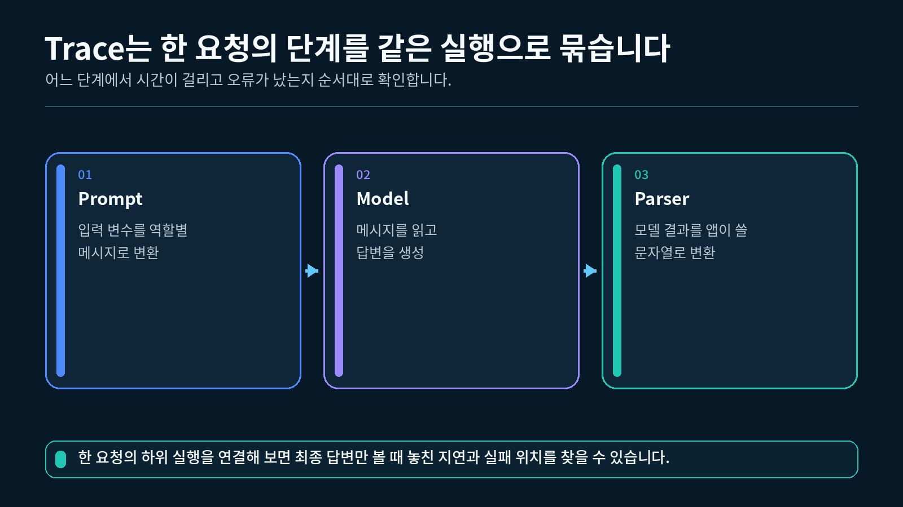
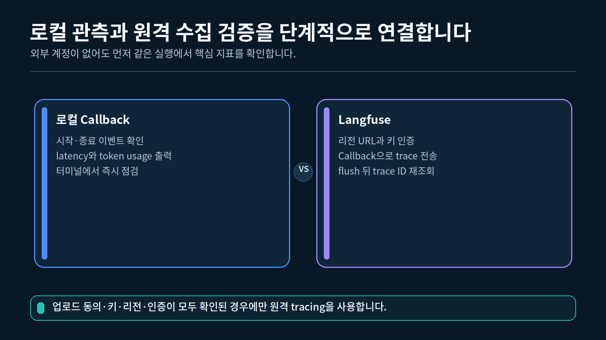
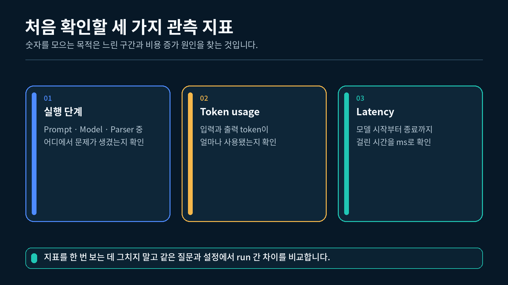

## 1. tracing과 한 번의 실행 구조 이해하기

**Tracing**은 하나의 요청이 어떤 단계를 거쳤고, 각 단계가 언제 시작하고 끝났는지를 연결해서 기록하는 방법입니다. 이번 실습은 다음 한 번의 실행만 관찰합니다.

```
질문 입력
→ Prompt 구성
→ OpenAI ChatModel 호출
→ StrOutputParser
→ 문자열 답변 반환
```

하나의 trace 안에서 관찰하는 실행 구조



### 1.1 이번 실습에서 확인할 값

| 관찰 값 | 의미 | 확인 위치 |
| --- | --- | --- |
| 시작·완료 | 모델 호출이 정상적으로 진행되었는지 | 로컬 Callback |
| 실행 시간 | 모델 시작부터 완료까지 걸린 시간 | 로컬 Callback |
| 입력 토큰 | 모델에 전달된 입력의 사용량 | 모델 완료 결과 |
| 출력 토큰 | 모델이 생성한 출력의 사용량 | 모델 완료 결과 |
| 전체 토큰 | 입력과 출력을 합친 사용량 | 모델 완료 결과 |

모델이나 응답 형식이 토큰 메타데이터를 제공하지 않으면 숫자를 추측하지 않고 `제공되지 않음`으로 표시합니다.

### 1.2 로컬 trace와 Langfuse trace

이번 실습은 두 관찰 방법을 다음처럼 구성합니다.

```
항상 사용          → LocalTraceHandler가 VS Code 터미널에 측정값 출력
동의·인증이 있을 때 → Langfuse CallbackHandler가 같은 실행을 trace로 전송
```

로컬 관측과 선택적 Langfuse 관측



Langfuse는 필수 실행 조건이 아닙니다. 명시적 업로드 동의, 설정, 패키지, 인증 중 하나라도 준비되지 않았어도 로컬 Callback은 그대로 실행됩니다.

### 1.3 `invoke()` 횟수와 HTTP 요청 횟수 구분하기

Handler가 두 개여도 체인을 두 번 실행하지 않습니다.

```python
# 로컬 Handler와 선택적 Langfuse Handler를 한 목록에 넣습니다.
callbacks = [local_handler, langfuse_handler]

# invoke 한 번을 두 Handler가 함께 관찰합니다.
raw_answer = chain.invoke(
    {
        "question": "tracing은 왜 필요한가요?"
    },
    config={
        "callbacks": callbacks,
    },
)
```

`callbacks` 목록은 관찰자를 추가할 뿐이며, `chain.invoke()`는 한 번만 호출됩니다. 다만 **`invoke()` 한 번이 언제나 HTTP 요청 한 번이라는 뜻은 아닙니다.** 모델 클라이언트의 자동 Retry가 켜져 있으면 일시 오류 뒤 HTTP 요청이 추가될 수 있습니다.

이번 실습은 `ChatOpenAI(max_retries=0)`으로 SDK 내부 자동 Retry를 끕니다. 따라서 “한 번의 `invoke()`”와 “이 클라이언트가 수행하는 한 번의 OpenAI 요청 시도”를 같은 조건에서 관찰할 수 있습니다. 실제 운영에서는 9장에서 배울 제한된 Retry 정책을 별도로 설계합니다.

---

## 2. 로컬 Callback으로 실행 시간 측정하기

실행 시간은 시작 시각과 완료 시각의 차이입니다. 이번 실습은 `time.perf_counter()`를 사용합니다.

### 2.1 `perf_counter()`를 사용하는 이유

`perf_counter()`는 프로그램에서 경과 시간을 측정하는 데 알맞은 단조 시계입니다. 컴퓨터의 표시 시각이 바뀌어도 경과 시간 계산에 영향을 덜 받습니다.

```python
# 경과 시간 측정에 사용할 표준 라이브러리를 가져옵니다.
import time

# 모델 호출이 시작되는 순간의 값을 저장합니다.
started_at = time.perf_counter()

# 이 위치에서 실제 모델 호출이 실행된다고 가정합니다.

# 완료 시각에서 시작 시각을 뺀 뒤 밀리초 단위로 바꿉니다.
elapsed_milliseconds = (time.perf_counter() - started_at) * 1000

# 밀리초 단위 결과를 소수점 첫째 자리까지 표시합니다.
print(f"{elapsed_milliseconds:.1f}ms")
```

실행 시간은 네트워크 상태와 모델 응답 길이에 따라 달라집니다. 특정 숫자를 정답으로 고정하지 않습니다.

### 2.2 시작 이벤트에서 시각 저장하기

```python
# LocalTraceHandler 클래스 안에 작성하는 메서드입니다.
def on_chat_model_start(
    self,
    serialized: dict[str, Any],
    messages: list[list[Any]],
    **kwargs: Any,
) -> None:
    """채팅 모델 호출이 시작될 때 현재 값을 저장합니다."""

    # 모델 호출 시작 시점의 단조 시계 값을 기록합니다.
    self.started_at = time.perf_counter()

    # 이전 실행에서 남은 경과 시간을 현재 실행 전에 초기화합니다.
    self.elapsed_milliseconds = None

    # 로컬 trace가 시작되었음을 표시합니다.
    print("[로컬 trace] 채팅 모델 호출 시작")
```

### 2.3 완료 이벤트에서 차이 계산하기

```python
# LocalTraceHandler 클래스 안에 작성하는 메서드입니다.
def on_llm_end(
    self,
    response: LLMResult,
    **kwargs: Any,
) -> None:
    """모델 호출이 끝나면 실행 시간을 계산합니다."""

    # 시작 시각이 있을 때만 경과 시간을 밀리초 단위로 계산합니다.
    if self.started_at is not None:
        self.elapsed_milliseconds = (
            time.perf_counter() - self.started_at
        ) * 1000

    # 정상 완료 상태를 표시합니다.
    print("[로컬 trace] 채팅 모델 호출 완료")

    # 측정된 실행 시간을 밀리초 단위로 표시합니다.
    if self.elapsed_milliseconds is not None:
        print(
            "[로컬 trace] 실행 시간: "
            f"{self.elapsed_milliseconds:.1f}ms"
        )
```

오류 이벤트에서도 같은 방법으로 실패하기까지 걸린 시간을 계산할 수 있습니다.

---

## 3. 모델 결과에서 토큰 사용량 읽기

현재 ChatModel의 완료 결과에는 생성된 `AIMessage`가 들어 있습니다. 모델이 사용량을 제공하면 `AIMessage.usage_metadata`에서 공통 키를 읽을 수 있습니다.

### 3.1 공통 토큰 키

```python
# 모델 완료 결과에서 첫 번째 생성 결과를 가져옵니다.
first_generation = response.generations[0][0]

# 채팅 생성 결과 안의 AIMessage 객체를 가져옵니다.
message = first_generation.message

# AIMessage에 들어 있는 공통 토큰 메타데이터를 읽습니다.
usage_metadata = message.usage_metadata
```

`usage_metadata`가 제공되면 다음 키를 확인합니다.

| 키 | 의미 |
| --- | --- |
| `input_tokens` | Prompt와 메시지에 사용된 입력 토큰 |
| `output_tokens` | 모델이 생성한 출력 토큰 |
| `total_tokens` | 입력과 출력을 합친 전체 토큰 |

실행 관측에서 확인하는 주요 값



### 3.2 값이 없을 수 있는 경우

모든 모델과 응답 형식이 같은 메타데이터를 제공하는 것은 아닙니다. 따라서 다음 순서로 읽습니다.

1. `AIMessage.usage_metadata`를 먼저 확인합니다.
2. 값이 없다면 `LLMResult.llm_output`의 공급자별 사용량을 확인합니다.
3. 두 곳 모두 없으면 `None`을 반환합니다.
4. 화면에는 `제공되지 않음`을 출력합니다.

### 3.3 정수 값만 사용하기

```python
# 여러 형태의 입력 값을 표시할 Any를 가져옵니다.
from typing import Any

# 토큰 사용량 값이 정수일 때만 안전하게 반환하는 함수를 정의합니다.
def read_integer(value: Any) -> int | None:
    """토큰 사용량 값이 정수일 때만 반환합니다."""

    # bool은 int의 하위 자료형이지만 토큰 개수로 사용하지 않습니다.
    if isinstance(value, bool):
        return None

    # 이미 정수인 값은 그대로 반환합니다.
    if isinstance(value, int):
        return value

    # 정수가 아닌 값은 알 수 없는 사용량으로 처리합니다.
    return None
```

문자열을 억지로 정수로 바꾸거나 세 토큰 값을 직접 계산하지 않습니다. 모델이 제공한 정수 메타데이터만 표시합니다.

### 3.4 Parser와 Callback의 관찰 위치

이번 완성 체인은 `Prompt | Model | StrOutputParser`로 연결합니다.

```python
# 모델의 AIMessage를 문자열로 바꿀 Parser를 가져옵니다.
from langchain_core.output_parsers import StrOutputParser

# 모델의 AIMessage를 애플리케이션에서 사용할 문자열로 바꿉니다.
parser = StrOutputParser()

# Prompt, Model, Parser가 차례대로 실행되는 체인을 만듭니다.
chain = prompt | model | parser
```

최종 호출자는 Parser 뒤의 문자열을 받지만, `LocalTraceHandler.on_llm_end()`는 Model이 끝나는 시점의 `LLMResult`를 받습니다. 따라서 Handler는 AIMessage의 토큰 메타데이터를 읽고, 애플리케이션은 최종 문자열을 사용할 수 있습니다.

---

## 4. LocalTraceHandler 완성하기

로컬 Handler는 시작 시각, 실행 시간, 세 가지 토큰 값을 객체 속성으로 보관합니다.

### 4.1 초기 상태 만들기

```python
# Callback 메서드의 여러 인자 형식을 표시할 Any를 가져옵니다.
from typing import Any

# 사용자 정의 Callback의 기반 클래스를 가져옵니다.
from langchain_core.callbacks import BaseCallbackHandler

# 모델 완료 결과 자료형을 가져옵니다.
from langchain_core.outputs import LLMResult

# 한 번의 모델 실행 시간과 토큰 사용량을 기록할 Handler를 정의합니다.
class LocalTraceHandler(BaseCallbackHandler):
    """모델 한 번의 실행 시간과 토큰 사용량을 터미널에 기록합니다."""

    def __init__(self) -> None:
        """현재 실행의 시작 시각과 마지막 측정값을 준비합니다."""

        # 아직 모델 호출이 시작되지 않았으므로 시작 시각은 없습니다.
        self.started_at: float | None = None

        # 아직 완료된 실행이 없으므로 실행 시간도 없습니다.
        self.elapsed_milliseconds: float | None = None

        # 아직 응답을 받지 않았으므로 세 토큰 값을 알 수 없습니다.
        self.input_tokens: int | None = None
        self.output_tokens: int | None = None
        self.total_tokens: int | None = None
```

### 4.2 완료 결과 읽기

완성 `실습.py`의 `extract_usage_from_result()` 함수는 최신 공통 형식을 우선 읽고 공급자별 형식을 보조로 확인합니다.

```python
# 모델 완료 결과에서 세 가지 토큰 값을 읽습니다.
(
    self.input_tokens,
    self.output_tokens,
    self.total_tokens,
) = extract_usage_from_result(response)
```

### 4.3 관측 결과 출력하기

```python
# 전체 토큰 값이 있으면 입력, 출력, 전체 값을 함께 표시합니다.
if self.total_tokens is not None:
    print(
        "[로컬 trace] 토큰 사용량: "
        f"입력{self.input_tokens}, "
        f"출력{self.output_tokens}, "
        f"전체{self.total_tokens}"
    )
else:
    # 모델이 값을 주지 않으면 추측하지 않고 안내합니다.
    print("[로컬 trace] 토큰 사용량: 제공되지 않음")
```

실행 시간이 짧거나 토큰 수가 작다는 사실만으로 답변 품질을 판단할 수는 없습니다. 이번 강의에서는 값을 정확히 수집하고 읽는 데 집중합니다.

---

## 5. Langfuse를 선택 기능으로 준비하기

Langfuse를 사용하면 LangChain의 Callback 이벤트를 외부 trace로 모아 실행 흐름을 확인할 수 있습니다. 이번 실습은 Langfuse가 없어도 실행되도록 선택 기능으로 연결합니다.

### 5.1 선택 패키지 설치하기

Langfuse를 함께 사용할 때만 현재 가상환경에 패키지를 설치합니다.

```powershell
# 현재 프로젝트의 가상환경에 Langfuse Python 패키지를 설치합니다.
uv add "langfuse==4.14.1"
```

로컬 tracing만 확인한다면 이 설치를 생략할 수 있습니다.

### 5.2 프로젝트 지역에 맞는 환경변수 준비하기

Langfuse 프로젝트에서 발급받은 두 키와 **프로젝트가 생성된 지역의 주소**를 `.env`에 추가합니다.

```
# Prompt와 답변을 외부 Langfuse 프로젝트로 보낼 때만 1로 설정합니다.
ENABLE_LANGFUSE_UPLOAD=1
LANGFUSE_PUBLIC_KEY=발급받은_Public_Key
LANGFUSE_SECRET_KEY=발급받은_Secret_Key
LANGFUSE_BASE_URL=https://cloud.langfuse.com
```

위 주소는 EU 지역 예시입니다. 자신의 프로젝트 설정에 표시된 주소를 그대로 사용합니다.

| 프로젝트 지역 | `LANGFUSE_BASE_URL` |
| --- | --- |
| EU | `https://cloud.langfuse.com` |
| US | `https://us.cloud.langfuse.com` |
| Japan | `https://jp.cloud.langfuse.com` |
| HIPAA | `https://hipaa.cloud.langfuse.com` |
| Self-hosted v4+ | 관리자가 안내한 배포 기본 주소 |

키가 올바르더라도 다른 지역 주소를 사용하면 인증 또는 조회가 실패할 수 있습니다. 이 실습은 Client 객체가 만들어졌다는 사실만으로 연결 성공을 판단하지 않고 `auth_check()` 결과를 확인합니다.

이 실습의 observation 재조회는 Langfuse v4 Observations API를 사용합니다. Self-hosted v3는 legacy 조회 API가 필요하므로 이번 코드의 지원 범위가 아닙니다.

Langfuse 업로드는 기본적으로 꺼져 있습니다. `ENABLE_LANGFUSE_UPLOAD=1`을 직접 설정한 경우에만 원격 Handler를 만듭니다. 활성화하면 Prompt와 모델 답변 같은 실행 데이터가 외부 프로젝트에 기록될 수 있으므로 수업의 예제 질문만 사용하고 개인정보, API Key, 회사 비밀정보는 입력하지 않습니다.

### 5.3 OpenAI API 과금 조건 확인하기

`OPENAI_API_KEY`로 실행하는 OpenAI API 사용량은 ChatGPT Plus·Pro 같은 구독 사용량과 별도로 계산됩니다. 수업 전에 OpenAI Platform의 결제·사용 한도와 프로젝트 API Key를 확인합니다.

이 교안의 기본 권장 모델은 `gpt-5.6-luna`이며, `.env`의 `OPENAI_MODEL`로 변경할 수 있습니다. 유효한 API Key가 있어도 선택 모델의 프로젝트 사용 권한, 결제 설정 또는 사용 한도에 따라 호출이 실패할 수 있습니다. 수업 전에 OpenAI 모델 안내와 Platform의 Limits 화면을 확인합니다.

### 5.4 업로드 동의나 설정이 없으면 로컬 실행 유지하기

```python
# 환경변수 확인에 사용할 표준 라이브러리를 가져옵니다.
import os

# 명시적 업로드 동의와 필수 Langfuse 설정을 함께 확인합니다.
def has_langfuse_settings() -> bool:
    """업로드 동의와 세 Langfuse 설정이 모두 있으면 True를 반환합니다."""

    # 외부 전송을 명시적으로 허용했는지 확인합니다.
    upload_enabled = os.getenv("ENABLE_LANGFUSE_UPLOAD", "").strip() == "1"

    # Langfuse 프로젝트를 식별하는 공개 키를 읽습니다.
    public_key = os.getenv("LANGFUSE_PUBLIC_KEY", "").strip()

    # Langfuse 프로젝트 전송에 필요한 비밀 키를 읽습니다.
    secret_key = os.getenv("LANGFUSE_SECRET_KEY", "").strip()

    # 잘못된 지역으로 보내지 않도록 프로젝트 기본 주소를 읽습니다.
    base_url = os.getenv("LANGFUSE_BASE_URL", "").strip()

    # 동의와 세 설정이 모두 준비된 경우에만 원격 전송을 허용합니다.
    return bool(upload_enabled and public_key and secret_key and base_url)

# 동의나 설정이 하나라도 없으면 로컬 trace만 사용한다고 안내합니다.
if not has_langfuse_settings():
    print("[Langfuse] 업로드가 비활성화되었거나 설정이 부족해 로컬 trace만 사용합니다.")
```

완성 `실습.py`에서는 이 조건일 때 `(None, None)`을 반환합니다. 이 분기는 오류가 아니며, 로컬 Handler는 이미 별도로 만들어지므로 모델 실행과 로컬 측정은 계속됩니다.

### 5.5 인증을 확인한 뒤 Handler 만들기

```python
# Langfuse 설정과 패키지가 있을 때만 두 실행 객체를 만드는 함수를 정의합니다.
def create_optional_langfuse_callback():
    """인증된 Langfuse Handler와 클라이언트 또는 두 개의 None을 반환합니다."""

    # 업로드 동의나 필수 설정이 하나라도 없으면 로컬 trace만 사용합니다.
    if not has_langfuse_settings():
        print("[Langfuse] 업로드가 비활성화되었거나 설정이 부족해 로컬 trace만 사용합니다.")
        return None, None

    try:
        # .env 설정을 사용하는 Langfuse 공유 클라이언트를 가져옵니다.
        from langfuse import get_client

        # LangChain 이벤트를 Langfuse trace로 바꾸는 Handler를 가져옵니다.
        from langfuse.langchain import CallbackHandler
    except ImportError:
        # 선택 패키지가 없어도 로컬 trace는 중단하지 않습니다.
        print("[Langfuse] 패키지가 없어 로컬 trace만 사용합니다.")
        return None, None

    try:
        # .env 설정을 사용하는 공유 클라이언트를 준비합니다.
        langfuse_client = get_client()

        # Client 객체 생성과 서버 인증 성공을 구분해 확인합니다.
        authenticated = langfuse_client.auth_check()

        # 키 또는 프로젝트 지역 주소가 틀리면 원격 tracing을 사용하지 않습니다.
        if not authenticated:
            print(
                "[Langfuse] 인증 실패로 로컬 trace만 사용합니다. "
                "키와 LANGFUSE_BASE_URL을 확인해 주세요."
            )
            return None, None

        # LangChain 실행 설정에 넣을 Langfuse Handler를 만듭니다.
        langfuse_handler = CallbackHandler()
    except Exception as error:
        # 인증 요청 예외도 선택 기능 경계에서 처리해 로컬 trace를 유지합니다.
        print(
            "[Langfuse] 초기화 실패로 로컬 trace만 사용합니다. "
            f"({type(error).__name__})"
        )
        return None, None

    # 실행용 Handler와 종료 전 flush할 클라이언트를 함께 반환합니다.
    return langfuse_handler, langfuse_client
```

Import를 함수 안에 둔 이유는 Langfuse가 선택 패키지이기 때문입니다. 키와 패키지가 없는 기본 실행에서도 파일 위쪽의 import 단계가 실패하지 않습니다.

`auth_check()`는 서버에 확인하는 동기 호출이므로 이번 짧은 실습의 시작 단계에서 한 번만 사용합니다. 매 요청마다 반복하는 운영용 상태 확인 함수로 사용하지 않습니다. 인증 호출 자체가 예외를 발생시킬 수 있으므로 완성 `실습.py`는 초기화 경계의 `try/except`에서 처리하고 로컬 trace를 유지합니다.

---

## 6. 같은 실행에 두 Handler 연결하기

로컬 Handler는 항상 목록에 넣고, Langfuse Handler가 만들어졌을 때만 추가합니다.

### 6.1 Callback 목록 만들기

```python
# 실행 시간과 토큰 사용량을 기록할 로컬 Handler를 만듭니다.
local_handler = LocalTraceHandler()

# 설정이 준비된 경우에만 Langfuse Handler와 클라이언트를 받습니다.
langfuse_handler, langfuse_client = create_optional_langfuse_callback()

# 로컬 Handler는 모든 실행에서 사용하도록 목록에 먼저 넣습니다.
callbacks: list[Any] = [local_handler]

# 선택 Handler가 만들어졌을 때만 같은 목록에 추가합니다.
if langfuse_handler is not None:
    callbacks.append(langfuse_handler)
```

### 6.2 한 번의 요청 시도를 위한 모델 설정

이번 강의는 Retry를 아직 적용하지 않습니다. `invoke()` 횟수와 SDK 요청 시도를 명확히 비교할 수 있도록 모델 내부 자동 Retry를 끕니다.

```python
# 한 번의 invoke에서 SDK 내부 자동 재시도를 하지 않는 ChatModel을 만듭니다.
model = ChatOpenAI(
    # 화면이나 코드에 직접 쓰지 않고 환경변수에서 읽은 API Key를 전달합니다.
    api_key=api_key,
    # 수업 기본값 또는 OPENAI_MODEL에서 읽은 모델명을 사용합니다.
    model=model_name,
    # 한 요청이 오래 멈추지 않도록 호출 제한 시간을 둡니다.
    timeout=20,
    # 이번 관측 실습에서는 SDK 내부 자동 Retry를 끕니다.
    max_retries=0,
    # OpenAI Responses API를 명시적으로 사용합니다.
    use_responses_api=True,
)
```

`max_retries=0`은 Retry가 나쁜 기능이라는 뜻이 아닙니다. 이번 강의에서 “실행 한 번”의 경계를 정확히 관찰하기 위한 설정입니다. 실제 앱은 9장에서 Retry 대상 예외, 최대 시도 횟수, 대기 정책을 별도로 설계합니다.

### 6.3 `invoke()` 한 번 실행하기

```python
# 같은 invoke 실행을 로컬 Handler와 선택적 Langfuse Handler가 함께 관찰합니다.
raw_answer = chain.invoke(
    {
        "question": SAMPLE_QUESTION,
    },
    config={
        "callbacks": callbacks,
        "run_name": "langchain_beginner_trace",
    },
)
```

`run_name`은 trace에서 이번 실행을 알아보기 쉽게 붙인 이름입니다. 모델의 Prompt나 답변 내용은 바꾸지 않습니다.

### 6.4 Parser 결과에서 답변 읽기

```python
# Parser가 반환한 값을 애플리케이션의 일반 문자열로 명시 변환합니다.
answer = str(raw_answer)

# 비어 있는 모델 답변을 정상 결과로 사용하지 않도록 확인합니다.
if not answer.strip():
    raise ValueError("모델 답변이 비어 있습니다.")

# 관측 정보와 구분되는 최종 모델 답변을 출력합니다.
print("[모델 답변]")
print(answer)
```

이번 체인의 최종 결과는 Parser가 내보낸 문자열입니다. 토큰 메타데이터는 최종 문자열에서 읽지 않고 Model 완료 이벤트를 받은 로컬 Handler가 기록합니다.

### 6.5 짧은 스크립트에서 `flush()`하기

Langfuse는 trace를 백그라운드 대기열에 모아 전송할 수 있습니다. `실습.py`처럼 실행 후 바로 끝나는 프로그램은 종료 전에 `flush()`를 호출해 대기 중 이벤트를 ingestion API로 보내고 호출이 반환될 때까지 기다립니다.

```python
# Langfuse 클라이언트가 만들어졌을 때만 대기 이벤트를 전송합니다.
if langfuse_client is not None:
    # 짧은 Python 스크립트가 끝나기 전에 ingestion API 전송을 완료합니다.
    langfuse_client.flush()
```

완성 실습은 `try`와 `finally`를 사용해 모델 실행이 성공하거나 실패하더라도 `flush()`를 시도합니다. `flush()`가 반환되면 대기 중 이벤트의 ingestion API 전송은 끝났지만, **서버 측 처리와 조회 API 반영까지 끝났다는 뜻은 아닙니다.**

### 6.6 `last_trace_id`로 원격 수집 다시 확인하기

한 번의 `invoke()`가 끝난 뒤 Handler가 만든 `last_trace_id`를 읽고, `flush()`한 다음 같은 ID의 observation을 조회합니다.

```python
# 단일 실행 전용 Handler에서 마지막 trace ID를 읽습니다.
trace_id = read_last_trace_id(langfuse_handler)

# 짧은 스크립트가 끝나기 전에 ingestion API 전송을 완료합니다.
flushed = flush_langfuse(langfuse_client)

# flush 성공 뒤 같은 trace에 속한 observation이 조회되는지 확인합니다.
if flushed:
    verified = verify_langfuse_trace(
        langfuse_client,
        trace_id,
    )
```

Langfuse 신규 데이터는 수집 뒤 조회 가능해지기까지 보통 15~30초가 걸릴 수 있으며, 일시적인 부하에서는 더 길어질 수 있습니다. 완성 코드는 `core,basic,model,usage` 필드 그룹을 요청하고 2초 간격으로 최대 31회, 약 60초의 제한 안에서 `GENERATION` observation을 조회합니다.

```
invoke() 완료
→ Handler의 last_trace_id 읽기
→ flush()로 ingestion API 전송 완료
→ 같은 trace_id의 GENERATION observation 조회
→ 있으면 모델명·usage 제공 여부를 확인하고 원격 조회 성공
→ 아직 없으면 기다린 뒤 제한 횟수 안에서 재조회
```

이 실습처럼 Handler 하나를 `invoke()` 한 번에만 사용하는 경우 `last_trace_id`를 읽기 쉽습니다. 여러 요청이 동시에 실행되는 서버에서 같은 Handler를 공유하면 마지막 ID가 다른 요청의 값으로 바뀔 수 있으므로 요청별 Handler 또는 미리 정한 trace ID를 사용해야 합니다.

---

## 7. 완성 실습 실행하기

`실습.py`는 `chain.invoke()`를 한 번 호출합니다. `ChatOpenAI(max_retries=0)`이므로 이 실습의 SDK 내부 자동 Retry는 발생하지 않습니다. 로컬 tracing은 항상 사용하고, Langfuse는 명시적 업로드 동의와 설정·인증이 준비된 경우에만 같은 실행에 추가합니다.

### 7.1 로컬 tracing만 실행하기

`.env`에 OpenAI 설정만 있는 상태로 실행합니다. Langfuse 키가 이미 저장되어 있더라도 `ENABLE_LANGFUSE_UPLOAD=1`이 없으면 외부로 trace를 보내지 않습니다.

```
OPENAI_API_KEY=발급받은_API_Key
OPENAI_MODEL=gpt-5.6-luna
```

ChatGPT 구독만 있고 OpenAI Platform API 결제가 준비되지 않았다면 live 모드는 실행되지 않습니다. API Key, Platform 결제·사용 한도, 모델의 사용 등급을 함께 확인합니다.

1-2강에서 만든 `pyproject.toml`과 `uv.lock`이 있는 프로젝트의 하위 폴더에 `실습.py`를 두고, 해당 폴더에서 실행합니다. VS Code 인터프리터는 이 프로젝트의 `.venv` (Python 3.12)를 선택합니다.

```powershell
# 8-2강 폴더에서 uv가 관리하는 Python 3.12으로 실습을 실행합니다.
uv run python 실습.py
```

"""8-2강: 로컬 Callback과 Langfuse로 한 번의 invoke 실행을 검증합니다."""

import os
import time
from typing import Any

from dotenv import load_dotenv
from langchain_core.callbacks import BaseCallbackHandler
from langchain_core.output_parsers import StrOutputParser
from langchain_core.outputs import LLMResult
from langchain_core.prompts import ChatPromptTemplate
from langchain_openai import ChatOpenAI


# .env에 모델명이 없을 때 사용할 수업 기본 모델을 지정합니다.
DEFAULT_MODEL = "gpt-5-nano"

# Langfuse 수집 뒤 최대 60초 동안 확인하도록 조회 횟수를 지정합니다.
LANGFUSE_QUERY_ATTEMPTS = 31

# 첫 조회를 포함해 약 60초가 되도록 각 조회 사이의 간격을 지정합니다.
LANGFUSE_QUERY_DELAY_SECONDS = 2.0

# 로컬 trace와 선택적 Langfuse trace로 함께 관찰할 질문을 준비합니다.
SAMPLE_QUESTION = "LLM 애플리케이션에서 tracing이 필요한 이유를 두 문장으로 설명해 주세요."


def read_integer(value: Any) -> int | None:
    """토큰 사용량 값이 정수일 때만 안전하게 반환합니다."""

    # bool은 int의 하위 자료형이지만 토큰 개수로 사용하지 않습니다.
    if isinstance(value, bool):
        return None

    # 이미 정수인 값은 그대로 반환합니다.
    if isinstance(value, int):
        return value

    # 정수가 아닌 값은 알 수 없는 사용량으로 처리합니다.
    return None


def extract_usage_from_result(
    response: LLMResult,
) -> tuple[int | None, int | None, int | None]:
    """모델 완료 결과에서 입력, 출력, 전체 토큰 수를 읽습니다."""

    # 최신 ChatModel이 AIMessage에 담아 주는 usage_metadata를 먼저 찾습니다.
    try:
        # 첫 번째 입력의 첫 번째 생성 결과를 가져옵니다.
        first_generation = response.generations[0][0]

        # 채팅 생성 결과 안의 AIMessage 객체를 가져옵니다.
        message = getattr(first_generation, "message", None)

        # AIMessage에 토큰 메타데이터가 있으면 딕셔너리로 읽습니다.
        usage_metadata = getattr(message, "usage_metadata", None)
    except (IndexError, TypeError):
        # 생성 결과가 비어 있거나 예상한 중첩 목록이 아니면 다음 형식을 확인합니다.
        usage_metadata = None

    # 최신 공통 키 형식이 있으면 각 토큰 수를 정수로 읽습니다.
    if isinstance(usage_metadata, dict):
        input_tokens = read_integer(usage_metadata.get("input_tokens"))
        output_tokens = read_integer(usage_metadata.get("output_tokens"))
        total_tokens = read_integer(usage_metadata.get("total_tokens"))

        # 하나 이상의 값이 있으면 최신 형식의 결과를 우선 사용합니다.
        if any(
            value is not None
            for value in (input_tokens, output_tokens, total_tokens)
        ):
            return input_tokens, output_tokens, total_tokens

    # 일부 응답에서 사용하는 공급자별 llm_output 딕셔너리를 확인합니다.
    llm_output = response.llm_output

    # llm_output이 딕셔너리가 아니면 토큰 사용량을 알 수 없습니다.
    if not isinstance(llm_output, dict):
        return None, None, None

    # 공급자 응답 안의 token_usage 딕셔너리를 가져옵니다.
    token_usage = llm_output.get("token_usage")

    # token_usage가 딕셔너리가 아니면 세 값을 모두 알 수 없음으로 반환합니다.
    if not isinstance(token_usage, dict):
        return None, None, None

    # 공급자별 키를 공통 입력 토큰 값으로 바꿔 읽습니다.
    input_tokens = read_integer(token_usage.get("prompt_tokens"))

    # 공급자별 키를 공통 출력 토큰 값으로 바꿔 읽습니다.
    output_tokens = read_integer(token_usage.get("completion_tokens"))

    # 공급자가 계산한 전체 토큰 값을 읽습니다.
    total_tokens = read_integer(token_usage.get("total_tokens"))

    # 찾은 세 토큰 값을 정해진 순서로 반환합니다.
    return input_tokens, output_tokens, total_tokens


class LocalTraceHandler(BaseCallbackHandler):
    """모델 한 번의 실행 시간과 토큰 사용량을 로컬 터미널에 기록합니다."""

    def __init__(self) -> None:
        """현재 실행의 시작 시각과 마지막 측정값을 준비합니다."""

        # 아직 모델 호출이 시작되지 않았으므로 시작 시각은 없습니다.
        self.started_at: float | None = None

        # 아직 완료된 실행이 없으므로 실행 시간도 없습니다.
        self.elapsed_milliseconds: float | None = None

        # 아직 응답을 받지 않았으므로 입력 토큰 수를 알 수 없습니다.
        self.input_tokens: int | None = None

        # 아직 응답을 받지 않았으므로 출력 토큰 수를 알 수 없습니다.
        self.output_tokens: int | None = None

        # 아직 응답을 받지 않았으므로 전체 토큰 수를 알 수 없습니다.
        self.total_tokens: int | None = None

    def on_chat_model_start(
        self,
        serialized: dict[str, Any],
        messages: list[list[Any]],
        **kwargs: Any,
    ) -> None:
        """채팅 모델 호출이 시작될 때 단조 시계의 현재 값을 저장합니다."""

        # 시스템 시각 변경의 영향을 받지 않는 perf_counter로 시작점을 기록합니다.
        self.started_at = time.perf_counter()

        # 이전 실행에서 남은 경과 시간이 현재 실행에 보이지 않도록 초기화합니다.
        self.elapsed_milliseconds = None

        # 이전 실행에서 남은 토큰 측정값을 모두 초기화합니다.
        self.input_tokens = None
        self.output_tokens = None
        self.total_tokens = None

        # 로컬 trace가 시작되었음을 짧게 표시합니다.
        print("[로컬 trace] 채팅 모델 호출 시작")

    def on_llm_end(
        self,
        response: LLMResult,
        **kwargs: Any,
    ) -> None:
        """모델 호출이 끝나면 실행 시간과 토큰 사용량을 기록합니다."""

        # 시작 시각이 있으면 완료 시각과의 차이로 실행 시간을 계산합니다.
        if self.started_at is not None:
            self.elapsed_milliseconds = (
                time.perf_counter() - self.started_at
            ) * 1000

        # 모델 완료 결과에서 사용 가능한 토큰 메타데이터를 읽습니다.
        (
            self.input_tokens,
            self.output_tokens,
            self.total_tokens,
        ) = extract_usage_from_result(response)

        # 모델 호출이 정상적으로 완료되었음을 표시합니다.
        print("[로컬 trace] 채팅 모델 호출 완료")

        # 측정할 수 있었던 실행 시간을 소수점 첫째 자리까지 표시합니다.
        if self.elapsed_milliseconds is not None:
            print(
                "[로컬 trace] 실행 시간: "
                f"{self.elapsed_milliseconds:.1f}ms"
            )

        # 토큰 메타데이터가 있으면 입력, 출력, 전체 값을 함께 표시합니다.
        if self.total_tokens is not None:
            print(
                "[로컬 trace] 토큰 사용량: "
                f"입력 {self.input_tokens}, "
                f"출력 {self.output_tokens}, "
                f"전체 {self.total_tokens}"
            )
        else:
            # 모델이나 응답 형식이 사용량을 주지 않으면 추측하지 않고 안내합니다.
            print("[로컬 trace] 토큰 사용량: 제공되지 않음")

    def on_llm_error(
        self,
        error: BaseException,
        **kwargs: Any,
    ) -> None:
        """모델 호출 중 오류가 발생하면 실행 시간과 예외 종류를 표시합니다."""

        # 시작 시각이 있으면 오류가 발생하기까지 걸린 시간을 계산합니다.
        if self.started_at is not None:
            self.elapsed_milliseconds = (
                time.perf_counter() - self.started_at
            ) * 1000

        # API Key 같은 민감한 값은 출력하지 않고 예외 클래스 이름만 보여 줍니다.
        print(f"[로컬 trace] 채팅 모델 호출 실패 · {type(error).__name__}")

        # 측정할 수 있었던 실패 시점까지의 실행 시간을 표시합니다.
        if self.elapsed_milliseconds is not None:
            print(
                "[로컬 trace] 실패까지 시간: "
                f"{self.elapsed_milliseconds:.1f}ms"
            )


def build_chain(model: ChatOpenAI):
    """Prompt, Model, 문자열 Parser를 연결한 기본 설명 체인을 만듭니다."""

    # tracing의 역할을 짧고 쉬운 문장으로 답하도록 Prompt를 만듭니다.
    prompt = ChatPromptTemplate.from_messages(
        [
            (
                "system",
                "당신은 LangChain 입문 수업의 튜터입니다. "
                "질문에 쉬운 한국어 두 문장으로 답하세요.",
            ),
            (
                "human",
                "{question}",
            ),
        ]
    )

    # 모델의 AIMessage를 애플리케이션에서 사용할 문자열로 바꿉니다.
    parser = StrOutputParser()

    # Callback은 Model 이벤트를 관찰하고 최종 호출자는 문자열을 받습니다.
    return prompt | model | parser


def create_optional_langfuse_callback():
    """Langfuse 설정과 인증이 유효할 때만 원격 tracing 객체를 만듭니다."""

    # Prompt와 답변의 외부 전송을 명시적으로 허용했는지 확인합니다.
    upload_enabled = os.getenv("ENABLE_LANGFUSE_UPLOAD", "").strip() == "1"

    # Langfuse 프로젝트를 식별하는 공개 키가 있는지 확인합니다.
    public_key = os.getenv("LANGFUSE_PUBLIC_KEY", "").strip()

    # Langfuse 프로젝트에 전송할 때 필요한 비밀 키가 있는지 확인합니다.
    secret_key = os.getenv("LANGFUSE_SECRET_KEY", "").strip()

    # 잘못된 프로젝트 지역으로 보내지 않도록 기본 주소를 명시했는지 확인합니다.
    base_url = os.getenv("LANGFUSE_BASE_URL", "").strip()

    # 명시적 업로드 동의가 없으면 자격 증명이 있어도 외부로 전송하지 않습니다.
    if not upload_enabled:
        print("[Langfuse] 업로드가 비활성화되어 로컬 trace만 사용합니다.")
        return None, None

    # 두 키나 프로젝트 지역 주소가 하나라도 없으면 로컬 trace를 유지합니다.
    if not public_key or not secret_key or not base_url:
        print("[Langfuse] 설정이 부족해 로컬 trace만 사용합니다.")
        return None, None

    try:
        # 설치된 경우에만 Langfuse의 공유 클라이언트를 가져옵니다.
        from langfuse import get_client

        # LangChain 이벤트를 Langfuse trace로 바꾸는 Handler를 가져옵니다.
        from langfuse.langchain import CallbackHandler
    except ImportError:
        # 선택 패키지가 없어도 로컬 trace 실습은 중단하지 않습니다.
        print("[Langfuse] 패키지가 없어 로컬 trace만 사용합니다.")
        return None, None

    try:
        # .env의 Langfuse 설정을 사용하는 공유 클라이언트를 준비합니다.
        langfuse_client = get_client()

        # 객체 생성과 실제 인증 성공을 구분하기 위해 서버 인증을 확인합니다.
        authenticated = langfuse_client.auth_check()

        # 키 또는 프로젝트 지역 주소가 맞지 않으면 원격 tracing을 사용하지 않습니다.
        if not authenticated:
            print(
                "[Langfuse] 인증 실패로 로컬 trace만 사용합니다. "
                "키와 LANGFUSE_BASE_URL을 확인해 주세요."
            )
            return None, None

        # LangChain 실행에 연결할 Langfuse CallbackHandler를 만듭니다.
        langfuse_handler = CallbackHandler()
    except Exception as error:
        # 선택 도구의 초기화 오류는 종류만 알리고 로컬 trace로 계속합니다.
        print(
            "[Langfuse] 초기화 실패로 로컬 trace만 사용합니다. "
            f"({type(error).__name__})"
        )
        return None, None

    # 이번 실행에서 Langfuse 전송도 활성화되었음을 표시합니다.
    print("[Langfuse] 원격 tracing을 함께 사용합니다.")

    # 실행용 Handler와 종료 전에 flush할 클라이언트를 함께 반환합니다.
    return langfuse_handler, langfuse_client


def flush_langfuse(langfuse_client: Any | None) -> bool:
    """대기 중 이벤트를 ingestion API로 전송하고 성공 여부를 반환합니다."""

    # Langfuse가 비활성화된 실행에서는 아무 작업도 하지 않습니다.
    if langfuse_client is None:
        return False

    try:
        # 짧은 스크립트가 끝나기 전에 대기 이벤트를 ingestion API로 전송합니다.
        langfuse_client.flush()
    except Exception as error:
        # 선택 도구의 전송 오류가 로컬 관측 결과를 지우지 않도록 짧게 안내합니다.
        print(f"[Langfuse] trace 전송 실패 · {type(error).__name__}")
        return False

    # ingestion 전송은 끝났지만 서버 처리와 조회 가능 상태는 별도로 확인합니다.
    print("[Langfuse] ingestion 전송 완료")
    return True


def read_last_trace_id(langfuse_handler: Any | None) -> str | None:
    """한 번의 실행 전용 Handler에서 마지막 trace ID를 안전하게 읽습니다."""

    # Langfuse Handler가 없으면 조회할 trace도 없습니다.
    if langfuse_handler is None:
        return None

    # 현재 Langfuse CallbackHandler가 제공하는 마지막 trace ID를 읽습니다.
    trace_id = getattr(langfuse_handler, "last_trace_id", None)

    # 비어 있지 않은 문자열일 때만 원격 조회에 사용할 수 있습니다.
    if isinstance(trace_id, str) and trace_id.strip():
        return trace_id

    # Callback이 trace ID를 만들지 못한 실행은 조회 대상이 없는 것으로 처리합니다.
    return None


def verify_langfuse_trace(
    langfuse_client: Any | None,
    trace_id: str | None,
    *,
    attempts: int = LANGFUSE_QUERY_ATTEMPTS,
    delay_seconds: float = LANGFUSE_QUERY_DELAY_SECONDS,
    sleep_fn: Any = time.sleep,
) -> bool:
    """flush 뒤 같은 trace의 observation을 제한된 횟수로 다시 조회합니다."""

    # Client 또는 trace ID가 없으면 원격 조회 가능 상태를 검증할 수 없습니다.
    if langfuse_client is None or trace_id is None:
        print("[Langfuse] trace ID가 없어 원격 조회 상태를 확인하지 못했습니다.")
        return False

    # 잘못된 반복 설정이 조용히 성공처럼 보이지 않도록 먼저 확인합니다.
    if attempts < 1:
        raise ValueError("attempts는 1 이상이어야 합니다.")

    # 수집 처리 지연을 고려해 같은 trace ID를 제한된 횟수로 조회합니다.
    for attempt in range(1, attempts + 1):
        try:
            # trace에 속한 observation을 한 건만 요청해 수집 여부를 확인합니다.
            response = langfuse_client.api.observations.get_many(
                trace_id=trace_id,
                limit=1,
                # 실제 모델 실행을 나타내는 Generation observation만 조회합니다.
                type="GENERATION",
                # 모델명과 사용량 필드를 확인할 수 있는 그룹을 함께 요청합니다.
                fields="core,basic,model,usage",
            )
        except Exception as error:
            # 인증 뒤 조회 API가 실패하면 오류 종류만 표시하고 검증을 종료합니다.
            print(f"[Langfuse] trace 조회 실패 · {type(error).__name__}")
            return False

        # 한 건 이상의 observation이 조회되면 원격 조회 가능 상태로 판정합니다.
        if getattr(response, "data", None):
            # 첫 Generation에서 외부 전송에 포함된 모델 이름을 읽습니다.
            generation = response.data[0]
            model_name = getattr(
                generation,
                "provided_model_name",
                None,
            ) or "제공되지 않음"

            # 사용량 딕셔너리의 유무를 값 추측 없이 구분합니다.
            usage_details = getattr(
                generation,
                "usage_details",
                None,
            )
            usage_status = "확인됨" if usage_details else "제공되지 않음"

            # 원문 Prompt와 답변은 출력하지 않고 수집 판정에 필요한 값만 표시합니다.
            print(
                "[Langfuse] Generation 조회 성공 · "
                f"trace_id={trace_id} "
                f"model={model_name} "
                f"usage={usage_status}"
            )
            return True

        # 마지막 조회가 아니라면 다음 조회 전에 정해진 시간만 기다립니다.
        if attempt < attempts:
            sleep_fn(delay_seconds)

    # 제한 시간 안에 조회되지 않았다는 사실과 수집 실패를 구분해 안내합니다.
    print(
        "[Langfuse] 제한 시간 안에 trace를 조회하지 못했습니다. "
        "프로젝트 지역과 Langfuse 상태를 확인해 주세요."
    )
    return False


def main() -> None:
    """로컬 Callback을 항상 사용하고 Langfuse는 설정이 있을 때만 추가합니다."""

    # 실습 폴더 또는 상위 폴더에 있는 .env 파일의 값을 불러옵니다.
    load_dotenv()

    # 실제 OpenAI API Key는 환경변수에서 읽고 화면에는 출력하지 않습니다.
    api_key = os.getenv("OPENAI_API_KEY")

    # 환경변수로 모델을 바꾸지 않으면 수업 기본 모델을 사용합니다.
    model_name = os.getenv("OPENAI_MODEL", DEFAULT_MODEL)

    # OpenAI API Key가 없으면 모델 객체를 만들기 전에 안내하고 종료합니다.
    if not api_key:
        print("OPENAI_API_KEY가 없습니다.")
        print("1-2강에서 만든 .env 파일을 확인해 주세요.")
        return

    # 한 번의 invoke와 SDK 요청 시도 수를 구분할 OpenAI ChatModel을 만듭니다.
    model = ChatOpenAI(
        api_key=api_key,
        model=model_name,
        # 한 요청이 오래 멈추지 않도록 호출 제한 시간을 둡니다.
        timeout=20,
        # 이번 실습에서는 SDK 내부 자동 재시도를 끄고 한 번의 시도만 관찰합니다.
        max_retries=0,
        # OpenAI의 Responses API를 명시적으로 사용해 실행 경계를 고정합니다.
        use_responses_api=True,
    )

    # Callback 관찰 뒤 최종 답변을 문자열로 반환하는 체인을 만듭니다.
    chain = build_chain(model)

    # 실행 시간과 토큰 사용량을 터미널에 기록할 로컬 Handler를 만듭니다.
    local_handler = LocalTraceHandler()

    # Langfuse 설정과 패키지가 준비되었을 때만 선택 Handler를 만듭니다.
    langfuse_handler, langfuse_client = create_optional_langfuse_callback()

    # 로컬 Handler는 모든 실행에서 사용하도록 목록에 먼저 넣습니다.
    callbacks: list[Any] = [local_handler]

    # 선택 Handler가 만들어졌을 때만 같은 실행 설정에 추가합니다.
    if langfuse_handler is not None:
        callbacks.append(langfuse_handler)

    try:
        # 같은 invoke 실행을 로컬 Handler와 선택적 Langfuse Handler가 함께 관찰합니다.
        raw_answer = chain.invoke(
            {
                "question": SAMPLE_QUESTION,
            },
            config={
                "callbacks": callbacks,
                "run_name": "langchain_beginner_trace",
            },
        )

        # Parser가 반환한 값을 애플리케이션의 일반 문자열로 명시 변환합니다.
        answer = str(raw_answer)

        # 비어 있는 모델 답변을 정상 결과로 사용하지 않도록 확인합니다.
        if not answer.strip():
            raise ValueError("모델 답변이 비어 있습니다.")

        # 관측 정보와 구분되는 최종 모델 답변을 출력합니다.
        print("[모델 답변]")
        print(answer)
    finally:
        # 이번 단일 invoke에서 Langfuse Handler가 만든 trace ID를 읽습니다.
        trace_id = read_last_trace_id(langfuse_handler)

        # 성공과 실패 어느 경우에도 짧은 스크립트가 끝나기 전 전송을 시도합니다.
        flushed = flush_langfuse(langfuse_client)

        # ingestion 전송과 서버 처리·조회 가능 상태를 구분해 다시 조회합니다.
        if flushed:
            verify_langfuse_trace(
                langfuse_client,
                trace_id,
            )


if __name__ == "__main__":
    # VS Code 터미널에서 python 실습.py로 실행할 때만 main을 호출합니다.
    main()

모델 답변, 시간, 토큰 수는 달라질 수 있습니다. 출력 구조는 다음과 같습니다.
```
[Langfuse] 업로드가 비활성화되어 로컬 trace만 사용합니다.
[로컬 trace] 채팅 모델 호출 시작
[로컬 trace] 채팅 모델 호출 완료
[로컬 trace] 실행 시간: N.Nms
[로컬 trace] 토큰 사용량: 입력 N, 출력 N, 전체 N
[모델 답변]
모델이 생성한 두 문장 답변
```

토큰 메타데이터가 없는 응답에서는 다음처럼 표시될 수 있습니다.

```
[로컬 trace] 토큰 사용량: 제공되지 않음
```

### 7.2 Langfuse tracing 함께 실행하기

1. uv 프로젝트에서 `uv add "langfuse==4.14.1"`로 선택 패키지를 추가합니다.
2. `.env`에 `LANGFUSE_PUBLIC_KEY`, `LANGFUSE_SECRET_KEY`, 프로젝트 지역의 `LANGFUSE_BASE_URL`을 추가합니다.
3. 예제 Prompt와 답변의 외부 전송에 동의할 때만 `ENABLE_LANGFUSE_UPLOAD=1`을 추가합니다.
4. `uv run python 실습.py`를 다시 실행합니다.

추가되는 출력 구조는 다음과 같습니다.

```
[Langfuse] 원격 tracing을 함께 사용합니다.
...
[Langfuse] ingestion 전송 완료
[Langfuse] Generation 조회 성공 · trace_id=<실행마다 다른 ID> model=<모델명> usage=<확인됨 또는 제공되지 않음>
```

`ingestion 전송 완료`는 SDK 이벤트가 수집 API까지 전달되었다는 뜻입니다. 같은 `trace_id`의 Generation이 실제로 조회되어야 서버 측 처리와 조회 가능 상태까지 확인한 것입니다. 조회에는 최대 약 60초가 걸릴 수 있으며, 제한 시간 안에 보이지 않으면 프로젝트 지역 주소와 Langfuse 상태를 확인합니다. 로컬 Handler와 모델 답변 출력은 그대로 유지됩니다.

### 7.3 OpenAI API Key가 없을 때

OpenAI API Key가 없으면 모델과 Langfuse 객체를 만들기 전에 안내하고 정상 종료합니다.

```
OPENAI_API_KEY가 없습니다.
1-2강에서 만든 .env 파일을 확인해 주세요.
```