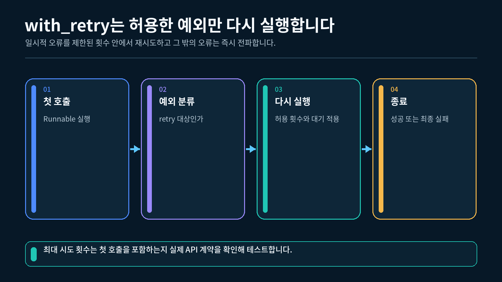
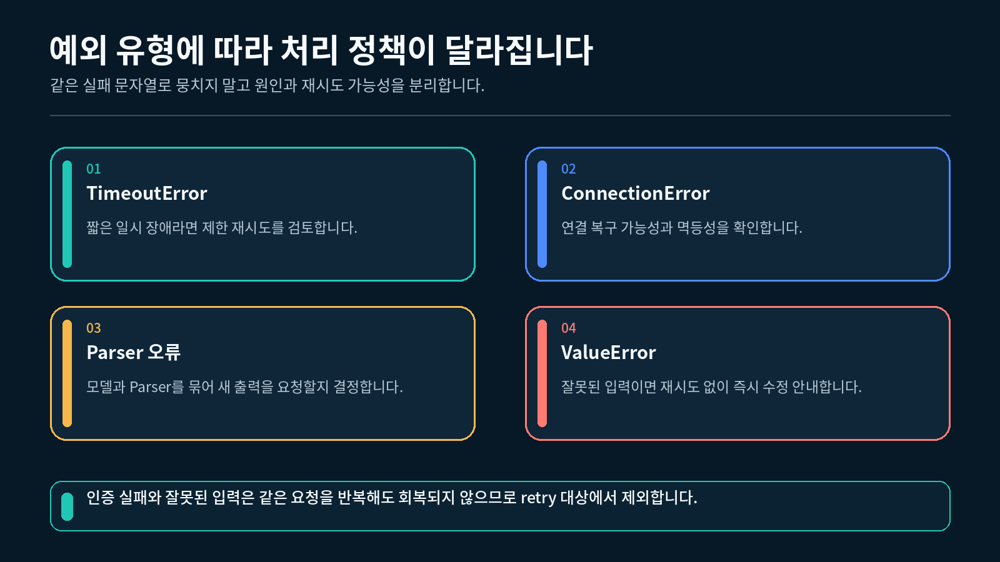
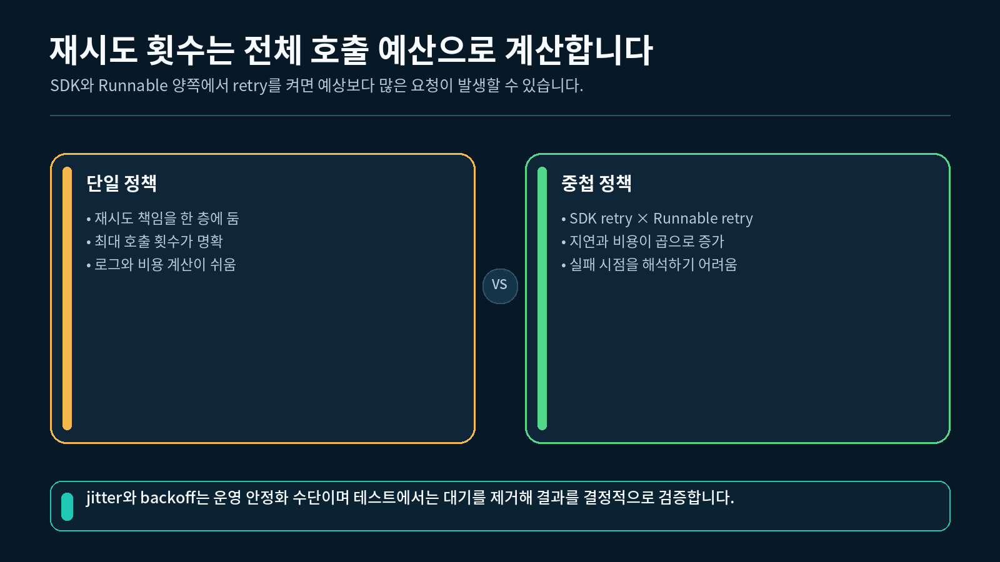

## 1. Retry할 오류와 멈출 오류 구분하기

오류가 발생했다고 바로 Retry를 적용하면 안 됩니다. 먼저 같은 입력과 같은 실행 경로를 반복했을 때 결과가 달라질 가능성이 있는지 판단합니다.

| 오류 사례 | 기본 처리 | 이유 |
| --- | --- | --- |
| 일시적인 모델 연결 실패 | 제한된 Retry | 다음 호출에서 연결이 회복될 수 있음 |
| 순간적인 서버 과부하 | 제한된 Retry | 잠시 뒤 처리될 가능성이 있음 |
| 비어 있는 질문 | 즉시 실패 | 같은 입력을 반복해도 바뀌지 않음 |
| 잘못된 자료형 | 즉시 실패 | 입력 계약을 먼저 수정해야 함 |
| 코드의 `TypeError` | 즉시 실패 | 코드를 고쳐야 해결됨 |

아래 그림에서는 오류가 발생한 뒤 복구 가능성을 판단하고, 허용한 오류만 Retry 경로로 보내는 흐름을 확인할 수 있습니다.

일시 오류와 영구 오류를 구분하는 Retry 판단 흐름



이번 실습에서는 다음 두 예외를 구분합니다.

```python
# 다시 시도할 수 있는 일시 오류를 다른 예외와 구분합니다.
class TemporaryModelError(RuntimeError):
    """다시 시도하면 회복될 수 있는 교육용 일시 오류입니다."""
```

- `TemporaryModelError`: Retry 대상
- `ValueError`: 비어 있는 질문을 나타내는 Retry 제외 오류

예외 타입을 구분하면 “실패했으니 모두 다시 실행한다”는 모호한 처리를 피할 수 있습니다.

---

## 2. 계획된 일시 오류와 호출 횟수 만들기

실제 모델 장애가 우연히 발생하기를 기다리면 실행할 때마다 결과가 달라집니다. 실습에서는 호출 횟수를 딕셔너리에 저장하고, 지정한 횟수만큼 `TemporaryModelError`를 발생시킵니다.

```python
# 이번 실행에서 실제 모델 함수가 호출된 횟수를 저장합니다.
state = {
    "attempts": 0,
}

def call_model(question: str) -> str:
    # 함수에 진입할 때마다 실제 시도 횟수를 한 번 증가시킵니다.
    state["attempts"] += 1

    # 같은 입력을 반복해도 해결되지 않는 빈 질문은 즉시 거부합니다.
    if not isinstance(question, str) or not question.strip():
        # 입력 오류는 Retry 대상과 다른 ValueError로 전달합니다.
        raise ValueError("질문은 비어 있지 않은 문자열이어야 합니다.")

    # 첫 번째 호출에서는 복구 가능한 교육용 일시 오류를 발생시킵니다.
    if state["attempts"] <= 1:
        # Retry 정책이 처리할 TemporaryModelError를 명시적으로 발생시킵니다.
        raise TemporaryModelError("계획된 일시 모델 오류입니다.")

    # 두 번째 호출에서는 고정된 정상 답변을 반환합니다.
    return "정상 응답"
```

실행 순서는 다음과 같습니다.

1. 함수가 호출될 때마다 `attempts`를 1 증가시킵니다.
2. 질문이 비어 있으면 즉시 `ValueError`를 발생시킵니다.
3. 첫 호출에서는 계획된 `TemporaryModelError`를 발생시킵니다.
4. 두 번째 호출에서는 `"정상 응답"`을 반환합니다.

실패 횟수와 성공 조건이 코드에 명시되어 있으므로 인터넷 연결 없이도 같은 Retry 흐름을 반복해서 확인할 수 있습니다.

---

## 3. `with_retry()` 적용하기

일반 함수를 `RunnableLambda`로 감싼 뒤 `with_retry()`를 연결합니다.

```python
# 일반 Python 함수를 Runnable로 바꾸기 위한 클래스를 불러옵니다.
from langchain_core.runnables import RunnableLambda

# 실패 가능성이 있는 모델 함수만 독립된 Runnable 단계로 만듭니다.
model_step = RunnableLambda(call_model)

# 일시 오류만 최대 두 번까지 실행하도록 Retry 정책을 연결합니다.
retry_step = model_step.with_retry(
    retry_if_exception_type=(TemporaryModelError,),
    stop_after_attempt=2,
    wait_exponential_jitter=False,
)

# Retry 정책이 적용된 새 Runnable에 정상 질문을 전달합니다.
answer = retry_step.invoke("LCEL Retry를 설명해 주세요.")
```

| 인자 | 이번 값 | 의미 |
| --- | --- | --- |
| `retry_if_exception_type` | `(TemporaryModelError,)` | 이 예외만 다시 실행 |
| `stop_after_attempt` | `2` | 최초 호출을 포함해 최대 두 번 실행 |
| `wait_exponential_jitter` | `False` | 수업에서 실제 대기와 무작위 지연 제거 |

아래 그림에서는 최초 호출도 시도 예산에 포함되며, 실패 가능성이 있는 모델 단계만 다시 실행되는 구조를 확인할 수 있습니다.

실패 가능성이 있는 단계에만 적용하는 Retry 경계와 시도 예산



`with_retry()`는 기존 `model_step`을 직접 바꾸지 않습니다. Retry 정책이 연결된 새 Runnable을 반환하므로 이후에는 `retry_step.invoke(...)`를 실행해야 합니다.

---

## 4. 최대 시도 횟수와 소진 결과 확인하기

`stop_after_attempt=2`는 최초 호출 한 번과 추가 시도 한 번을 합한 값입니다. “첫 호출 뒤 두 번 더 실행한다”는 뜻이 아닙니다.

| 설정된 실패 횟수 | 최대 시도 횟수 | 실제 결과 | 실제 호출 횟수 |
| --- | --- | --- | --- |
| 0 | 2 | 첫 호출 성공 | 1 |
| 1 | 2 | 두 번째 호출 성공 | 2 |
| 3 | 2 | 두 번 실패 후 마지막 오류 전달 | 2 |

허용된 횟수 안에 회복하지 못하면 마지막 `TemporaryModelError`가 호출자에게 전달됩니다.

```python
# 앞의 성공 사례와 상태를 분리해 매번 실패하는 모델 함수를 만듭니다.
exhaustion_state = {"attempts": 0}

def always_fail_model(question: str) -> str:
    exhaustion_state["attempts"] += 1
    if not isinstance(question, str) or not question.strip():
        raise ValueError("질문은 비어 있지 않은 문자열이어야 합니다.")
    raise TemporaryModelError("계획된 지속 모델 오류입니다.")

exhaustion_step = RunnableLambda(always_fail_model).with_retry(
    retry_if_exception_type=(TemporaryModelError,),
    stop_after_attempt=2,
    wait_exponential_jitter=False,
)
try:
    exhaustion_step.invoke("Retry 소진을 확인해 주세요.")
except TemporaryModelError as error:
    error_name = type(error).__name__
    print(error_name, exhaustion_state["attempts"])  # TemporaryModelError 2
```

마지막 오류를 빈 문자열이나 성공 결과로 바꾸면 상위 코드가 실패를 알 수 없습니다. 처리할 수 없는 실패는 호출자에게 전달해야 이후에 Fallback이나 사용자 안내를 선택할 수 있습니다.

---

## 5. Retry 대상이 아닌 오류 확인하기

비어 있는 질문은 반복해도 올바른 질문으로 바뀌지 않습니다. 따라서 `ValueError`는 Retry 목록에 포함하지 않습니다.

```python
# Retry 목록에 없는 입력 오류가 한 번에 전달되는지 확인합니다.
try:
    # 공백만 있는 질문을 전달해 ValueError 경로를 실행합니다.
    retry_step.invoke("   ")
except ValueError as error:
    # Fallback이나 화면에서 구분할 수 있도록 예외 클래스 이름을 저장합니다.
    error_name = type(error).__name__
```

`stop_after_attempt=3`으로 설정해도 `retry_if_exception_type`에 없는 `ValueError`는 한 번만 실행됩니다.

아래 그림처럼 예외 유형과 다음 행동을 함께 정하면 입력 오류와 코드 오류가 불필요하게 반복되는 일을 막을 수 있습니다.

오류 유형에 따라 Retry와 즉시 실패를 구분하는 처리표



| 예외 | Retry 여부 | 다음 행동 |
| --- | --- | --- |
| `TemporaryModelError` | 예 | 허용 횟수 안에서 같은 모델 단계를 다시 실행 |
| `ValueError` | 아니요 | 입력을 고친 뒤 새로 실행 |
| `TypeError` | 아니요 | 코드와 자료형 계약 확인 |

Retry 정책이 올바른지는 성공 결과만 보고 판단할 수 없습니다. Retry 대상이 아닌 오류의 실제 호출 횟수도 함께 확인해야 합니다.

---

## 6. Retry 적용 경계와 timeout 구분하기

Retry는 실패 가능성이 있는 좁은 단계에 적용합니다.

```
입력 확인 → 문서 검색 → 모델 호출 → 결과 저장
                       ↑
                 Retry 적용
```

전체 흐름에 Retry를 적용하면 모델 오류 한 번 때문에 문서 검색과 결과 저장까지 반복될 수 있습니다. 검색 결과 저장이나 메시지 전송처럼 부작용이 있는 작업이 두 번 실행될 수도 있습니다.

`with_retry()`와 timeout도 서로 다른 기능입니다.

| 기능 | 해결하는 문제 |
| --- | --- |
| Retry | 실패한 호출을 조건에 따라 다시 실행 |
| timeout | 한 번의 호출이 기다릴 수 있는 시간을 제한 |

`with_retry()`를 적용해도 한 번의 호출이 끝없이 기다리는 문제를 자동으로 해결하지 않습니다. 실제 모델을 연결할 때는 모델 클라이언트의 timeout 설정을 별도로 확인해야 합니다.

### 바깥 Retry와 모델 내부 Retry의 주인 정하기

실제 `ChatOpenAI`에는 모델 클라이언트 자체의 자동 Retry도 있습니다. 바깥 LCEL Retry와 내부 Retry를 동시에 켜면 한 번의 `invoke()` 안에서 실제 HTTP 요청 시도가 예상보다 많아질 수 있습니다.

예를 들어 `with_retry(stop_after_attempt=2)`가 바깥에서 모델 단계를 최대 두 번 실행하고, 모델 클라이언트가 각 실행에서 최초 요청과 내부 Retry 두 번까지 수행한다면 실제 HTTP 요청은 최악의 경우 최대 `2 × 3 = 6회`가 될 수 있습니다.

이 교안처럼 Retry 정책을 LCEL 바깥에서 명시적으로 학습하고 관리할 때는 모델 내부 Retry를 끄고 한 계층만 시도 횟수의 주인으로 둡니다.

```python
# .env에서 지정한 권장 모델을 읽습니다.
import os
from dotenv import load_dotenv
from langchain_openai import ChatOpenAI

# 실제 OpenAI 연결에서도 바깥 Retry가 전체 시도 횟수를 관리하도록 설정합니다.
load_dotenv()

model = ChatOpenAI(
    model=os.getenv("OPENAI_MODEL", "gpt-5.6-luna"),
    # 한 번의 HTTP 요청이 오래 멈추지 않도록 제한 시간을 둡니다.
    timeout=20,
    # 모델 클라이언트 내부 Retry를 꺼서 시도 횟수의 중첩을 막습니다.
    max_retries=0,
    # OpenAI Responses API 사용을 명시합니다.
    use_responses_api=True,
)
```

운영에서 내부 Retry를 사용할 수도 있지만, 그 경우에는 바깥 Retry와 곱해지는 최대 요청 횟수·지연·비용을 계산하고 기록해야 합니다.

이번 실습은 Retry의 선택과 횟수에 집중하므로 실제 대기와 실제 네트워크 timeout은 사용하지 않습니다.

---

## 7. 완성 실습 실행하기

VS Code에서 `실습.py`가 있는 강 폴더를 열고 터미널에서 실행합니다.

1-2강에서 만든 `pyproject.toml`과 `uv.lock`이 있는 프로젝트의 하위 폴더에 `실습.py`를 두고, 해당 폴더에서 실행합니다. VS Code 인터프리터는 이 프로젝트의 `.venv` (Python 3.12)를 선택합니다.

```bash
uv run python 실습.py
```

완성 실습은 서로 독립된 세 사례를 실행합니다.

1. 첫 일시 오류 뒤 두 번째 시도에서 복구
2. 최대 두 번을 모두 실패하고 Retry 소진
3. Retry 대상이 아닌 입력 오류를 한 번에 전달

"""9-1강: 복구 가능한 일시 오류에만 제한된 Retry를 적용합니다."""

from __future__ import annotations

from langchain_core.runnables import Runnable, RunnableLambda


class TemporaryModelError(RuntimeError):
    """같은 요청을 다시 시도하면 회복될 수 있는 교육용 일시 오류입니다."""


def build_retry_step(
    *,
    failures_before_success: int,
    max_attempts: int,
) -> tuple[Runnable[str, str], dict[str, int]]:
    """계획된 일시 오류를 내는 Runnable과 호출 횟수 상태를 반환합니다."""

    # 음수 실패 횟수는 의미가 없으므로 Runnable 생성 전에 차단합니다.
    if failures_before_success < 0:
        raise ValueError("실패 횟수는 0 이상이어야 합니다.")

    # 최초 호출도 한 번의 시도이므로 최대 시도 횟수는 1 이상이어야 합니다.
    if max_attempts < 1:
        raise ValueError("최대 시도 횟수는 1 이상이어야 합니다.")

    # 각 실행 사례가 독립된 호출 횟수를 갖도록 새 딕셔너리를 만듭니다.
    state = {
        "attempts": 0,
    }

    def call_model(question: str) -> str:
        """정해진 횟수만큼 실패한 뒤 고정된 성공 답변을 반환합니다."""

        # Runnable 함수가 실제로 호출된 횟수를 먼저 증가시킵니다.
        state["attempts"] += 1

        # 비어 있는 질문은 반복해도 해결되지 않으므로 즉시 입력 오류로 처리합니다.
        if not isinstance(question, str) or not question.strip():
            raise ValueError("질문은 비어 있지 않은 문자열이어야 합니다.")

        # 설정된 실패 횟수 안에서는 복구 가능한 일시 오류를 발생시킵니다.
        if state["attempts"] <= failures_before_success:
            raise TemporaryModelError("계획된 일시 모델 오류입니다.")

        # 허용된 시도 안에 회복하면 정상 문자열을 반환합니다.
        return "정상 응답"

    # 실패 가능성이 있는 모델 호출 함수만 Runnable로 감쌉니다.
    model_step = RunnableLambda(call_model)

    # 일시 오류만 다시 실행하고 ValueError 같은 입력 오류는 반복하지 않습니다.
    retry_step = model_step.with_retry(
        retry_if_exception_type=(TemporaryModelError,),
        stop_after_attempt=max_attempts,
        # 수업 실행에서는 실제 대기와 무작위 지연을 제거합니다.
        wait_exponential_jitter=False,
    )

    # 결과와 실제 호출 횟수를 함께 검사할 수 있도록 두 값을 반환합니다.
    return retry_step, state


def run_recovered_case() -> tuple[str, int]:
    """첫 호출은 실패하고 두 번째 호출에서 복구되는 사례를 실행합니다."""

    # 한 번 실패한 뒤 성공하며 최대 두 번까지 시도하는 단계를 만듭니다.
    retry_step, state = build_retry_step(
        failures_before_success=1,
        max_attempts=2,
    )

    # 같은 질문을 Retry 정책이 적용된 단계에 전달합니다.
    answer = retry_step.invoke("LCEL Retry를 설명해 주세요.")

    # 성공 답변과 실제 호출 횟수를 반환합니다.
    return answer, state["attempts"]


def run_exhausted_case() -> tuple[str, int]:
    """허용된 횟수 안에 회복하지 못한 사례의 오류 종류를 반환합니다."""

    # 세 번 실패하도록 설정하되 전체 시도 예산은 두 번으로 제한합니다.
    retry_step, state = build_retry_step(
        failures_before_success=3,
        max_attempts=2,
    )

    try:
        # 두 번 모두 실패하면 마지막 TemporaryModelError가 호출자에게 전달됩니다.
        retry_step.invoke("Retry 소진을 확인해 주세요.")
    except TemporaryModelError as error:
        # 오류 원문 대신 예외 클래스 이름만 결과로 사용합니다.
        error_name = type(error).__name__
    else:
        # 실패 사례가 성공하면 실습 조건이 잘못된 것이므로 즉시 중단합니다.
        raise AssertionError("Retry 소진 사례가 예상과 다르게 성공했습니다.")

    # 마지막 오류 종류와 실제 시도 횟수를 반환합니다.
    return error_name, state["attempts"]


def run_non_retryable_case() -> tuple[str, int]:
    """Retry 대상이 아닌 입력 오류가 한 번에 전달되는지 확인합니다."""

    # 일시 오류는 최대 세 번 시도할 수 있는 단계를 만듭니다.
    retry_step, state = build_retry_step(
        failures_before_success=0,
        max_attempts=3,
    )

    try:
        # 비어 있는 문자열은 함수 진입 직후 ValueError를 발생시킵니다.
        retry_step.invoke("   ")
    except ValueError as error:
        # 화면에는 입력 원문 대신 오류 클래스 이름만 표시합니다.
        error_name = type(error).__name__
    else:
        # 입력 오류가 성공으로 끝나면 예외 분류가 잘못된 것입니다.
        raise AssertionError("비어 있는 질문이 예상과 다르게 성공했습니다.")

    # ValueError는 Retry 대상이 아니므로 Runnable 호출 횟수는 한 번입니다.
    return error_name, state["attempts"]


def main() -> None:
    """복구, 소진, 비대상 오류의 세 가지 Retry 경로를 실행합니다."""

    # 첫 일시 오류 뒤 정상적으로 복구되는 경로를 실행합니다.
    recovered_answer, recovered_attempts = run_recovered_case()

    # 최대 시도 횟수를 모두 사용한 경로를 실행합니다.
    exhausted_error, exhausted_attempts = run_exhausted_case()

    # Retry 목록에 없는 입력 오류 경로를 실행합니다.
    invalid_error, invalid_attempts = run_non_retryable_case()

    # 각 경로의 상태와 실제 호출 횟수를 순서대로 출력합니다.
    print("=== Retry 복구 ===")
    print(
        f"status=success attempts={recovered_attempts} "
        f"answer={recovered_answer}"
    )

    # 허용 횟수 안에 복구하지 못한 경로의 관측 결과를 출력합니다.
    print("=== Retry 소진 ===")
    print(
        f"status=error attempts={exhausted_attempts} "
        f"error={exhausted_error}"
    )

    # Retry 대상이 아닌 오류가 한 번만 실행된 결과를 출력합니다.
    print("=== Retry 제외 오류 ===")
    print(
        f"status=error attempts={invalid_attempts} "
        f"error={invalid_error}"
    )


if __name__ == "__main__":
    # VS Code 터미널에서 파일을 직접 실행할 때만 실습을 시작합니다.
    main()

### 예상 출력

```
=== Retry 복구 ===
status=success attempts=2 answer=정상 응답
=== Retry 소진 ===
status=error attempts=2 error=TemporaryModelError
=== Retry 제외 오류 ===
status=error attempts=1 error=ValueError
```

### 결과 해석

- `Retry 복구`는 첫 호출이 실패하고 두 번째 호출에서 성공했습니다.
- `Retry 소진`은 최대 두 번만 실행하고 마지막 일시 오류를 전달했습니다.
- `Retry 제외 오류`는 `ValueError`가 정책에 없으므로 한 번만 실행했습니다.
- 세 사례는 각각 새 호출 횟수 딕셔너리를 사용하므로 이전 실행의 상태가 섞이지 않습니다.