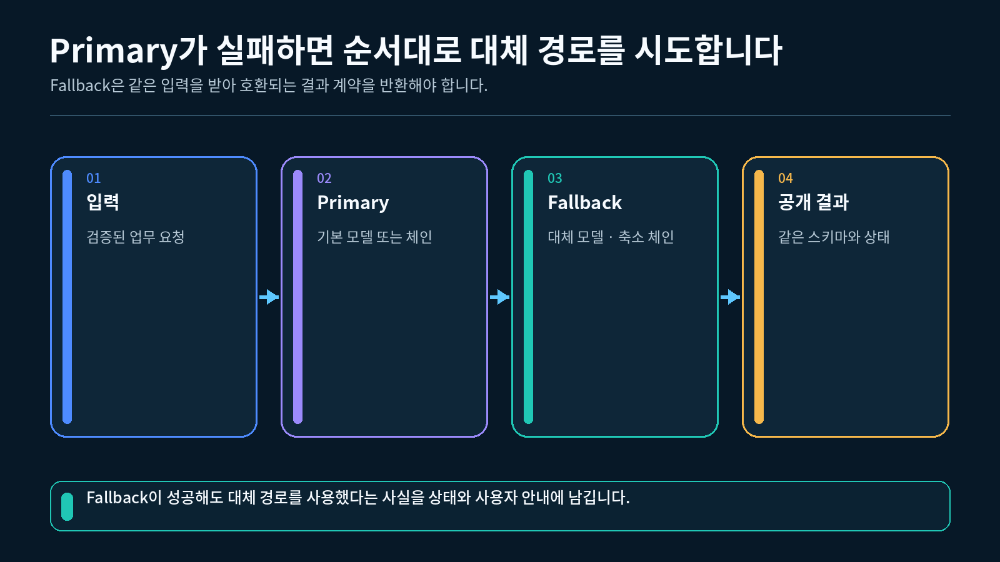
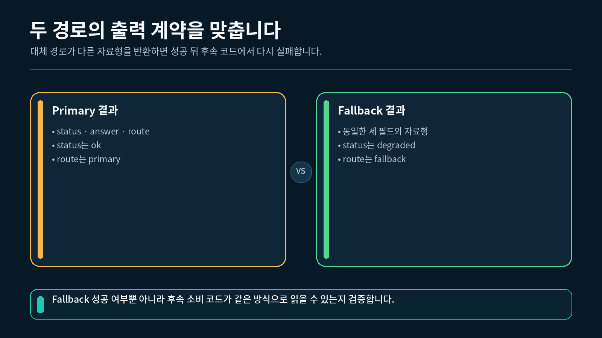
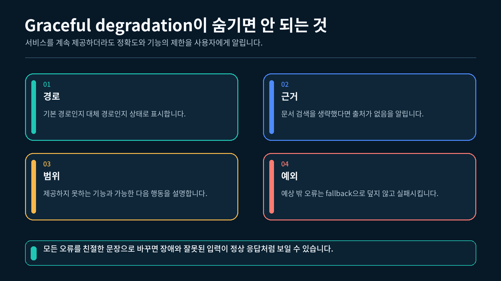

## 1. Retry와 Fallback 구분하기

Retry와 Fallback은 모두 오류 대응에 사용하지만 질문이 다릅니다.

| 처리 방식 | 판단 질문 | 예시 |
| --- | --- | --- |
| Retry | 같은 경로를 다시 실행하면 회복될 수 있는가? | 첫 모델 호출의 일시 오류 |
| Fallback | Primary 대신 사용할 수 있는 허용된 대체 경로가 있는가? | 상세 답변 대신 고정된 제한 안내 |
| 즉시 실패 | 반복하거나 대체하면 안 되는 오류인가? | 비어 있는 입력, 코드 오류 |

아래 그림은 Retry가 같은 경로로 돌아가는 반면 Fallback은 다른 경로로 이동하는 차이를 보여 줍니다.

같은 경로를 다시 실행하는 Retry와 대체 경로로 이동하는 Fallback 비교



이번 실습의 실행 정책은 다음과 같습니다.

- Primary가 정상 동작하면 Fallback을 호출하지 않습니다.
- `PrimaryUnavailable`이 발생하면 Fallback을 한 번 실행합니다.
- `ValueError`가 발생하면 Fallback으로 숨기지 않고 호출자에게 전달합니다.

Fallback은 Primary가 정상인데 더 저렴한 경로를 선택하는 일반적인 분기와도 다릅니다. Primary가 처리할 수 없을 때만 대체 경로가 실행됩니다.

실제 모델을 Primary로 사용할 때는 9-1강에서 정한 Retry 예산을 먼저 확인합니다. 모델 클라이언트의 내부 Retry와 바깥 Retry가 모두 소진된 뒤 Fallback으로 이동하면 실제 HTTP 요청 수와 대기 시간이 겹쳐 커질 수 있습니다. 바깥 정책이 시도 횟수를 관리한다면 `ChatOpenAI(max_retries=0)`처럼 내부 자동 Retry를 끄고, Fallback이 시작되기 전 최대 요청 수를 한곳에서 계산합니다.

---

## 2. 공통 출력 계약 만들기

Primary는 Pydantic 객체를 반환하고 Fallback은 문자열을 반환하면 호출자는 경로마다 다른 코드를 작성해야 합니다. 두 경로가 같은 `UserAnswer`를 반환하도록 만들면 화면은 하나의 타입을 처리하면서 상태만 구분할 수 있습니다.

```python
# 출력 필드가 가질 수 있는 문자열 범위를 제한하는 타입을 불러옵니다.
from typing import Literal

# 정상 경로와 저하 경로가 공유할 Pydantic 기반 클래스를 불러옵니다.
from pydantic import BaseModel

# 두 실행 경로가 함께 사용할 사용자 응답 계약을 정의합니다.
class UserAnswer(BaseModel):
    status: Literal["ok", "degraded"]
    answer: str
    route: Literal["primary", "fallback"]
```

| 필드 | Primary 정상 | Fallback 전환 |
| --- | --- | --- |
| `status` | `"ok"` | `"degraded"` |
| `answer` | 정상 처리 문장 | 기능 제한과 재시도 안내 |
| `route` | `"primary"` | `"fallback"` |

아래 그림처럼 내부 실행 경로가 달라도 최종 출력 스키마는 하나로 합쳐집니다.

Primary와 Fallback이 같은 UserAnswer 출력 계약으로 합쳐지는 구조



`status="degraded"`는 결과 생성에 실패했다는 뜻만은 아닙니다. 대체 경로가 정상 실행되었지만 제공할 수 있는 기능이 줄었다는 뜻입니다.

---

## 3. Primary의 세 가지 동작 정의하기

완성 실습은 `primary_mode` 값으로 Primary의 동작을 선택합니다.

| `primary_mode` | Primary 동작 | 기대 결과 |
| --- | --- | --- |
| `"normal"` | 정상 `UserAnswer` 반환 | Primary 종료 |
| `"unavailable"` | `PrimaryUnavailable` 발생 | Fallback 전환 |
| `"invalid"` | `ValueError` 발생 | 호출자에게 오류 전달 |

먼저 Fallback을 허용할 오류를 별도 클래스로 정의합니다.

```python
# Fallback 전환을 허용할 Primary 일시 장애를 별도 타입으로 정의합니다.
class PrimaryUnavailable(RuntimeError):
    """Primary가 일시적으로 응답할 수 없음을 나타냅니다."""
```

Primary 함수는 질문을 확인한 뒤 선택한 모드에 따라 동작합니다.

```python
def primary(payload: dict[str, str]) -> UserAnswer:
    # Primary 함수가 실제로 선택된 횟수를 한 번 증가시킵니다.
    calls["primary"] += 1

    # 질문이 없으면 대체 경로로 숨기지 않을 입력 오류를 발생시킵니다.
    if not payload.get("question", "").strip():
        # 같은 입력을 반복해도 해결되지 않는 ValueError를 전달합니다.
        raise ValueError("질문은 비어 있지 않아야 합니다.")

    # 일시 중단 모드에서는 Fallback이 처리할 구체 오류를 발생시킵니다.
    if primary_mode == "unavailable":
        # 허용된 대체 경로로 전환할 수 있도록 오류 타입을 명확히 합니다.
        raise PrimaryUnavailable("Primary가 일시 중단되었습니다.")

    # 잘못된 계약 모드에서는 정책 밖 ValueError를 재현합니다.
    if primary_mode == "invalid":
        # 코드나 입력을 고쳐야 하는 오류를 Fallback으로 숨기지 않습니다.
        raise ValueError("Primary 입력 계약이 올바르지 않습니다.")

    # 정상 모드에서는 공통 출력 계약의 성공 결과를 반환합니다.
    return UserAnswer(
        status="ok",
        answer="Primary 경로가 요청을 정상 처리했습니다.",
        route="primary",
    )
```

두 실패 모드는 모두 예외를 발생시키지만 처리 방법은 다릅니다. 예외 타입이 다음 행동을 결정하는 실행 계약 역할을 합니다.

---

## 4. 안전한 Fallback 만들기

Fallback은 Primary가 만들었을 법한 상세 답을 추측하지 않습니다. 현재 기능이 제한되었음을 알리고 다시 시도할 수 있는 행동을 안내합니다.

```python
def fallback(payload: dict[str, str]) -> UserAnswer:
    # 실제로 대체 경로가 선택된 횟수를 한 번 증가시킵니다.
    calls["fallback"] += 1

    # Fallback도 원래 질문이 유지되었는지 최소 입력 계약을 확인합니다.
    if not payload.get("question", "").strip():
        # 비어 있는 질문은 기능 저하 결과로 바꾸지 않고 즉시 거부합니다.
        raise ValueError("Fallback 질문도 비어 있지 않아야 합니다.")

    # 정상 경로와 같은 타입이지만 기능 저하 상태인 결과를 반환합니다.
    return UserAnswer(
        status="degraded",
        answer=(
            "현재 상세 답변을 만들 수 없습니다. "
            "잠시 후 다시 시도해 주세요."
        ),
        route="fallback",
    )
```

Fallback도 Primary와 같은 `UserAnswer`를 반환합니다. 다만 사용자가 정상 결과로 오해하지 않도록 `status`와 `route`가 다릅니다.

좋은 기능 저하 안내는 다음 두 내용을 포함합니다.

- 현재 상세 기능을 사용할 수 없다는 사실
- 잠시 후 다시 시도하는 것처럼 사용자가 취할 수 있는 다음 행동

모호한 정상 답을 만드는 것보다 한계를 분명히 알리는 편이 안전합니다.

---

## 5. `with_fallbacks()`로 두 경로 연결하기

Primary와 Fallback 함수를 각각 Runnable로 만든 뒤 `with_fallbacks()`로 연결합니다.

```python
# 일반 함수를 같은 입출력의 Runnable로 바꾸는 클래스를 불러옵니다.
from langchain_core.runnables import RunnableLambda

# 정상 응답을 먼저 시도할 Primary Runnable을 만듭니다.
primary_step = RunnableLambda(primary)
# Primary 장애 뒤 실행할 Fallback Runnable을 만듭니다.
fallback_step = RunnableLambda(fallback)

# 허용한 PrimaryUnavailable만 대체 경로로 보내는 체인을 구성합니다.
resilient_chain = primary_step.with_fallbacks(
    [fallback_step],
    exceptions_to_handle=(PrimaryUnavailable,),
)
```

| 설정 | 역할 |
| --- | --- |
| `[fallback_step]` | Primary 실패 시 시도할 대체 Runnable 목록 |
| `exceptions_to_handle` | Fallback 전환을 허용할 예외 타입 |

이번 체인은 `PrimaryUnavailable`만 처리합니다. `ValueError`는 목록에 없으므로 Fallback으로 전환되지 않습니다.

실행 흐름은 다음과 같습니다.

```
입력 → Primary 성공 ─────────────→ status=ok
          │
          └─ PrimaryUnavailable → Fallback → status=degraded
```

Primary와 Fallback의 호출 횟수를 각각 기록하면 실제로 어떤 경로가 선택되었는지 확인할 수 있습니다.

---

## 6. Graceful degradation과 정책 밖 오류 확인하기

Graceful degradation은 장애를 숨기는 것이 아닙니다. 사용할 수 있는 기능은 유지하되, 줄어든 기능과 결과의 한계를 사용자에게 명확히 표시하는 방식입니다.

아래 그림에서는 Primary 장애 뒤 Fallback이 제한된 안내를 반환하고, 화면이 기능 저하 상태를 구분하는 흐름을 확인할 수 있습니다.

Primary 장애 뒤 제한된 안내로 전환하는 graceful degradation 흐름



| 경로 | `status` | `route` | Primary 호출 | Fallback 호출 |
| --- | --- | --- | --- | --- |
| 정상 | `ok` | `primary` | 1 | 0 |
| 기능 저하 | `degraded` | `fallback` | 1 | 1 |
| 정책 밖 오류 | 결과 없음 | 결과 없음 | 1 | 0 |

정책 밖 오류는 다음처럼 확인합니다.

```python
# 정책 목록에 없는 ValueError가 호출자에게 전달되는지 확인합니다.
try:
    # 잘못된 Primary 모드의 체인에 정상 형태의 질문을 전달합니다.
    chain.invoke(
        {
            "question": "잘못된 경로를 확인합니다.",
        }
    )
except ValueError as error:
    # 오류 원문 대신 전달된 예외 클래스 이름만 저장합니다.
    error_name = type(error).__name__
```

`exceptions_to_handle=(Exception,)`처럼 모든 오류를 처리하면 입력 오류와 코드 오류까지 정상적인 기능 저하처럼 보일 수 있습니다. 대체 경로로 처리할 수 있는 구체적인 예외만 지정해야 합니다.

---

## 7. 완성 실습 실행하기

VS Code에서 `실습.py`가 있는 강 폴더를 열고 터미널에서 실행합니다.

1-2강에서 만든 `pyproject.toml`과 `uv.lock`이 있는 프로젝트의 하위 폴더에 `실습.py`를 두고, 해당 폴더에서 실행합니다. VS Code 인터프리터는 이 프로젝트의 `.venv` (Python 3.12)를 선택합니다.

```bash
uv run python 실습.py
```

완성 실습은 서로 독립된 세 사례를 실행합니다.

1. Primary가 정상 처리하고 Fallback은 실행하지 않음
2. `PrimaryUnavailable` 뒤 Fallback으로 전환
3. 정책에 없는 `ValueError`를 호출자에게 전달

"""9-2강: Primary 실패 시 같은 출력 계약의 Fallback으로 전환합니다."""

from __future__ import annotations

from typing import Literal

from langchain_core.runnables import Runnable, RunnableLambda
from pydantic import BaseModel


class PrimaryUnavailable(RuntimeError):
    """Primary 경로가 일시적으로 응답할 수 없음을 나타냅니다."""


class UserAnswer(BaseModel):
    """정상 경로와 기능 저하 경로가 함께 사용하는 출력 계약입니다."""

    # 결과가 정상인지 기능 저하 상태인지 구분합니다.
    status: Literal["ok", "degraded"]

    # 사용자가 읽을 최종 안내 문장을 저장합니다.
    answer: str

    # 실제 결과를 만든 경로 이름을 저장합니다.
    route: Literal["primary", "fallback"]


def build_fallback_chain(
    primary_mode: Literal["normal", "unavailable", "invalid"],
) -> tuple[Runnable[dict[str, str], UserAnswer], dict[str, int]]:
    """지정한 Primary 동작과 안전한 Fallback을 연결합니다."""

    # Primary와 Fallback의 실제 실행 횟수를 따로 기록합니다.
    calls = {
        "primary": 0,
        "fallback": 0,
    }

    def primary(payload: dict[str, str]) -> UserAnswer:
        """정상, 일시 중단, 입력 오류 중 선택된 Primary 경로를 실행합니다."""

        # Primary 함수가 호출된 횟수를 한 번 증가시킵니다.
        calls["primary"] += 1

        # 질문 키가 없거나 값이 비어 있으면 반복하지 않을 입력 오류를 발생시킵니다.
        if not payload.get("question", "").strip():
            raise ValueError("질문은 비어 있지 않아야 합니다.")

        # unavailable 모드는 Fallback이 처리할 일시 장애를 발생시킵니다.
        if primary_mode == "unavailable":
            raise PrimaryUnavailable("Primary 경로가 일시적으로 중단되었습니다.")

        # invalid 모드는 정책에 포함되지 않은 코드·입력 오류를 재현합니다.
        if primary_mode == "invalid":
            raise ValueError("Primary 입력 계약이 올바르지 않습니다.")

        # 정상 모드는 Primary가 같은 출력 스키마의 결과를 반환합니다.
        return UserAnswer(
            status="ok",
            answer="Primary 경로가 요청을 정상 처리했습니다.",
            route="primary",
        )

    def fallback(payload: dict[str, str]) -> UserAnswer:
        """PrimaryUnavailable이 발생했을 때 고정된 저하 응답을 반환합니다."""

        # Fallback 함수가 실제로 선택되었음을 횟수로 기록합니다.
        calls["fallback"] += 1

        # Fallback도 질문 입력이 있는지 최소한의 계약을 확인합니다.
        if not payload.get("question", "").strip():
            raise ValueError("Fallback 질문도 비어 있지 않아야 합니다.")

        # 기능이 제한되었다는 사실을 숨기지 않는 사용자 안내를 반환합니다.
        return UserAnswer(
            status="degraded",
            answer="현재 상세 답변을 만들 수 없습니다. 잠시 후 다시 시도해 주세요.",
            route="fallback",
        )

    # Primary와 Fallback 함수를 각각 동일한 입출력 Runnable로 감쌉니다.
    primary_step = RunnableLambda(primary)
    fallback_step = RunnableLambda(fallback)

    # 지정한 일시 장애만 Fallback으로 넘기고 ValueError는 그대로 전달합니다.
    resilient_chain = primary_step.with_fallbacks(
        [fallback_step],
        exceptions_to_handle=(PrimaryUnavailable,),
    )

    # 실행 결과와 두 경로의 호출 횟수를 함께 반환합니다.
    return resilient_chain, calls


def run_primary_case() -> tuple[UserAnswer, dict[str, int]]:
    """Primary가 성공하여 Fallback이 호출되지 않는 사례를 실행합니다."""

    # 정상 모드의 안정화 체인과 호출 횟수 상태를 만듭니다.
    chain, calls = build_fallback_chain("normal")

    # 정상 질문을 체인에 전달해 Primary 결과를 받습니다.
    result = chain.invoke(
        {
            "question": "Fallback은 언제 사용하나요?",
        }
    )

    # 결과와 실제 경로별 호출 횟수를 반환합니다.
    return result, calls


def run_fallback_case() -> tuple[UserAnswer, dict[str, int]]:
    """PrimaryUnavailable 뒤 Fallback이 실행되는 사례를 실행합니다."""

    # 일시 중단 모드의 안정화 체인과 호출 횟수 상태를 만듭니다.
    chain, calls = build_fallback_chain("unavailable")

    # 같은 질문이 Primary 실패 뒤 Fallback에 전달됩니다.
    result = chain.invoke(
        {
            "question": "현재 서비스 상태를 알려 주세요.",
        }
    )

    # 기능 저하 결과와 실제 호출 횟수를 반환합니다.
    return result, calls


def run_unhandled_case() -> tuple[str, dict[str, int]]:
    """처리 목록에 없는 ValueError가 숨겨지지 않는지 확인합니다."""

    # 정책 밖 오류를 내는 체인과 호출 횟수 상태를 만듭니다.
    chain, calls = build_fallback_chain("invalid")

    try:
        # ValueError는 Fallback 대상이 아니므로 호출자에게 바로 전달됩니다.
        chain.invoke(
            {
                "question": "잘못된 경로를 확인합니다.",
            }
        )
    except ValueError as error:
        # 내부 문장 대신 오류 클래스 이름만 저장합니다.
        error_name = type(error).__name__
    else:
        # 정책 밖 오류가 성공으로 바뀌면 오류가 잘못 숨겨진 것입니다.
        raise AssertionError("정책 밖 오류가 예상과 다르게 처리되었습니다.")

    # 오류 종류와 실제 경로별 호출 횟수를 반환합니다.
    return error_name, calls


def main() -> None:
    """Primary 성공, Fallback 전환, 정책 밖 오류의 세 경로를 실행합니다."""

    # Primary가 정상적으로 성공하는 첫 번째 사례를 실행합니다.
    primary_result, primary_calls = run_primary_case()

    # Primary 장애 뒤 Fallback으로 전환되는 두 번째 사례를 실행합니다.
    fallback_result, fallback_calls = run_fallback_case()

    # Fallback이 처리하지 않을 오류를 확인하는 세 번째 사례를 실행합니다.
    unhandled_error, unhandled_calls = run_unhandled_case()

    # 사용자가 경로와 기능 저하 여부를 비교할 수 있도록 결과를 출력합니다.
    print("=== Primary 정상 ===")
    print(
        f"status={primary_result.status} route={primary_result.route} "
        f"primary_calls={primary_calls['primary']} "
        f"fallback_calls={primary_calls['fallback']}"
    )

    # 일시 장애 뒤 Fallback으로 전환된 경로를 출력합니다.
    print("=== Fallback 전환 ===")
    print(
        f"status={fallback_result.status} route={fallback_result.route} "
        f"primary_calls={fallback_calls['primary']} "
        f"fallback_calls={fallback_calls['fallback']}"
    )

    # 정책 밖 오류가 Fallback으로 숨겨지지 않은 결과를 출력합니다.
    print("=== 처리하지 않는 오류 ===")
    print(
        f"error={unhandled_error} "
        f"primary_calls={unhandled_calls['primary']} "
        f"fallback_calls={unhandled_calls['fallback']}"
    )


if __name__ == "__main__":
    # VS Code 터미널에서 파일을 직접 실행할 때만 세 사례를 실행합니다.
    main()


### 예상 출력

```
=== Primary 정상 ===
status=ok route=primary primary_calls=1 fallback_calls=0
=== Fallback 전환 ===
status=degraded route=fallback primary_calls=1 fallback_calls=1
=== 처리하지 않는 오류 ===
error=ValueError primary_calls=1 fallback_calls=0
```

### 결과 해석

- `Primary 정상`에서는 Primary가 한 번 실행되고 Fallback 호출 횟수는 0입니다.
- `Fallback 전환`에서는 Primary가 한 번 실패한 뒤 Fallback이 한 번 실행되었습니다.
- 두 성공 경로 모두 `UserAnswer`를 반환하지만 `status`와 `route`가 다릅니다.
- `처리하지 않는 오류`에서는 `ValueError`가 Fallback으로 숨지 않았습니다.