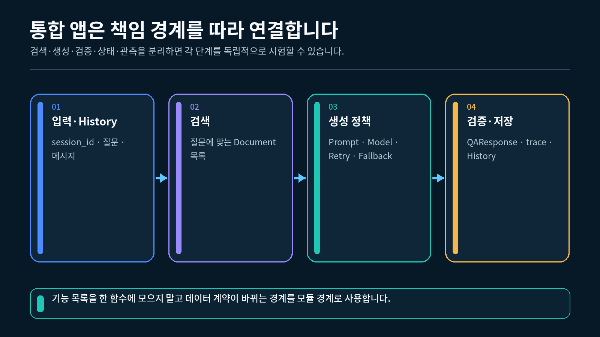
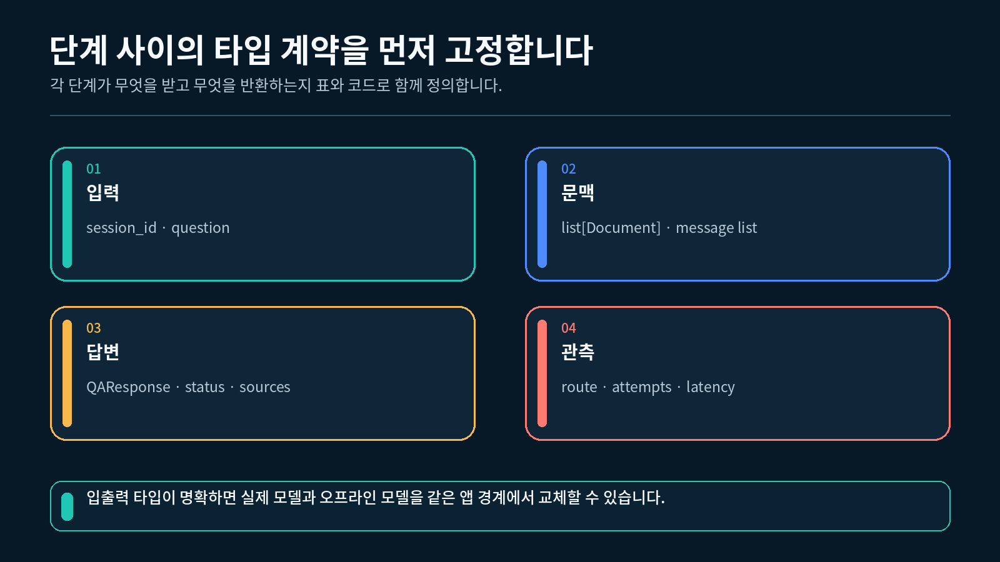
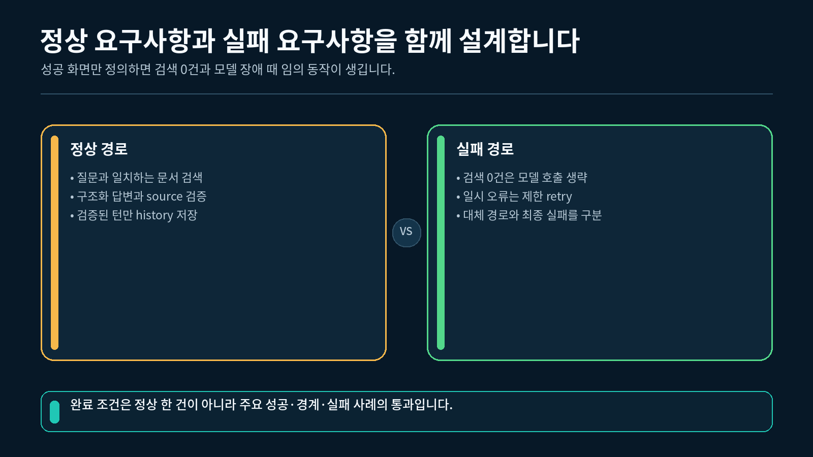

## 1. 통합 전에 책임을 나누는 이유

지금까지 Prompt, Model, Parser, Retriever, 대화 기록, Retry, Fallback, 실행 관측을 각각 배웠습니다. 이 기능을 한 함수에 모두 넣으면 실행은 가능해도 어느 단계가 어떤 값을 받아 무엇을 반환하는지 확인하기 어렵습니다.

이번 통합 앱의 목적은 수업 문서에서 근거를 찾고 답변하는 작은 문서 Q&A 앱을 만드는 것입니다. 앱의 책임은 다음처럼 나눕니다.

| 책임 | 받는 값 | 내보내는 값 |
| --- | --- | --- |
| 입력 확인 | 질문, `session_id` | 검증된 요청 |
| 대화 조회 | `session_id` | 이전 메시지 목록 |
| 문서 검색 | 질문 | `Document` 목록 |
| Prompt 구성 | 질문, 대화, 문서 | 모델 메시지 |
| 모델 정책 | 모델 메시지 | 모델 응답 |
| 구조화 검증 | 모델 응답 | `QAResponse` |
| 로컬 관측 | 실행 정보 | trace 레코드 |
| 대화 저장 | 검증된 질문과 답변 | 갱신된 메시지 목록 |

통합 앱의 기능을 단계별 책임으로 나눈 구조



책임을 나누면 검색 방식을 바꾸어도 대화 저장 코드는 유지할 수 있고, 모델 응답 형식이 달라져도 입력 확인 코드는 유지할 수 있습니다.

### 이번 강의에서 만드는 설계 결과

완성 실습은 다음 세 결과를 출력합니다.

```
요구사항 딕셔너리
단계 계획 목록
테스트 사례 목록
```

이 결과는 실제 체인을 대신하지 않습니다. 다음 강의의 구현 범위와 단계 순서를 확인하는 설계 자료입니다.

---

## 2. 필수 기능과 선택 기능 구분하기

모든 기능을 첫 실행부터 필수로 두면 계정이나 외부 저장소가 준비되지 않았을 때 핵심 흐름도 연습할 수 없습니다. 이번 실습은 로컬에서 확인할 기능을 필수로 두고, 추가 설정이 필요한 기능은 선택으로 분리합니다.

### 요구사항 딕셔너리의 구조

```python
# 문서 Q&A 앱의 기능 범위를 만드는 함수를 정의합니다.
def build_requirements() -> dict[str, list[str] | str]:
    """앱 종류와 필수·선택 기능을 구분해 반환합니다."""

    # 이번 통합 실습의 앱 종류를 문서 Q&A로 고정합니다.
    app_type = "document_qa"

    # 로컬에서 반드시 연결할 핵심 기능을 순서와 무관한 목록으로 만듭니다.
    required_features = [
        # 사용자 질문을 앱 입력으로 받습니다.
        "question_input",
        # 질문과 관련된 외부 문서를 찾습니다.
        "retriever",
        # Prompt, Model, Parser의 기본 체인을 연결합니다.
        "prompt_model_parser",
        # 모델 응답을 정해진 필드로 검증합니다.
        "structured_output",
        # 현재 세션의 짧은 대화 기록을 유지합니다.
        "session_history",
        # 일시 오류와 지속 장애의 경로를 나눕니다.
        "retry_fallback",
        # 로컬에서 실행 경로와 결과를 확인합니다.
        "local_trace",
    ]

    # 외부 서비스나 영구 저장소가 필요한 기능은 선택 항목으로 둡니다.
    optional_features = [
        # 외부 관측 화면 연결은 핵심 실행 뒤에 추가합니다.
        "langfuse_trace",
        # 프로세스 종료 뒤에도 남는 저장소는 선택 기능입니다.
        "persistent_storage",
    ]

    # 세 값을 하나의 요구사항 딕셔너리로 묶어 반환합니다.
    return {
        "app_type": app_type,
        "required": required_features,
        "optional": optional_features,
    }
```

`required`에는 다음 강의의 오프라인 실행만으로도 확인할 수 있는 기능이 들어갑니다. `optional`은 핵심 앱이 정상 동작한 뒤 필요에 따라 연결할 기능입니다.

`langfuse_trace`처럼 외부로 실행 데이터를 보내는 선택 기능은 패키지나 키가 있다는 이유만으로 자동 활성화하지 않습니다. 실제 연결 단계에서 업로드 동의, 프로젝트 지역, 인증, 전송할 데이터 범위를 별도로 확인하고, 연결 실패가 필수 앱 결과를 바꾸지 않게 경계를 둡니다.

### 개수 확인하기

```python
# 요구사항 딕셔너리를 새로 만듭니다.
requirements = build_requirements()

# 앱 종류와 필수·선택 기능의 개수를 확인합니다.
print(
    requirements["app_type"],
    len(requirements["required"]),
    len(requirements["optional"]),
)
```

```
document_qa 7 2
```

개수는 기능의 중요도를 나타내지 않습니다. 이번 범위에서 반드시 구현할 항목과 나중에 붙일 항목이 섞이지 않았는지 확인하는 값입니다.

---

## 3. 단계별 데이터 계약 설계하기

기능 목록만으로는 실행 순서를 알 수 없습니다. 각 단계를 `name`, `input`, `output`, `responsibility` 네 필드로 표현하면 앞 단계의 출력과 다음 단계의 입력을 함께 검토할 수 있습니다.

입력부터 검증된 대화 저장까지 이어지는 데이터 계약



### Stage 자료형 정의하기

```python
# 정해진 키를 가진 딕셔너리 자료형을 정의하기 위해 TypedDict를 가져옵니다.
from typing import TypedDict

# 파이프라인 한 단계의 데이터 계약을 정의합니다.
class Stage(TypedDict):
    """단계의 이름, 입출력, 책임을 표현합니다."""

    # 실행 순서와 오류 위치를 식별할 단계 이름입니다.
    name: str

    # 현재 단계가 받기로 약속한 값의 설명입니다.
    input: str

    # 다음 단계에 전달할 값의 설명입니다.
    output: str

    # 이 단계만 담당해야 할 작업의 설명입니다.
    responsibility: str
```

`TypedDict`는 실제 실행 객체를 만들지 않습니다. 단계 설명 딕셔너리에 필요한 키가 무엇인지 코드에 드러내는 역할을 합니다.

### 첫 세 단계 만들기

```python
# 입력 확인, 대화 조회, 문서 검색의 계약을 순서대로 만듭니다.
stages: list[Stage] = [
    # 첫 단계에서 외부 입력을 앱 내부 요청으로 바꿉니다.
    {
        "name": "input_check",
        "input": "question + session_id",
        "output": "validated request",
        "responsibility": "비어 있는 질문과 세션 값을 확인",
    },
    # 입력 확인 뒤 현재 세션의 이전 메시지를 조회합니다.
    {
        "name": "history_read",
        "input": "session_id",
        "output": "message list",
        "responsibility": "현재 세션의 짧은 대화 기록 조회",
    },
    # 현재 질문으로 모델이 참고할 외부 문서를 찾습니다.
    {
        "name": "retrieve",
        "input": "question",
        "output": "list[Document]",
        "responsibility": "질문과 관련된 외부 문서 검색",
    },
]

# 설계한 단계 이름을 실행 순서대로 출력합니다.
print(
    " -> ".join(
        stage["name"]
        for stage in stages
    )
)
```

```
input_check -> history_read -> retrieve
```

완성 실습에는 `prompt`, `model_policy`, `structured_parser`, `local_trace`, `history_save`가 이어져 총 여덟 단계가 들어갑니다.

---

## 4. 단계 순서 검증하기

단계가 모두 존재하더라도 순서가 잘못되면 앱의 의미가 달라집니다. 예를 들어 모델을 먼저 호출하고 문서를 검색하면 검색 근거를 모델 입력에 사용할 수 없습니다.

### 필수 단계 집합 확인하기

```python
# 설계 목록에서 단계 이름만 순서대로 가져옵니다.
names = [
    stage["name"]
    for stage in stages
]

# 앱에 반드시 있어야 할 단계 이름을 집합으로 정의합니다.
required_names = {
    "input_check",
    "history_read",
    "retrieve",
}

# 빠지거나 추가된 단계가 있으면 설계 오류를 알립니다.
if set(names) != required_names:
    raise ValueError("필수 단계 구성이 올바르지 않습니다.")
```

집합 검사는 존재 여부를 확인하고, 아래의 위치 검사는 실행 순서를 확인합니다.

### 의미가 있는 두 순서 확인하기

```python
# 검색 단계는 모델 정책 단계보다 앞에 있어야 합니다.
if names.index("retrieve") > names.index("model_policy"):
    raise ValueError("Retriever는 Model보다 먼저 실행되어야 합니다.")

# 구조화 검증은 대화 저장보다 앞에 있어야 합니다.
if names.index("structured_parser") > names.index("history_save"):
    raise ValueError(
        "Structured Parser는 History 저장보다 먼저 실행되어야 합니다."
    )
```

첫 번째 조건은 모델이 검색 근거를 읽게 하고, 두 번째 조건은 검증되지 않은 답변이 대화 기록에 저장되지 않게 합니다.

### 검증 함수의 사용 위치

```python
# 전체 단계 계획을 새로 만듭니다.
stages = build_stage_plan()

# 실제 앱 구현 전에 단계 누락과 순서를 검사합니다.
validate_stage_plan(stages)

# 오류 없이 끝났다면 설계 계약을 통과한 것입니다.
print("stage_plan_valid=True")
```

```
stage_plan_valid=True
```

---

## 5. 정상 경로와 실패 경로 나누기

정상 질문만 설계하면 검색 결과가 없거나 모델 호출이 실패했을 때 어디에서 끝나야 하는지 결정하기 어렵습니다. 구현 전에 종료 경로와 반환 상태를 함께 정합니다.

정상·검색 0건·Retry·Fallback의 종료 경로



| 사례 | 모델 호출 | 기대 상태 | 기대 경로 |
| --- | --- | --- | --- |
| 정상 검색 | 실행 | `grounded` | `primary` |
| 검색 결과 0건 | 생략 | `not_found` | `local` |
| 일시 오류 뒤 복구 | 다시 실행 | `grounded` | `primary` |
| Primary 지속 실패 | Fallback 실행 | `degraded` | `fallback` |

### 검색 결과 0건을 별도 경로로 두는 이유

검색 결과가 없는데도 모델을 호출하면 앱은 제공된 문서가 아닌 일반 지식으로 답할 수 있습니다. 따라서 `no_document` 사례는 모델 정책 단계로 가지 않고 로컬 안내 결과로 끝나야 합니다.

```python
# 검색된 문서가 없는 상황을 나타내는 개수를 준비합니다.
retrieved_count = 0

# 문서가 없으면 모델 경로 대신 로컬 종료 경로를 선택합니다.
if retrieved_count == 0:
    status = "not_found"
    route = "local"
else:
    # 문서가 있으면 기본 모델 경로로 진행합니다.
    status = "grounded"
    route = "primary"

# 선택된 상태와 경로를 한 줄로 출력합니다.
print(f"status={status} route={route}")
```

```
status=not_found route=local
```

Retry와 Fallback은 검색 결과가 존재하고 모델 정책 단계에 도달했을 때만 적용합니다.

---

## 6. 테스트 행렬 만들기

테스트 행렬은 각 사례에서 기대하는 `status`와 `route`를 구현 전에 고정합니다. 실제 테스트 코드가 결과를 이 표와 비교하면 경로가 의도대로 동작했는지 확인할 수 있습니다.

### TestCase 자료형

```python
# 정해진 키를 가진 테스트 사례를 표현하기 위해 TypedDict를 가져옵니다.
from typing import TypedDict

# 한 실행 사례의 이름과 기대 결과를 정의합니다.
class TestCase(TypedDict):
    """최종 앱에서 확인할 실행 사례를 표현합니다."""

    # 테스트 출력과 로그에서 사용할 사례 식별자입니다.
    name: str

    # 앱이 반환해야 할 구조화 상태 문자열입니다.
    expected_status: str

    # 최종 결과를 만든 실행 경로의 이름입니다.
    expected_route: str
```

### 네 사례 구성하기

```python
# 정상과 실패 경로를 포함한 네 가지 테스트 사례를 만듭니다.
test_cases: list[TestCase] = [
    # 오류 없이 Primary가 답하는 기본 경로입니다.
    {
        "name": "normal",
        "expected_status": "grounded",
        "expected_route": "primary",
    },
    # 검색 결과가 없어 모델을 호출하지 않는 로컬 경로입니다.
    {
        "name": "no_document",
        "expected_status": "not_found",
        "expected_route": "local",
    },
    # 일시 오류 뒤 Primary가 다시 성공하는 경로입니다.
    {
        "name": "retry_recovered",
        "expected_status": "grounded",
        "expected_route": "primary",
    },
    # Primary의 시도 소진 뒤 대체 체인이 답하는 경로입니다.
    {
        "name": "fallback",
        "expected_status": "degraded",
        "expected_route": "fallback",
    },
]

# 구현 뒤 반복 실행할 사례 이름을 순서대로 확인합니다.
print(
    ",".join(
        case["name"]
        for case in test_cases
    )
)
```

```
normal,no_document,retry_recovered,fallback
```

각 테스트는 새로운 앱 상태에서 시작해야 합니다. 이전 테스트의 대화 기록이나 호출 횟수가 다음 사례에 남으면 기대 경로를 정확히 비교할 수 없습니다.

---

## 7. 완성 실습 실행하기

완성 실습은 실제 모델을 호출하지 않습니다. 요구사항, 단계 계획, 테스트 행렬을 만들고 설계 계약만 검사하므로 API Key 없이 실행됩니다.

### VS Code 터미널에서 실행하기

1-2강에서 만든 `pyproject.toml`과 `uv.lock`이 있는 프로젝트의 하위 폴더에 `실습.py`를 두고, 해당 폴더에서 실행합니다. VS Code 인터프리터는 이 프로젝트의 `.venv` (Python 3.12)를 선택합니다.

```bash
uv run python 실습.py
```

### 예상 출력

```
=== 통합 앱 요구사항 ===
app=document_qa required=7 optional=2
=== 단계 계획 ===
stages=8 first=input_check last=history_save
=== 테스트 계획 ===
cases=4 names=normal,no_document,retry_recovered,fallback
architecture_contracts_passed=True
```

`required=7`과 `optional=2`는 기능 범위를, `stages=8`은 실제 데이터 흐름을 나타냅니다. 마지막 값이 `True`이면 필수 단계와 두 순서 조건을 모두 통과한 것입니다.

### 실습 파일에서 확인할 함수

| 함수 | 확인하는 내용 |
| --- | --- |
| `build_requirements()` | 필수·선택 기능 구분 |
| `build_stage_plan()` | 여덟 단계의 입출력과 책임 |
| `validate_stage_plan()` | 단계 누락과 순서 |
| `build_test_matrix()` | 네 가지 기대 경로 |
| `main()` | 전체 설계 결과 출력 |