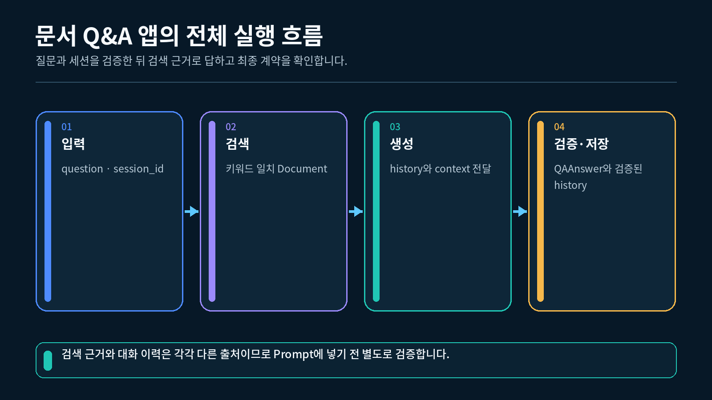
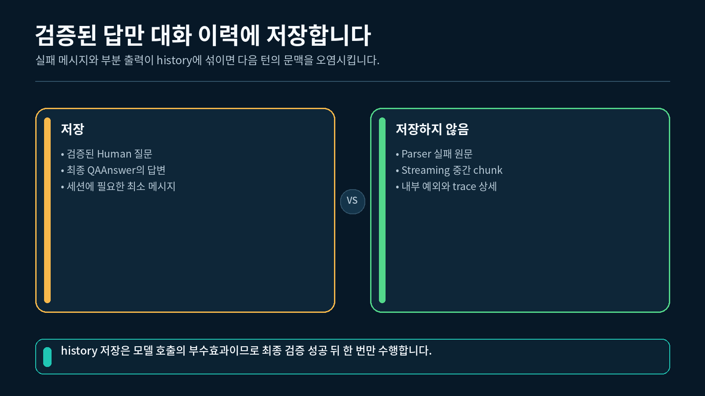
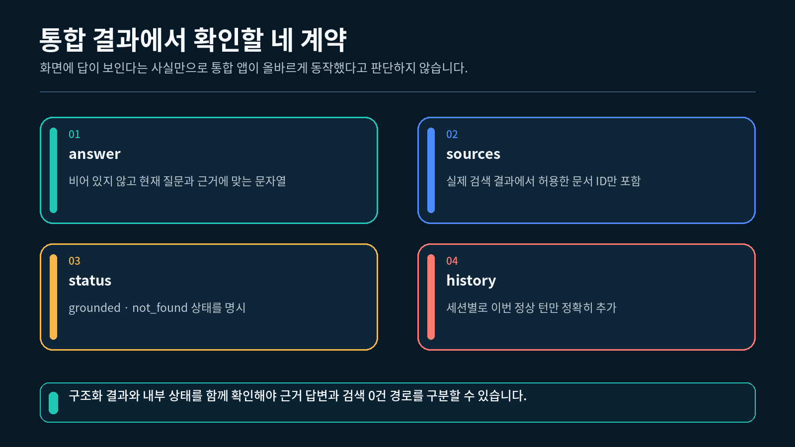

## 1. 문서 Q&A 앱의 전체 실행 흐름

이번 앱은 질문을 받자마자 모델부터 호출하지 않습니다. 입력 확인, 검색, Prompt 구성, 구조화 검증, 출처 검증, 대화 저장의 순서를 지킵니다.

질문 입력부터 구조화 답변까지 이어지는 문서 Q&A 실행 흐름



| 순서 | 단계 | 핵심 결과 |
| --- | --- | --- |
| 1 | 입력 확인 | 비어 있지 않은 질문과 `session_id` |
| 2 | 문서 검색 | 관련 `Document` 목록 |
| 3 | 검색 0건 확인 | 모델 호출 또는 `not_found` 종료 |
| 4 | 대화 조회 | 현재 세션의 최근 메시지 |
| 5 | Prompt 구성 | 질문, History, context |
| 6 | Model·Parser | `QAResponse` |
| 7 | 출처 검증 | 검색 결과 안의 문서 ID |
| 8 | 대화 저장 | 검증된 질문과 답변 |
| 9 | UI 표시 | 답변 문자열 조각 |

검색 결과가 없으면 3단계에서 끝납니다. 이때 모델은 호출하지 않고 출처가 없는 `not_found` 결과를 반환합니다.

### 한 질문의 입력

```python
# 앱이 한 질문을 처리할 때 사용할 세션 식별자를 준비합니다.
session_id = "student-a"

# 수업 문서에서 근거를 찾을 질문을 준비합니다.
question = "Retriever는 문서를 어떻게 검색하나요?"

# 입력 경계에서 공백만 있는 값을 먼저 차단합니다.
if not session_id.strip() or not question.strip():
    raise ValueError("session_id와 질문은 비어 있지 않아야 합니다.")

# 검증을 통과한 두 입력을 확인합니다.
print(session_id)
print(question)
```

```
student-a
Retriever는 문서를 어떻게 검색하나요?
```

입력 검사는 검색과 모델 실행 전에 끝나야 불필요한 작업을 피할 수 있습니다.

---

## 2. 모든 경로가 사용하는 QAResponse 설계하기

정상 답변과 검색 실패 답변이 서로 다른 자료형이면 호출하는 쪽에서 매번 분기해야 합니다. 이번 실습은 두 경로를 하나의 Pydantic 모델로 표현합니다.

### 세 필드의 역할

| 필드 | 자료형 | 역할 |
| --- | --- | --- |
| `status` | `"grounded"` 또는 `"not_found"` | 검색 근거 사용 여부 |
| `answer` | `str` | 사용자에게 보여 줄 최종 답변 |
| `sources` | `list[str]` | 사용한 문서 ID 목록 |

### 상태와 출처의 업무 규칙

```python
# 허용된 상태 문자열을 표시하기 위해 Literal을 가져옵니다.
from typing import Literal

# 구조화 응답과 객체 단위 검증기를 가져옵니다.
from pydantic import BaseModel, model_validator

# 모든 종료 경로가 사용하는 구조화 결과를 정의합니다.
class QAResponse(BaseModel):
    """문서 Q&A 앱의 상태, 답변, 출처를 저장합니다."""

    # 검색 근거가 있는지 상태 문자열로 구분합니다.
    status: Literal["grounded", "not_found"]

    # 사용자가 읽을 최종 답변을 저장합니다.
    answer: str

    # 실제 답변에 사용한 문서 ID를 저장합니다.
    sources: list[str]

    # status와 sources의 조합이 서로 모순되지 않는지 확인합니다.
    @model_validator(mode="after")
    def validate_sources(self) -> "QAResponse":
        """상태별 출처 규칙을 검사합니다."""

        # 근거 기반 답변에는 하나 이상의 출처가 필요합니다.
        if self.status == "grounded" and not self.sources:
            raise ValueError("grounded 결과에는 하나 이상의 출처가 필요합니다.")

        # 검색 실패 답변은 사용하지 않은 출처를 주장할 수 없습니다.
        if self.status == "not_found" and self.sources:
            raise ValueError("not_found 결과에는 출처를 넣을 수 없습니다.")

        # 두 규칙을 통과한 현재 객체를 반환합니다.
        return self
```

### 두 정상 조합

```python
# 검색 근거와 출처가 함께 있는 정상 답변을 만듭니다.
grounded = QAResponse(
    status="grounded",
    answer="Retriever는 관련 문서를 찾습니다.",
    sources=["doc-003"],
)

# 검색 결과가 없을 때 출처가 없는 안내 답변을 만듭니다.
not_found = QAResponse(
    status="not_found",
    answer="관련 근거를 찾지 못했습니다.",
    sources=[],
)

# 두 결과의 상태와 출처 개수를 확인합니다.
print(grounded.status, len(grounded.sources))
print(not_found.status, len(not_found.sources))
```

```
grounded 1
not_found 0
```

Pydantic 검증은 JSON 모양만 확인하는 것이 아니라 앱에서 정한 상태와 출처의 관계도 확인합니다.

---

## 3. 제공 뼈대로 문서 검색 준비하기

이 절의 문서 생성, 키워드 점수 계산, context 변환 함수는 **제공 뼈대**입니다. 수강생이 긴 보조 함수를 처음부터 모두 작성하기보다 각 함수의 입력·출력과 호출 순서를 읽는 데 집중합니다.

완성 실습에는 LCEL, Memory, Retriever를 설명하는 짧은 문서 세 개가 코드 안에 들어 있습니다.

### Document 한 개의 구조

```python
# 본문과 metadata를 함께 저장할 Document를 가져옵니다.
from langchain_core.documents import Document

# Retriever 개념을 설명하는 수업 문서를 만듭니다.
document = Document(
    # 모델이 참고할 실제 설명 문장을 본문으로 저장합니다.
    page_content="Retriever는 질문과 관련된 외부 Document를 찾아 반환합니다.",

    # 검색과 출처 검증에 사용할 부가 정보를 저장합니다.
    metadata={
        # 구조화 응답의 sources와 비교할 식별자입니다.
        "document_id": "doc-003",
        # Prompt에서 문서 주제를 보여 줄 제목입니다.
        "title": "Retriever 기초",
        # 질문과 문서의 관련성을 계산할 작은 검색 단서입니다.
        "keywords": [
            "retriever",
            "검색",
            "document",
            "문서",
        ],
    },
)

# 검색 결과와 답변 출처에서 공통으로 사용할 문서 ID를 확인합니다.
print(document.metadata["document_id"])
```

```
doc-003
```

### 키워드 검색의 계약

`search_documents(question, documents, top_k=2)`는 질문에 포함된 metadata 키워드 수를 계산합니다. 점수가 1 이상인 문서만 점수순으로 반환하고, 같은 점수에서는 원래 문서 순서를 유지합니다.

```python
# 질문과 문서 목록을 준비하는 제공 함수를 호출합니다.
documents = build_documents()

# Retriever 질문과 관련된 문서를 최대 두 개 검색합니다.
found_documents = search_documents(
    "Retriever는 문서를 어떻게 검색하나요?",
    documents,
    top_k=2,
)

# 검색된 문서 ID를 순서대로 모읍니다.
found_ids = [
    str(document.metadata["document_id"])
    for document in found_documents
]

# 실제 검색 결과의 문서 ID를 출력합니다.
print(found_ids)
```

```
['doc-003']
```

### Prompt용 context 만들기

```python
# 검색된 문서의 ID, 제목, 본문을 Prompt용 문자열로 변환합니다.
context = format_context(found_documents)

# context에 출처 검증에 사용할 문서 ID가 포함되는지 확인합니다.
print("doc-003" in context)
```

```
True
```

키워드 검색은 통합 흐름을 재현하기 위한 작은 예제입니다. 검색 품질을 높이는 별도 기법은 이 강의의 범위가 아닙니다.

---

## 4. 제공 뼈대로 Prompt·Model·Parser 연결하기

이 절의 Prompt 생성과 오프라인·실제 모델 선택 코드도 **제공 뼈대**입니다. 수강생은 `history`, `context`, `question` 세 값이 어디에서 만들어지고 `QAResponse`가 어디에서 검증되는지 추적합니다.

### Prompt가 받는 세 값

```python
# Parser의 스키마 안내를 Prompt에 넣을 수 있도록 문자열로 가져옵니다.
format_instructions = parser.get_format_instructions()

# 역할이 분리된 문서 Q&A Prompt를 만듭니다.
prompt = ChatPromptTemplate.from_messages(
    [
        # 모든 질문에 공통으로 적용할 답변 역할과 형식을 지정합니다.
        (
            "system",
            "문서 근거 안에서 답하고 사용한 문서 ID를 sources에 넣으세요. "
            "다음 출력 형식을 지키세요.\n{format_instructions}",
        ),
        # 실행마다 달라지는 대화, 문서, 질문의 위치를 지정합니다.
        (
            "human",
            "이전 대화:\n{history}\n\n"
            "문서 근거:\n{context}\n\n"
            "현재 질문:\n{question}",
        ),
    ]
).partial(
    # 실행마다 바뀌지 않는 스키마 안내를 미리 고정합니다.
    format_instructions=format_instructions
)
```

`history`는 현재 세션의 앞선 대화이고, `context`는 현재 질문으로 검색한 외부 문서입니다. 두 값은 서로 대신할 수 없습니다.

### 오프라인 체인의 역할

API Key가 없으면 `build_offline_chain()`이 Prompt에 들어 있는 문서 ID를 읽어 결정적인 JSON 응답을 만듭니다. 반환 흐름은 실제 체인과 같은 `Prompt → Model 역할 → Pydantic Parser`입니다.

```python
# API Key 없이 사용할 결정적인 답변 체인을 만듭니다.
answer_chain = build_offline_chain()

# Retriever 문서, 이전 대화, 현재 질문을 같은 입력 계약으로 전달합니다.
result = answer_chain.invoke(
    {
        "history": "이전 대화 없음",
        "context": (
            "[doc-003 | Retriever 기초]\n"
            "Retriever는 질문과 관련된 외부 Document를 찾아 반환합니다."
        ),
        "question": "Retriever는 어떤 역할을 하나요?",
    }
)

# Parser가 만든 구조화 결과의 핵심 값을 확인합니다.
print(result.status)
print(result.sources)
```

```
grounded
['doc-003']
```

### 실제 모델 체인의 교체 지점

API Key가 있으면 `build_live_chain()`이 `ChatOpenAI`를 사용합니다. 두 함수는 모두 `dict[str, str]`을 받아 `QAResponse`를 반환하므로 `DocumentQAApp`은 어느 체인인지 알 필요가 없습니다.

```python
# 실제 OpenAI 모델을 같은 입출력 계약에 연결합니다.
model = ChatOpenAI(
    api_key=api_key,
    model=model_name,
    # 한 요청이 오래 멈추지 않도록 제한 시간을 둡니다.
    timeout=20,
    # 9장에서 설계한 바깥 Retry와 요청 수가 겹치지 않도록 끕니다.
    max_retries=0,
    # OpenAI Responses API 사용을 명시합니다.
    use_responses_api=True,
)
```

`max_retries=0`은 이 모델 클라이언트가 한 번의 `invoke()` 안에서 HTTP 요청을 자동으로 다시 시도하지 않게 합니다. Retry가 필요하다면 9장에서 배운 것처럼 실패 가능한 모델 단계 바깥에 제한 정책을 한 번만 적용합니다.

---

## 5. 세션 History와 검색 근거 구분하기

앱은 `session_id`별로 `InMemoryChatMessageHistory`를 따로 저장합니다. 검색 문서는 여러 사용자가 함께 참고할 외부 지식이고, History는 한 세션에서 앞서 주고받은 메시지입니다.



세션 대화 기록과 외부 문서 검색이 서로 다른 입력으로 합쳐지는 구조

### 세션별 저장소 만들기

```python
# 인메모리 대화 기록 클래스를 가져옵니다.
from langchain_core.chat_history import InMemoryChatMessageHistory

# session_id별 History 객체를 저장할 빈 딕셔너리를 만듭니다.
histories: dict[str, InMemoryChatMessageHistory] = {}

# 같은 session_id에 같은 History를 반환하는 함수를 정의합니다.
def get_history(session_id: str) -> InMemoryChatMessageHistory:
    """세션별 History를 가져오거나 새로 만듭니다."""

    # 처음 보는 세션이면 비어 있는 History를 저장합니다.
    if session_id not in histories:
        # 다른 세션과 공유하지 않는 새 History 객체를 만듭니다.
        histories[session_id] = InMemoryChatMessageHistory()

    # 현재 세션에 대응하는 History를 반환합니다.
    return histories[session_id]
```

### 최근 네 메시지만 Prompt에 넣기

완성 실습의 `format_history()`는 메시지가 없으면 `"이전 대화 없음"`을 반환하고, 메시지가 있으면 최근 네 개만 역할과 함께 문자열로 바꿉니다.

```python
# 현재 세션의 전체 메시지에서 최근 네 개만 선택합니다.
recent_messages = messages[-4:]

# Human과 AI 역할을 화면에서 읽을 이름으로 바꿉니다.
lines = [
    (
        f"{'사용자' if isinstance(message, HumanMessage) else '도우미'}: "
        f"{message.content}"
    )
    for message in recent_messages
]

# 메시지 순서를 유지한 문자열을 Prompt 입력으로 만듭니다.
history_text = "\n".join(lines)
```

세션 A의 History는 세션 B의 Prompt에 들어가지 않습니다. 반면 같은 문서 목록은 두 세션의 Retriever가 함께 사용할 수 있습니다.

---

## 6. 검색 출처 검증 뒤 대화 저장하기

모델이 `sources=["doc-999"]`를 반환했다고 해서 해당 문서를 실제로 검색했다는 뜻은 아닙니다. 앱은 모델이 주장한 출처와 Retriever가 반환한 문서 ID를 대조합니다.

구조화 응답의 sources를 실제 검색 문서 ID와 대조하는 과정



### 허용된 출처 집합 만들기

```python
# 현재 질문에서 실제로 검색된 문서 ID만 집합으로 만듭니다.
allowed_sources = {
    # metadata의 문서 ID를 비교하기 쉬운 문자열로 통일합니다.
    str(document.metadata["document_id"])
    for document in found_documents
}

# 구조화 결과의 모든 출처가 검색 결과 안에 있는지 확인합니다.
if not set(result.sources).issubset(allowed_sources):
    raise ValueError(
        "응답 출처가 실제 검색 결과와 일치하지 않습니다."
    )
```

집합의 `issubset()`은 모델 출처에 검색하지 않은 ID가 하나라도 섞였는지 확인합니다.

### 검증 뒤에만 저장하기

```python
# 입력, 검색, 구조화 출력, 출처 검증을 모두 통과한 History를 가져옵니다.
history = app.get_history("student-a")

# 검증된 현재 질문과 최종 답변만 같은 세션에 저장합니다.
history.add_messages(
    [
        # 현재 질문을 Human 역할 메시지로 저장합니다.
        HumanMessage(
            content="Retriever는 문서를 어떻게 검색하나요?"
        ),
        # 검증된 최종 답변을 AI 역할 메시지로 저장합니다.
        AIMessage(
            content="Retriever는 질문과 관련된 외부 문서를 찾습니다."
        ),
    ]
)

# 한 번의 질문과 답변이 두 메시지로 저장되었는지 확인합니다.
print(len(history.messages))
```

```
2
```

검색 결과가 없는 `not_found` 경로는 완성 실습에서 History를 새로 만들거나 메시지를 저장하지 않습니다.

---

## 7. 검증된 답변을 UI 표시용 조각으로 나누기

`stream_validated_answer()`는 모델 토큰 스트리밍 함수가 아닙니다. Model과 Parser 실행, `QAResponse` 검증, 출처 검증이 모두 끝난 **완성된 답변 문자열**을 VS Code 터미널에 점진적으로 보여 주기 위해 단어 단위로 나누는 UI 표시 함수입니다.

### 표시용 generator

```python
# 순서대로 문자열 조각을 내보내는 자료형을 가져옵니다.
from collections.abc import Iterator

# 검증이 끝난 답변을 화면 표시용 작은 문자열로 나눕니다.
def stream_validated_answer(answer: str) -> Iterator[str]:
    """완성된 답변의 단어를 공백과 함께 차례대로 반환합니다."""

    # 단어 사이의 공백을 유지하도록 각 단어 뒤에 공백을 붙입니다.
    for word in answer.split():
        yield f"{word} "
```

### 검증 뒤 표시하기

```python
# 이미 구조화 검증과 출처 검증을 통과한 답변 문자열을 준비합니다.
validated_answer = "Retriever는 관련 문서를 찾습니다."

# UI 표시용 조각을 도착 순서대로 출력합니다.
for chunk in stream_validated_answer(validated_answer):
    print(
        chunk,
        end="",
        flush=True,
    )

# 다음 터미널 출력이 새 줄에서 시작되도록 줄바꿈합니다.
print()
```

```
Retriever는 관련 문서를 찾습니다.
```

화면에는 점진적으로 나타나지만 모델 응답은 이미 완성된 상태입니다. 8장의 모델 응답 스트리밍과 실행 시점이 다르다는 점을 구분해야 합니다.

---

## 8. 완성 실습 실행하기

완성 실습은 기본적으로 API Key 유무에 따라 실행 모드를 선택합니다.

| 조건 | 선택 체인 | 모델 호출 |
| --- | --- | --- |
| `OPENAI_API_KEY` 없음 | `build_offline_chain()` | 없음 |
| `OPENAI_API_KEY` 있음 | `build_live_chain()` | 실제 호출 시도 |

두 모드 모두 같은 `QAResponse`를 반환하므로 검색, 출처 검증, History 저장, UI 표시 코드는 바뀌지 않습니다.

환경변수에 문자열이 있다는 사실은 인증 성공을 뜻하지 않습니다. live 모드가 성공하려면 프로젝트 API Key가 유효하고, OpenAI Platform의 결제·사용 한도와 `.env`의 `OPENAI_MODEL`에 지정한 모델 사용 권한이 준비되어 있어야 합니다. 기본 권장 모델은 `gpt-5.6-luna`이며 공식 모델 안내에서 지원 기능을 확인할 수 있습니다. ChatGPT Plus·Pro 같은 구독과 OpenAI API 과금은 별도입니다.

실제 과금을 원하지 않는 반복 학습이나 자동 검사에서는 현재 터미널 환경변수와 `.env` 파일 양쪽에 `OPENAI_API_KEY`가 없는지 확인한 뒤 실행해 `mode=offline`을 확인합니다. 터미널에서만 키를 제거해도 `load_dotenv()`가 `.env`의 키를 다시 읽으면 live 모드가 선택됩니다. 비밀 키는 코드·교안·출력에 직접 적지 않고 `.env` 또는 안전한 환경변수에만 저장합니다.

### VS Code 터미널에서 실행하기

1-2강에서 만든 `pyproject.toml`과 `uv.lock`이 있는 프로젝트의 하위 폴더에 `실습.py`를 두고, 해당 폴더에서 실행합니다. VS Code 인터프리터는 이 프로젝트의 `.venv` (Python 3.12)를 선택합니다.

```bash
uv run python 실습.py
```
"""10-2강: Retriever, 세션 History, 구조화 출력을 연결한 문서 Q&A 앱입니다."""

from __future__ import annotations

import json
import os
from collections.abc import Iterator
from typing import Literal

from dotenv import load_dotenv
from langchain_core.chat_history import InMemoryChatMessageHistory
from langchain_core.documents import Document
from langchain_core.messages import AIMessage, BaseMessage, HumanMessage
from langchain_core.output_parsers import PydanticOutputParser
from langchain_core.prompts import ChatPromptTemplate
from langchain_core.runnables import Runnable, RunnableLambda
from langchain_openai import ChatOpenAI
from pydantic import BaseModel, model_validator


# .env에 모델명이 없을 때 이전 장과 같은 수업 모델을 사용합니다.
DEFAULT_MODEL = "gpt-5-nano"


class QAResponse(BaseModel):
    """문서 Q&A 앱이 모든 경로에서 반환하는 구조화 결과입니다."""

    # 근거 답변인지 검색 실패인지 현재 상태를 구분합니다.
    status: Literal["grounded", "not_found"]

    # 사용자가 읽을 최종 답변 문자열을 저장합니다.
    answer: str

    # 실제 검색 결과에서 사용한 문서 ID만 저장합니다.
    sources: list[str]

    @model_validator(mode="after")
    def validate_sources(self) -> "QAResponse":
        """grounded 결과에는 출처가 있고 not_found 결과에는 출처가 없는지 확인합니다."""

        # 근거 기반 답변인데 출처가 없으면 구조화 계약을 통과시키지 않습니다.
        if self.status == "grounded" and not self.sources:
            raise ValueError("grounded 결과에는 하나 이상의 출처가 필요합니다.")

        # 검색 실패 결과가 출처를 주장하면 서로 모순이므로 차단합니다.
        if self.status == "not_found" and self.sources:
            raise ValueError("not_found 결과에는 출처를 넣을 수 없습니다.")

        # 두 업무 규칙을 통과한 현재 객체를 그대로 반환합니다.
        return self


def build_documents() -> list[Document]:
    """실습에서 검색할 짧은 LangChain 문서 세 개를 반환합니다."""

    # 각 문서는 본문과 검색용 키워드, 표시용 ID를 함께 가집니다.
    return [
        Document(
            page_content="LCEL은 Runnable 단계를 pipe 연산자로 연결하는 표현식입니다.",
            metadata={
                "document_id": "doc-001",
                "title": "LCEL 기초",
                "keywords": ["lcel", "pipe", "runnable"],
            },
        ),
        Document(
            page_content="Memory는 현재 세션의 이전 대화 메시지를 다음 요청에 전달합니다.",
            metadata={
                "document_id": "doc-002",
                "title": "Memory 기초",
                "keywords": ["memory", "history", "세션", "대화"],
            },
        ),
        Document(
            page_content="Retriever는 질문과 관련된 외부 Document를 찾아 반환합니다.",
            metadata={
                "document_id": "doc-003",
                "title": "Retriever 기초",
                "keywords": ["retriever", "검색", "document", "문서"],
            },
        ),
    ]


def search_documents(
    question: str,
    documents: list[Document],
    *,
    top_k: int = 2,
) -> list[Document]:
    """질문에 포함된 metadata 키워드 수로 관련 문서를 검색합니다."""

    # 대소문자 차이 없이 비교하기 위해 질문을 소문자로 바꿉니다.
    normalized_question = question.lower()

    # 같은 점수에서는 원래 문서 순서를 유지할 수 있도록 위치도 함께 저장합니다.
    scored: list[tuple[int, int, Document]] = []

    # 모든 문서의 키워드와 질문을 비교합니다.
    for index, document in enumerate(documents):
        # metadata의 keywords가 리스트가 아니면 검색 단서가 없는 문서로 처리합니다.
        keywords = document.metadata.get("keywords", [])

        # 질문에 실제로 포함된 키워드 개수를 계산합니다.
        score = sum(
            1
            for keyword in keywords
            if str(keyword).lower() in normalized_question
        )

        # 하나 이상의 키워드가 일치한 문서만 결과 후보에 넣습니다.
        if score > 0:
            scored.append((score, index, document))

    # 점수는 큰 값부터, 같은 점수에서는 원래 문서 순서대로 정렬합니다.
    scored.sort(
        key=lambda item: (-item[0], item[1])
    )

    # 설정한 최대 개수만 Document 목록으로 반환합니다.
    return [
        document
        for _score, _index, document in scored[:top_k]
    ]


def format_context(documents: list[Document]) -> str:
    """검색 문서의 ID, 제목, 본문을 Prompt용 문자열로 변환합니다."""

    # 문서별 문자열을 검색 순서대로 저장합니다.
    sections: list[str] = []

    # 각 Document에서 필요한 metadata와 본문을 읽습니다.
    for document in documents:
        # 결과 검증에 사용할 문서 ID를 읽습니다.
        document_id = str(document.metadata["document_id"])

        # 모델이 근거의 주제를 알 수 있도록 제목을 읽습니다.
        title = str(document.metadata["title"])

        # 문서 사이를 구분할 수 있는 형식으로 문자열을 만듭니다.
        sections.append(
            f"[{document_id} | {title}]\n{document.page_content}"
        )

    # 여러 문서 사이에 빈 줄을 넣어 하나의 context로 합칩니다.
    return "\n\n".join(sections)


def format_history(messages: list[BaseMessage]) -> str:
    """최근 네 개 메시지를 역할과 내용이 보이는 짧은 문자열로 바꿉니다."""

    # 대화가 아직 없다면 명시적인 안내 문자열을 반환합니다.
    if not messages:
        return "이전 대화 없음"

    # 너무 긴 맥락을 피하기 위해 가장 최근 네 메시지만 사용합니다.
    recent_messages = messages[-4:]

    # Human과 AI 역할을 사람이 읽기 쉬운 이름으로 바꿉니다.
    lines = [
        (
            f"{'사용자' if isinstance(message, HumanMessage) else '도우미'}: "
            f"{message.content}"
        )
        for message in recent_messages
    ]

    # 메시지 순서를 유지한 채 줄바꿈으로 연결합니다.
    return "\n".join(lines)


def build_prompt(parser: PydanticOutputParser) -> ChatPromptTemplate:
    """검색 근거와 대화 기록을 받는 구조화 출력 Prompt를 만듭니다."""

    # Parser의 현재 스키마 안내를 Prompt 변수로 고정합니다.
    format_instructions = parser.get_format_instructions()

    # system과 human 역할을 분리한 메시지 기반 Prompt를 만듭니다.
    return ChatPromptTemplate.from_messages(
        [
            (
                "system",
                "당신은 수업 문서 Q&A 도우미입니다. "
                "문서 근거 안에서만 답하고 사용한 문서 ID를 sources에 넣으세요. "
                "다음 출력 형식을 지키세요.\n{format_instructions}",
            ),
            (
                "human",
                "이전 대화:\n{history}\n\n"
                "문서 근거:\n{context}\n\n"
                "현재 질문:\n{question}",
            ),
        ]
    ).partial(
        format_instructions=format_instructions
    )


def build_offline_chain() -> Runnable[dict[str, str], QAResponse]:
    """API Key 없이도 앱 연결을 확인할 수 있는 결정적 모델 체인을 만듭니다."""

    # 실제 모델 출력과 같은 JSON 문자열을 검사할 Parser를 만듭니다.
    parser = PydanticOutputParser(
        pydantic_object=QAResponse
    )

    # 실제 수업과 같은 Prompt 객체를 준비합니다.
    prompt = build_prompt(parser)

    def offline_model(prompt_value) -> AIMessage:
        """Prompt에 포함된 문서 ID를 읽어 고정된 구조화 응답을 만듭니다."""

        # 렌더링된 Prompt 전체를 문자열로 읽습니다.
        prompt_text = prompt_value.to_string()

        # Retriever 문서가 있으면 해당 문서 ID를 출처로 사용하는 답변을 만듭니다.
        if "doc-003" in prompt_text:
            payload = {
                "status": "grounded",
                "answer": "Retriever는 질문과 관련된 외부 문서를 찾습니다.",
                "sources": ["doc-003"],
            }
        elif "doc-002" in prompt_text:
            # Memory 질문에는 세션 대화 문서를 근거로 사용합니다.
            payload = {
                "status": "grounded",
                "answer": "Memory는 현재 세션의 이전 대화를 다음 요청에 전달합니다.",
                "sources": ["doc-002"],
            }
        else:
            # 다른 문서가 검색되면 첫 문서 ID를 사용하는 짧은 답변을 만듭니다.
            payload = {
                "status": "grounded",
                "answer": "LCEL은 Runnable 단계를 연결합니다.",
                "sources": ["doc-001"],
            }

        # 실제 ChatModel처럼 JSON 문자열을 가진 AIMessage를 반환합니다.
        return AIMessage(
            content=json.dumps(
                payload,
                ensure_ascii=False,
            )
        )

    # Prompt, 오프라인 모델, Pydantic Parser를 실제 LCEL 순서로 연결합니다.
    return prompt | RunnableLambda(offline_model) | parser


def build_live_chain(
    *,
    api_key: str,
    model_name: str,
) -> Runnable[dict[str, str], QAResponse]:
    """OpenAI ChatModel과 Pydantic Parser를 연결한 실제 호출 체인을 만듭니다."""

    # 모델의 JSON 문자열을 QAResponse로 검증할 Parser를 만듭니다.
    parser = PydanticOutputParser(
        pydantic_object=QAResponse
    )

    # 검색 근거, History, 질문을 받는 Prompt를 만듭니다.
    prompt = build_prompt(parser)

    # 바깥 Retry 정책과 실제 요청 횟수가 겹치지 않도록 내부 재시도를 끕니다.
    model = ChatOpenAI(
        api_key=api_key,
        model=model_name,
        # 한 번의 실제 요청이 오래 멈추지 않도록 제한 시간을 둡니다.
        timeout=20,
        # 이 체인에서는 모델 클라이언트 내부 자동 Retry를 사용하지 않습니다.
        max_retries=0,
        # OpenAI Responses API 사용을 명시해 호출 경계를 고정합니다.
        use_responses_api=True,
    )

    # 모델이 생성한 JSON을 최종 Pydantic 객체로 검증합니다.
    return prompt | model | parser


class DocumentQAApp:
    """문서 검색, 세션 History, 구조화 모델 체인을 연결합니다."""

    def __init__(
        self,
        *,
        documents: list[Document],
        answer_chain: Runnable[dict[str, str], QAResponse],
    ) -> None:
        """문서 목록과 답변 체인, 빈 세션 저장소를 준비합니다."""

        # 검색할 문서 목록을 앱 객체에 저장합니다.
        self.documents = documents

        # Prompt, Model, Parser가 연결된 답변 체인을 저장합니다.
        self.answer_chain = answer_chain

        # session_id별 대화 기록을 분리할 딕셔너리를 준비합니다.
        self.histories: dict[str, InMemoryChatMessageHistory] = {}

    def get_history(self, session_id: str) -> InMemoryChatMessageHistory:
        """session_id에 해당하는 History를 가져오거나 새로 만듭니다."""

        # 처음 보는 session_id라면 비어 있는 History 객체를 저장합니다.
        if session_id not in self.histories:
            self.histories[session_id] = InMemoryChatMessageHistory()

        # 같은 session_id에는 같은 History 객체를 반환합니다.
        return self.histories[session_id]

    def ask(self, *, session_id: str, question: str) -> QAResponse:
        """검색 결과와 현재 세션 대화를 반영해 구조화 답변을 반환합니다."""

        # 빈 session_id는 서로 다른 사용자의 기록을 섞을 수 있으므로 차단합니다.
        if not session_id.strip():
            raise ValueError("session_id는 비어 있지 않아야 합니다.")

        # 빈 질문은 Retriever와 모델을 실행하기 전에 차단합니다.
        if not question.strip():
            raise ValueError("질문은 비어 있지 않아야 합니다.")

        # 현재 질문과 관련된 외부 문서를 먼저 검색합니다.
        found_documents = search_documents(
            question,
            self.documents,
        )

        # 검색 결과가 없으면 모델 호출 없이 결정적인 결과를 반환합니다.
        if not found_documents:
            return QAResponse(
                status="not_found",
                answer="제공된 문서에서 관련 근거를 찾지 못했습니다.",
                sources=[],
            )

        # 현재 세션의 이전 메시지를 가져옵니다.
        history = self.get_history(session_id)

        # Prompt에 전달할 질문, 대화 기록, 문서 근거를 만듭니다.
        chain_input = {
            "question": question,
            "history": format_history(
                list(history.messages)
            ),
            "context": format_context(found_documents),
        }

        # 준비한 세 값을 모델 체인에 전달해 Pydantic 결과를 받습니다.
        result = self.answer_chain.invoke(chain_input)

        # 모델이 주장한 sources가 실제 검색 결과 안에 있는지 확인합니다.
        allowed_sources = {
            str(document.metadata["document_id"])
            for document in found_documents
        }

        # 검색하지 않은 문서 ID가 포함되면 대화 기록 전에 오류로 중단합니다.
        if not set(result.sources).issubset(allowed_sources):
            raise ValueError("응답 출처가 실제 검색 결과와 일치하지 않습니다.")

        # 검증을 모두 통과한 질문과 답변만 현재 세션에 저장합니다.
        history.add_messages(
            [
                HumanMessage(content=question),
                AIMessage(content=result.answer),
            ]
        )

        # 화면 출력에 사용할 최종 구조화 결과를 반환합니다.
        return result


def stream_validated_answer(answer: str) -> Iterator[str]:
    """검증이 끝난 답변을 VS Code 터미널에 표시할 작은 문자열로 나눕니다."""

    # 단어 사이 공백을 보존할 수 있도록 각 단어 뒤에 공백을 붙입니다.
    for word in answer.split():
        yield f"{word} "


def main() -> None:
    """API 설정에 따라 실제 또는 오프라인 체인으로 문서 Q&A를 실행합니다."""

    # 실습 폴더나 상위 폴더의 .env 환경변수를 불러옵니다.
    load_dotenv()

    # 실제 OpenAI 호출에 사용할 API Key를 환경변수에서 읽습니다.
    api_key = os.getenv("OPENAI_API_KEY")

    # 모델명을 따로 지정하지 않으면 수업 기본 모델을 사용합니다.
    model_name = os.getenv("OPENAI_MODEL", DEFAULT_MODEL)

    # API Key가 있으면 실제 ChatModel 체인을 사용합니다.
    if api_key:
        answer_chain = build_live_chain(
            api_key=api_key,
            model_name=model_name,
        )
        mode = "live"
    else:
        # API Key가 없으면 같은 입출력 계약의 오프라인 체인을 사용합니다.
        answer_chain = build_offline_chain()
        mode = "offline"

    # 문서 목록과 선택된 답변 체인을 하나의 앱으로 연결합니다.
    app = DocumentQAApp(
        documents=build_documents(),
        answer_chain=answer_chain,
    )

    # 검색 결과가 존재하는 Retriever 질문을 한 건 실행합니다.
    result = app.ask(
        session_id="student-a",
        question="Retriever는 문서를 어떻게 검색하나요?",
    )

    # 실행 모드와 구조화 결과의 주요 필드를 출력합니다.
    print(f"mode={mode}")
    print(f"status={result.status}")
    print(f"sources={','.join(result.sources)}")
    print("answer=", end="")

    # 검증된 답변을 작은 문자열로 나누어 터미널에 점진적으로 표시합니다.
    for chunk in stream_validated_answer(result.answer):
        print(chunk, end="", flush=True)

    # 다음 터미널 출력이 새 줄에서 시작되도록 줄바꿈을 추가합니다.
    print()


if __name__ == "__main__":
    # VS Code 터미널에서 파일을 직접 실행할 때만 문서 Q&A를 시작합니다.
    main()

### API Key가 없을 때의 예상 출력

```
mode=offline
status=grounded
sources=doc-003
answer=Retriever는 질문과 관련된 외부 문서를 찾습니다.
```

마지막 답변은 `stream_validated_answer()`가 단어 뒤 공백을 붙여 UI에 표시합니다. 이는 출력 모양을 점진적으로 보여 주는 처리이며 모델 토큰이 생성되는 즉시 전달하는 방식은 아닙니다.

live 모드에서 `mode=live`가 출력되기 전에 인증·결제·한도·네트워크 오류가 발생할 수 있습니다. 즉, API Key 존재는 live 체인을 선택하는 조건일 뿐 성공 판정이 아닙니다. 실제 구조화 답변이 반환되고 출처 검증까지 통과해야 앱 실행이 성공한 것입니다.

### 완성 실습의 핵심 호출

아래는 제공된 `실습.py`의 호출 부분입니다. 같은 파일에 정의된 `DocumentQAApp`, `build_documents`, 답변 체인 생성 함수를 함께 사용합니다.

```python
# 문서와 선택한 답변 체인을 하나의 앱 객체에 연결합니다.
app = DocumentQAApp(
    documents=build_documents(),
    answer_chain=answer_chain,
)

# 검색 결과가 있는 질문을 한 건 실행합니다.
result = app.ask(
    session_id="student-a",
    question="Retriever는 문서를 어떻게 검색하나요?",
)

# 구조화 결과의 상태와 출처를 확인합니다.
print(result.status)
print(result.sources)
```

`app.ask()` 안에서 입력 확인, 검색, History 조회, 체인 호출, 출처 검사, 대화 저장이 순서대로 실행됩니다.