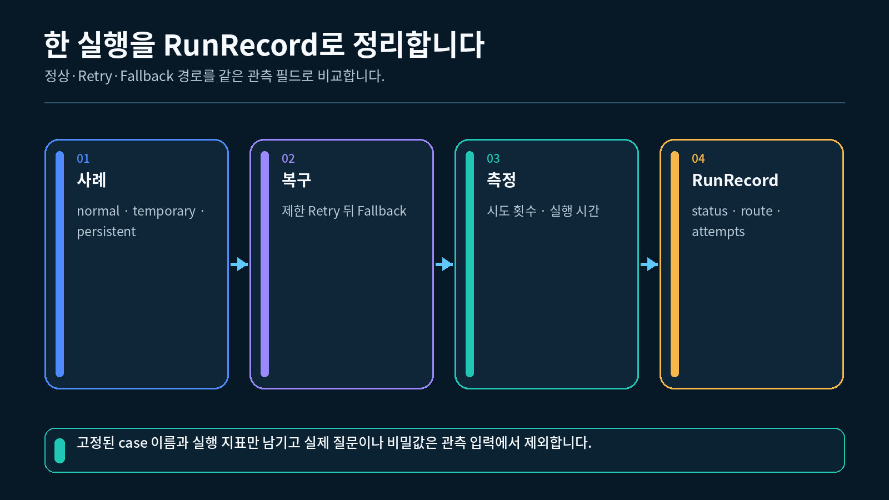
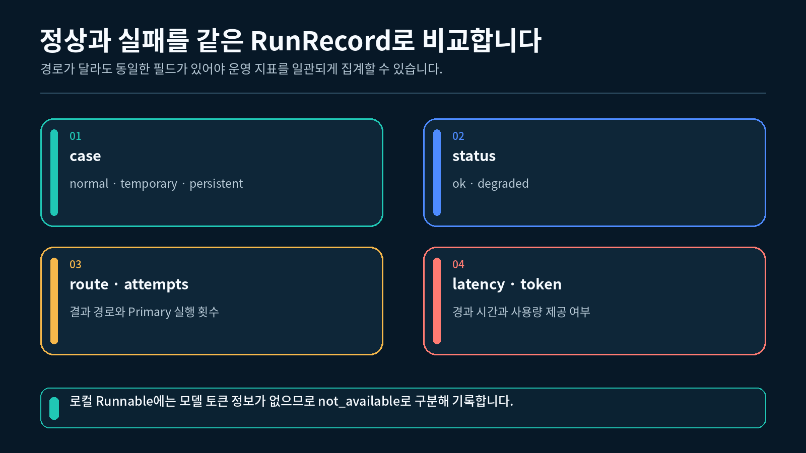

## 1. 관측과 오류 대응의 역할 구분하기

오류 대응은 실패가 발생했을 때 다음 행동을 결정합니다. 관측은 그 결정이 실제로 어떻게 실행되었는지 확인할 수 있는 기록을 남깁니다. 두 역할을 섞지 않으면 앱의 제어 정책과 관측 도구를 각각 바꾸기 쉬워집니다.

| 구성 요소 | 역할 | 앱 결과를 결정하는가 |
| --- | --- | --- |
| `with_retry()` | 지정한 오류에서 Primary를 제한적으로 다시 실행 | 예 |
| `with_fallbacks()` | Retry가 소진되면 대체 결과를 반환 | 예 |
| `RunRecord` | 최종 경로와 Primary 시도 횟수를 로컬에 기록 | 아니요 |
| Langfuse Callback | 같은 Runnable 실행 이벤트를 선택적으로 관찰 | 아니요 |
| `choose_orchestration()` | 요구사항을 LCEL과 LangGraph 경계에 대조 | 실행 전 설계 판단 |

Langfuse Callback이 연결되어도 `with_retry()`의 최대 시도 횟수나 `with_fallbacks()`의 이동 조건은 바뀌지 않습니다. 관측 도구는 실행을 바라보는 역할이고, Retry와 Fallback은 실행을 제어하는 역할입니다.

다음 그림은 정상, 일시 오류, 지속 장애에서 어떤 경로와 횟수를 관찰하는지 보여 줍니다.

정상, 일시 오류, 지속 장애의 경로와 시도 횟수를 비교한 관측 행렬



## 2. 최소 관측 레코드 설계하기

완성 실습은 앱이 반환하는 결과와 실행을 설명하는 레코드를 서로 다른 Pydantic 모델로 표현합니다.

```python
# 허용할 문자열 값을 제한하기 위해 Literal을 가져옵니다.
from typing import Literal

# 관측 결과의 자료형과 필수 필드를 검사할 기반 클래스를 가져옵니다.
from pydantic import BaseModel

# Primary와 Fallback이 함께 사용할 결과 계약을 정의합니다.
class ObservedAnswer(BaseModel):
    """사용자에게 전달할 상태, 경로, 답변을 표현합니다."""

    # 최종 결과가 정상인지 기능 저하 상태인지 기록합니다.
    status: Literal["ok", "degraded"]

    # 실제로 결과를 만든 실행 경로를 기록합니다.
    route: Literal["primary", "fallback"]

    # 사용자에게 표시할 짧은 답변을 저장합니다.
    answer: str
```

`ObservedAnswer`는 사용자에게 전달할 결과입니다. 반면 `RunRecord`는 한 번의 실행에서 어떤 정책이 동작했는지 확인하기 위한 최소 관측 정보입니다.

```python
# 한 실행 사례의 최소 관측 필드를 정의합니다.
class RunRecord(BaseModel):
    """질문 원문 없이 오류 대응 경로를 설명합니다."""

    # 실행한 장애 조건의 이름을 기록합니다.
    case: Literal["normal", "temporary", "persistent"]

    # 최종 결과의 정상 또는 기능 저하 상태를 기록합니다.
    status: Literal["ok", "degraded"]

    # 최종 결과를 만든 Primary 또는 Fallback 경로를 기록합니다.
    route: Literal["primary", "fallback"]

    # Primary 함수가 실제로 호출된 횟수를 기록합니다.
    attempts: int

    # 시작부터 최종 결과까지의 경과 시간을 밀리초로 기록합니다.
    latency_ms: float

    # 로컬 Runnable에는 모델 토큰 정보가 없음을 명시합니다.
    token_usage: Literal["not_available"]
```

| 필드 | 확인할 질문 |
| --- | --- |
| `case` | 어떤 계획된 장애 조건을 실행했는가 |
| `status` | 최종 결과가 정상인가, 기능이 제한되었는가 |
| `route` | Primary와 Fallback 중 누가 결과를 만들었는가 |
| `attempts` | Primary를 실제로 몇 번 호출했는가 |
| `latency_ms` | 전체 처리에 얼마나 걸렸는가 |
| `token_usage` | 이 실행에서 토큰 정보를 구할 수 있는가 |

질문 원문, 답변 원문, 비밀 키, 상세 오류 메시지는 이 레코드에 넣지 않습니다. 이번 실습의 목적은 오류 정책의 경로를 확인하는 것이므로 그 목적에 필요한 필드만 저장합니다.

다음 그림은 로컬 레코드에 남길 필드와 남기지 않을 원문 데이터를 구분합니다.

경로와 횟수는 기록하고 질문 원문과 비밀값은 제외하는 안전한 관측 필드


## 3. 정상·일시 오류·지속 장애 비교하기

완성 실습은 `normal`, `temporary`, `persistent` 세 사례를 각각 새 체인에서 실행합니다. 따라서 이전 사례의 호출 횟수가 다음 사례에 누적되지 않습니다.

```python
# Runnable 함수와 Retry, Fallback 조합에 사용할 클래스를 가져옵니다.
from langchain_core.runnables import RunnableLambda

# 같은 요청을 제한적으로 다시 실행할 수 있는 오류를 정의합니다.
class TemporaryRunError(RuntimeError):
    """수업에서 계획적으로 발생시키는 일시 오류입니다."""

# 실패 가능한 Primary 한 단계만 최대 두 번 시도하도록 감쌉니다.
retry_step = RunnableLambda(primary).with_retry(
    retry_if_exception_type=(TemporaryRunError,),
    stop_after_attempt=2,
    wait_exponential_jitter=False,
)

# 두 번의 Primary 시도가 모두 실패한 경우에만 Fallback을 실행합니다.
resilient_chain = retry_step.with_fallbacks(
    [
        RunnableLambda(fallback),
    ],
    exceptions_to_handle=(TemporaryRunError,),
)
```

위 코드는 `build_observed_chain()` 안에서 `primary`와 `fallback` 함수를 정의한 뒤 연결하는 핵심 부분입니다. `stop_after_attempt=2`는 첫 호출을 포함한 전체 Primary 시도 횟수가 최대 2회라는 뜻입니다.

| 사례 | Primary 동작 | 최종 경로 | `attempts` | Fallback 호출 |
| --- | --- | --- | --- | --- |
| `normal` | 첫 시도 성공 | `primary` | 1 | 0 |
| `temporary` | 첫 시도 실패, 둘째 시도 성공 | `primary` | 2 | 0 |
| `persistent` | 두 시도 모두 실패 | `fallback` | 2 | 1 |

`temporary`와 `persistent`는 같은 오류 타입을 사용하지만 발생 횟수가 다릅니다. 이번 실습은 오류 종류보다 “허용한 시도 안에서 회복했는가”를 비교하기 위한 결정적인 오프라인 예제입니다.

`wait_exponential_jitter=False`는 세 사례를 빠르고 반복 가능하게 실행하려는 수업 설정입니다. 실제 외부 서비스의 재시도 간격은 공급자 제한과 운영 정책을 고려해 별도로 정해야 합니다.

---

## 4. 실행 시간과 토큰 정보 해석하기

`run_case()`는 Runnable 실행 직전과 직후의 `time.perf_counter()` 차이를 밀리초로 바꿉니다.

```python
# 경과 시간을 측정할 표준 라이브러리를 가져옵니다.
import time

# 실행 직전의 단조 시계 값을 시작점으로 저장합니다.
started_at = time.perf_counter()

# 선택한 오류 사례의 Runnable을 한 번 실행합니다.
result = chain.invoke(
    {
        "case": case,
    }
)

# 완료 시각과 시작 시각의 차이를 밀리초로 계산합니다.
latency_ms = (
    time.perf_counter() - started_at
) * 1000
```

`latency_ms`는 같은 코드라도 컴퓨터 상태와 실행 시점에 따라 달라집니다. 따라서 완성 실습은 값이 0 이상인지 확인할 수 있지만 특정 숫자를 정답으로 고정하지 않습니다.

| 값 | 해석 방법 |
| --- | --- |
| `attempts` | 사례별로 1 또는 2가 되어야 하는 결정적인 정책 값 |
| `route` | Primary 또는 Fallback 중 실제 결과 생성 경로 |
| `latency_ms` | 실행마다 달라질 수 있는 측정값 |
| `token_usage` | 로컬 Runnable에서는 `not_available` |

이번 체인은 실제 ChatModel을 호출하지 않으므로 토큰 사용량 메타데이터가 생기지 않습니다. 정보가 없다는 사실을 0으로 바꾸면 “토큰을 전혀 사용하지 않았다”는 다른 뜻이 되므로 `not_available`로 명시합니다.

실제 모델을 연결하는 앱에서는 모델 응답이 제공하는 사용량 메타데이터를 별도로 읽을 수 있습니다. 그러나 제공되지 않은 값을 문자 수로 추측하거나 로컬 실습의 결과와 섞어서는 안 됩니다.

---

## 5. Langfuse를 선택적으로 연결하기

Langfuse는 이 실습의 필수 실행 조건이 아닙니다. 외부 전송에 명시적으로 동의하고 키·리전·패키지·인증이 모두 준비된 경우에만 Callback과 Client를 만듭니다. 그렇지 않으면 `(None, None)`을 반환해 로컬 관측을 계속합니다.

```
# 로컬 실행 데이터를 외부 프로젝트로 보낼 때만 1로 설정합니다.
ENABLE_LANGFUSE_UPLOAD=1
LANGFUSE_PUBLIC_KEY=본인의_프로젝트_공개_키
LANGFUSE_SECRET_KEY=본인의_프로젝트_비밀_키
LANGFUSE_BASE_URL=https://cloud.langfuse.com
```

위 기본 주소는 EU 프로젝트 예시입니다.

| 프로젝트 지역 | `LANGFUSE_BASE_URL` |
| --- | --- |
| EU | `https://cloud.langfuse.com` |
| US | `https://us.cloud.langfuse.com` |
| Japan | `https://jp.cloud.langfuse.com` |
| HIPAA | `https://hipaa.cloud.langfuse.com` |
| Self-hosted v4+ | 관리자가 안내한 배포 기본 주소 |

키가 맞아도 프로젝트가 생성된 지역과 `LANGFUSE_BASE_URL`이 다르면 인증이나 조회가 실패할 수 있습니다. `ENABLE_LANGFUSE_UPLOAD=1`이 없으면 키가 환경에 남아 있어도 원격 Handler를 만들지 않습니다.

이 실습의 observation 재조회는 Langfuse v4 Observations API를 사용합니다. Self-hosted v3는 legacy 조회 API가 필요하므로 이번 코드의 지원 범위가 아닙니다.

선택 기능을 사용하려는 경우 현재 가상환경에 패키지를 추가합니다.

```bash
uv add "langfuse==4.14.1"
```

```python
# 환경변수와 여러 선택 객체를 다루기 위한 모듈과 자료형을 가져옵니다.
import os
from typing import Any

# 필요한 설정과 패키지가 있을 때만 Langfuse 객체를 만듭니다.
def create_optional_langfuse_callback() -> tuple[Any | None, Any | None]:
    """동의와 인증을 확인해 Handler와 Client 또는 None을 반환합니다."""

    # 로컬 실행 데이터를 외부 프로젝트로 보낼지 명시적으로 확인합니다.
    upload_enabled = os.getenv("ENABLE_LANGFUSE_UPLOAD", "").strip() == "1"

    # 프로젝트 공개 키를 환경변수에서 읽습니다.
    public_key = os.getenv("LANGFUSE_PUBLIC_KEY", "").strip()

    # 프로젝트 비밀 키를 환경변수에서 읽습니다.
    secret_key = os.getenv("LANGFUSE_SECRET_KEY", "").strip()

    # 프로젝트 지역에 맞는 기본 주소를 읽습니다.
    base_url = os.getenv("LANGFUSE_BASE_URL", "").strip()

    # 명시적 동의가 없으면 자격 증명이 있어도 외부로 전송하지 않습니다.
    if not upload_enabled:
        return None, None

    # 키 또는 프로젝트 지역 주소가 없으면 로컬 관측만 사용합니다.
    if not public_key or not secret_key or not base_url:
        print("[Langfuse] 설정이 부족해 로컬 관측만 사용합니다.")
        return None, None

    try:
        # 선택 패키지가 있을 때만 공유 Client를 가져옵니다.
        from langfuse import get_client

        # 현재 LangChain 연동용 Callback을 가져옵니다.
        from langfuse.langchain import CallbackHandler
    except ImportError:
        # 선택 패키지가 없어도 앱 실행을 계속합니다.
        return None, None

    try:
        # 환경변수 설정을 사용하는 공유 Client를 만듭니다.
        client = get_client()

        # Client 객체 생성과 실제 프로젝트 인증 성공을 구분합니다.
        authenticated = client.auth_check()

        # 키 또는 프로젝트 지역 주소가 틀리면 외부 전송을 중단합니다.
        if not authenticated:
            print(
                "[Langfuse] 인증 실패로 로컬 관측만 사용합니다. "
                "키와 LANGFUSE_BASE_URL을 확인해 주세요."
            )
            return None, None

        # 같은 Runnable 실행을 관찰할 Callback을 만듭니다.
        handler = CallbackHandler()
    except Exception as error:
        # 선택 도구 초기화가 실패하면 로컬 관측으로 돌아갑니다.
        print(
            "[Langfuse] 초기화 실패로 로컬 관측만 사용합니다. "
            f"({type(error).__name__})"
        )
        return None, None

    # 인증을 통과해 원격 trace가 활성화되었음을 표시합니다.
    print("[Langfuse] 원격 tracing을 함께 사용합니다.")

    # Runnable 설정에 넣을 Handler와 종료 전에 flush할 Client를 반환합니다.
    return handler, client
```

`auth_check()`는 서버에 확인하는 동기 호출입니다. 짧은 실습 시작 단계에서 한 번만 실행하고, 매 요청마다 상태 확인 함수처럼 반복하지 않습니다. Prompt와 답변을 외부 프로젝트에 보낼 수 있으므로 수업 예제만 사용하고 개인정보·API Key·회사 비밀정보는 입력하지 않습니다.

Callback이 있을 때만 `config`의 `callbacks` 목록에 넣습니다.

```python
# Callback이 있으면 한 실행에 전달하고 없으면 기본 로컬 경로를 사용합니다.
config = {
    "callbacks": [callback],
} if callback is not None else None

# 관측 설정과 함께 같은 Runnable을 한 번만 실행합니다.
result = chain.invoke(
    {
        "case": case,
    },
    config=config,
)
```

Callback은 같은 실행을 관찰할 뿐 Runnable을 한 번 더 호출하지 않습니다. Langfuse의 연결 여부는 `status`, `route`, `attempts`를 결정하는 조건으로 사용하지 않습니다.

---

## 6. 관측 실패에서 앱 결과 지키기

짧은 CLI 프로그램은 종료 전에 Langfuse Client의 `flush()`를 호출해 대기 중 이벤트를 ingestion API로 보낼 수 있습니다. 이때 관측 도구의 오류가 이미 만들어진 앱 결과를 지우지 않게 선택 기능의 경계에서 예외를 처리합니다.

```python
# 여러 종류의 선택 Client를 받을 수 있도록 Any를 가져옵니다.
from typing import Any

# 선택적 Client의 ingestion API 전송을 안전하게 요청합니다.
def flush_langfuse(client: Any | None) -> bool:
    """ingestion API 전송을 요청하고 호출 성공 여부를 반환합니다."""

    # 비활성 상태에서는 추가 작업 없이 돌아갑니다.
    if client is None:
        return False

    try:
        # 짧은 CLI가 끝나기 전에 대기 이벤트를 ingestion API로 전송합니다.
        client.flush()
    except Exception as error:
        # 관측 전송 실패를 앱 실패로 바꾸지 않고 종류만 표시합니다.
        print(f"[Langfuse] trace 전송 실패 ·{type(error).__name__}")
        return False

    # ingestion 전송은 끝났지만 서버 처리와 조회 가능 상태는 별도로 확인합니다.
    print("[Langfuse] ingestion 전송 완료")
    return True
```

여기서 넓은 예외 처리는 선택적 관측 도구의 초기화와 전송 경계에만 사용합니다. `chain.invoke()`까지 같은 `try` 블록으로 감싸면 Primary의 실제 오류가 관측 실패처럼 숨겨질 수 있으므로 그렇게 구성하지 않습니다.

`flush()` 호출이 반환되면 ingestion API 전송은 끝났지만 서버 측 처리와 조회 반영까지 끝났다고 단정할 수 없습니다. 각 `run_case()` 직후 Handler의 `last_trace_id`를 저장하고, 세 실행이 끝난 뒤 `flush()`한 다음 같은 ID의 observation을 제한된 시간 동안 다시 조회합니다.

```python
# 세 실행에서 바로 저장한 case와 trace ID 목록입니다.
case_trace_ids = [
    # 정상 경로가 끝난 직후 읽은 trace ID를 보관합니다.
    ("normal", "각_실행에서_읽은_trace_ID"),
    # 일시 오류 복구 경로가 끝난 직후 읽은 trace ID를 보관합니다.
    ("temporary", "각_실행에서_읽은_trace_ID"),
    # Fallback 경로가 끝난 직후 읽은 trace ID를 보관합니다.
    ("persistent", "각_실행에서_읽은_trace_ID"),
]

# flush 호출이 성공한 경우에만 원격 조회를 시작합니다.
flushed = flush_langfuse(client)
if flushed:
    verify_langfuse_traces(
        client,
        case_trace_ids,
    )
```

완성 `실습.py`는 첫 조회를 포함해 2초 간격으로 최대 31회, 약 60초 동안 확인합니다. Langfuse의 조회 반영이 전송 직후보다 늦을 수 있기 때문입니다.

조회 전에는 `normal`, `temporary`, `persistent`가 정확히 한 번씩 있고 세 trace ID가 서로 다른지도 확인합니다. 하나라도 누락되거나 같은 ID가 중복되면 일부 실행만 확인하고 전체 성공으로 잘못 판정하지 않습니다.

```
case 실행 완료
→ Handler의 last_trace_id 즉시 저장
→ 세 case 실행 뒤 flush()로 ingestion 전송 완료
→ trace_id별 observation 재조회
→ 세 case가 모두 보이면 원격 조회 성공
```

10-3은 ChatModel이 아니라 로컬 `RunnableLambda`를 관찰합니다. 따라서 조회 조건을 `type="GENERATION"`으로 제한하지 않고, 해당 trace에 observation이 한 건 이상 존재하는지 확인합니다. 원격 조회가 실패하거나 제한 시간 안에 반영되지 않아도 로컬 `RunRecord`와 앱 결과는 그대로 유지합니다.

완성 실습은 세 사례를 순서대로 실행하고 각 실행 직후 ID를 읽기 때문에 하나의 Handler를 사용할 수 있습니다. 여러 요청이 동시에 실행되는 서버에서는 공유 Handler의 `last_trace_id`가 다른 요청의 값으로 바뀔 수 있으므로 요청마다 Handler 또는 미리 정한 trace ID를 사용해야 합니다.

---

## 7. LCEL로 충분한 흐름 판단하기

현재 실습의 한 요청은 다음과 같이 한 방향으로 진행한 뒤 종료됩니다.

```
사례 입력
→ Primary 실행
→ TemporaryRunError이면 제한된 Retry
→ 허용한 시도가 소진되면 Fallback
→ 구조화 결과 반환
```

Retry 때문에 Primary를 다시 호출하더라도 최대 횟수가 정해져 있고, 실행을 멈춘 뒤 다른 시점에 이어가지 않습니다. 따라서 이 제한된 재시도를 곧바로 상태 그래프의 반복 흐름으로 볼 필요는 없습니다.

다음 조건을 모두 만족하면 현재처럼 LCEL Runnable 조합으로 유지할 수 있습니다.

- 한 요청 안에서 시작하고 끝납니다.
- 실행 순서가 앞에서 뒤로 진행됩니다.
- Retry 횟수가 작고 명확하게 제한됩니다.
- 사람의 승인을 기다리기 위해 실행을 멈추지 않습니다.
- 프로세스가 끝난 뒤 중간 상태를 복원할 필요가 없습니다.

단계가 여러 개라는 사실만으로 별도 오케스트레이션 도구가 필요한 것은 아닙니다. 제어 흐름과 상태 수명 요구가 선택 기준입니다.

---

## 8. LangGraph를 검토할 경계 판단하기

완성 실습은 네 가지 요구 중 하나라도 필요하면 LangGraph를 검토하도록 판단 함수를 둡니다.

| 요구 | `False`인 현재 경량 앱 | `True`가 되는 예 |
| --- | --- | --- |
| `needs_loop` | 한 번의 Retry 정책 뒤 종료 | 검색 결과를 평가해 질문을 바꾸고 다시 검색 |
| `needs_resume` | 한 요청 안에서 완료 | 실행을 중단하고 나중에 이어서 처리 |
| `needs_human_approval` | 자동으로 결과 반환 | 담당자 승인 뒤 다음 단계 실행 |
| `needs_persistent_state` | 프로세스 안의 임시 상태 사용 | 재시작 뒤에도 중간 상태 복원 |

```python
# 반환 가능한 도구 이름을 제한하기 위해 Literal을 가져옵니다.
from typing import Literal

# 제어 흐름과 상태 요구로 오케스트레이션 경계를 판단합니다.
def choose_orchestration(
    *,
    needs_loop: bool,
    needs_resume: bool,
    needs_human_approval: bool,
    needs_persistent_state: bool,
) -> Literal["LCEL", "LangGraph"]:
    """상태 기반 흐름이 필요하면 LangGraph 검토 결과를 반환합니다."""

    # 네 요구 중 하나라도 있으면 상태 기반 오케스트레이션을 검토합니다.
    if any(
        (
            needs_loop,
            needs_resume,
            needs_human_approval,
            needs_persistent_state,
        )
    ):
        return "LangGraph"

    # 한 요청에서 끝나는 선형 흐름은 LCEL로 유지합니다.
    return "LCEL"
```

다음 그림은 단방향 실행과 상태 기반 장기 흐름의 선택 경계를 보여 줍니다.

선형 단방향 흐름은 LCEL로 유지하고 반복과 재개와 영속 상태가 필요하면 LangGraph를 검토하는 경계



열 단계가 이어져도 한 방향으로 끝나는 흐름은 LCEL로 구성할 수 있습니다. 반대로 단계가 적어도 사람 승인을 기다리며 멈추고 재시작 뒤 이어가야 한다면 상태 기반 오케스트레이션을 검토할 이유가 생깁니다.

이번 강의에서는 판단 함수만 사용합니다. 현재 앱에 반복, 재개, 사람 승인, 영속 상태가 없으므로 실제 그래프를 추가하지 않습니다.

---

## 9. 완성 실습 실행하고 결과 읽기

VS Code에서 1-2강의 uv 프로젝트 아래 강 폴더를 연 뒤 고정된 필수 패키지 환경을 동기화합니다.

```powershell
# 1-2강에서 준비한 프로젝트의 고정 버전 환경을 동기화합니다.
uv sync --frozen
```

강 폴더의 터미널에서 실습 파일을 실행합니다.

1-2강에서 만든 `pyproject.toml`과 `uv.lock`이 있는 프로젝트의 하위 폴더에 `실습.py`를 두고, 해당 폴더에서 실행합니다. VS Code 인터프리터는 이 프로젝트의 `.venv` (Python 3.12)를 선택합니다.

```bash
uv run python 실습.py
```

최적화 모드에서도 같은 경로가 유지되는지 확인할 수 있습니다.

```bash
uv run python -O 실습.py
```
"""10-3강: Retry/Fallback 경로를 관측하고 LangGraph 전환 기준을 판단합니다."""

from __future__ import annotations

import os
import time
from typing import Any, Literal

from dotenv import load_dotenv
from langchain_core.runnables import Runnable, RunnableLambda
from pydantic import BaseModel


# Langfuse 수집 뒤 최대 약 60초 동안 확인할 조회 횟수를 정합니다.
LANGFUSE_QUERY_ATTEMPTS = 31

# 첫 조회를 포함해 약 60초가 되도록 조회 사이 간격을 정합니다.
LANGFUSE_QUERY_DELAY_SECONDS = 2.0


class TemporaryRunError(RuntimeError):
    """같은 요청을 제한적으로 다시 실행할 수 있는 일시 오류입니다."""


class ObservedAnswer(BaseModel):
    """Primary와 Fallback이 함께 사용하는 간단한 결과 계약입니다."""

    # 결과가 정상인지 기능 저하 상태인지 기록합니다.
    status: Literal["ok", "degraded"]

    # 결과를 만든 실행 경로를 기록합니다.
    route: Literal["primary", "fallback"]

    # 사용자에게 표시할 짧은 답변을 저장합니다.
    answer: str


class RunRecord(BaseModel):
    """한 실행 사례에서 관찰한 최소 필드를 저장합니다."""

    # 어떤 장애 조건을 실행했는지 나타냅니다.
    case: Literal["normal", "temporary", "persistent"]

    # 최종 결과가 정상인지 기능 저하인지 나타냅니다.
    status: Literal["ok", "degraded"]

    # 최종 결과를 만든 경로를 나타냅니다.
    route: Literal["primary", "fallback"]

    # Primary 함수가 실제로 호출된 횟수를 저장합니다.
    attempts: int

    # 실행 시작부터 최종 결과까지의 경과 시간을 밀리초로 저장합니다.
    latency_ms: float

    # 로컬 Runnable 실습에는 모델 토큰 정보가 없음을 명시합니다.
    token_usage: Literal["not_available"]


def build_observed_chain(
    case: Literal["normal", "temporary", "persistent"],
) -> tuple[Runnable[dict[str, str], ObservedAnswer], dict[str, int]]:
    """선택한 장애 사례에 Retry와 Fallback을 적용한 체인을 반환합니다."""

    # Primary와 Fallback의 실제 호출 횟수를 각각 기록합니다.
    calls = {
        "primary": 0,
        "fallback": 0,
    }

    def primary(_: dict[str, str]) -> ObservedAnswer:
        """정상, 한 번 실패, 계속 실패 중 선택된 Primary 동작을 실행합니다."""

        # Primary에 실제로 진입한 횟수를 한 번 증가시킵니다.
        calls["primary"] += 1

        # temporary 사례는 첫 시도에만 일시 오류를 발생시킵니다.
        if case == "temporary" and calls["primary"] == 1:
            raise TemporaryRunError("첫 시도의 계획된 일시 오류입니다.")

        # persistent 사례는 허용된 모든 Primary 시도에서 오류를 발생시킵니다.
        if case == "persistent":
            raise TemporaryRunError("계속되는 계획된 일시 오류입니다.")

        # 정상 또는 복구된 사례는 Primary 성공 결과를 반환합니다.
        return ObservedAnswer(
            status="ok",
            route="primary",
            answer="문서 Q&A 결과를 정상적으로 만들었습니다.",
        )

    def fallback(_: dict[str, str]) -> ObservedAnswer:
        """Primary Retry가 모두 실패하면 고정된 저하 결과를 반환합니다."""

        # 실제 Fallback 실행 횟수를 한 번 증가시킵니다.
        calls["fallback"] += 1

        # 기능 제한을 숨기지 않는 사용자 안내를 반환합니다.
        return ObservedAnswer(
            status="degraded",
            route="fallback",
            answer="현재 상세 답변을 만들 수 없습니다. 잠시 후 다시 시도해 주세요.",
        )

    # 실패 가능성이 있는 Primary 한 단계만 Retry로 감쌉니다.
    retry_step = RunnableLambda(primary).with_retry(
        retry_if_exception_type=(TemporaryRunError,),
        stop_after_attempt=2,
        # 재현 가능한 수업 실행을 위해 실제 대기와 무작위 지연을 끕니다.
        wait_exponential_jitter=False,
    )

    # Retry 소진 뒤에만 같은 출력 계약의 Fallback을 실행합니다.
    resilient_chain = retry_step.with_fallbacks(
        [
            RunnableLambda(fallback),
        ],
        exceptions_to_handle=(TemporaryRunError,),
    )

    # 완성된 체인과 실제 호출 횟수를 반환합니다.
    return resilient_chain, calls


def create_optional_langfuse_callback() -> tuple[Any | None, Any | None]:
    """명시적 업로드 동의와 인증이 있을 때만 Handler와 Client를 반환합니다."""

    # 로컬 실행 데이터를 외부 프로젝트로 보낼지 명시적으로 확인합니다.
    upload_enabled = os.getenv("ENABLE_LANGFUSE_UPLOAD", "").strip() == "1"

    # Langfuse 프로젝트를 식별하는 공개 키를 읽습니다.
    public_key = os.getenv("LANGFUSE_PUBLIC_KEY", "").strip()

    # Langfuse 전송에 필요한 비밀 키를 읽습니다.
    secret_key = os.getenv("LANGFUSE_SECRET_KEY", "").strip()

    # 프로젝트가 생성된 지역의 기본 주소를 읽습니다.
    base_url = os.getenv("LANGFUSE_BASE_URL", "").strip()

    # 명시적 동의가 없으면 자격 증명이 있어도 외부로 전송하지 않습니다.
    if not upload_enabled:
        return None, None

    # 키 또는 프로젝트 지역 주소가 없으면 로컬 관측만 사용합니다.
    if not public_key or not secret_key or not base_url:
        print("[Langfuse] 설정이 부족해 로컬 관측만 사용합니다.")
        return None, None

    try:
        # 설치된 경우에만 공유 Langfuse Client를 가져옵니다.
        from langfuse import get_client

        # 현재 LangChain 연동용 CallbackHandler를 가져옵니다.
        from langfuse.langchain import CallbackHandler
    except ImportError:
        # 선택 패키지가 없어도 로컬 관측 실습은 계속합니다.
        return None, None

    try:
        # 환경변수를 사용하는 공유 Client를 만듭니다.
        client = get_client()

        # Client 생성과 실제 프로젝트 인증 성공을 구분해 확인합니다.
        authenticated = client.auth_check()

        # 키 또는 프로젝트 지역 주소가 틀리면 외부 전송을 중단합니다.
        if not authenticated:
            print(
                "[Langfuse] 인증 실패로 로컬 관측만 사용합니다. "
                "키와 LANGFUSE_BASE_URL을 확인해 주세요."
            )
            return None, None

        # Runnable 실행 이벤트를 받을 Handler를 만듭니다.
        handler = CallbackHandler()
    except Exception as error:
        # 선택 도구 초기화가 실패해도 로컬 관측 결과를 유지합니다.
        print(
            "[Langfuse] 초기화 실패로 로컬 관측만 사용합니다. "
            f"({type(error).__name__})"
        )
        return None, None

    # 인증을 통과해 이번 실행에서 원격 trace가 활성화되었음을 표시합니다.
    print("[Langfuse] 원격 tracing을 함께 사용합니다.")

    # 실행용 Handler와 종료 전 flush할 Client를 함께 반환합니다.
    return handler, client


def flush_langfuse(client: Any | None) -> bool:
    """대기 중 이벤트를 ingestion API로 전송하고 성공 여부를 반환합니다."""

    # Langfuse가 비활성화된 실행에서는 아무 작업도 하지 않습니다.
    if client is None:
        return False

    try:
        # 짧은 CLI가 끝나기 전에 대기 이벤트를 ingestion API로 전송합니다.
        client.flush()
    except Exception as error:
        # 관측 도구의 전송 실패가 앱 결과를 지우지 않게 종류만 알립니다.
        print(f"[Langfuse] trace 전송 실패 · {type(error).__name__}")
        return False

    # ingestion 전송은 끝났지만 서버 처리와 조회 가능 상태는 별도로 확인합니다.
    print("[Langfuse] ingestion 전송 완료")
    return True


def read_last_trace_id(callback: Any | None) -> str | None:
    """순차 실행 전용 Callback에서 마지막 trace ID를 안전하게 읽습니다."""

    # Langfuse Callback이 없으면 조회할 trace도 없습니다.
    if callback is None:
        return None

    # 현재 CallbackHandler가 제공하는 마지막 trace ID를 읽습니다.
    trace_id = getattr(callback, "last_trace_id", None)

    # 내용이 있는 문자열만 원격 조회 식별자로 사용합니다.
    if isinstance(trace_id, str) and trace_id.strip():
        return trace_id

    # trace가 생성되지 않은 실행은 조회 대상이 없는 것으로 처리합니다.
    return None


def verify_langfuse_traces(
    client: Any | None,
    case_trace_ids: list[tuple[str, str]],
    *,
    attempts: int = LANGFUSE_QUERY_ATTEMPTS,
    delay_seconds: float = LANGFUSE_QUERY_DELAY_SECONDS,
    sleep_fn: Any = time.sleep,
) -> bool:
    """flush 뒤 세 로컬 Runnable trace를 제한된 횟수로 다시 조회합니다."""

    # Client나 trace ID가 없으면 원격 조회 가능 상태를 판정할 수 없습니다.
    if client is None or not case_trace_ids:
        print("[Langfuse] trace ID가 없어 원격 조회 상태를 확인하지 못했습니다.")
        return False

    # 잘못된 반복 설정이 조용히 성공처럼 보이지 않도록 확인합니다.
    if attempts < 1:
        raise ValueError("attempts는 1 이상이어야 합니다.")

    # 이번 실습에서 반드시 확인할 세 case 이름을 고정합니다.
    expected_cases = {
        "normal",
        "temporary",
        "persistent",
    }

    # 누락·중복 검사를 위해 전달된 case와 trace ID를 각각 모읍니다.
    provided_cases = [
        case
        for case, _trace_id in case_trace_ids
    ]
    provided_trace_ids = [
        trace_id
        for _case, trace_id in case_trace_ids
    ]

    # 세 case가 정확히 한 번씩 있고 trace ID도 서로 달라야 조회를 시작합니다.
    if (
        len(case_trace_ids) != len(expected_cases)
        or set(provided_cases) != expected_cases
        or len(set(provided_trace_ids)) != len(expected_cases)
    ):
        # 일부 trace만 확인하고 전체 성공으로 잘못 판정하지 않도록 중단합니다.
        print("[Langfuse] 세 case의 고유 trace ID가 완전하지 않습니다.")
        return False

    # 아직 조회되지 않은 case와 trace ID를 복사해 상태를 분리합니다.
    pending = dict(case_trace_ids)

    # 수집 처리 지연을 고려해 남은 trace를 제한된 횟수로 조회합니다.
    for attempt in range(1, attempts + 1):
        for case, trace_id in list(pending.items()):
            try:
                # 10-3은 로컬 Runnable이므로 특정 GENERATION 타입으로 제한하지 않습니다.
                response = client.api.observations.get_many(
                    trace_id=trace_id,
                    limit=1,
                    fields="core,basic",
                )
            except Exception as error:
                # 조회 API 오류도 선택 관측 경계에서 처리해 앱 결과를 유지합니다.
                print(f"[Langfuse] trace 조회 실패 · {type(error).__name__}")
                return False

            # observation이 한 건 이상 조회되면 해당 case의 원격 수집을 확인합니다.
            if getattr(response, "data", None):
                print(
                    "[Langfuse] trace 조회 성공 · "
                    f"case={case} trace_id={trace_id}"
                )
                pending.pop(case)

        # 세 case가 모두 조회되면 원문 데이터 없이 성공을 반환합니다.
        if not pending:
            return True

        # 마지막 조회가 아니라면 다음 조회 전 정해진 시간만 기다립니다.
        if attempt < attempts:
            sleep_fn(delay_seconds)

    # 제한 시간 안에 보이지 않은 case 이름만 표시하고 실패로 판정합니다.
    print(
        "[Langfuse] 제한 시간 안에 trace를 조회하지 못했습니다. "
        f"cases={','.join(sorted(pending))}"
    )
    return False


def run_case(
    case: Literal["normal", "temporary", "persistent"],
    *,
    callback: Any | None = None,
) -> RunRecord:
    """한 장애 사례를 실행하고 경로, 횟수, 경과 시간을 기록합니다."""

    # 선택한 사례에 맞는 독립 체인과 호출 횟수 상태를 만듭니다.
    chain, calls = build_observed_chain(case)

    # 실행 직전의 단조 시계 값을 시작점으로 기록합니다.
    started_at = time.perf_counter()

    # Callback이 있으면 config에 넣고 없으면 빈 설정으로 실행합니다.
    config = {
        "callbacks": [callback],
    } if callback is not None else None

    # 원문 질문 대신 고정된 사례 이름만 Runnable 입력으로 전달합니다.
    result = chain.invoke(
        {
            "case": case,
        },
        config=config,
    )

    # 완료 시각과 시작 시각의 차이를 밀리초로 계산합니다.
    latency_ms = (
        time.perf_counter() - started_at
    ) * 1000

    # 사용자 질문이나 비밀값 없이 최소 관측 필드만 구조화해 반환합니다.
    return RunRecord(
        case=case,
        status=result.status,
        route=result.route,
        attempts=calls["primary"],
        latency_ms=latency_ms,
        token_usage="not_available",
    )


def choose_orchestration(
    *,
    needs_loop: bool,
    needs_resume: bool,
    needs_human_approval: bool,
    needs_persistent_state: bool,
) -> Literal["LCEL", "LangGraph"]:
    """선형 체인으로 충분한지 상태 기반 오케스트레이션이 필요한지 판단합니다."""

    # 반복, 재개, 사람 승인, 영속 상태 중 하나라도 필요하면 LangGraph를 선택합니다.
    if any(
        (
            needs_loop,
            needs_resume,
            needs_human_approval,
            needs_persistent_state,
        )
    ):
        return "LangGraph"

    # 한 번의 요청 안에서 끝나는 선형 흐름은 LCEL로 유지합니다.
    return "LCEL"


def main() -> None:
    """세 가지 오류 경로와 두 가지 오케스트레이션 판단을 출력합니다."""

    # 실습 폴더나 상위 폴더에 있는 Langfuse 선택 설정을 읽습니다.
    load_dotenv()

    # 명시적 동의와 인증이 있는 경우에만 외부 trace 객체를 만듭니다.
    callback, client = create_optional_langfuse_callback()

    # 세 사례의 앱 결과와 실행 직후 trace ID를 각각 보관합니다.
    records: list[RunRecord] = []
    case_trace_ids: list[tuple[str, str]] = []

    # 정상, 한 번 실패 후 복구, Retry 소진 후 Fallback 사례를 순서대로 실행합니다.
    for case in ("normal", "temporary", "persistent"):
        # 선택 Callback은 같은 실행을 관찰할 뿐 실행 횟수를 늘리지 않습니다.
        record = run_case(
            case,
            callback=callback,
        )
        records.append(record)

        # 공유 Handler의 마지막 ID가 바뀌기 전에 현재 case의 ID를 즉시 저장합니다.
        trace_id = read_last_trace_id(callback)
        if trace_id is not None:
            case_trace_ids.append((case, trace_id))

    # 원격 조회를 기다리기 전에 로컬 앱 결과를 한 줄씩 먼저 출력합니다.
    print("=== 실행 관측 ===")
    for record in records:
        print(
            f"case={record.case} status={record.status} "
            f"route={record.route} attempts={record.attempts} "
            f"latency_ms={record.latency_ms:.3f} "
            f"tokens={record.token_usage}"
        )

    # 현재 경량 앱과 상태 기반 장기 흐름의 도구 선택 결과를 비교합니다.
    simple_choice = choose_orchestration(
        needs_loop=False,
        needs_resume=False,
        needs_human_approval=False,
        needs_persistent_state=False,
    )

    # 중단·재개와 반복이 필요한 상태 기반 흐름의 선택 결과를 구합니다.
    stateful_choice = choose_orchestration(
        needs_loop=True,
        needs_resume=True,
        needs_human_approval=True,
        needs_persistent_state=True,
    )

    # 새 프레임워크를 무조건 추가하지 않고 요구사항에 따라 선택한 결과를 출력합니다.
    print("=== 오케스트레이션 경계 ===")
    print(f"linear_document_qa={simple_choice}")
    print(f"stateful_long_running_flow={stateful_choice}")

    # 로컬 결과를 모두 표시한 뒤 선택적 trace 전송 대기열을 처리합니다.
    flushed = flush_langfuse(client)

    # flush와 원격 조회 성공을 구분해 세 case의 실제 수집 여부를 확인합니다.
    if flushed:
        verify_langfuse_traces(
            client,
            case_trace_ids,
        )


if __name__ == "__main__":
    # VS Code 터미널에서 파일을 직접 실행할 때만 관측 실습을 시작합니다.
    main()

출력 구조는 다음과 같습니다. `latency_ms`의 숫자는 실행할 때마다 달라집니다.

```
=== 실행 관측 ===
case=normal status=ok route=primary attempts=1 latency_ms=<실행마다 달라지는 값> tokens=not_available
case=temporary status=ok route=primary attempts=2 latency_ms=<실행마다 달라지는 값> tokens=not_available
case=persistent status=degraded route=fallback attempts=2 latency_ms=<실행마다 달라지는 값> tokens=not_available
=== 오케스트레이션 경계 ===
linear_document_qa=LCEL
stateful_long_running_flow=LangGraph
```

결과를 다음 순서로 읽습니다.

1. `normal`은 첫 Primary 호출에서 성공했는지 확인합니다.
2. `temporary`는 한 번 실패한 뒤 둘째 Primary 호출에서 회복했는지 확인합니다.
3. `persistent`는 두 번의 Primary 실패 뒤 Fallback 결과를 반환했는지 확인합니다.
4. 세 사례의 `tokens`가 정보 부재를 나타내는 `not_available`인지 확인합니다.
5. 선형 문서 Q&A와 상태 기반 장기 흐름의 선택 결과가 다른지 확인합니다.

명시적 업로드 동의나 필수 설정·패키지·인증이 없어도 위 로컬 결과는 그대로 출력됩니다. 모두 준비하면 같은 Runnable 실행에 선택 Callback이 연결되지만, Retry와 Fallback의 결과는 바뀌지 않습니다.

Langfuse를 선택적으로 켰다면 다음 출력이 추가됩니다. trace ID는 실행마다 달라집니다.

```
[Langfuse] 원격 tracing을 함께 사용합니다.
[Langfuse] ingestion 전송 완료
[Langfuse] trace 조회 성공 · case=normal trace_id=<실행마다 다른 ID>
[Langfuse] trace 조회 성공 · case=temporary trace_id=<실행마다 다른 ID>
[Langfuse] trace 조회 성공 · case=persistent trace_id=<실행마다 다른 ID>
```

세 `trace 조회 성공`이 모두 보여야 이 실습에서 서버 처리와 조회 가능 상태까지 확인한 것입니다. `ingestion 전송 완료`만 보이거나 제한 시간 메시지가 나오면 이벤트 전달은 끝났지만 조회 가능 상태는 아직 확인되지 않은 것입니다. 로컬 앱 결과는 그대로 유지됩니다.