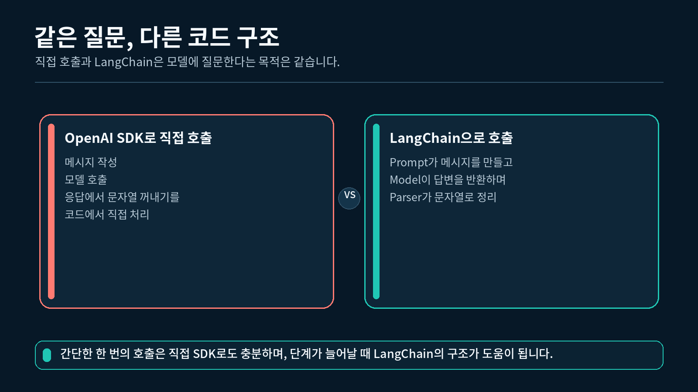
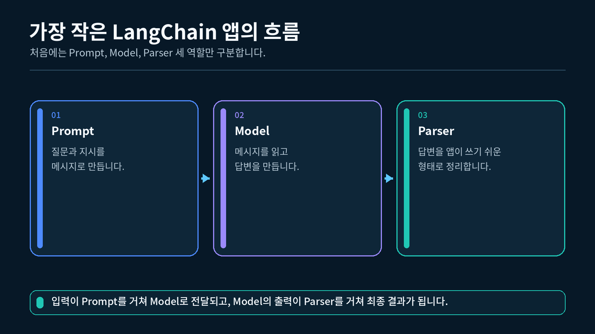
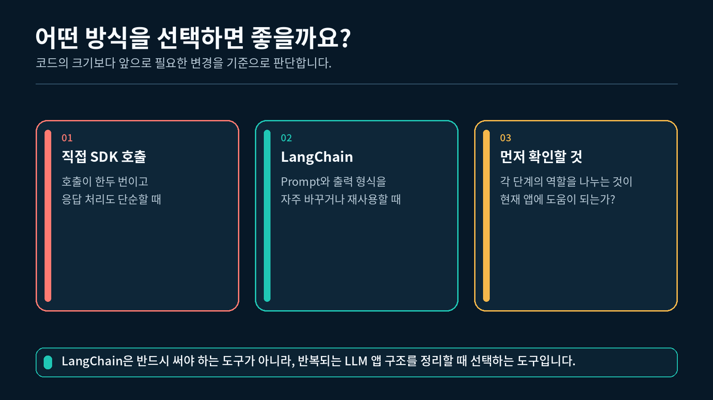

## 1. LangChain이 필요한 이유

LLM 애플리케이션의 출발점은 모델에게 메시지를 보내고 답변을 받는 것입니다. 질문 하나를 보내고 답변 하나를 출력하는 프로그램이라면 OpenAI SDK만으로도 충분히 만들 수 있습니다.

하지만 프로그램이 커지면 프롬프트를 바꾸거나, 모델을 교체하거나, 답변을 리스트나 딕셔너리로 변환해야 하는 일이 생깁니다. 이때 모든 로직이 한 함수 안에 섞여 있으면 작은 변경에도 전체 코드를 다시 읽고 수정해야 합니다.

LangChain은 모델을 대신하는 또 다른 AI가 아닙니다. **LLM 애플리케이션의 여러 작업을 역할별 구성 요소로 나누고 연결하기 위한 프레임워크**입니다.

식당에 비유하면 직접 호출은 한 사람이 주문 접수, 조리, 포장을 모두 담당하는 방식과 비슷합니다. LangChain은 주문서 작성, 조리, 포장을 각각 다른 담당으로 나누는 방식과 비슷합니다. 작은 식당에서는 한 사람이 모두 처리하는 편이 단순할 수 있지만, 주문 종류가 많아지면 역할을 나누는 편이 관리하기 쉽습니다.

직접 OpenAI API 호출과 LangChain 방식 비교



💡 LangChain을 사용한다고 같은 모델의 지식이나 답변 능력이 자동으로 좋아지지는 않습니다. 달라지는 것은 모델 자체가 아니라 애플리케이션 코드를 구성하는 방식입니다.

## 2. OpenAI SDK로 직접 호출하기

OpenAI SDK로 모델을 직접 호출할 때는 애플리케이션 코드가 메시지 작성, API 요청, 응답 본문 추출을 모두 담당합니다.

### 2.1 역할별 메시지 만들기

채팅 모델은 보통 역할과 본문을 가진 메시지 목록을 입력으로 받습니다.

```python
# 모델이 따라야 할 역할과 답변 원칙을 system 메시지에 넣습니다.
system_message = {
    "role": "system",
    "content": "당신은 어려운 AI 용어를 쉽게 설명하는 튜터입니다.",
}

# 실행할 때마다 바뀌는 질문을 user 메시지에 넣습니다.
user_message = {
    "role": "user",
    "content": "프롬프트가 무엇인지 두 문장으로 설명해 주세요.",
}

# 메시지는 모델에 전달할 순서대로 목록에 담습니다.
messages = [system_message, user_message]
```

`system` 메시지는 모델의 역할과 응답 원칙을 정합니다. `user` 메시지는 사용자가 실제로 묻는 내용을 전달합니다.

### 2.2 모델 호출하고 답변 꺼내기

다음 코드는 OpenAI SDK로 메시지를 직접 전달하는 가장 작은 예입니다.

```python
# 운영체제 환경변수를 읽기 위해 os를 가져옵니다.
import os

# 공식 OpenAI Python SDK의 클라이언트를 가져옵니다.
from openai import OpenAI

# .env 파일의 값을 운영체제 환경변수로 불러옵니다.
from dotenv import load_dotenv

# OPENAI_API_KEY를 읽기 전에 .env 파일을 먼저 불러옵니다.
load_dotenv()

messages = [
    {"role": "user", "content": "안녕하세요!"}
]

# 코드에 키를 직접 쓰지 않고 환경변수에서 API Key를 읽습니다.
api_key = os.getenv("OPENAI_API_KEY")

# 읽은 API Key로 OpenAI 클라이언트를 만듭니다.
client = OpenAI(api_key=api_key)

# 모델명과 메시지 목록을 직접 지정해 요청을 보냅니다.
response = client.chat.completions.create(
    model=os.getenv("OPENAI_MODEL", "gpt-5.6-luna"),
    messages=messages,
)

# 첫 번째 응답 후보의 assistant 메시지에서 문자열 본문을 꺼냅니다.
answer = response.choices[0].message.content

# 최종 답변을 화면에 출력합니다.
print(answer)
```

이 방식은 코드의 흐름이 눈에 바로 보인다는 장점이 있습니다. 반면 프롬프트 작성 방식이나 응답 구조가 바뀌면 메시지 생성 코드와 응답 추출 코드를 직접 수정해야 합니다.

### 2.3 직접 호출 코드가 맡은 일

위 코드에는 세 가지 책임이 함께 들어 있습니다.

| 책임 | 코드에서 하는 일 |
| --- | --- |
| 입력 준비 | system과 user 메시지를 직접 만듭니다. |
| 모델 실행 | 모델명과 메시지를 API에 전달합니다. |
| 출력 정리 | 응답 객체 안에서 최종 문자열을 직접 꺼냅니다. |

작은 프로그램에서는 이 구성이 가장 이해하기 쉽고 충분히 실용적입니다.

---

## 3. LangChain의 세 단계로 나누기

LangChain은 앞에서 한 작업을 `Prompt`, `Model`, `Parser` 세 단계로 나눕니다.

Prompt, Model, Parser의 기본 흐름



### 3.1 Prompt

Prompt는 입력값을 모델이 받을 메시지로 바꿉니다. 아래 코드는 `question` 값이 들어갈 자리를 미리 만들어 둡니다.

```python
# 역할별 메시지를 만들 수 있는 ChatPromptTemplate을 가져옵니다.
from langchain_core.prompts import ChatPromptTemplate

# system 메시지는 고정하고, human 메시지의 질문만 실행할 때 바뀌게 만듭니다.
prompt = ChatPromptTemplate.from_messages(
    [
        ("system", "당신은 어려운 AI 용어를 쉽게 설명하는 튜터입니다."),
        ("human", "{question}"),
    ]
)

# question 변수에 실제 질문을 넣어 역할별 메시지 목록을 만듭니다.
messages = prompt.format_messages(
    question="프롬프트가 무엇인지 두 문장으로 설명해 주세요."
)
```

OpenAI SDK가 사용하는 `user`와 LangChain이 사용하는 `human`은 모두 사용자의 질문을 나타냅니다. 도구마다 역할 이름의 표기가 다를 뿐, 이 예제에서는 같은 위치에 대응합니다.

`{question}`은 아직 값이 정해지지 않은 입력 자리입니다. 같은 Prompt를 유지한 채 질문만 바꿀 수 있습니다. Prompt의 자세한 사용법은 2-1강에서 다룹니다.

### 3.2 Model

Model은 Prompt가 만든 메시지를 받아 실제 LLM을 호출합니다.

```python
# .env에서 지정한 권장 모델을 읽습니다.
import os
from dotenv import load_dotenv

# OpenAI 모델을 LangChain 방식으로 연결하는 클래스를 가져옵니다.
from langchain_openai import ChatOpenAI

# 사용할 모델을 지정해 ChatModel 객체를 만듭니다.
load_dotenv()

model = ChatOpenAI(model=os.getenv("OPENAI_MODEL", "gpt-5.6-luna"))

# Prompt가 만든 메시지를 모델에 전달해 AIMessage 응답을 받습니다.
ai_message = model.invoke(messages)
```

`model.invoke()`의 결과는 일반 문자열이 아니라 `AIMessage`입니다. `AIMessage`에는 답변 본문과 함께 모델 호출에 관한 부가 정보가 들어갈 수 있습니다.

### 3.3 Parser

Parser는 모델 응답을 애플리케이션에서 사용하기 쉬운 형태로 바꿉니다.

```python
# AIMessage의 본문을 문자열로 바꾸는 Parser를 가져옵니다.
from langchain_core.output_parsers import StrOutputParser

# 문자열 변환을 담당할 Parser 객체를 만듭니다.
parser = StrOutputParser()

# AIMessage를 Parser에 전달해 최종 문자열을 얻습니다.
answer = parser.invoke(ai_message)

# 화면에 표시할 문자열을 출력합니다.
print(answer)
```

지금은 문자열 Parser만 사용합니다. 2-2강에서는 리스트와 JSON을 다루는 Parser도 연결합니다.

### 3.4 세 단계의 입출력

| 단계 | 받는 값 | 내보내는 값 | 한 문장 역할 |
| --- | --- | --- | --- |
| Prompt | 질문이 담긴 입력값 | 역할별 메시지 | 모델에게 보낼 내용을 만듭니다. |
| Model | 역할별 메시지 | `AIMessage` | LLM을 호출해 응답을 만듭니다. |
| Parser | `AIMessage` | 문자열 | 앱에서 쓰기 쉬운 값으로 바꿉니다. |

> 이 강의에서는 세 단계를 **한 줄로 연결하지 않고 하나씩 실행**합니다. `prompt | model | parser`처럼 파이프로 연결하는 문법은 3장에서 충분히 설명합니다.
> 

---

## 4. 두 방식의 코드와 결과 비교하기

### 4.1 공통점

두 방식 모두 같은 OpenAI 모델 API를 호출합니다. API Key가 필요하고, 모델 사용량에 따라 비용이 발생하며, 답변 내용은 실행할 때마다 조금 달라질 수 있습니다.

### 4.2 차이점

| 비교 항목 | OpenAI SDK 직접 호출 | LangChain 방식 |
| --- | --- | --- |
| 메시지 구성 | 딕셔너리 목록을 직접 만듭니다. | Prompt 객체가 메시지를 만듭니다. |
| 모델 호출 | SDK 클라이언트를 직접 호출합니다. | ChatModel의 `invoke()`를 호출합니다. |
| 결과 추출 | 응답 객체에서 본문을 직접 찾습니다. | Parser가 원하는 자료형으로 바꿉니다. |
| 코드 규모 | 작은 기능에서 짧고 단순합니다. | 단계가 많아질수록 구조가 선명합니다. |
| 변경 범위 | 관련 코드를 직접 찾아 수정합니다. | 바뀌는 단계만 교체하기 쉽습니다. |

### 4.3 결과가 완전히 같아야 할까

같은 질문과 같은 모델을 사용해도 LLM 답변 문장은 달라질 수 있습니다. 따라서 이 실습의 목적은 두 답변을 글자 단위로 같게 만드는 것이 아닙니다.

다음 두 가지를 확인하면 됩니다.

- 두 방식 모두 사용자 질문에 맞는 답변을 반환하는가
- LangChain 코드에서 Prompt, Model, Parser의 역할이 분리되어 있는가

---

## 5. 나중에 연결할 구성 요소 살펴보기

LangChain에는 기본 세 단계 외에도 여러 구성 요소가 있습니다. 이 강의에서는 이름과 위치만 확인하고 구현하지 않습니다.

| 구성 요소 | 하는 일 | 다루는 시점 |
| --- | --- | --- |
| Retriever | 질문과 관련된 외부 문서를 찾습니다. | 6장 |
| Memory | 같은 대화의 이전 메시지를 다음 질문에 반영합니다. | 7장 |
| Callback | 실행 중 발생하는 이벤트를 관찰합니다. | 8장 |

기본 흐름은 다음과 같습니다.

```
사용자 입력 → Prompt → Model → Parser → 애플리케이션 결과
```

Retriever나 Memory가 필요해지면 Prompt에 전달할 정보를 앞쪽에 더하고, Callback은 전체 실행을 관찰하는 위치에 연결합니다.

> 처음부터 모든 구성 요소를 한 프로그램에 넣지 마세요. 기본 세 단계가 정확히 동작하는지 확인한 뒤 필요한 기능만 추가하는 편이 이해와 디버깅에 모두 유리합니다.

## 6. 완성 실습 실행하기

이 강의 폴더의 `실습.py`에는 두 호출 방식이 모두 들어 있습니다. **지금은 코드 구조를 먼저 읽고, 1-2강의 환경 설정을 마친 뒤 이 위치로 돌아와 실행하세요.**

### 6.1 VS Code에서 실행

1-2강에서 만든 `pyproject.toml`과 `uv.lock`이 있는 프로젝트의 하위 폴더에 `실습.py`를 두고, 해당 폴더에서 실행합니다. VS Code 인터프리터는 이 프로젝트의 `.venv` (Python 3.12)를 선택합니다.

```powershell
# uv가 관리하는 Python 3.12으로 1-1강 실습 파일을 실행합니다.
uv run python 실습.py
```

API Key가 없으면 다음과 같이 안내하고 실제 요청을 보내지 않습니다.

```
OPENAI_API_KEY가 없습니다.
1-2강의 안내에 따라 .env 파일을 만든 뒤 다시 실행해 주세요.
```

API Key가 있으면 다음 구조로 결과가 출력됩니다. 모델이 생성하는 문장은 매번 달라질 수 있습니다.

```
[1] OpenAI SDK 직접 호출 결과
모델이 생성한 답변

[2] LangChain 단계별 호출 결과
모델이 생성한 답변

[구조 비교]
- 직접 호출: 메시지 작성, 모델 호출, 응답 추출을 코드가 직접 처리합니다.
- LangChain: Prompt, Model, Parser가 각자 한 가지 역할을 담당합니다.
```

"""1-1강: 직접 OpenAI API 호출과 LangChain 방식의 구조를 비교합니다."""

import os

from dotenv import load_dotenv
from langchain_core.output_parsers import StrOutputParser
from langchain_core.prompts import ChatPromptTemplate
from langchain_openai import ChatOpenAI
from openai import OpenAI


# 수업에서 사용할 기본 모델명을 한 곳에 모아 둡니다.
DEFAULT_MODEL = "gpt-5-nano"

# 두 방식에 똑같이 전달할 시스템 메시지를 고정합니다.
SYSTEM_MESSAGE = "당신은 어려운 AI 용어를 쉽게 설명하는 튜터입니다."

# 두 호출 결과를 비교할 때 사용할 질문을 고정합니다.
QUESTION = "프롬프트가 무엇인지 두 문장으로 설명해 주세요."


def build_direct_messages(question: str) -> list[dict[str, str]]:
    """OpenAI SDK에 직접 전달할 메시지 목록을 만듭니다."""

    # system 메시지에는 모델이 따라야 할 역할과 원칙을 넣습니다.
    system_message = {"role": "system", "content": SYSTEM_MESSAGE}

    # user 메시지에는 실행할 때마다 달라질 질문을 넣습니다.
    user_message = {"role": "user", "content": question}

    # OpenAI SDK는 역할과 본문이 들어 있는 딕셔너리 목록을 입력으로 받습니다.
    return [system_message, user_message]


def call_with_openai_sdk(client, model_name: str, question: str) -> str:
    """OpenAI SDK로 모델을 직접 호출하고 답변 문자열을 꺼냅니다."""

    # 앞에서 만든 메시지 목록을 Chat Completions 요청에 전달합니다.
    response = client.chat.completions.create(
        model=model_name,
        messages=build_direct_messages(question),
    )

    # 첫 번째 응답 후보의 assistant 메시지에서 본문을 꺼냅니다.
    answer = response.choices[0].message.content

    # 본문이 비어 있으면 이후 코드가 조용히 잘못 동작하지 않도록 오류를 냅니다.
    if not answer:
        raise ValueError("OpenAI SDK 응답에 표시할 문자열이 없습니다.")

    # 화면에 바로 출력할 수 있는 순수 문자열을 반환합니다.
    return answer


def build_langchain_prompt() -> ChatPromptTemplate:
    """LangChain에서 역할별 메시지를 만드는 Prompt를 정의합니다."""

    # system과 human 역할을 분리하고, 질문이 들어갈 자리를 {question}으로 표시합니다.
    return ChatPromptTemplate.from_messages(
        [
            ("system", SYSTEM_MESSAGE),
            ("human", "{question}"),
        ]
    )


def call_with_langchain(model, question: str) -> str:
    """Prompt, Model, Parser를 한 단계씩 실행합니다."""

    # Prompt 단계가 입력 딕셔너리를 역할별 메시지 목록으로 바꿉니다.
    messages = build_langchain_prompt().format_messages(question=question)

    # Model 단계가 메시지를 받아 AIMessage를 반환합니다.
    ai_message = model.invoke(messages)

    # Parser 단계가 AIMessage의 본문을 화면에 쓸 문자열로 바꿉니다.
    parser = StrOutputParser()
    answer = parser.invoke(ai_message)

    # Parser 결과가 문자열이 아니거나 비어 있으면 바로 원인을 알 수 있게 합니다.
    if not isinstance(answer, str) or not answer.strip():
        raise TypeError("StrOutputParser 결과에서 문자열을 찾지 못했습니다.")

    # 검사한 문자열을 별도의 강제 변환 없이 반환합니다.
    return answer


def print_comparison(direct_answer: str, langchain_answer: str) -> None:
    """두 방식의 최종 결과와 코드가 맡은 책임을 나란히 출력합니다."""

    # 직접 호출 방식의 결과를 먼저 보여 줍니다.
    print("\n[1] OpenAI SDK 직접 호출 결과")
    print(direct_answer)

    # LangChain 방식의 결과를 이어서 보여 줍니다.
    print("\n[2] LangChain 단계별 호출 결과")
    print(langchain_answer)

    # 핵심 차이는 답변 문구가 아니라 코드 책임의 분리라는 점을 정리합니다.
    print("\n[구조 비교]")
    print("- 직접 호출: 메시지 작성, 모델 호출, 응답 추출을 코드가 직접 처리합니다.")
    print("- LangChain: Prompt, Model, Parser가 각자 한 가지 역할을 담당합니다.")


### 6.2 API 호출 횟수

이 실습은 같은 질문을 두 방식으로 비교하기 때문에 실행할 때 모델을 두 번 호출합니다. 반복 실행이 필요하지 않다면 결과를 확인한 뒤 바로 종료하세요.

## 7. 직접 호출과 LangChain 선택하기

직접 호출과 LangChain의 선택 기준



### 직접 호출이 잘 맞는 경우

- 질문 하나를 보내고 문자열 하나를 받는 작은 스크립트
- 프롬프트와 출력 형식이 자주 바뀌지 않는 기능
- 외부 프레임워크 없이 API 동작을 빠르게 확인하는 예제

### LangChain이 잘 맞는 경우

- 여러 Prompt를 공통 형식으로 관리해야 하는 기능
- 모델 응답을 문자열, 리스트, JSON 등으로 바꾸어 사용해야 하는 기능
- 이후 Retriever, Memory 같은 단계를 연결할 계획이 있는 기능

### 선택 질문

아래 질문에 대부분 `예`라고 답한다면 LangChain을 사용할 이유가 커집니다.

1. 프롬프트가 여러 개이고 같은 형식으로 관리해야 합니까?
2. 모델이나 출력 형식을 교체할 가능성이 있습니까?
3. 검색, 대화 이력 등 추가 단계를 연결할 계획이 있습니까?

반대로 단순한 한 번의 호출이라면 직접 SDK 방식이 더 읽기 쉬울 수 있습니다.